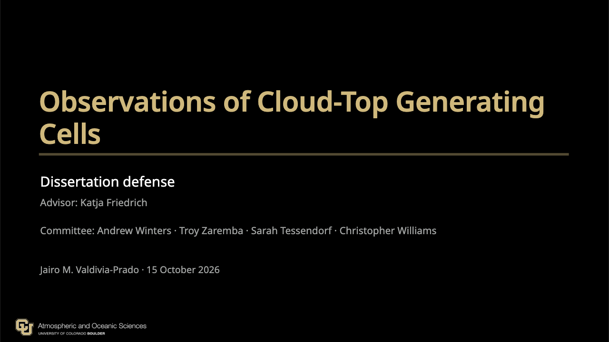

# Dissertation Slides

Slidev presentation source for the dissertation defense. Built with Slidev 53 and the CU Boulder theme.

**Live presentation:** https://JValdivia23.github.io/dissertation-slides/

*Observations of Cloud-Top Generating Cells* — Ph.D. dissertation defense,
Department of Atmospheric and Oceanic Sciences, University of Colorado
Boulder, presented 15 October 2026.



## Local development

Requires Node.js 22.12+ (24 LTS recommended) and npm.

```sh
npm ci
npm run dev
npm run build
```

## Theme and animations

- Theme: `cu-boulder`, pinned to `JValdivia23/slidev-theme-cu-boulder` commit `2bf13d7` on `beta/cu-manim`.
- `manim-web@0.3.24` is a direct dependency for `<CuManim>` slides.
- Before writing Manim slides, read `docs/manim-web-guide.md`.
- `manim-examples/` is a version-pinned upstream source reference, not Slidev slides; keep archived files unchanged.

## Publishing

GitHub Actions builds the static Slidev site from `package-lock.json` and
deploys `dist/` to GitHub Pages on every push to `main` (see
[`.github/workflows/deploy.yml`](.github/workflows/deploy.yml)). The build
uses `--base /dissertation-slides/`, so the live site is served at
https://JValdivia23.github.io/dissertation-slides/.

## License

[MIT](./LICENSE) — © 2026 Jairo M. Valdivia.

## Personal acknowledgments

All center text on the photo acknowledgment slide is editable in its frontmatter
in [`sections/close.md`](sections/close.md), just above `<ThankYouPhotos>`:

- `title`: the big stationary heading.
- `subtitle`: the smaller stationary line beneath it.
- `personalThanks: |`: the rotating handwritten messages, in paragraph order.

Keep the title and subtitle brief so each fits on one line. To add, change, or
reorder people, edit the `personalThanks` block: indent each text line by two
spaces and leave a blank line between people. Soft-wrapped lines belong to the
same message; HTML comments and Markdown headings are ignored. There is no
need to edit the Vue component.

Messages follow the file order and loop: a 3.2-second left-to-right write-on,
one line at a time, seven seconds fully visible, a 0.65-second fade out, and
a short blank interval. The full text layout is reserved while it is written.
Keep each message to a brief sentence; longer text is sized down to fit the
fixed area.
The heading and subtitle do not move, and the photo sequence is independent.
Reduced-motion, overview, and print-mode views show the first message without
animation. The locally bundled Caveat font is licensed under the SIL OFL;
see [`assets/fonts/`](assets/fonts/).
