# Backup

Jump here only if asked.

<!--
Not part of the 40 minutes.
-->

---

# Backup: limits of this case

- One storm, and one cell in the three-dimensional analysis
- Six-minute volumes; soundings at 02:00 and 04:15 UTC
- A boundary can enclose several cells
- Overlapping echoes block attribution to the tracked cell
- Rates depend on the chosen $Z$–rate relations

<!--
Use this if the question is "what does this not show?"

Also: COW loses the cell at the last time. The footprints are time-mean masks, so they are not the streak's position at every step. Results change little from the 85th to the 95th percentile.
-->

---
class: smoothing-conclusions population-limits
---

# Project 3: Limits

  <section>
    <h2>Detection and boundaries</h2>
    
The 5-dB threshold, smoothing, and X-band sensitivity can exclude weaker features.

    
A contour may contain several turrets: counts and areas describe detected radar features, not individual updrafts.

  </section>
  <section>
    <h2>Temporal resolution</h2>
    
Six-minute volumes can miss short-lived cells and rapid merging or splitting.

    
Stage boundaries are selected from population trends, so stage durations are approximate.

  </section>
  <section>
    <h2>Microphysical interpretation</h2>
    
ZDR evolution is consistent with aggregation and sorting, but does not uniquely identify particle habits or processes.

    
Uncorrected differential attenuation can lower absolute values.

  </section>
  <section>
    <h2>Environmental attribution</h2>
    
Two soundings provide environmental context but do not resolve local, short-timescale instability.

    
The observations do not isolate the mechanisms responsible for initiation, organization, or decay.

  </section>

<strong>Scope:</strong> One winter storm; additional cases are needed to assess how general these lifecycle and microphysical trends are.

<!--
Supporting slide, no clicks. Use if asked about population-study limitations. Read the panels from top left to bottom right, then the scope statement. These are the boundaries of the conclusions, not reasons to dismiss the observed evolution. Suggested delivery: “We identify radar features, which can omit weak cells or combine several turrets. Six-minute sampling limits individual-cell histories, and the population stage boundaries are approximate. The polarimetric evolution supports aggregation and sorting, but does not identify particles uniquely. Absolute Z_DR may be biased low, although the paper's attenuation bounds argue against attenuation as the primary explanation for the late increase. Two soundings constrain the environment, not the forcing mechanism. These conclusions describe one winter storm.”

Detection and boundaries: the threshold balances coherent detection against false positives. It is a 5-dB reflectivity enhancement in the perturbation field, not an absolute 5-dBZ echo threshold. Smoothing and X-band sensitivity can obscure weak or small features; the small-area screen primarily removes noise-scale regions. Connected contours may encompass several adjacent turrets, so increasing area reflects both physical organization and segmentation connectivity, not solely the growth of one updraft. Do not call all observed clustering an artifact.

Temporal resolution: six-minute volume sampling can miss short-lived cells and rapid splitting or merging. Lifecycle stage transitions were selected from count and area trends; small shifts change stage durations and the statistics assigned to each stage. The approximately 1.7-hour population sequence is not a typical individual-cell lifetime, and the selected nearly 50-minute track is not a population lifetime estimate.

Microphysical interpretation: particle shape, orientation, density, and mixtures affect Z_DR, so the proposed aggregation and later preferential fallout/sorting are interpretations consistent with the observations, not direct particle-habit measurements. Full differential-attenuation correction was not applied through the mixed-phase beam paths. Bird-bath calibration addresses instrumental offsets, not propagation effects. The paper's conservative attenuation-bound analysis argues against attenuation as the primary driver of the late higher Z_DR; distinguish that case-specific evidence from uncertainty in absolute values. Do not argue that a negative bias alone, without examining how it changes in time, rules out every possible temporal artifact.

Environmental attribution: the two Sorel soundings are offset from the cells in space and time and cannot resolve local, short-lived instability. VAD provides intermediate wind context but does not fill the thermodynamic sampling gap. Shear relaxation and layer-specific drying accompany the evolution, but the observations do not isolate a radiative, shear, or wave mechanism. No definitive wave signature was found; that is not proof that waves were absent. Finally, additional storms are needed to test the generality of the lifecycle and microphysical trends. Refer to Project 3: Conclusions in the main talk.
-->

---
class: smoothing-conclusions population-limits paper4-limits
---

# Project 4: Limitations

  <section>
    <h2>CTGC Contribution</h2>
    
The 51% snow and 72% rain contrasts do not measure the tracked cell’s precipitation.

  </section>
  <section>
    <h2>Unresolved mechanisms</h2>
    
The roles of wind shear and CTGC triggers remain unresolved.

  </section>
  <section>
    <h2>Footprints and rate estimates</h2>
    
Time-mean footprints may miss instantaneous streak boundaries; rates depend on chosen reflectivity–rate relations.

  </section>
  <section>
    <h2>Case scope</h2>
    
One selected cell cannot establish a population mean or a storm-total precipitation contribution.

  </section>

<!--
Supporting slide, no clicks. Use if asked about single-cell-study limitations.
Read the panels from top left to bottom right.
These limitations follow Chapter 5's discussion, matching the submitted paper.

Suggested delivery: “The 51% snow and 72% rain contrasts do not measure this
cell's share of precipitation. Changing shear and overlapping CTGC
precipitation may both affect the bands, but their relative roles remain
unresolved. The fixed footprints may miss instantaneous streak boundaries,
and the estimated rates depend on reflectivity–rate relations. Finally, one
cell cannot establish a population mean or its contribution to storm-total
precipitation.”

Supporting detail for discussion and questions, not the timed delivery:

Attribution: The 51% liquid-equivalent snow-rate and 72% rain-rate enhancements
compare rates inside versus outside the layer-specific footprints. They are
spatial contrasts associated with persistent reflectivity enhancements, not
the tracked cell's contribution or a fraction of storm-total precipitation.
Both regions may include other CTGCs and pre-existing precipitation; the
outside region is not a control without generating cells.

Unresolved mechanisms: Changing shear and overlapping CTGC precipitation may
both contribute to the less distinct north–south band pattern, but their
relative roles remain unresolved. The observed connection is consistent with
seeder–feeder growth, not a direct measurement of the growth mechanisms.
Three-dimensional winds, particle trajectories, cloud liquid water, and
ice-particle measurements would help constrain the processes and attribution.

Footprints and rate estimates: The upper-decile footprints come from time-mean
column-maximum reflectivity anomaly; they capture persistent features but may
miss the fall streak's instantaneous position and extent. Rates depend on the
chosen Z–S and Z–R relations and are estimates, not measured mass fluxes.
The paper tested p85, p90, and p95: snow-rate enhancement spans 49–51% and
rain-rate enhancement 68–75%. These ranges describe threshold sensitivity,
not confidence intervals or the total rate-estimation uncertainty.

Case scope: One selected cell in one winter storm cannot establish a population
mean or a storm-total precipitation contribution. Additional cases are needed
to assess which structural relationships and precipitation contrasts recur.

Sampling details for questions: Nine synchronized volume sets, six minutes
apart, can miss changes between scans. The 02:00 and 04:15 UTC soundings provide
thermodynamic context rather than continuous local measurements along the
02:54–03:42 UTC cell track. Keep these supporting constraints in the notes
rather than displacing the paper's principal limitations on the slide.
-->

---
class: smoothing-transfer
---

# Transfer functions on a polar grid

Choose a smoothing kernel and its analytical DCT-domain response, H(k; W).

  <section>

## Angle: response varies with range

Adjacent rays separate by approximately rΔθ.

$$
\begin{aligned}
W_{\theta}(r) &= \frac{W_{\mathrm{phys}}}{r\,\Delta\theta} \\
H_{\theta}(k_{\theta},r) &= H_{\mathrm{kernel}}\!\left(k_{\theta};W_{\theta}(r)\right)
\end{aligned}
$$

One angular-frequency response for each range.

  </section>

  <section>

## Range: fixed response

Range-gate spacing Δr is constant.

$$
\begin{aligned}
W_r &= \text{fixed in range gates} \\
H_r(k_r) &= H_{\mathrm{kernel}}\!\left(k_r;W_r\right)
\end{aligned}
$$

The same range-frequency response at every angle.

  </section>

The angle responses form a range-indexed set; the range response is shared. Apply each in its own DCT pass.

Boxcar response via the Dirichlet identity: Oppenheim et al. (1999). Gaussian response: Smith (1997).

<!--
About 45 seconds. The paper obtains the analytical continuous-width boxcar response using the Dirichlet-kernel identity cited to Oppenheim et al. (1999), and cites Smith (1997) for the normalized Gaussian response. We do not need to derive either on this slide. H_kernel denotes the chosen response as a function of spatial frequency and smoothing width; the Gaussian's native width parameter is sigma. For the field comparison after the method slide, we use the analytical boxcar response; the later large-array benchmark highlights the Gaussian response. Along angle, adjacent rays are physically separated by approximately r times delta theta, so a fixed physical smoothing scale translates to W_theta(r) = W_phys/(r delta theta) angular samples. Evaluate the chosen response at that width for each range, giving a range-indexed set of angular responses H_theta(k_theta,r). Along range, range gates have fixed separation, so W_r and the range response H_r(k_r) are fixed and shared across angles. These responses are derived for the chosen kernel and reflected DCT boundary treatment, not obtained by naively transforming an arbitrary finite array of weights. Next slide: apply the two responses in successive DCT filtering passes, with an inverse angular DCT between them.
-->

---
class: smoothing-polar-dct
---

# DCT smoothing on a polar grid

Apply the separable filter to the two dimensions of the polar field, X(θ, r).

<section class="polar-dct-pass">

## 1 · Angular pass — range-varying width

$$
Y_{\theta} = \operatorname{IDCT}_{\theta}\!\left[\operatorname{DCT}_{\theta}(X) \odot H_{\theta}(k_{\theta},r)\right]
$$

At each range, multiply angular-frequency coefficients by a response that changes with range.

</section>

<section class="polar-dct-pass">

## 2 · Range pass — fixed width

$$
Y = \operatorname{IDCT}_{r}\!\left[\operatorname{DCT}_{r}(Y_{\theta}) \odot H_{r}(k_{r})\right]
$$

At each angle, multiply range-frequency coefficients by the same fixed-width response.

</section>

The angular response varies with range, so the intermediate field Yθ is needed between passes—not one global 2D multiplication.

<!--
About 1 minute. We have now selected the angle-dependent response H_theta and fixed range response H_r. The separable boxcar lets us smooth the 2D field in two directions. Click 1: at every range, take the DCT along the angular samples, multiply corresponding coefficients by H_theta, and inverse-transform to get the intermediate angularly smoothed field Y_theta. Its angular width decreases in samples with range, holding the desired physical scale. Click 2: DCT the intermediate field along range, multiply by H_r, and inverse-transform to obtain the final 2D field Y. Range-gate spacing does not widen with range. The products are element-wise in the appropriate spectral domain; both passes use reflected boundaries. Because the angular response depends on spatial range, we must return to Y_theta before transforming along range. This is not one global 2D DCT followed by a single product H_theta times H_r. The field comparison on the next slide uses the boxcar response. Gaps are interpolated before this method; discuss the limitation after the results.
-->

---
class: smoothing-synthetic
---

# Synthetic validation of DCT smoothing

  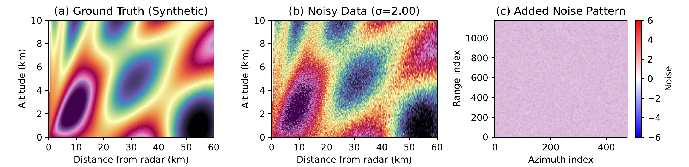
  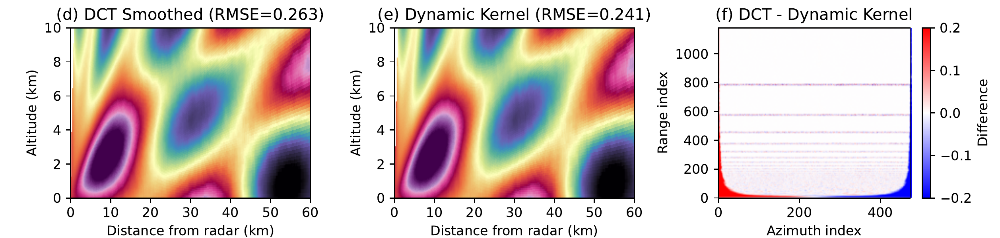

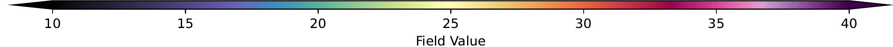

Synthetic reflectivity-like field · Paper Figure 2(a–f). Noise and difference panels have separate scales.

<!--
About 1 minute. First show the synthetic ground truth, noisy observation with added noise of standard deviation 2, and the noise pattern. This is an artificial reflectivity-like field, not the measured C-band RHI on the next slide. Click 1: reveal the paper's DCT-smoothed result, spatial dynamic-kernel result, and DCT-minus-dynamic-kernel difference. Both remove much of the speckle and preserve the broad structures. The DCT and spatial outputs are visually nearly indistinguishable, but not numerically identical: their RMSEs against the known truth are 0.263 and 0.241, respectively. The difference panel uses a separate narrow scale and shows small structured discrepancies, especially near edges; do not call the outputs exactly equal or confuse this with an error-to-truth panel. These are the boxcar comparisons from panels (a)–(f) of the paper's Figure 2. The shared field-value scale is shown below, while the noise and difference panels retain their own colorbars. Next move from controlled synthetic data to the real C-band radar comparison.
-->

---
class: figure-slide
---

# Backup: DCT and spatial smoothing on radar data

  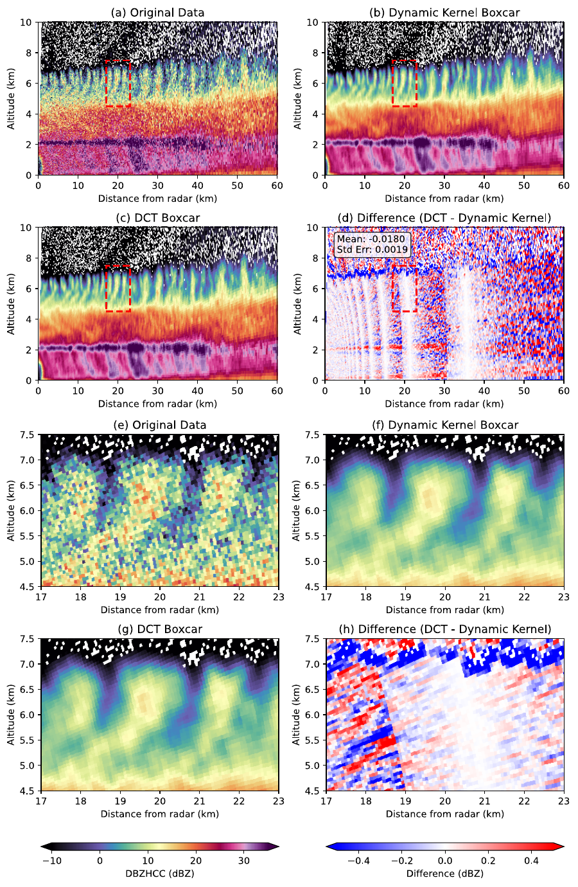

23 Feb 2022, 02:28 UTC. Window of 5 pixels. Difference is the rightmost column of the comparison.

---
class: convolution-cartesian
---

# Backup: Gaussian weighting on a Cartesian grid

  
Noisy inputSmoothed output

  

    <CuManim :steps="2" :width="1080" :height="320" :construct="cartesianGaussianConvolution" />
    <svg v-if="clicks === 0" class="convolution-first-frame" viewBox="0 0 1080 390" aria-hidden="true">
      <rect v-for="(cell, index) in cartesianGaussianPreview.input" :key="`in-${index}`" :x="cell.x" :y="cell.y" :width="cell.w" :height="cell.h" :fill="cell.fill" />
      <rect v-for="(cell, index) in cartesianGaussianPreview.backing" :key="`back-${index}`" :x="cell.x" :y="cell.y" :width="cell.w" :height="cell.h" :fill="cell.fill" />
      <circle v-for="(dot, index) in cartesianGaussianPreview.dots" :key="`dot-${index}`" :cx="dot.x" :cy="dot.y" :r="dot.r" fill="#fff1c4" fill-opacity="0.8" />
      <path :d="`M${cartesianGaussianPreview.arrowShaft.x1},${cartesianGaussianPreview.arrowShaft.y1} L${cartesianGaussianPreview.arrowShaft.x2},${cartesianGaussianPreview.arrowShaft.y2}`" stroke="#cfb87c" stroke-width="6" stroke-linecap="round" fill="none" />
      <polygon :points="cartesianGaussianPreview.arrowTip.map(point => `${point.x},${point.y}`).join(' ')" fill="#cfb87c" />
    </svg>
  

  
Illustrative, evenly spaced grid · <strong>Gaussian: center-weighted mean</strong>

Same synthetic field as the boxcar illustration · Gaussian sigma 0.85 cells.

<!--
Use if asked about kernel choice. Same synthetic, complete field as the boxcar illustration. Click 1: the Gaussian-weighted average at the center appears at the corresponding output cell. Click 2: the weighting glides along the same row-by-row path with dot sizes tracking it, revealing each Gaussian output value in sync. Dots are sized by the same discrete Gaussian, sigma 0.85 cells, truncated to three-by-three samples and normalized for the output. This is an illustration of center-weighted averaging, not a comparison of method performance.
-->

---
class: figure-slide
---

# Backup: a hard spectral cutoff rings

  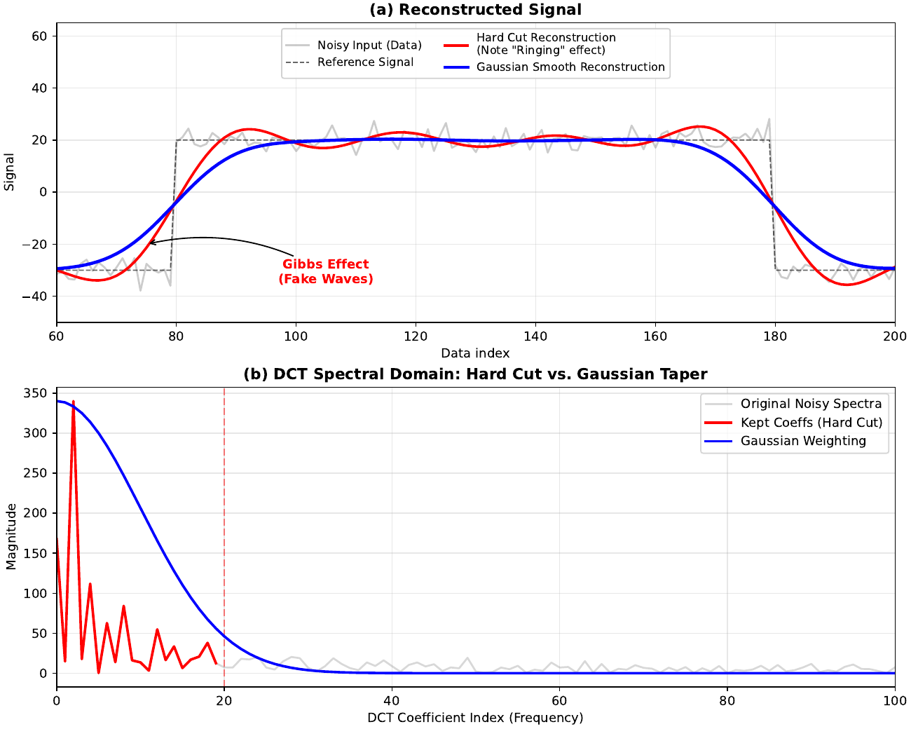

The talk uses a Gaussian taper, not a hard cutoff.

---
class: figure-slide
---

# Backup: periodic boundaries wrap

  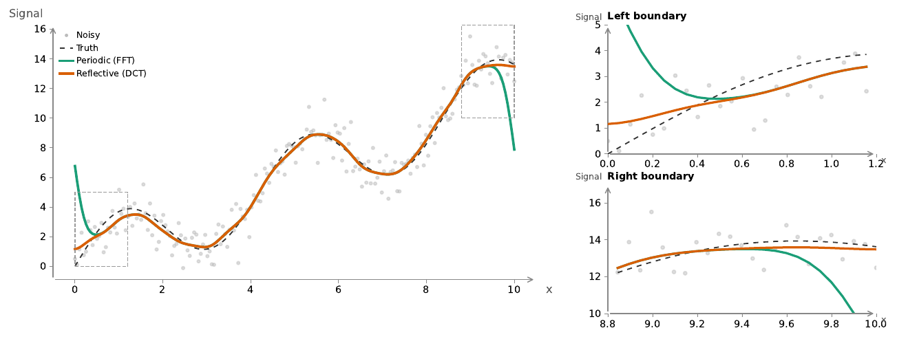

Reflective DCT follows the local trend. Periodic treatment pulls the edges toward the opposite end.

---
class: figure-slide
---

# Backup: gaps, without filling them first

  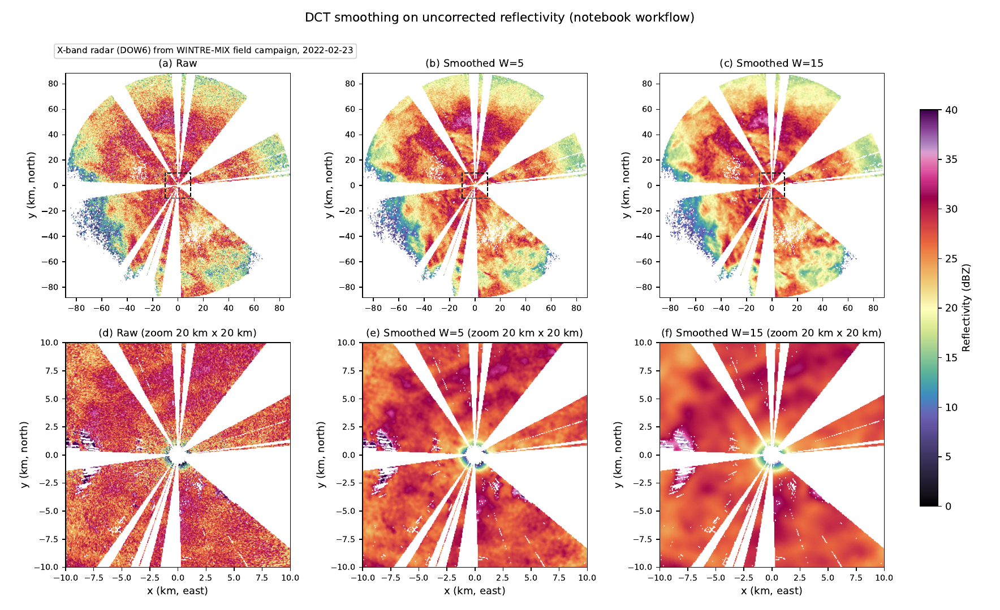

DOW6, 23 Feb 2022. Periodic azimuth, reflective range. Blocked sectors stay unsupported.

---
class: figure-slide
---

# Backup: the variance can flag outliers

  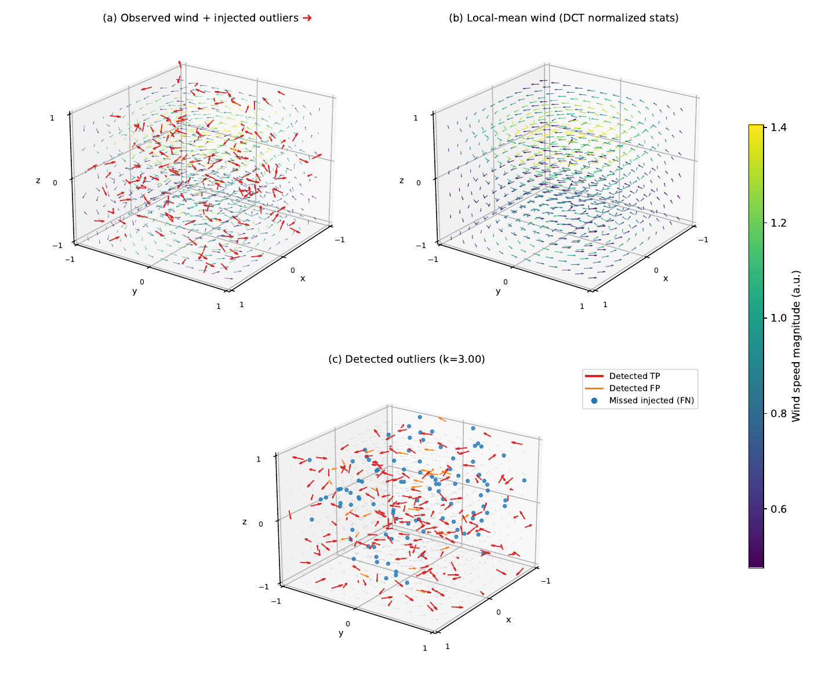

A validation of the local statistics, not a result of the storm.

---
class: population-environment
clicks: 2
---

# Vertical evolution and environmental conditions

  
DOW6 RHI observations show the evolution of the 5.5–8 km MSL generating layer.

  
<strong>Sorel · 02:00 UTC</strong> · Gray shading marks the 5.5–8 km MSL generating layer.

  
<strong>Sorel · 04:15 UTC</strong> · Gray shading marks the same 5.5–8 km MSL layer.

  

    <figure><figcaption>02:22 · deep stratiform echo</figcaption>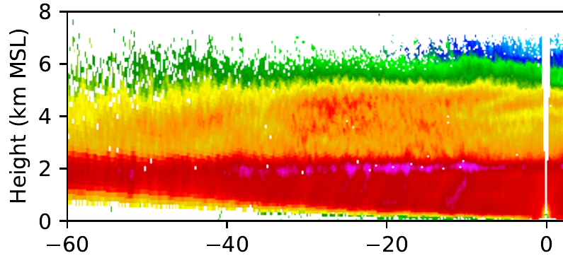</figure>
    <figure><figcaption>02:40 · distinct cloud-top turrets</figcaption>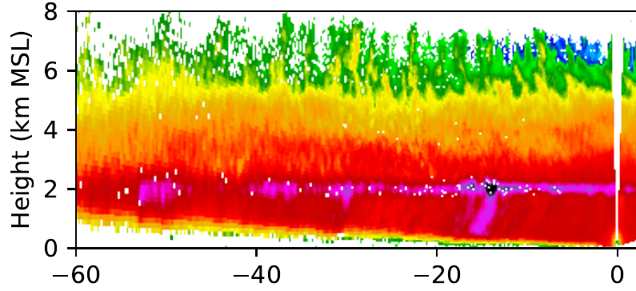</figure>
    <figure><figcaption>03:04 · fewer, larger features</figcaption>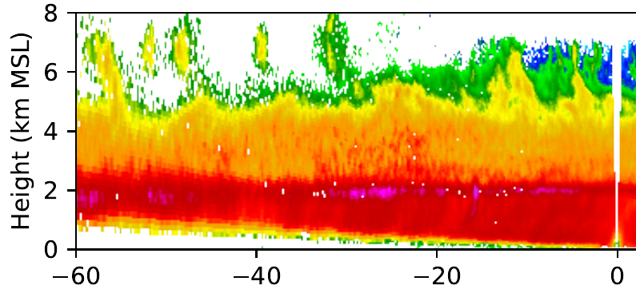</figure>
    <figure><figcaption>03:34 · increasing echo separation</figcaption>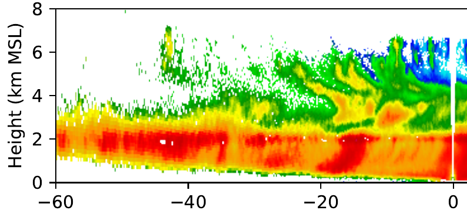</figure>
    <svg class="population-rhi-scale" viewBox="0 0 64 300" role="img" aria-label="DOW6 reflectivity scale, −10 to 40 dBZ">
      <defs><clipPath id="population-rhi-scale-clip"><rect x="4" y="27" width="14" height="253" /></clipPath></defs>
      <image href="../figures/population-rhi-scale.png" x="1" y="22.6" width="71.5" height="266" preserveAspectRatio="none" clip-path="url(#population-rhi-scale-clip)" />
      <text x="32" y="15" class="population-scale-unit">dBZ</text>
      <g v-for="(value, index) in [40, 30, 20, 10, 0, -10]" :key="value">
        <line x1="18" x2="23" :y1="27 + index * 50.6" :y2="27 + index * 50.6" />
        <text x="28" :y="27 + index * 50.6">{{ value }}</text>
      </g>
    </svg>
  

  <figure v-click="[1,2]" class="population-sounding-row" data-sounding="0200">
    

      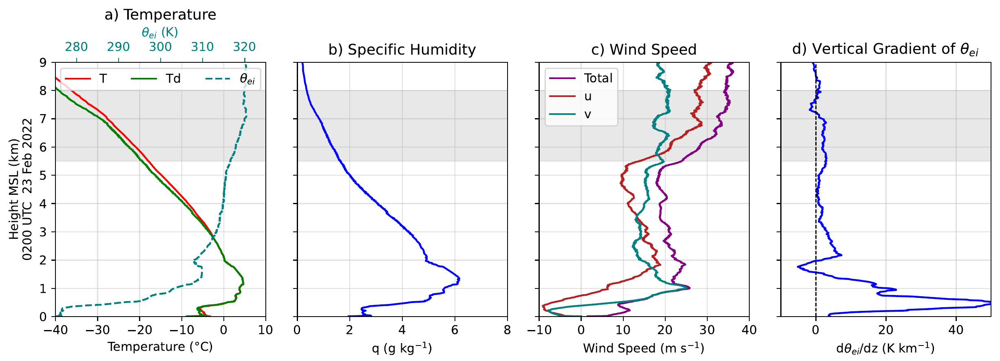
      <svg viewBox="0 0 2453 886" aria-hidden="true">
        <rect x="731" y="222" width="142" height="175" />
        <path d="M1796 222 H1816 V397 H1796" />
        <rect x="1974" y="222" width="62" height="175" />
      </svg>
    

    <figcaption class="population-sounding-annotations">
      
<strong>CTGC layer</strong>
5.5–8 km MSL

      
<strong>Moisture</strong>
Initial layer humidity

      
<strong>Bulk vector shear</strong>
≈18 m s−1

      
<strong>Stability</strong>
Near-neutral / weakly stable Shallow negative at cloud top

    </figcaption>
  </figure>
  <figure v-click="2" class="population-sounding-row" data-sounding="0415">
    

      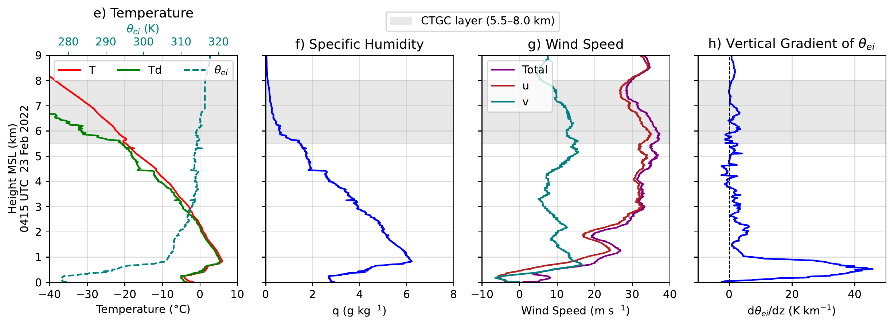
      <svg viewBox="0 0 2453 886" aria-hidden="true">
        <rect x="731" y="222" width="142" height="175" />
        <path d="M1796 222 H1816 V397 H1796" />
        <rect x="1974" y="222" width="62" height="175" />
      </svg>
    

    <figcaption class="population-sounding-annotations">
      
<strong>CTGC layer</strong>
5.5–8 km MSL

      
<strong>Moisture</strong>
Drier than at 02:00

      
<strong>Bulk vector shear</strong>
≈9 m s−1 · weaker

      
<strong>Stability</strong>
More uniformly stable

    </figcaption>
  </figure>

  
<strong>Cloud-top features become fewer and larger,</strong> with increasing separation from the underlying stratiform echo.

  
Paper Figure 9(a–h) · Sorel, 23 February 2022. Soundings bracket the event; these are accompanying conditions, not demonstrated causes.

<!--
Supporting slide, about 85–90 seconds if needed, two clicks. Begin with the northwest portions of the four DOW6 RHI scans in Paper 3 Figure 6. These are fixed-azimuth cuts at 316 degrees, not a Lagrangian vertical sequence of the red selected cell. At 02:22 the stratiform echo is deep, with cloud top near 7 km. By 02:40 there are many distinct cloud-top turrets. At 03:04 the visible generating features are fewer and larger. By 03:34 the generating-layer echo is increasingly separated from the stratiform echo below. This apparent decoupling is consistent with drying, but reflectivity alone does not measure humidity. The cross-shear viewing direction emphasizes turret spacing and does not capture the complete along-shear fall streak. Negative ranges point northwest from DOW6; the shared color scale is equivalent reflectivity in dBZ.

[click] Show the complete 02:00 UTC Sorel sounding row, Paper 3 Figure 9(a–d), across the slide. Retain all four original panels, their axes and legends: temperature/dewpoint and ice-equivalent potential temperature; specific humidity; total wind speed and u/v components; and the vertical gradient of ice-equivalent potential temperature. Gray shading identifies the 5.5–8 km MSL generating layer. The gold outlines focus attention on humidity and the near-zero stability-gradient region; the wind bracket marks the same height interval, not a difference in wind speed. Within this layer, the bulk vector shear is approximately 18 meters per second. The stability profile is generally near-neutral to weakly stable, with only a shallow weakly-negative gradient near cloud top. Mention this limited exception rather than claiming broad instability or a uniquely established initiation mechanism. The first humidity profile provides the reference for the next sounding; avoid an unrelated tour of the low-level warm nose.

[click] Crossfade to the complete 04:15 UTC row, Figure 9(e–h), with all panels aligned in the same positions. These are two measured profiles, not a morph or a continuous thermodynamic time series. Specific humidity is lower within the generating layer, not uniformly throughout the column. Its bulk vector wind shear is now approximately 9 meters per second, compared with approximately 18 at 02:00; do not describe this as halving the wind speed or derive the vector difference from the purple total-speed curve alone. The profile is more uniformly stable, despite small noisy gradient excursions near zero. Paper 3's VAD analysis, retained in the full backup Figure 9, gives intermediate kinematic context and shows shear relaxation during the organization period. The two soundings bracket the event rather than resolve its short-term thermodynamic evolution, and their spatial separation from the cells limits causal interpretation. These are accompanying conditions, not demonstrated causes; do not diagnose a unique radiative, shear, or wave initiation mechanism. The next supporting slide retains full Figure 9, including the VAD wind context.
-->

---
class: figure-slide
---

# Backup: two soundings, and the wind in between

  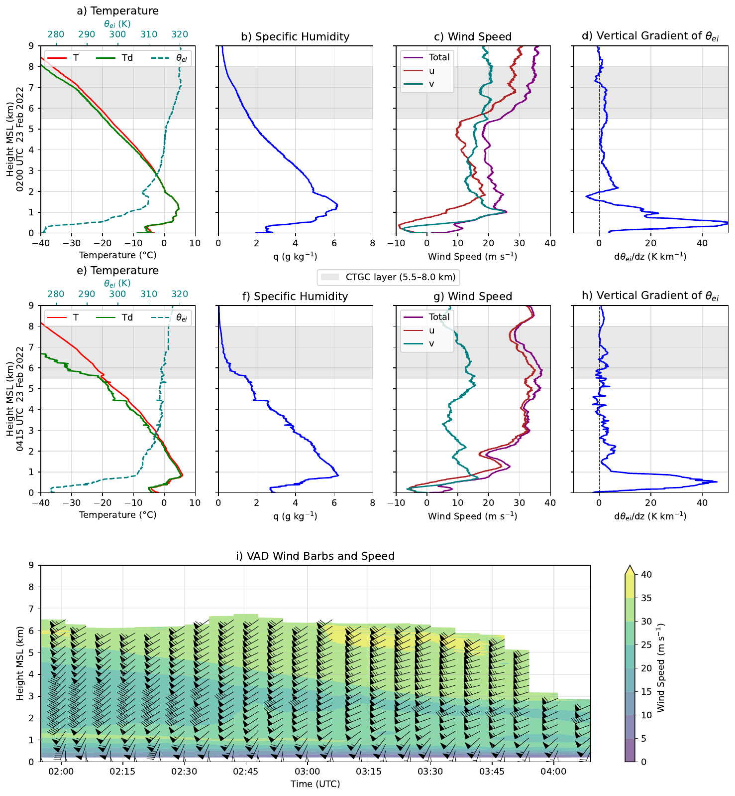

Sorel, 02:00 and 04:15 UTC. Gray band is the 5.5–8 km generating-cell layer.

<!--
Use for environment questions. Moisture and shear are context. They are not a demonstrated cause of the life cycle.
-->

---
class: population-identification population-zdr
title: Differential reflectivity — detailed explanation
---

# Differential reflectivity

  {{ label }}

  

    

      <CuManim :steps="5" :width="1000" :height="310" :construct="zdrInterpretation" />
      <svg v-if="zdrStep === 0" class="ctgc-first-frame" viewBox="0 0 1000 580" aria-hidden="true">
        <path v-for="(item, i) in zdrPreview" :key="i" :d="item.d" :fill="item.color" :fill-opacity="item.fill" :stroke="item.color" :stroke-opacity="item.stroke" :stroke-width="item.width" />
      </svg>
      <svg class="zdr-labels" viewBox="0 0 1000 580" aria-hidden="true">
        <g v-if="zdrStep <= 3">
          <text x="93" y="166">Radar</text>
          <text x="218" y="170" class="zdr-vertical">V</text>
          <text x="218" y="325" class="zdr-horizontal">H</text>
          <text x="430" y="68">Particle viewed along beam</text>
          <text x="560" y="445" class="zdr-horizontal">Horizontal</text>
          <text x="290" y="96" class="zdr-vertical">Vertical</text>
          <text x="795" y="136">Relative reflectivity</text>
          <text x="635" y="240" class="zdr-horizontal">H</text>
          <text x="635" y="340" class="zdr-vertical">V</text>
          <text x="795" y="425" class="zdr-comparison">{{ ['Compare H and V', 'H > V', 'H ≈ V', 'H < V'][zdrStep] }}</text>
          <text x="795" y="465" class="zdr-comparison">{{ ['', 'ZDR > 0 dB', 'ZDR ≈ 0 dB', 'ZDR < 0 dB'][zdrStep] }}</text>
          <text x="500" y="538" class="zdr-muted">{{ ['Two polarizations · the same radar sample', 'Idealized horizontally oriented plate', 'Idealized spherical particle', 'Idealized vertically elongated particle'][zdrStep] }}</text>
        </g>
        <g v-else>
          <text x="500" y="48">Generating layer · 5.5–8 km MSL</text>
          <text x="500" :y="zdrStep === 4 ? 475 : 83" class="zdr-gold">{{ zdrStep === 4 ? 'Aggregation: more isotropic particles' : 'Larger aggregates fall out faster' }}</text>
          <text x="165" y="553" text-anchor="start" class="zdr-crystal">Oriented crystals</text>
          <text x="603" y="553" text-anchor="start" class="zdr-gold">Aggregates</text>
        </g>
      </svg>
    

    
{{ zdrStep <= 3 ? 'Independent reference cases · idealized near-horizontal beam' : 'Conceptual particle sequence · sizes and fall speeds are schematic' }}

  

  

    

$$Z_{\mathrm{DR}} = 10\log_{10}\!\left(\frac{z_{\mathrm{H}}}{z_{\mathrm{V}}}\right)\;\mathrm{dB}$$

    
zH and zV are linear reflectivities for horizontal and vertical polarization.

    

      <h2>Compare two polarizations</h2>
      
Radar compares the horizontal and vertical returns from the <strong>same sample</strong>.

      
Their ratio depends on particle shape, orientation, density, and the mixture of particles.

    

    

      <h2>Positive ZDR</h2>
      
<strong>Horizontal return is stronger.</strong>

      
Horizontally oriented plates can produce this signature.

      
The shape and bars illustrate the comparison; they do not assign an exact dB value.

    

    

      <h2>ZDR near zero</h2>
      
<strong>Horizontal and vertical returns are approximately equal.</strong>

      
Zero does not mean no particles or no echo.

      
Spheres are one example, not a unique explanation: orientations and particle mixtures also matter.

    

    

      <h2>Negative ZDR</h2>
      
<strong>Vertical return is stronger.</strong>

      
A vertically elongated particle can produce this signature.

      
This is a reference case, not a negative population mean observed in this study.

    

    

      <h2>Early decrease in Set 1</h2>
      
Consistent with aggregation increasing the contribution from <strong>more isotropic particles</strong>.

      
Aggregation is illustrated; riming can also reduce particle anisotropy. Neither is uniquely identified by ZDR.

    

    

      <h2>Later increase in Set 1</h2>
      
The later increase is consistent with differential sedimentation and particle sorting in the cloud-top layer.

      
Aggregates fall out faster; oriented crystals contribute relatively more aloft.

    

    <figure v-if="zdrStep >= 4" class="zdr-observed">
      

        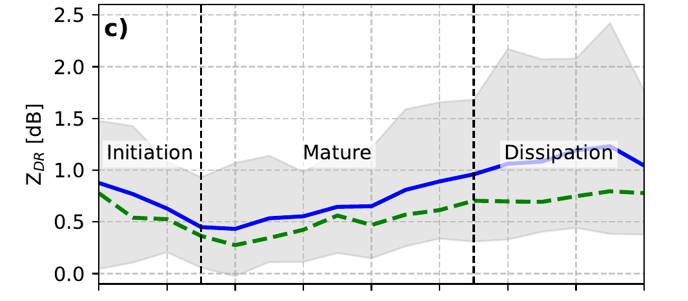
        <svg viewBox="0 0 1066 467" aria-hidden="true">
          <rect :x="zdrStep === 4 ? 153 : 365" y="7" :width="zdrStep === 4 ? 212 : 633" height="435" />
        </svg>
      

      <figcaption>Set 1 · {{ zdrStep === 4 ? 'early decrease' : 'later increase' }} · mean &gt; 0</figcaption>
    </figure>
  

{{ zdrStep <= 3 ? 'Illustrative scattering signatures, not a particle-identification key; real radar samples contain many particles.' : 'Paper Figure 13(c) and the proposed microphysical evolution · particle habits and mechanisms are inferred, not directly observed.' }}

<!--
Supporting slide. This preserves the full explanation from the former main slide 36. References below to the previous and next slides refer to main-talk slides 35 and 37.

About 75–90 seconds, five clicks. Entry: the radar compares horizontal and vertical reflectivity from the same sampled volume. Define Z_DR as ten times the base-ten logarithm of the ratio of linear horizontal to vertical reflectivity. The horizontal and vertical arrows indicate electric-field directions in the plane perpendicular to propagation; the particle is shown as viewed along an idealized near-horizontal beam. Beside the radar, blue H and pink V wave arrows show the polarized transmitted signal in schematic perspective: both propagate toward the particle, while their electric fields oscillate in perpendicular horizontal and vertical planes. The wave glyphs are offset vertically only for legibility, not separate physical beam paths. Both have the same illustrative 3D amplitude; H looks flatter because its horizontal plane is foreshortened. Their amplitudes do not change with particle shape or explain differences in returned reflectivity. Wave crests advance briefly during the existing first three clicks and disappear with the radar on click four. The bars are qualitative relative linear reflectivity, not calculated scattering cross-sections or measured values. These first three cases are independent illustrations, not a time sequence of one observed crystal changing shape.

[click] Positive Z_DR: the horizontal return is stronger. A horizontally oriented plate is an idealized example relevant to ice clouds. Real values depend on shape, orientation, density, wavelength, and the particle mixture; do not identify a particular crystal habit from Z_DR alone.

[click] Near-zero Z_DR: the horizontal and vertical returns are approximately equal. A sphere provides the simplest illustration, but less anisotropic particles, broad orientation distributions, or mixtures can also produce a small net difference. Zero is not no particles, no echo, or zero reflectivity. Aggregates and rimed crystals need not be spherical or have exactly zero Z_DR.

[click] Negative Z_DR: the vertical return is stronger, illustrated by a vertically elongated particle. Spend only about five seconds here. This explains the sign convention; it is not a negative population mean in our observations. Beam elevation and propagation/calibration effects can also influence actual radar measurements.

[click] Return explicitly to the same observed Figure 13(c) from the previous slide, with its early-decrease interval highlighted. The population mean remains positive; the teaching examples do not imply it reaches zero. The conceptual animation shows oriented crystals joining into larger, more isotropic aggregates. This is consistent with the paper's early aggregation interpretation; riming can also reduce anisotropy but is not separately animated or uniquely established. Shapes, counts, and sizes are schematic, and the radar ratio is reflectivity-weighted rather than a simple particle-number average. Reflectivity is relatively stable after initiation and rho_HV stays high; these additional plots remain in the full Figure 13. Do not call the contour-size increase growth of every individual cell.

[click] Highlight the subsequent overall rise through maturity and dissipation. The interpretation is that larger, more isotropic particles sediment out, leaving a relatively greater contribution from slower-falling oriented crystals aloft. Keep the oriented crystals visibly distinct while the aggregates cross the lower boundary of the 5.5–8 km MSL generating layer: aggregates do not transform back into pristine crystals. Polarimetry supports this inference but does not directly identify particle habit. The animation shows the proposed differential sedimentation and sorting, not measured particle trajectories, a unique mechanism, or an exact scattering calculation. Continue to the one selected cell tracked through this sequence; its Z_DR evolution shows the same population trend in a single example, which then supports the conceptual population-life-cycle figure.
-->

---
class: figure-slide
---

# Backup: the storm at 03:00 UTC

  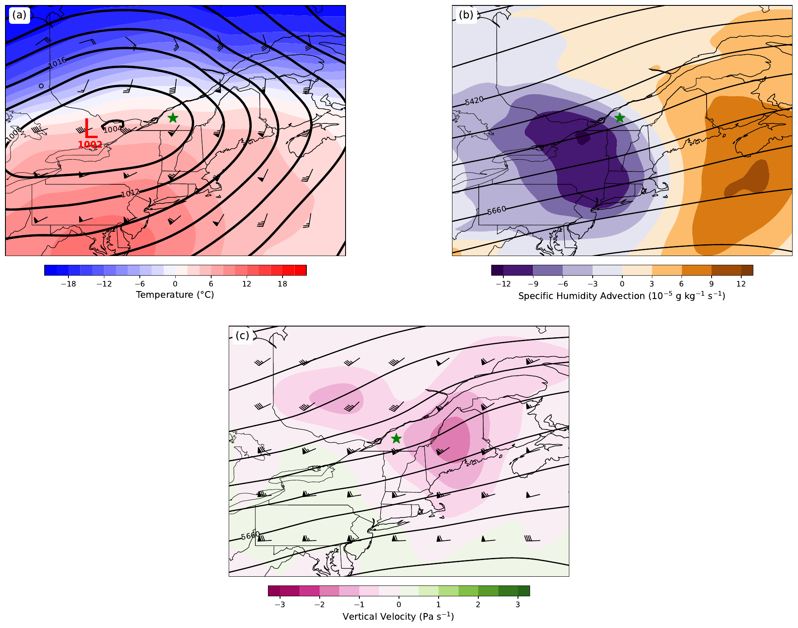

ERA5. The green star is DOW6. Not a synoptic analysis of the cells.

---
class: figure-slide
---

# Backup: where the boundaries were

  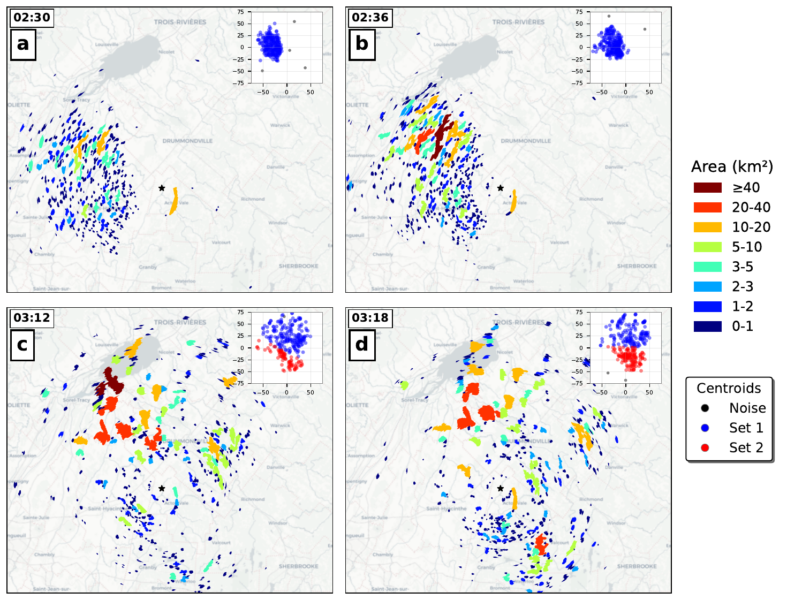

Set 1 in blue on the insets. Larger markers are merged boundaries, not necessarily single cells.

---
class: figure-slide
---

# Backup: the same cell in $Z_{DR}$

  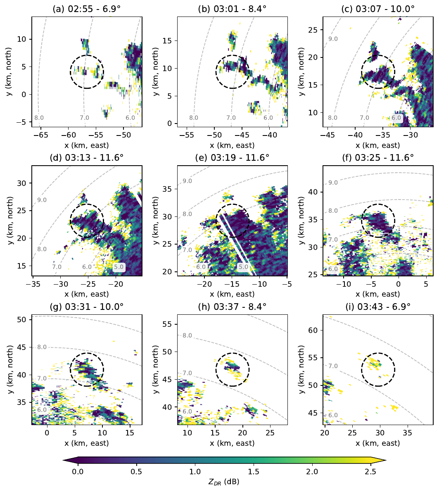

Same track as the reflectivity sequence. The population's $Z_{DR}$ rise has an individual-cell example.

---
class: figure-slide
---

# Backup: mid-level precipitation the streak meets

  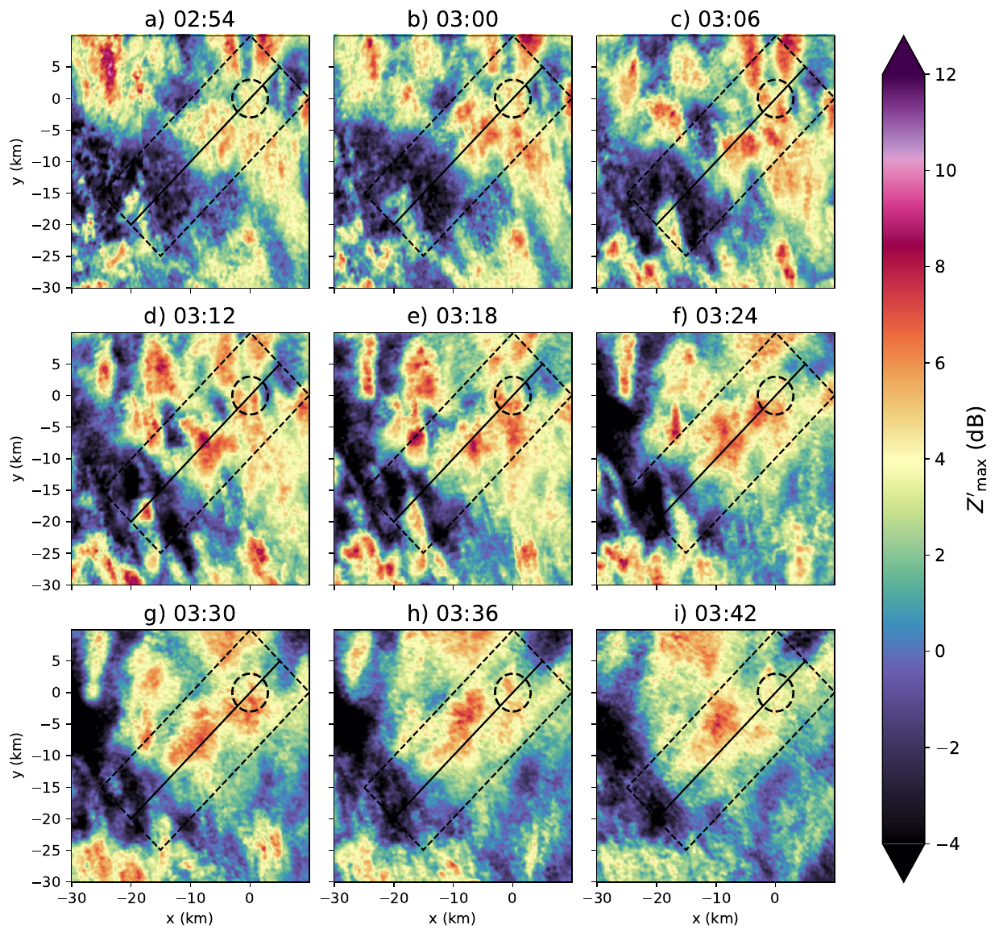

3.5–5 km. The fall streak overlaps structures that are already there.

---
class: paper4-map-evolution
---

# Melting layer effects (1.5–2.5 km)

<Paper4EvolutionMaps :src="rainMaps" alt="Chapter 5 Figure 5: lower-level (1–1.5 km MSL) equivalent reflectivity maps with p90 footprint contours across nine analysis times (02:54–03:42 UTC)">
    <section><strong>Early melting layer enhancement</strong>
Lower-level precipitation is already present before CTGC fall-streak arrival; it is not related to the cell alone.
</section>
    <section><strong>Horizontal precipitating bands</strong>
Underlying stratiform bands produce significant background precipitation throughout the domain.
</section>
    <section><strong>A combined effect</strong>
The CTGC fall streak and pre-existing precipitating bands overlap, producing localized precipitation enhancement.
</section>
</Paper4EvolutionMaps>

<!--
About 50 seconds. Madison Slide 15 and Paper Figure 5. Looking below the melting level in the 1–1.5 km rain layer: At early times (02:54 UTC), substantial reflectivity is already observed below the melting level. The underlying precipitation field contains organized bands independent of the cell. As the cell matures and its fall streak descends, it overlaps these existing bands. The outcome is a combined effect: the cell reinforces and enriches an active precipitation system rather than initiating rainfall on dry ground.

Figure metadata, retained here rather than as a visible caption: maximum-radar
composite Z-e-max over 1–1.5 km MSL, in dBZ, at all nine times from 02:54 to
03:42 UTC. This figure is below the melting layer named in the slide title,
not a map of the 1.5–2.5 km melting layer itself. The original footprint legend,
contours, time labels, distance axes, and colorbar remain part of the figure.
-->

---
class: figure-slide
---

# Backup: the tracked cell in the population

  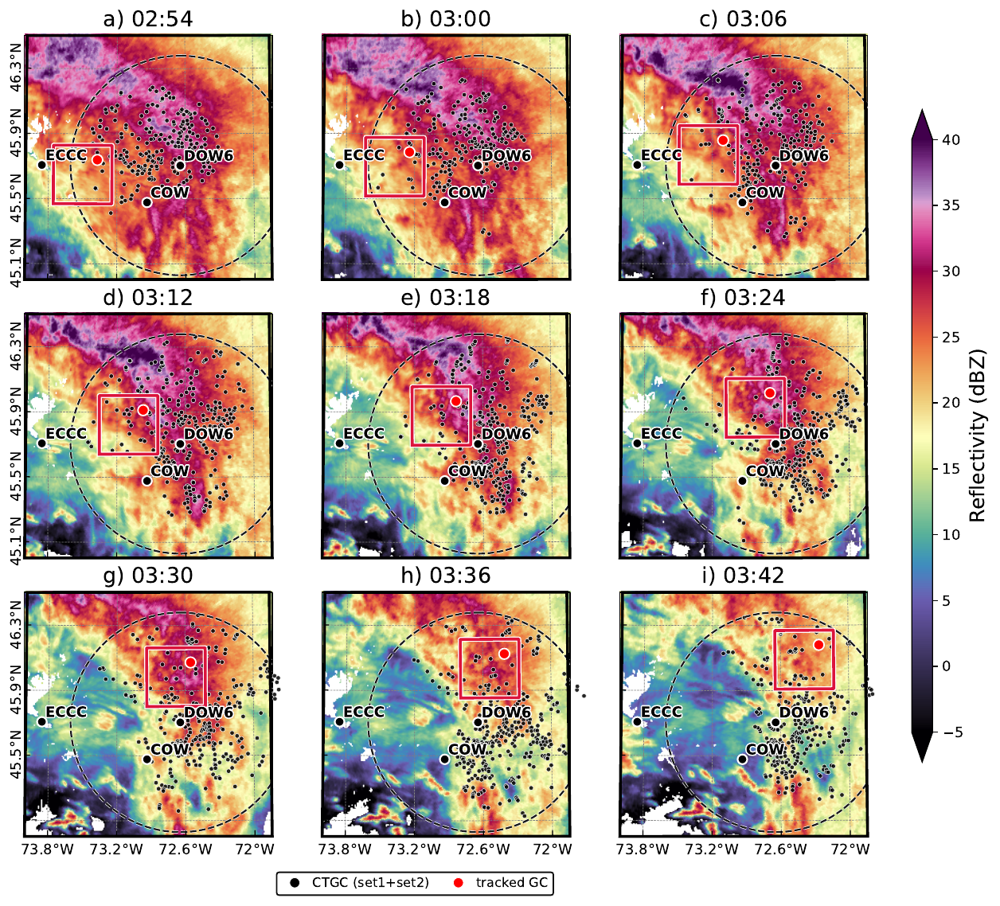

Nine analysis times, 02:54–03:42 UTC. The 3D cell is one member of Set 1.

---
class: local-math
---

# Local mean, variance, and support

One shared denominator from the filtered mask.

Data density

$$
\rho = \mathcal{S}_g\{m\}
$$

Mean

$$
\mu = \mathcal{S}_g\{x \cdot m\} / \rho
$$

Variance, std

$$
\sigma^2 = \mathcal{S}_g\{x^2 \cdot m\} / \rho - \mu^2, \quad \sigma = \sqrt{\sigma^2}
$$

Effective number

$$
N_{\mathrm{eff}} = A\,\rho
$$

Area

$$
A = \prod_d W_d, \quad A_{\mathrm{polar}}(r) = W_{\mathrm{range}} \cdot W_{\mathrm{az,grid}}(r)
$$

<!--
About 80 seconds. x is the observed field and m is 1 where retained, 0 where missing or excluded. S_g is the spectral smoothing operator: transform, multiply by H_g, invert. The filtered mask ρ is the shared denominator: normalizing the filtered values gives the mean, and normalizing the filtered squared values gives the second moment for variance and standard deviation. The same denominator measures available support through N_eff: ρ is the retained fraction, and A is the nominal window area — the product of axis widths on Cartesian grids, range-dependent on polar grids — so N_eff reads as the effective number of contributing grid cells. Zero placeholders never enter as zero-valued observations because the denominator removes their weight. The prefilled-field fallback applies only where ρ is below epsilon; screening weakly supported estimates is a separate analysis choice. Next: how the spectral operator implements boundaries.
-->

---
class: local-math
---

# Boundary conditions are part of the transform

The choice of transform is also a boundary model for Sg.

$$
\mathcal{S}_g\{f\} = \mathcal{T}^{-1}\{\mathcal{T}\{f\} \cdot H_g\}
$$

  <section class="local-math-card">
    <h2>Reflective (DCT-II)</h2>
    <svg class="local-boundary-svg" viewBox="0 0 300 70" aria-hidden="true">
      <line x1="10" y1="56" x2="290" y2="56" stroke="currentColor" stroke-width="1.2" opacity="0.6" />
      <rect class="ext" x="70" y="37" width="16" height="18" />
      <rect class="ext" x="90" y="43" width="16" height="12" />
      <rect class="orig" x="110" y="43" width="16" height="12" />
      <rect class="orig" x="130" y="37" width="16" height="18" />
      <rect class="orig" x="150" y="31" width="16" height="24" />
      <rect class="orig" x="170" y="25" width="16" height="30" />
      <rect class="orig" x="190" y="19" width="16" height="36" />
      <rect class="orig" x="210" y="13" width="16" height="42" />
      <rect class="ext" x="230" y="13" width="16" height="42" />
      <rect class="ext" x="250" y="19" width="16" height="36" />
    </svg>
    
Mirror at the ends. Finite axes.

$$
\omega_k = \pi k / n
$$

  </section>
  <section class="local-math-card">
    <h2>Periodic (RFFT)</h2>
    <svg class="local-boundary-svg" viewBox="0 0 300 70" aria-hidden="true">
      <line x1="10" y1="56" x2="290" y2="56" stroke="currentColor" stroke-width="1.2" opacity="0.6" />
      <rect class="ext" x="70" y="19" width="16" height="36" />
      <rect class="ext" x="90" y="13" width="16" height="42" />
      <rect class="orig" x="110" y="43" width="16" height="12" />
      <rect class="orig" x="130" y="37" width="16" height="18" />
      <rect class="orig" x="150" y="31" width="16" height="24" />
      <rect class="orig" x="170" y="25" width="16" height="30" />
      <rect class="orig" x="190" y="19" width="16" height="36" />
      <rect class="orig" x="210" y="13" width="16" height="42" />
      <rect class="ext" x="230" y="43" width="16" height="12" />
      <rect class="ext" x="250" y="37" width="16" height="18" />
    </svg>
    
Repeat end to start. Circular azimuth.

$$
\omega_k = 2\pi k / n
$$

  </section>

Gaussian example: Hg[k] = exp[−½(sωk)²], s = W/√12. Same form, different grid. Boxcar and discrete boxcar are also implemented.

<!--
Read the center equation as: S sub g of f equals the inverse transform of the transform of f, times H sub g. S_g is the spectral smoother, T is the forward transform, and H_g is the kernel response. The same operator applies to data, mask, squared data, or a prefilled field; it is not itself a local mean. The transform is also the boundary model: DCT-II, read D C T two, means half-sample symmetric reflective extension; RFFT means periodic extension. The bars are schematic: gold is the finite signal of n samples, muted bars the assumed continuation — mirrored at the edges on the left, wrapped end to start on the right. Below, omega sub k equals pi k over n is the DCT frequency grid, and omega sub k equals two pi k over n is the periodic grid; k is the wavenumber, the integer frequency-bin index; omega is the frequency in radians per grid sample; and n is the number of samples. The Gaussian response H sub g of k is e to the minus one-half s omega sub k squared, with s equals W over root twelve linking s to the window width W. Same functional form, different grid. Next: does the boundary choice matter in practice?
-->

---
class: local-math
---

# Spectral operations in N dimensional space

Separability: one operator, two equivalent paths.

$$
\begin{aligned}
\mathcal{S}^{(D)}\{f\} &= \mathcal{T}^{-1}\{\mathcal{T}\{f\} \cdot H_D\} \\
H_D(k_1,\ldots,k_D) &= \prod_{d=1}^{D} H_d(k_d), \quad \mathcal{S}^{(D)} = \mathcal{S}_D \circ \cdots \circ \mathcal{S}_1
\end{aligned}
$$

<svg class="local-paths-svg" viewBox="40 0 366 134" role="img" aria-label="Single D-dimensional multiply by H D is equivalent to successive one-dimensional passes along x, then y, then z">
  <rect class="vol" x="158" y="8" width="40" height="40" />
  <path class="parrow" d="M203 28h40m-7-7 7 7-7 7" />
  <text class="pop" x="223" y="20" text-anchor="middle">×H_D</text>
  <rect class="vol vol-out" x="248" y="8" width="40" height="40" />
  <text class="equiv" x="223" y="86" text-anchor="middle">≡</text>
  <rect class="vol" x="70" y="92" width="36" height="36" />
  <path class="parrow" d="M111 110h44m-7-7 7 7-7 7" />
  <text class="pop" x="133" y="102" text-anchor="middle">×H_1</text>
  <text class="paxis" x="133" y="126" text-anchor="middle">x</text>
  <rect class="vol" x="160" y="92" width="36" height="36" />
  <path class="parrow" d="M201 110h44m-7-7 7 7-7 7" />
  <text class="pop" x="223" y="102" text-anchor="middle">×H_2</text>
  <text class="paxis" x="223" y="126" text-anchor="middle">y</text>
  <rect class="vol" x="250" y="92" width="36" height="36" />
  <path class="parrow" d="M291 110h44m-7-7 7 7-7 7" />
  <text class="pop" x="313" y="102" text-anchor="middle">×H_3</text>
  <text class="paxis" x="313" y="126" text-anchor="middle">z</text>
  <rect class="vol vol-out" x="340" y="92" width="36" height="36" />
</svg>

Each axis keeps its own width. Apply the full operator to x·m, x²·m, and m, then form ratios.

<!--
About 50 seconds. The D-dimensional smoother is one operator: transform, multiply once by H_D, invert — with H_D the product of the axis responses. By separability this equals successive one-dimensional passes: S_1 along x, then S_2 along y, then S_3 along z. The circle means then, applied right to left, so S_1 runs first. Each axis keeps its own width. As before, apply the full multidimensional operator to the masked field, masked squares, and mask, then form the normalized ratios; do not average separately normalized intermediates. Next: the same idea with mixed boundaries on a polar grid.
-->

---
class: smoothing-polar-dct
---

# Polar filtering with mixed boundaries

Apply the separable filter to the two dimensions of the polar field, X(θ, r).

<section class="polar-dct-pass">

## 1 · Azimuth pass — range-dependent width

$$
Y_{\mathrm{az}} = \operatorname{IRFFT}\!\left[\operatorname{RFFT}(X) \cdot H_{\mathrm{az}}\right]
$$

At each range index, the grid width follows $W_{\mathrm{az,grid}}(r) = W_{\mathrm{azimuth}}/(r\Delta\theta)$.

</section>

<section class="polar-dct-pass">

## 2 · Range pass — fixed reflective width

$$
Y = \operatorname{IDCT}_{r}\!\left[\operatorname{DCT}_{r}(Y_{\mathrm{az}}) \cdot H_{r}\right]
$$

At each angle, multiply range coefficients by the same fixed-width response.

</section>

Full-circle: periodic azimuth with reflective range; partial-sector: reflective azimuth.

<!--
About 50 seconds. Polar arrays are indexed as azimuth by range. To hold physical azimuth width approximately fixed, the kernel width in grid units is W_az,grid(r) = W_azimuth / (r delta-theta), where r is the 1-based range index and delta-theta is azimuth spacing in radians. This r is an index convention, distinct from physical range discussed in the smoothing section. Because that width varies with range, H_az is a range-dependent 2D transfer-function array, not one global 2D multiplication. For a full-circle scan the implemented mixed mode is periodic azimuth with reflective range, shown here with RFFT and IRFFT; a partial-sector scan need not wrap and uses reflective DCT in azimuth. Stage 2 filters the intermediate field Y_az along range with reflective DCT-II. Apply the same two-stage operator to masked values, masked squares, and mask, then normalize. Polar effective area is range-dependent: A_polar(r) = W_range times W_az,grid(r). Next: validation, starting with structured 3D flow.
-->

---
class: figure-slide
---

# Boundary treatment changes the edges

Edge RMSE over the first and last W samples: 0.38 reflective versus 2.52 periodic.

  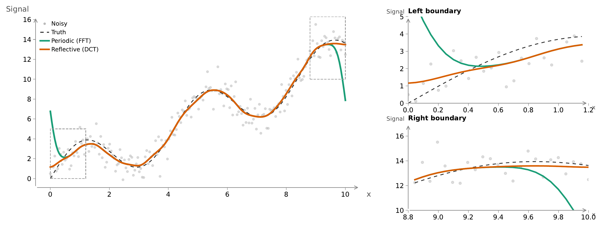

1D non-periodic signal, N = 200, W = 15 Gaussian. All-domain RMSE 0.28 versus 1.00. Dashed boxes mark the edge regions.

<!--
About 45 seconds. A 1D non-periodic synthetic signal with trend plus Gaussian noise, matched W = 15 Gaussian kernel, 5 seeds. Reflective DCT follows local trend continuity; periodic treatment pulls the edges toward the opposite end. All-domain RMSE is about 0.28 reflective versus 1.00 periodic; edge-only RMSE over the first and last W samples is about 0.38 versus 2.52. This is a boundary-model check, not a general accuracy claim. Next: what is new in this work.
-->

---
class: figure-slide
---

# Outlier threshold sensitivity

$$
|\,\|v\| - \mu_{\|v\|}\,| > k\,\sigma_{\|v\|}
$$

  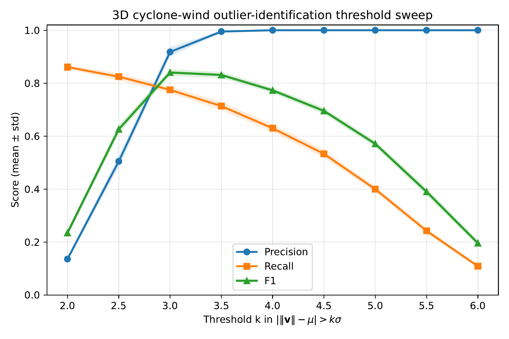

Precision is the fraction of detections that are true anomalies; recall is the fraction of true anomalies found. At k = 2.0: 0.14 and 0.86. At k = 3.0: 0.92, 0.77, F1 0.84. At k = 4.0: 1.00 and 0.63. Mean F1 peaks at k = 3.0 within the tested 2.0–6.0 sweep.

<!--
About 40 seconds. Threshold sweep over k from 2.0 to 6.0, mean plus/minus std across seeds. Lower k finds more with more false alarms; higher k is cleaner but misses more. Mean F1 peaks at k = 3.0 within the tested sweep. Recommended practice is iterative: compute local statistics, flag with the z-score criterion, exclude flagged points from the mask, and recompute so outliers do not inflate local spread. Window width, support, and boundary mode also affect screening. Transition from synthetic winds to real radar.
F1 is the harmonic mean of precision and recall, so 0.84 means the k = 3.0 setting balances both.
-->

---
class: smoothing-contribution
---

# Contribution: from smoothing to local statistics

  
Local mean and spread on <strong>N-dimensional Cartesian</strong> and <strong>polar grids</strong>, mixing <strong>boundary conditions</strong> and <strong>kernel types</strong> per dimension.

  <svg class="shrink-0" width="360" height="225" viewBox="0 0 320 200" role="img" aria-label="Illustrative Cartesian grid and polar sampling grid, not measured data">
    <g fill="none" stroke="currentColor" stroke-opacity="0.65" stroke-width="2">
      <path d="M18 50 H108 M18 50 V140 M108 50 V140 M18 140 H108 M48 50 V140 M78 50 V140 M18 80 H108 M18 110 H108" />
    </g>
    <rect x="48" y="80" width="30" height="30" fill="#cfb87c" fill-opacity="0.55" />
    <text x="63" y="170" text-anchor="middle" fill="currentColor" style="font-size: 22px">Cartesian</text>
    <g transform="translate(140,45) scale(0.55)">
      <path d="M32 158 L250.24 32 A252 252 0 0 1 284 158 Z" fill="#cfb87c" fill-opacity="0.12" />
      <g fill="none" stroke="currentColor" stroke-opacity="0.65" stroke-width="2">
        <path d="M32 158 H284 M32 158 L280.18 114.24 M32 158 L268.8 71.81 M32 158 L250.24 32" />
        <path d="M86.56 126.5 A63 63 0 0 1 95 158 M141.12 95 A126 126 0 0 1 158 158 M195.68 63.5 A189 189 0 0 1 221 158 M250.24 32 A252 252 0 0 1 284 158" />
      </g>
      <circle cx="32" cy="158" r="4" fill="currentColor" />
    </g>
    <text x="227" y="160" text-anchor="middle" fill="currentColor" style="font-size: 22px">Polar</text>
  </svg>

See the preprint <a href="https://doi.org/10.48550/arXiv.2604.22721" target="_blank" rel="noopener noreferrer">Valdivia et al. (arXiv:2604.22721)</a> for the mathematical formulation and implementation.

<!--
About 30 seconds, no clicks. The sketches are illustrative, not results or measured data. Suggested delivery: “Paper 1 smoothed complete fields with one kernel average. The new step is a statistical framework: from retained values only, we estimate local mean, spread, and available support — on N-dimensional Cartesian and polar grids, combining reflective and periodic boundaries and different kernel types per dimension. I will leave the formulation to the paper and now show the validation.” Do not present equations on this slide; the estimator, boundary, dimensionality, and polar-filter details are in the supporting slides if asked. This work is under review; cite the arXiv preprint, not a publication. The link opens the preprint in a separate tab.
-->
