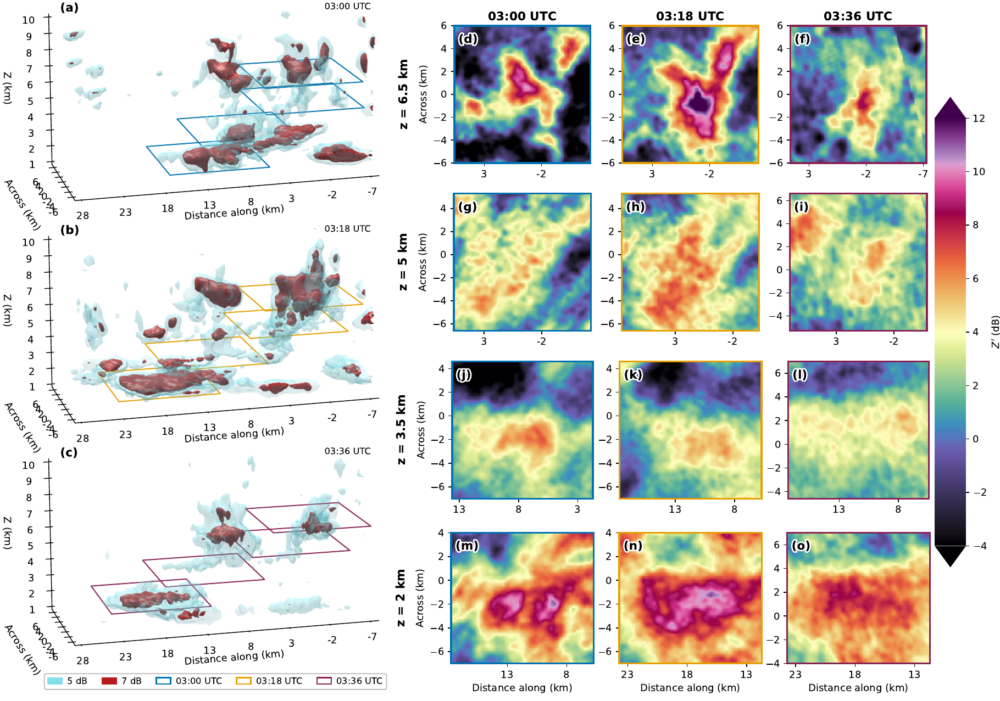
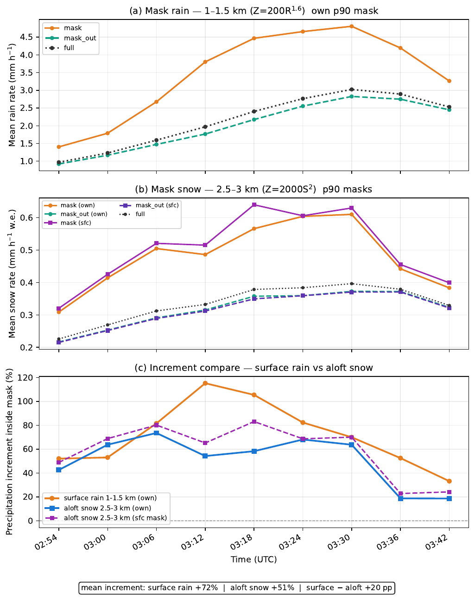

# Follow the cell, not the radar

- **DOW6** (X), **COW** (C), and **ECCC** (S), every 6 minutes
- The grid moves with the track. The cell stays at the origin
- $Z'$ is each radar's anomaly, merged by beam weight

<!--
Why not one radar: a vertically pointing radar sees the cell only while it is overhead. A single scanning radar changes resolution as the cell moves away.

Nine volumes, 02:54–03:42 UTC. Common grid 40 km by 40 km, 1–9 km, 100 m spacing. The cell centroid is at x = y = 0.

Each radar is smoothed in polar coordinates, mapped to the moving grid, and turned into an anomaly against its own spatial background. The backgrounds are combined with a beam weight, so a voxel a radar does not sample does not vote.

COW is beyond its maximum range at the last time, about 94 km from the cell. Wavelength differences are why this is an anomaly merge, not a raw reflectivity blend.

Submitted to GRL, manuscript 2026GL126989. Not accepted.
-->

---
class: figure-slide
---

# A fall streak from cloud top to below the melting layer

  

Cell-relative $Z'$. 03:00, 03:18, and 03:36 UTC. The mid-level connection is clearer in the mature stage.

<!--
Left: 5 dB and 7 dB isosurfaces. Right: slices at 6.5, 5, 3.5, and 2 km.

The signature extends from the tracked cell through underlying cloud, including the dendritic growth zone, to below the melting layer. Do not point at a panel and call it the dendritic growth zone unless you are looking at the sounding. The rain-layer comparison later is 1–1.5 km; the snow-layer comparison is 2.5–3 km.

The connection to mid-level precipitation becomes more prominent at the mature time. It develops inside an existing precipitation field.
-->

---
class: figure-slide
---

# The enhancement is not a column under the cell

  

Top 10% of time-mean $Z'$. The cell is at the origin. The footprint lies along the fall streak.

<!--
This is the attribution slide. Say it before the percentages.

The footprint is the upper decile of the time-mean column-maximum anomaly, not the instantaneous position of the streak at every time. The strong enhancement is southwest of the cell, overlapping pre-existing north–south precipitation structures.

Consistent with ice from the cell entering cloud that is already producing precipitation, and with further growth during descent. Not proof that this cell produced the precipitation below.

Figure titles still use analysis-script wording. The claim does not depend on those labels.
-->

---
class: figure-slide
---

# Higher rates in the footprint — not this cell's share

  

Inside versus outside: snow <strong>+51%</strong>, rain <strong>+72%</strong>. Other cells and pre-existing precipitation are in both regions.

<!--
Chapter 6 wording: radar-estimated liquid-equivalent snow rates averaged 51% higher inside the snow-layer footprint than outside. Rain rates averaged 72% higher inside the rain-layer footprint than outside.

Relations: Z = 2000 S² above the melting layer, Z = 200 R^1.6 below. The outside region is the rest of the domain. It is not a no-generating-cell control.

The contrast is not very sensitive to the 85th, 90th, or 95th percentile threshold. Say that only if asked.

The axis titles on this figure are provisional and should be cleaned before the defense. The bottom annotation is the number to stand on.
-->
