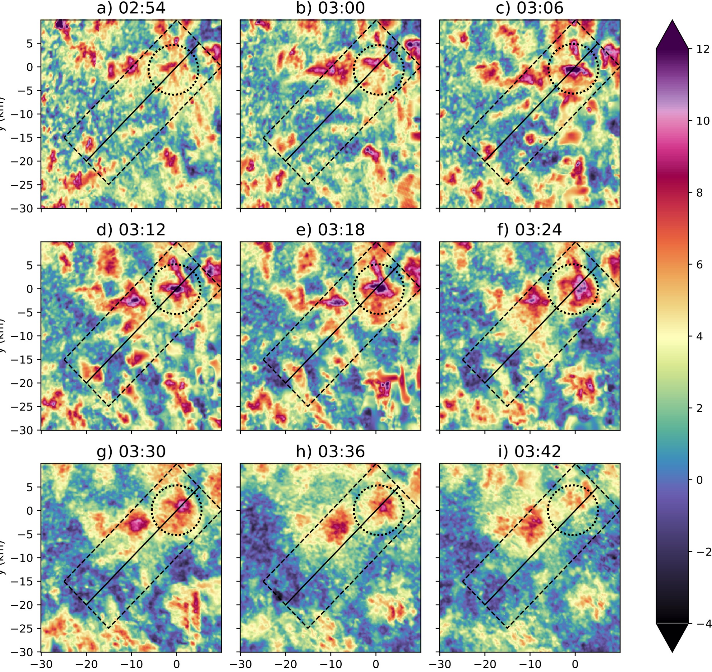
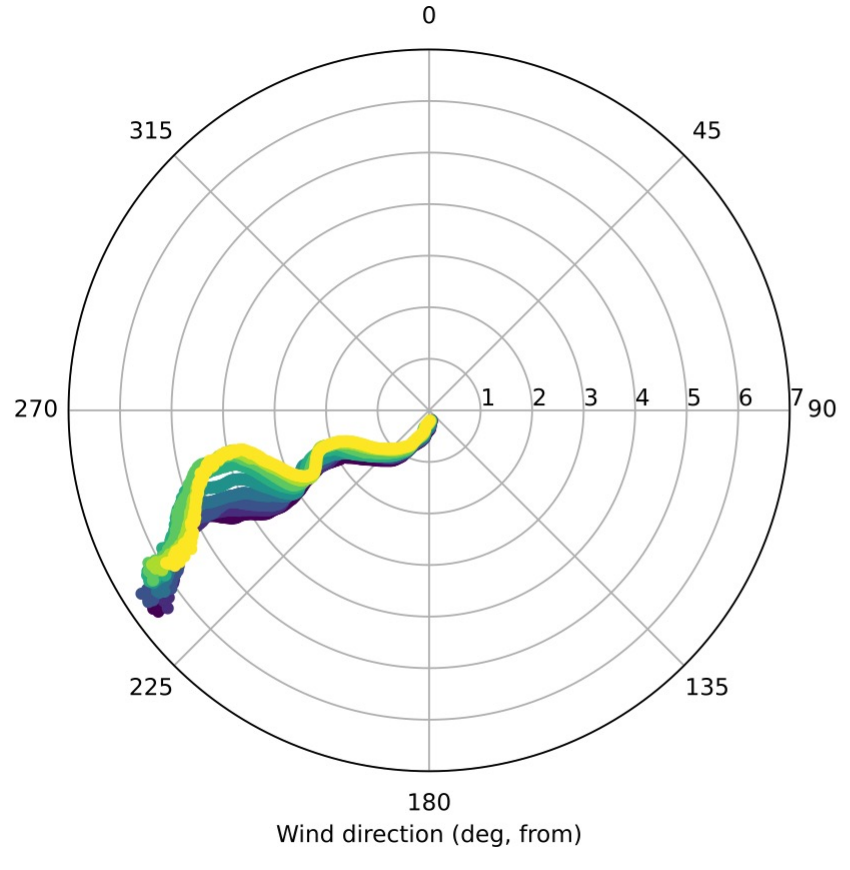
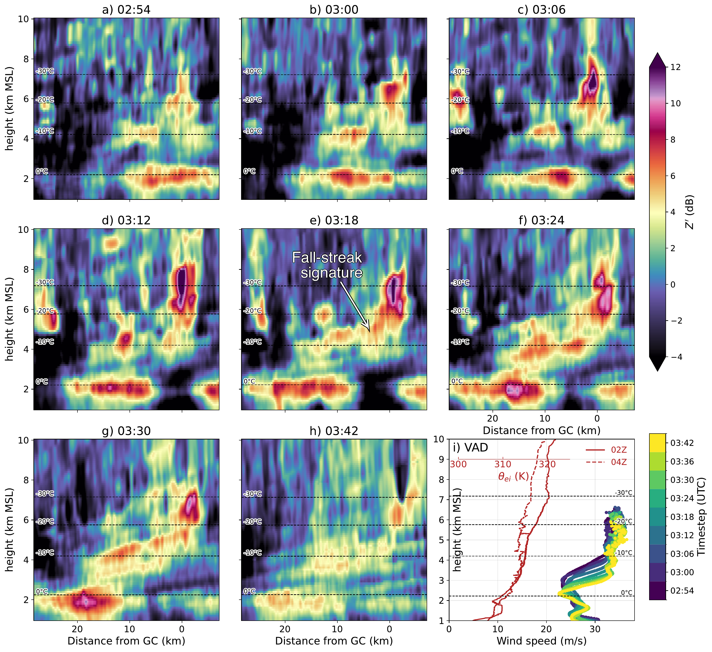
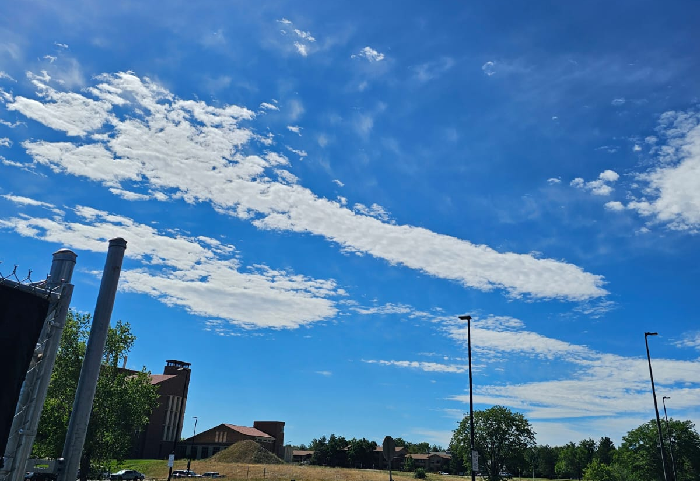

  
Paper 4 · CTGC fall streak and precipitation

  <h1>Tracking and Quantifying 3D Cloud-Top Generating-Cell Structure and Associated Precipitation</h1>
  

    
<strong>Jairo M. Valdivia-Prado</strong>

    
Coauthors: Katja Friedrich · Troy Zaremba · Sarah Tessendorf

  

  
Department of Atmospheric and Oceanic Sciences · University of Colorado Boulder

  
Submitted to <em>Geophysical Research Letters</em>, 16 September 2026 · manuscript 2026GL126989

<!--
About 20 seconds. This fourth paper is submitted to Geophysical Research Letters, 16 September 2026. It uses the selected Set 1 cell track introduced in Paper 3. Papers 1 and 2 enter this analysis through polar smoothing and the weighted local background. Credit Katja Friedrich, Troy Zaremba, and Sarah Tessendorf. Start with the physical questions of tracking in 3D and precipitation connection.
-->

---
class: paper4-question
---

# Following CTGC precipitation in three dimensions

  

    
We know CTGC fall streaks extends downward below the generating layer.

    <section><strong>Structure</strong>Can we resolve the 3D cell and its fall streak through underlying cloud?</section>
    <section><strong>Evolution</strong>How does the fall streak interact with pre-existing cloud?</section>
    <section><strong>Precipitation</strong>Can we quantify the precipitation enhancement due to CTGC?</section>
  

  <svg class="paper4-question-diagram" viewBox="0 0 610 380" role="img" aria-label="Conceptual vertical schematic: a cloud-top generating cell, a southwestward fall-streak path through an existing cloud and precipitation layer, a melting layer, and precipitation below; not an observed cross section">
    <rect x="35" y="122" width="540" height="179" rx="55" class="paper4-cloud" />
    <path d="M440 52 C472 28 511 48 515 75 C538 78 549 105 533 119 L389 119 C369 102 382 73 407 73 C413 62 423 55 440 52Z" class="paper4-cell" />
    <path d="M450 115 C423 158 385 181 359 205 S288 258 234 309" class="paper4-streak" />
    <path d="M80 275 H535" class="paper4-melting" />
    <path d="M165 187 L157 207 M205 176 L197 196 M251 213 L243 233 M330 168 L322 188 M490 205 L482 225 M238 312 L230 332 M308 310 L300 330 M420 309 L412 329" class="paper4-precip" />
    <text x="360" y="38">Tracked CTGC</text>
    <text x="56" y="143">Pre-existing cloud / precipitation</text>
    <text x="61" y="265">Melting layer</text>

  </svg>

<!--
About 35 seconds. The central challenge: particles generated in cloud-top turrets fall into underlying cloud, where they grow through aggregation, vapor deposition, and riming. However, pre-existing precipitation and overlapping neighboring cells make direct attribution challenging. The schematic illustrates the core concept: a tracked CTGC near cloud top, a southwestward fall streak descending through an existing cloud layer, across the melting level, and into the rain layer below.
-->

---
class: paper4-fusion
clicks: 6
---

# 3D tracking methodology

  {{ label }}

  

    

      <CuManim v-if="fusionActive" :steps="6" :width="1000" :height="310" :construct="constructFusion" />
      

      <svg v-if="clicks === 0 || !fusionActive" class="fusion-first-frame" viewBox="0 0 1000 580" aria-hidden="true">
        <path v-for="(item, i) in fusionPreview" :key="i" :d="item.d" :fill="item.color" :fill-opacity="item.fill" :stroke="item.color" :stroke-opacity="item.stroke" :stroke-width="item.width" />
      </svg>
      <svg class="fusion-labels" viewBox="0 0 1000 580" aria-hidden="true">
        <defs>
          <linearGradient id="fusion-field-scale">
            <stop v-for="(color, i) in clicks >= 4 ? fusionColors.anomaly : fusionColors.reflectivity" :key="i" :offset="`${clicks >= 4 ? fusionColors.anomalyOffsets[i] : i * 25}%`" :stop-color="color" />
          </linearGradient>
        </defs>
        <g v-if="clicks <= 2">
          <text v-for="(item, i) in fusionLabels.map" :key="i" :x="item.x" :y="item.y" :fill="item.color" :text-anchor="item.anchor">{{ item.text }}</text>
          <g v-if="clicks === 2">
            <text v-for="(item, i) in fusionLabels.frame" :key="i" :x="item.x" :y="item.y" :fill="item.color" :text-anchor="item.anchor">{{ item.text }}</text>
          </g>
          <text v-else x="500" y="535" class="fusion-muted">{{ clicks === 1 ? 'Cloud translates while the three beams sweep together' : 'Selected cell embedded in a moving cloud' }}</text>
        </g>
        <g v-else-if="clicks <= 4">
          <g v-for="(radar, i) in fusionLabels.grids" :key="i">
            <text :x="radar.name.x" :y="radar.name.y" :fill="radar.name.color" class="fusion-label-title">{{ radar.name.text }}</text>
            <text :x="radar.field.x" :y="radar.field.y">{{ clicks === 4 ? radar.anomaly.text : radar.field.text }}</text>
            <text v-if="clicks === 4" :x="radar.background.x" :y="radar.background.y" :fill="radar.background.color">{{ radar.background.text }}</text>
          </g>
          <text v-if="clicks === 3" x="500" y="525" class="fusion-muted">Same voxel coordinates · separate radar fields and coverage</text>
        </g>
        <g v-else-if="clicks === 5">
          <text v-for="(item, i) in fusionLabels.merge" :key="i" :x="item.x" :y="item.y" :fill="item.color" :text-anchor="item.anchor">{{ item.text }}</text>
        </g>
        <g v-else>
          <text v-for="(item, i) in fusionLabels.section" :key="i" :x="item.x" :y="item.y" :fill="item.color" :text-anchor="item.anchor">{{ item.text }}</text>
          <g class="fusion-wind-labels">
            <text v-for="(item, i) in fusionLabels.wind" :key="i" :x="item.x" :y="item.y" :fill="item.color" :text-anchor="item.anchor">{{ item.text }}</text>
          </g>
        </g>
        <g v-if="clicks >= 3" class="fusion-scale">
          <rect x="360" y="545" width="245" height="10" fill="url(#fusion-field-scale)" />
          <text x="340" y="558" text-anchor="end">{{ clicks >= 4 ? '−4' : '0' }}</text>
          <text x="627" y="558" text-anchor="start">{{ clicks >= 4 ? '16 dB' : '45 dBZ' }}</text>
        </g>
      </svg>
    

    
{{ fusionCaptions[Math.min(clicks, 6)] }}

  

  

    

      <h2>Three complementary views</h2>
      
<strong>DOW6 · X band</strong> <strong>COW · C band</strong> <strong>ECCC · S band</strong>

      
Different sites and viewing angles sample the same moving storm.

      
Nine synchronized volume sets, every six minutes.

    

    

      <h2>Synchronized volume scans</h2>
      
The three beams start at <strong>0°</strong> and sweep at equal speed in this illustration.

      
The cloud moves during sampling.

      
The observations synchronize six-minute volumes—not necessarily identical antenna rotations.

    

    

      <h2>Follow the selected cell</h2>
      
The Paper 3 centroid track defines the moving origin: <strong>cell at (0, 0)</strong>.

      
<strong>40 × 40 km</strong> horizontal domain: x, y = −30 to +10 km.

      
Altitude: 1–9 km MSL. The box extends farther southwest to retain the downwind region.

    

    

      <h2>Grid each radar independently</h2>
      
Polar smoothing → common Cartesian coordinates → gap filling and <strong>500-m 3D smoothing</strong>.

      
Grid spacing: <strong>100 m</strong> in x, y, and z.

      
These are three separate fields on the same grid, not yet a merged reflectivity volume. Dim tiles mark unsampled voxels.

    

    

      <h2>Subtract each radar's background</h2>
      
Calculate a beam-weighted local mean over <strong>40 × 40 × 2 km</strong>.

      

$$Z'_r(p)=\widetilde Z_{e,r}(p)-\mu_r(p)$$

      
Localized enhancements remain relative to that radar's own background.

      
Gold slabs illustrate the 2-km vertical window; μ values refer to the highlighted voxel.

    

    

      <h2>Merge the anomalies</h2>
      
<strong>Gaussian beam-center weights:</strong> nearer the beam center → greater weight.

      

$$Z'(p)=\frac{\sum_r M_r(p)Z'_r(p)}{\sum_r M_r(p)}$$

      
M = 0 where a radar does not sample the voxel. Merge anomalies, not raw cross-wavelength reflectivity.

      
One 3D enhancement field, in dB.

    

    

      <h2>Inspect the expected fall streak</h2>
      
<strong>DOW6 VAD winds:</strong> mainly SW → NE, with stronger flow above the mid-level shear layer.

      
Slower winds below can leave falling particles southwest of the northeastward-moving cell.

      
Select a cell-relative section through the descending positive Z′.

      
A narrowed view does not uniquely isolate this cell's particles. Quantitative footprints are defined separately later.

    

  

<!--
About 90 seconds, six clicks. Chapter 5 Data and Methods. This is a methodological illustration, not the observed volume data. The radar locations, scan angles, beam widths, cloud, and deliberately coarse displayed voxels are schematic. The smooth synthetic fields represent independently gridded/smoothed radar reflectivity; the beam-weighted local backgrounds, individual anomalies, and normalized merge are numerically computed from those illustrative fields. The coarse example truncates and renormalizes background windows at its domain boundaries; it is not an implementation or validation of the papers' DCT operators. Text and equations remain in Slidev/SVG, matching the earlier Manim slides.

Entry: identify the three instruments and wavelength bands. Different views help describe the same moving cell despite incomplete, range-dependent sampling. The paper analyzes nine synchronized volume sets, every six minutes, from 02:54 to 03:42 UTC.

[click] The three beams start at zero-degree azimuth (north) and rotate clockwise together at constant speed while the cloud translates northeast. This equal-speed, common-phase rotation demonstrates synchronized sampling; it is not a claim that the actual antennas used identical azimuth starts, angular speeds, or elevation schedules. The observed synchronization is at the volume level. This plan view stands in for repeated multi-elevation sweeps, not a full reconstruction from one PPI.

[click] Draw the asymmetric 40-by-40-km box and move it with the selected cell. The Paper 3 centroid track supplies the origin, x=y=0; the horizontal bounds are -30 to +10 km, so the cell is not centered in the box. Altitude spans 1–9 km MSL. Retaining more of the southwest region anticipates the expected downwind signature. This is the common analysis domain, not an exclusive particle-source mask.

[click] Map each radar separately into that common frame. The actual pipeline smooths reflectivity in polar coordinates using Paper 1, grids independently, fills gaps, and applies beam-weighted 500-m smoothing in all Cartesian directions. Grid spacing is 100 m in all directions; grid spacing is not the native or effective resolution. The animation shows three horizontal slices at 3, 5, and 7 km to make the 3D grids legible, not three layers replacing the full vertical volume. Dim tiles indicate that a radar does not sample a voxel; they are not zero reflectivity. Preserve each radar's own field and sampling weights through this stage.

[click] Use the Paper 2 weighted-local-statistics framework to calculate each radar's own background. For a voxel, the background is the spatial mean of smoothed dBZ reflectivity with Gaussian beam weights over a 40-by-40-by-2-km boxcar window. The gold slabs show the 6–8-km example around the highlighted (0,0,7 km) voxel; repeat the window at other heights. Subtract the background separately for every radar. Z'_r is a logarithmic reflectivity difference, in dB. Different wavelengths can have different equivalent reflectivity because of scattering and attenuation; do not claim anomaly subtraction makes all wavelength effects vanish.

[click] Use the same radar-beam weights in the normalized weighted average. Weight decreases with distance from the beam center according to a Gaussian, not simply with horizontal distance from the radar. The right-hand inset compares the same voxel relative to each radar's beam center; its M values come from the illustrative fields. No radar coverage means M=0, and a voxel with no contributing radar remains missing. The three independent anomaly grids become one common 3D Z-prime field, not a raw-reflectivity maximum or a wind retrieval.

[click] Reveal the southwest–northeast cell-relative section and a separate ground-relative VAD wind profile. The speed curve and horizontal direction arrows are an observation-informed schematic based on Chapter 5 Figures 1(i) and 3(i), not digitized retrievals, a time mean, or a particular analysis time. Show the lower/mid-level speed minimum and stronger flow above the shear layer, with modest directional turning. Restrict the illustrated VAD to approximately 1–6.5 km MSL; do not extrapolate measured winds to the 7.5-km cell or the 9-km analysis-domain top. The speed axis is in m/s. The direction arrows use one common speed-to-length scale and N-up/E-right miniature plan views at the labeled heights; they do not show vertical velocity. The source polar figure reports meteorological direction FROM, mainly the southwest, so our arrowheads point TOWARD the northeast. The direction arrows and the echo cross-section are in different reference frames. Slower northeastward winds below can allow sedimenting particles to lag the northeastward-moving generating cell and form a southwestward trailing signature in its moving frame; do not claim the ground-relative VAD winds themselves point southwest. This is a qualitative shear explanation, not a calculation of cell-relative velocities from these illustrative numbers. The gold dashed corridor remains a qualitative expected extension, not integrated particle trajectories, a measured terminal velocity, or proof of exclusive particle origin. A cross-section/subvolume makes the structure easier to inspect without removing the physical ambiguity from neighboring cells and pre-existing precipitation. The quantitative snow and rain footprints are defined separately later from the upper decile of time-mean layer-maximum Z-prime, not from a VAD-only trajectory or this schematic curtain. Continue to the observed generating-layer maps and VAD context on the next slide.
-->

---
class: paper4-layer-slide
---

# Generating layer (5.5–9 km) and downwind domain

  <figure class="paper4-layer-main">
    

  </figure>
  

    <figure class="paper4-panel-i-figure">
      
      <figcaption>VAD wind direction profile</figcaption>
    </figure>
    

      <section><strong>Generating layer · 5.5–9 km</strong>: layer maximum of <em>Z</em>′ isolates cloud-top cells</section>
      <section><strong>Wind direction from VAD</strong>: shear directs falling particles toward the <strong>southwest (SW)</strong></section>
      <section><strong>Asymmetric subdomain</strong>: <strong>−30 to +10 km</strong> in <em>x</em> and <em>y</em> captures downwind fallout</section>
    

  

<!--
About 50 seconds. Madison Slide 9 and Paper Figure 1. Left: 5.5–9 km layer maximum of Z' across nine analysis times (02:54–03:42 UTC). The dashed circle marks the selected cell at the origin. Right: the polar VAD wind profile showing upper-tropospheric shear directing sedimenting ice southwestward relative to the cell, motivating the asymmetric -30 to +10 km analysis domain.
-->

---
class: paper4-evolution
---

# Three-dimensional evolution

<Paper4Evolution />

<!--
About 50 seconds. Madison Slide 10. This 12-second 3D animation (Paper 4 hero sequence in continuous time) renders Z' isosurfaces at 5 and 7 dB in the moving frame. Note three immediate physical observations: First, other generating cells continuously form and dissipate in the vicinity of the tracked cell. Second, tracing a continuous fall streak in 3D isosurfaces alone is challenging because turbulent eddies, shear, and evaporation create patchy signatures aloft. Third, notice the large, persistent red feature in the lowest layer: a strong melting-layer enhancement is present throughout the entire sequence.

The original twelve-second evolution is preserved. It now plays once, then
explicitly returns to the Madison reference volume and camera pose in a short
crossfade and holds that frame. This reset is not additional storm evolution
or a new observed time. The original movies did not join because the evolution's last volume
differs from the camera-rotation clip's first volume. This reference ending is
the same image, crop, scale, and position used on entry to the next slide.
The scientific statements above are unchanged; their text is now on the left
so the volume can remain at the right across both slides. Motion is web-only.
-->

---
src: ./paper4-lateral-view.md
---

---
class: figure-slide paper4-cross-full
---

# Understanding the fall streak: Vertical cross-sections

  

<!--
About 50 seconds. Madison Slide 12 and Paper Figure 3. Vertical cross sections along the southwestward fall-streak azimuth across all nine times (02:54 to 03:42 UTC). Two critical takeaways: First, a persistent trail and melting-layer enhancement exist at 02:54 UTC, even before the selected generating cell reaches peak intensity. Second, a coherent downward connection from the cloud-top cell into the mid-cloud layer is not fully established until time step 5 (03:18 UTC, panel e, indicated by the black arrow). By 03:36–03:42 UTC, the southwestward enhancement extends downward through the mid-cloud layer into the melting layer.
-->

---
class: paper4-video paper4-midcloud
clicks: 1
---

# Understanding the mid-cloud layer (3.5–5 km)

  <Paper4MidCloudVideo />
  

    <section>
      <h2>Horizontal convective rolls?</h2>
      
Mid-cloud echoes exhibit organized, elongated parallel bands aligned with the background shear.

    </section>
    <figure class="paper4-roll-photo">
      
      <figcaption>Boundary-layer roll clouds (analogous organization aloft)</figcaption>
    </figure>
    <section>
      <h2>Pre-existing precipitation trails</h2>
      
These organized bands already produce their own precipitation trails prior to the arrival of CTGC ice.

    </section>
  

<!--
About 45 seconds. Madison Slide 13. Slicing through the 3.5–5 km mid-cloud layer reveals elongated, quasi-parallel reflectivity enhancements oriented roughly north–south. These structures resemble horizontal convective rolls or shear-parallel precipitation bands (conceptually analogous to visible cloud streets). Importantly, these rolls already produce their own precipitation trails, establishing that mid-cloud echoes are not created in a vacuum by cloud-top turrets alone.

[click] Play the original three-second elevation cutaway once, then hold its
final view. Entry and rewind show the decoded first frame; direct entry at the
completed click and return from the following slide show the final frame.
The cloud-street photograph uses Madison slide 13's original crop, exported
without resampling by scripts/export-paper4-midcloud.py. It remains an analogy
for the organization of the echoes aloft, not an observation of this storm.
-->

---
class: paper4-map-evolution
---

# Mid-cloud layer: max Z' between 3.5 and 5 km

<Paper4EvolutionMaps :src="midCloudMaps" alt="Chapter 5 Figure 4: column-maximum reflectivity anomaly over 3.5–5 km MSL at all nine analysis times from 02:54 to 03:42 UTC, in dB; cell-relative distance axes, analysis corridor, transect, and selected-cell circle are retained">
    <section>
      <h2>Mid-cloud evolution</h2>
      
North–south bands are already present at 02:54 UTC and become less distinct during 03:24–03:42 UTC.

    </section>
    <section>
      <h2>Modulation of mid-level echo</h2>
      
As the cell passes overhead, its falling ice feeds into the updraft portion of the pre-existing rolls.

    </section>
    <section>
      <h2>Combined structure</h2>
      
The resulting mid-level reflectivity anomaly reflects both the CTGC fall streak and roll updraft enhancement.

    </section>
</Paper4EvolutionMaps>

<!--
About 45 seconds. Paper Figure 4, replacing Madison slide 14's cutaway video.
These are column-maximum reflectivity-anomaly maps over 3.5–5 km MSL at all
nine analysis times from 02:54 to 03:42 UTC, in the moving cell-relative frame.
The plotted quantity is Z-prime-max in dB, not equivalent reflectivity in dBZ.
Keep the original time labels, distance axes, colorbar, corridor, transect,
and selected-cell circle visible; the figure caption is omitted on the slide
so the complete nine-panel figure can fill the left-hand space.

North–south elongated structures are already present at 02:54 UTC and persist,
but become less distinct during 03:24–03:42 UTC. Changes in shear and the
increasing prominence of CTGC precipitation may both contribute to this
evolution. The roll-updraft and seeder–feeder mechanisms remain interpretations:
these anomaly maps do not retrieve vertical velocity or exclusive particle
origin. Use the preceding vertical sections when discussing the connection
between the selected CTGC and the existing mid-cloud echoes.
-->

---
class: paper4-map-evolution
---

# Melting layer effects (1.5–2.5 km)

<Paper4EvolutionMaps :src="rainMaps" alt="Chapter 5 Figure 5: lower-level (1–1.5 km MSL) equivalent reflectivity maps with p90 footprint contours across nine analysis times (02:54–03:42 UTC)">
    <section><strong>Early melting layer enhancement</strong>
Lower-level precipitation is already present before CTGC fall-streak arrival; it is not related to the cell alone.
</section>
    <section><strong>Horizontal precipitating bands</strong>
Underlying stratiform bands produce significant background precipitation throughout the domain.
</section>
    <section><strong>A combined effect</strong>
The CTGC fall streak and pre-existing precipitating bands overlap, producing localized precipitation enhancement.
</section>
</Paper4EvolutionMaps>

<!--
About 50 seconds. Madison Slide 15 and Paper Figure 5. Looking below the melting level in the 1–1.5 km rain layer: At early times (02:54 UTC), substantial reflectivity is already observed below the melting level. The underlying precipitation field contains organized bands independent of the cell. As the cell matures and its fall streak descends, it overlaps these existing bands. The outcome is a combined effect: the cell reinforces and enriches an active precipitation system rather than initiating rainfall on dry ground.

Figure metadata, retained here rather than as a visible caption: maximum-radar
composite Z-e-max over 1–1.5 km MSL, in dBZ, at all nine times from 02:54 to
03:42 UTC. This figure is below the melting layer named in the slide title,
not a map of the 1.5–2.5 km melting layer itself. The original footprint legend,
contours, time labels, distance axes, and colorbar remain part of the figure.
-->

---
class: paper4-footprints
---

# Defining fall-streak footprints

  Layer maximum of <em>Z'</em><b>→</b>Average over the nine time steps<b>→</b>Upper 10% in each layer (p90)

<Paper4Footprints />

Two layer-specific footprints: <strong>rain · 1–1.5 km</strong> and <strong>snow · 2.5–3 km MSL</strong>.

<!--
About 45 seconds. To quantitatively evaluate the precipitation impact without requiring subjective manual contouring, we define objective footprints. For each height layer, we take the vertical maximum of Z' at each time, average those nine fields over time, and extract the upper decile (top 10%, p90) as the persistent footprint. Left: 1–1.5 km rain footprint. Right: 2.5–3 km snow footprint. Both sit southwest of the cell origin, matching the expected downwind fallout trajectory.

Figure source: Chapter 5 Figure S2 (Appendix 5.A), gc3_anom_accum_1x2.pdf.
The displayed quantity is A_mean: the time mean of the layer maximum of Z',
not equivalent reflectivity in dBZ. The exact rain and snow p90 thresholds
are 2.94 and 2.16 dB, rounded to the source panel labels' 2.9 and 2.2 dB.
The two original colorbars have different ranges and are retained separately.
The complete source maps, contours, GC markers, corridor and transect are
preserved; only surrounding headings and axes are typeset at larger sizes.
The source's small in-plot keys remain intact for fidelity; the readable
contour key below the panels replaces the need to read those embedded keys.
-->

---
class: paper4-contrast
---

# Higher precipitation rates in the footprint

  

    <section>Snow · 2.5–3 km MSL<strong>+51%</strong>
liquid-equivalent rate (<em>Z</em> = 2000 <em>S</em>²)
</section>
    <section>Rain · 1–1.5 km MSL<strong>+72%</strong>
rate below melting layer (<em>Z</em> = 200 <em>R</em>1.6)
</section>
    
Inside versus outside the footprint: snow <strong>+51%</strong>, rain <strong>+72%</strong>. Other cells and pre-existing precipitation exist in both regions.

  

  

<!--
About 55 seconds. Here is the quantitative synthesis from Chapter 5. Converting maximum equivalent reflectivity to precipitation rates using standard relations (Z = 2000 S^2 for snow aloft, Z = 200 R^1.6 for rain below), we compare the spatially averaged rates inside versus outside each footprint across the 9 analysis times. Liquid-equivalent snow rates average 51% higher inside the snow footprint; rain rates average 72% higher inside the rain footprint. Crucial attribution caveat: "outside" is the rest of the 40x40 km domain, not a zero-cloud control. This confirms a substantial localized enhancement consistent with seeder–feeder growth, but cannot be claimed as 100% created by the single cell alone.
-->

---
class: smoothing-conclusions paper4-conclusions conclusions-bullets
---

# Project 4: Conclusions

- Multi-radar 3D voxel resolves the evolving three-dimensional structure and fall streak of a tracked CTGC.
- The fall streak interacts and merges with pre-existing mid-level cloud (horizontal rolls) and underlying precipitation.
- Persistent fall-streak footprints show 51% higher snow and 72% higher rain rates, consistent with seeder–feeder enhancement.

<!--
About 30 seconds. In summary: By combining three research radars into a cell-relative moving framework, we followed a single cloud-top generating cell in 3D through its life cycle. Rather than acting in isolation, the cell's fall streak interacted with pre-existing mid-level rolls and melting-layer precipitation. While we cannot isolate this cell's exclusive mass contribution, persistent footprints show 51% higher snow and 72% higher rain rates, providing strong radar observational evidence for localized precipitation enhancement by cloud-top generating cells.
-->
