

  
Paper 4 · CTGC fall streak and precipitation

  <h1>Tracking and Quantifying 3D Cloud-Top Generating-Cell Structure and Associated Precipitation</h1>
  

    
<strong>Jairo M. Valdivia-Prado</strong>

    
Coauthors: Katja Friedrich · Troy Zaremba · Sarah Tessendorf

  

  
Department of Atmospheric and Oceanic Sciences · University of Colorado Boulder

  
Submitted to <em>Geophysical Research Letters</em>, 16 September 2026 · manuscript 2026GL126989

<!--
About 20 seconds. This fourth paper is submitted to Geophysical Research Letters, not accepted or published. It uses the selected Set 1 cell track introduced in Paper 3. Papers 1 and 2 enter this analysis through polar smoothing and the weighted local background; they did not produce Paper 3's population detections. Credit Katja Friedrich, Troy Zaremba, and Sarah Tessendorf. Start with the question of what happens beneath a moving cell.
-->

---
class: paper4-question
---

# Following CTGC precipitation in three dimensions

  

    
Paper 3 followed one unusually persistent cloud-top cell in two dimensions. Its precipitation signature extends below the tracked layer.

    <section><strong>Structure</strong>Can we follow the cell and its fall streak through underlying cloud?</section>
    <section><strong>Environment</strong>How does the streak overlap precipitation already present below?</section>
    <section><strong>Precipitation</strong>How do estimated rates compare inside and outside persistent enhancements?</section>
  

  <svg class="paper4-question-diagram" viewBox="0 0 610 380" role="img" aria-label="Conceptual vertical schematic: a cloud-top generating cell, a southwestward fall-streak path through an existing cloud and precipitation layer, a melting layer, and precipitation below; not an observed cross section">
    <rect x="35" y="148" width="540" height="151" rx="55" class="paper4-cloud" />
    <path d="M440 52 C472 28 511 48 515 75 C538 78 549 105 533 119 L389 119 C369 102 382 73 407 73 C413 62 423 55 440 52Z" class="paper4-cell" />
    <path d="M450 115 C423 158 385 181 359 205 S288 258 234 309" class="paper4-streak" />
    <path d="M80 275 H535" class="paper4-melting" />
    <path d="M165 187 L157 207 M205 176 L197 196 M251 213 L243 233 M330 168 L322 188 M490 205 L482 225 M238 312 L230 332 M308 310 L300 330 M420 309 L412 329" class="paper4-precip" />
    <text x="360" y="38">Tracked CTGC</text>
    <text x="56" y="143">Pre-existing cloud / precipitation</text>
    <text x="61" y="265">Melting layer</text>
    <text x="36" y="363">Schematic, not a measured radar cross section</text>
  </svg>

<!--
About 35 seconds. The problem is not simply to display a cell in 3D. Particles associated with cloud-top generating cells can fall into cloud below and continue to grow, but overlapping echoes from neighboring cells and pre-existing precipitation complicate attribution. The schematic is conceptual; do not claim its individual particles, cloud geometry, or melting-layer height were measured. The goals are to follow a selected cell in a moving frame, examine its fall-streak connection to existing precipitation, and quantify associated rate contrasts without assigning all precipitation to this one cell. The Madison talk introduced the horizontal tracking and 3D views; this defense also develops the precipitation calculation and its limits.
-->

---
class: paper4-observations
---

# Three-radar observations of the selected cell

  <figure>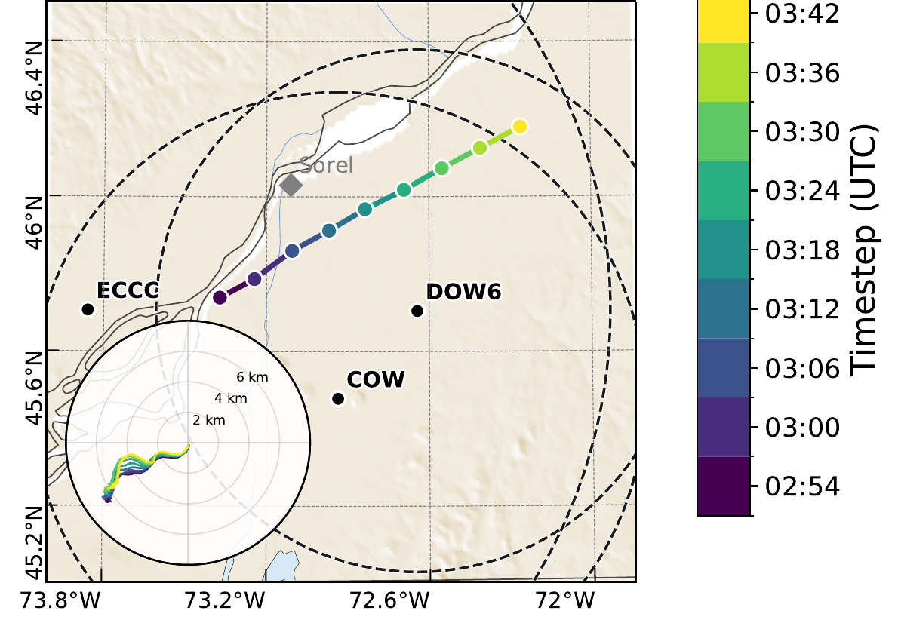<figcaption>Selected track · 02:54–03:42 UTC</figcaption></figure>
  <figure>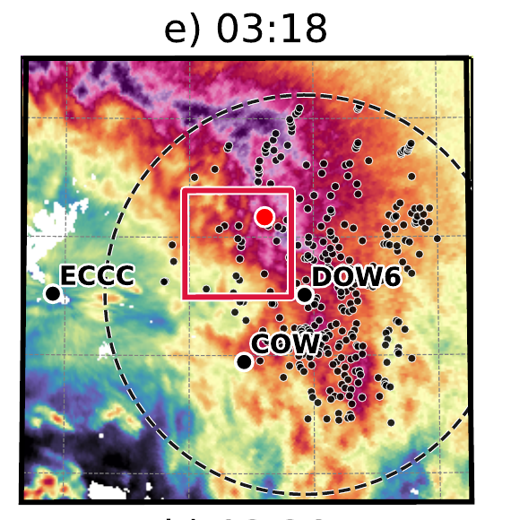<figcaption>03:18 UTC · selected cell among neighboring CTGCs</figcaption></figure>

DOW6 X band · COW C band · ECCC S band · nine synchronized volume sets at six-minute intervals.

Chapter 5 Figure 1(i) and Figure S1(e), cropped. The 2D centroid track from Paper 3 supplies the moving-grid origin.

<!--
About 40 seconds. On 23 February 2022 during WINTRE-MIX IOP05, DOW6, COW, and the ECCC Blainville radar sampled the same storm from different sites. Their X-, C-, and S-band volumes are synchronized every six minutes. The selected cell was followed at nine analysis times, 02:54–03:42 UTC, using the Paper 3 two-dimensional track. In the map, the path advances northeast; the VAD inset shows the expected southwestward direction for falling particles relative to the cell. The 03:18 ECCC panel shows that the selected red dot is one of many detected CTGCs, and the red box marks the moving analysis domain. This is one selected cell in one storm, not a sample of independent cases. COW is beyond its maximum range at the final time, so all three radars do not observe every voxel at every time. The source is Chapter 5 Figure 1(i) and supporting Figure S1(e).
-->

---
class: paper4-grid
---

# Follow the cell, not the radar

  <svg viewBox="0 0 650 380" role="img" aria-label="Schematic showing a moving 40 by 40 kilometer analysis box following three successive cell centroids and a cell-relative grid with the cell at x equals y equals zero near the upper right of a minus 30 to plus 10 kilometer domain">
    <text x="29" y="32" class="paper4-svg-heading">Ground-relative view</text>
    <path d="M60 285 L120 245 L175 214 L218 165 L268 125" class="paper4-track" />
    <rect x="39" y="134" width="175" height="175" class="paper4-previous-box" />
    <rect x="113" y="97" width="175" height="175" class="paper4-previous-box" />
    <rect x="188" y="53" width="175" height="175" class="paper4-current-box" />
    <circle cx="170" cy="178" r="8" class="paper4-previous-dot" />
    <circle cx="245" cy="141" r="8" class="paper4-previous-dot" />
    <circle cx="320" cy="97" r="9" class="paper4-current-dot" />
    <path d="M383 178 H418 M407 168 L418 178 L407 188" class="paper4-arrow" />
    <text x="427" y="32" class="paper4-svg-heading">Cell-relative grid</text>
    <rect x="432" y="62" width="180" height="180" class="paper4-current-box" />
    <path d="M477 62 V242 M522 62 V242 M567 62 V242 M432 107 H612 M432 152 H612 M432 197 H612" class="paper4-grid-lines" />
    <circle cx="567" cy="107" r="9" class="paper4-current-dot" />
    <text x="497" y="273">cell (0, 0)</text>
    <text x="442" y="296">x, y: −30 to +10 km</text>
    <text x="438" y="323">altitude: 1–9 km MSL</text>
  </svg>
  

    <section><strong>Moving origin</strong>
The grid moves with the track. The cell stays at the origin.
</section>
    <section><strong>Common volume</strong>
40 × 40 km horizontally; 1–9 km MSL at 100-m grid spacing.
</section>
    <section><strong>Three instruments</strong>
<strong>DOW6</strong> (X), <strong>COW</strong> (C), and <strong>ECCC</strong> (S), every 6 minutes.
</section>
  

Schematic of the Chapter 5 analysis coordinates; the cell is at (0, 0), not at the geometric center of the grid.

<!--
About 40 seconds. A single vertically pointing radar sees a cell only while it passes overhead, and a single scanning radar changes resolution and coverage as the cell moves. The Paper 3 centroid track gives us a moving reference: as the cell shifts in geographic coordinates, we recenter the analysis grid so the selected centroid is always x=y=0. The domain spans 40 by 40 km horizontally, with x and y running from -30 to +10 km, and 1–9 km MSL vertically on a 100-m Cartesian grid. The cell is consequently not at the middle of the square; the larger southwest extent captures its downwind fall streak. This drawing is schematic, not a source radar map. The three radars contribute where they actually sample the moving volume; COW does not cover the selected cell at the last time. Next, show how their observations enter a common anomaly field.
-->

---
class: paper4-merge
---

# Combining radar reflectivity anomalies

Each wavelength has its own reflectivity background; combine anomalies, not raw dBZ fields.

  <section>
    1<h2>Smooth and map</h2>
    
Smooth each radar in polar coordinates, map separately to the moving grid, then apply beam-weighted 500-m Cartesian smoothing.

  </section>
  <section v-click="1">
    2<h2>Subtract local background</h2>
    
For each radar, subtract its own weighted 40 × 40 × 2-km background mean from smoothed reflectivity.

  </section>
  <section v-click="2">
    3<h2>Merge where sampled</h2>
    
Combine each radar's <em>Z</em>′ using its beam weight; an unsampled voxel has zero weight.

  </section>

  
<strong>Paper 1</strong> polar smoothing + <strong>Paper 2</strong> support-weighted mean + <strong>Paper 3</strong> track → cell-relative <em>Z</em>′ (dB)

  
<em>Z</em>′ is each radar's anomaly, merged by beam weight; it is not a raw reflectivity composite or a rain rate.

<!--
About 55 seconds. Click 0: each radar's reflectivity is smoothed in polar coordinates using the earlier smoothing work, mapped separately to the cell-relative Cartesian grid with a Gaussian weight that decreases away from the radar-beam center and is zero where the beam does not sample a voxel, then smoothed at 500 m in all three Cartesian directions with those support weights. Click 1: for each radar separately, subtract a spatial weighted mean spanning the 40 by 40 km horizontal domain and 2 km vertically. The Paper 2 normalized local-statistics framework supplies that background calculation. The residual Z-prime is a reflectivity anomaly in dB, not an equivalent reflectivity in dBZ. Click 2: merge radar anomalies with the beam weights, Z-prime = sum(M_r Z-prime_r)/sum(M_r), wherever total support is positive. X, C, and S wavelengths cannot be treated as a simple blend of equivalent reflectivity because scattering and attenuation differ. The Paper 3 track supplies the origin, but Paper 3 population identification used its own smoothing and 5-dB contour procedure, not this 3D anomaly merge. The output is used to follow structure and define footprints; later precipitation rates use a separate equivalent-reflectivity composite.
-->

---
class: paper4-footprints
---

# Defining fall-streak footprints

  Layer maximum of Z′ at each time<b>→</b>Average the nine maps<b>→</b>Upper 10% in each layer

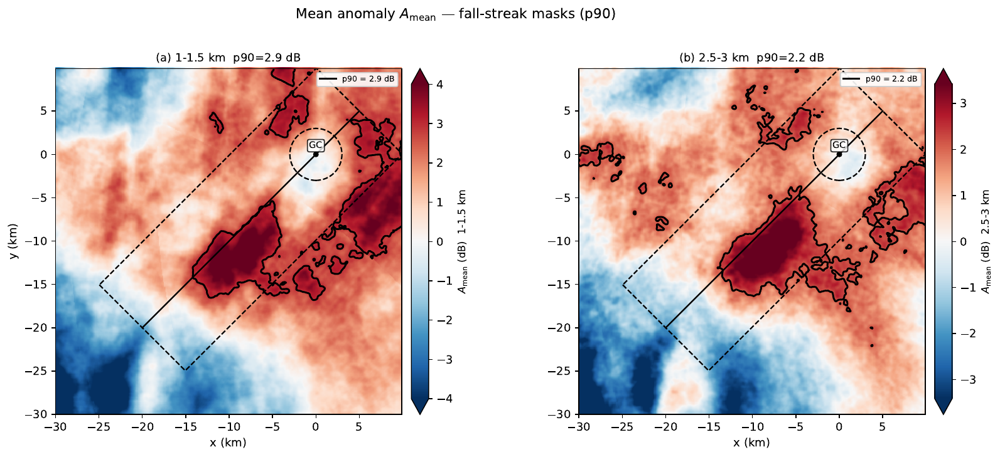

Two layer-specific footprints: <strong>rain · 1–1.5 km</strong> and <strong>snow · 2.5–3 km MSL</strong>.

Chapter 5 Figure S2. Black contours each cover 10% of the domain; they mark persistent anomalies, not the instantaneous streak at every time.

<!--
About 40 seconds. Before estimating precipitation, specify where the comparison is made. At every analysis time, take the vertical maximum of merged Z-prime in each of the two height layers. Average those nine layer-maximum maps over time, then use the top decile of each time-mean field as that layer's footprint. The left panel is 1–1.5 km, below the melting layer; the right is 2.5–3 km, above it. The black contours each occupy 10% of the horizontal domain. Their footprints lie southwest of the cell at the origin; the enhancement is not a vertical column immediately underneath it. These fixed time-mean footprints mark persistent anomaly regions, not a time-resolved segmentation of the cell's instantaneous fall streak, and do not isolate particles generated by the selected cell. Chapter 5 Figure S2; manuscript thresholds are approximately 2.9 dB low and 2.2 dB aloft. Next: rates are estimated from a different reflectivity quantity.
-->

---
class: paper4-estimation
---

# Estimating rain and snow rates

<em>Z</em>′ selects the footprints; equivalent reflectivity <em>Z</em>e supplies the rate estimates.

  <section><strong>At each place and time</strong>Maximum available <em>Z</em>e across the three radars and vertically within the analysis layer</section>
  <b>→</b>
  <section><strong>Convert and compare</strong>Use linear <em>Z</em> in each relation; spatially average estimated rates inside and outside that layer's footprint</section>

  <section>
    <h2>Snow · 2.5–3 km MSL</h2>

$$ Z = 2000 S^2 $$

<em>S</em>: liquid-equivalent snow rate, mm h−1

  </section>
  <section>
    <h2>Rain · 1–1.5 km MSL</h2>

$$ Z = 200 R^{1.6} $$

<em>R</em>: rain rate, mm h−1

  </section>

“Outside” is the rest of the domain—not a precipitation-free or CTGC-free control region.

Chapter 5 Data and Methods; Figure S3. These are radar-estimated rates within the radar-observed layers, not ground measurements or particle mass fluxes.

<!--
About 55 seconds. Separate the two reflectivity products. We used the merged Z-prime anomaly in dB to locate persistent footprints. To estimate rates, at each location and time we use the maximum available equivalent reflectivity in dBZ among the radars and vertically within that layer, forming Z_e,max. Convert that logarithmic dBZ value to linear Z before applying either empirical relation. The relation Z = 2000 S squared yields a liquid-equivalent snow rate for the 2.5–3 km layer above the melting layer; Z = 200 R to the 1.6 yields rain rate for 1–1.5 km below it. Both rates are in mm per hour. We spatially average rates inside and outside each layer's own upper-decile footprint at every analysis time and compare them; the rest of the domain is not a no-cell control. This maximum-radar composite is not the beam-weighted anomaly merge. The relations and maximum selection introduce assumptions and are not measurements at the surface. Next, show the observed 3D connection before presenting the rates.
-->

---
class: paper4-hero
clicks: 2
---

# Three-dimensional evolution of the selected cell

  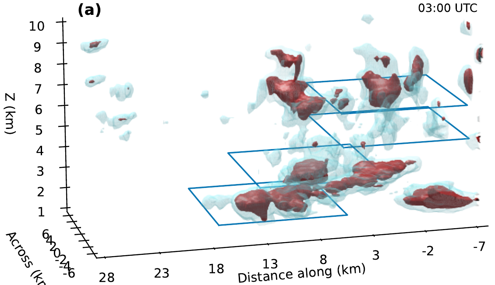
  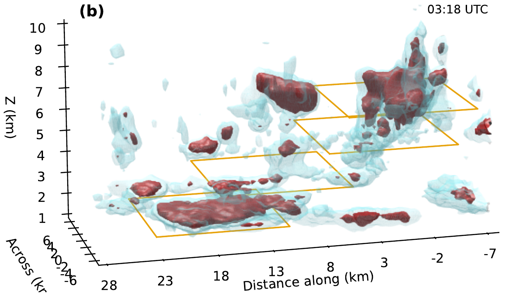
  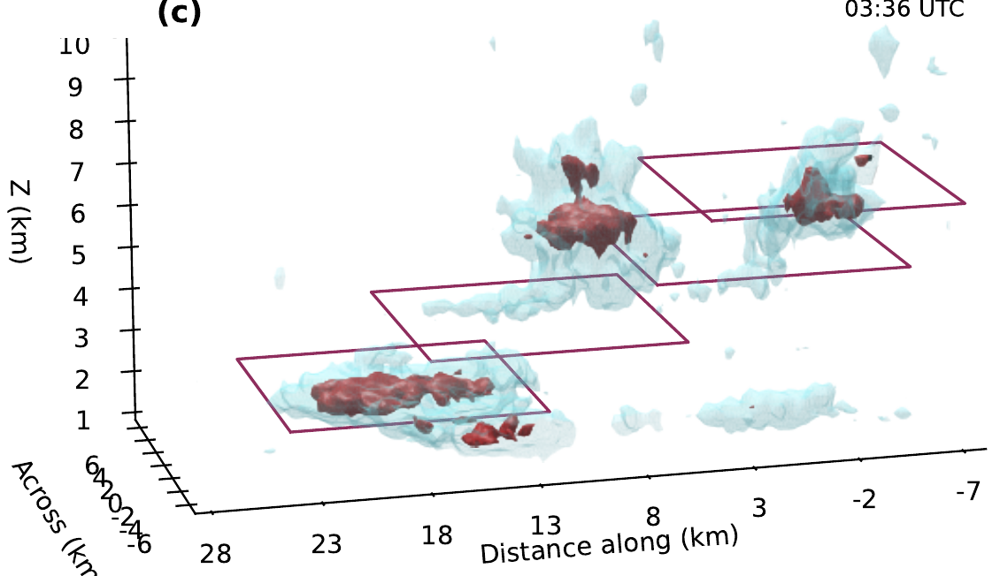

Chapter 5 Figure 2(a–c), enlarged crops. Cyan/red isosurfaces denote <em>Z</em>′ = 5/7 dB; outlined planes indicate heights. This is an anomaly field, not particle trajectories.

<!--
About 55 seconds. These are selected 3D states from the nine-time sequence, corresponding to the Madison presentation's 3D evolution. First, 03:00: the selected CTGC at cloud top coexists with neighboring cells and pre-existing precipitation lower down. Click 1, 03:18: the cloud-top cell is stronger and has joined a neighbor in a Y-shaped enhancement in the full figure; a mid-level connection becomes more prominent. Click 2, 03:36: the selected cell is weaker and more separate, while a southwestward anomaly remains in the underlying field. The cyan and red surfaces are thresholds at 5 and 7 dB in merged Z-prime; they are not literal surfaces of falling particles. The colored rectangles in the source indicate height-dependent plan-view windows. Do not describe the lower field as originating solely from this CTGC. The corresponding 6.5, 5, 3.5, and 2 km plan views remain in the full chapter figure; the cross-section on the next slide clarifies the vertical connection.
-->

---
class: paper4-cross
clicks: 2
---

# A fall streak from cloud top to below the melting layer

  

    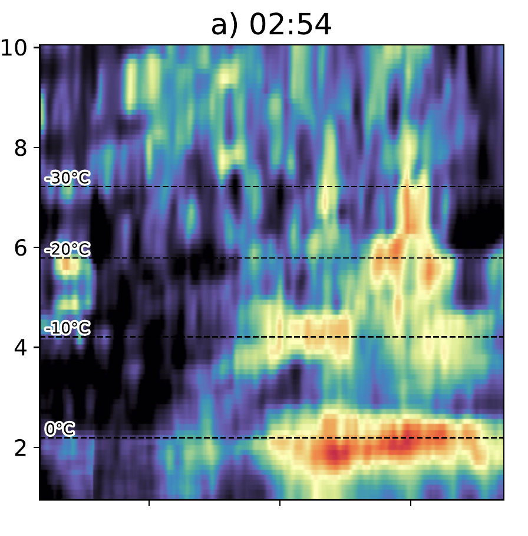
    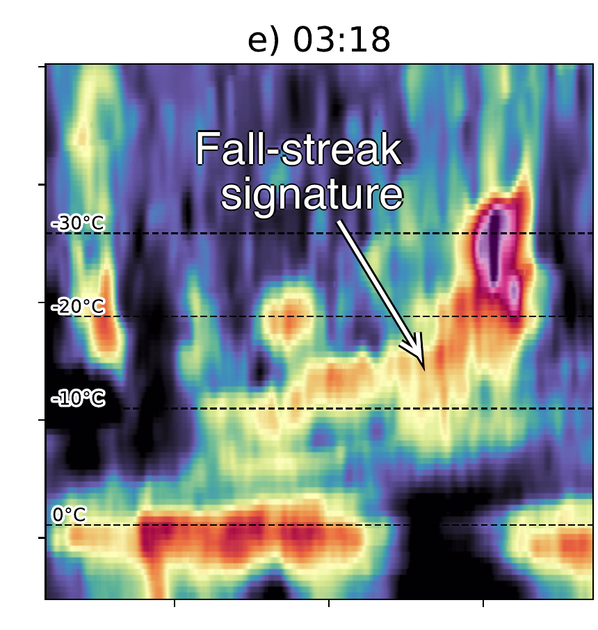
    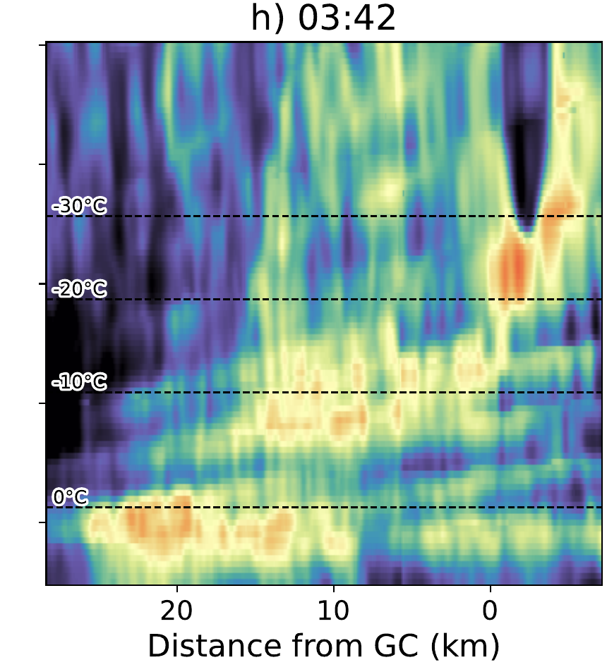
  

  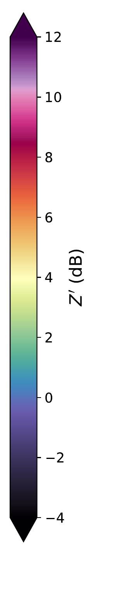

  
02:54 · pre-existing mid-cloud echoes are already present.

  
03:18 · an enhanced region connects the CTGC to the mid-cloud layer.

  
03:42 · the southwestward signature remains visible below the melting layer.

Chapter 5 Figure 3(a, e, h), enlarged. Dashed isotherms are interpolated from 02:00 and 04:15 UTC soundings; the 0 °C line marks the melting level.

<!--
About 60 seconds. These are three selected vertical cross sections along the line marked on the study maps. At 02:54, the cell's fall-streak signature is not yet clear, but mid-cloud echoes and a strong melting-layer signal are already present. Click 1: by 03:18, an enhanced Z-prime region connects the tracked cell near cloud top to precipitation around 3.5–5 km; the paper arrow identifies the fall-streak signature. Click 2: by 03:42, the southwestward signature remains visible into lower layers, including below the 0 C melting level. It becomes clearer through about 03:24–03:42, not at the first scan. The dashed temperature levels come from time interpolation between two off-track soundings, so do not over-interpret their exact height over the cell. This association is consistent with ice from the generating cell entering underlying cloud and further growth, not a direct trajectory or a measurement of the cell's exclusive precipitation contribution. The early pre-existing echo motivates the paired horizontal maps next.
-->

---
class: paper4-overlap
---

# The enhancement is not a column under the cell

  
<strong>02:54 UTC</strong> · before a distinct fall streak, north–south precipitation structures are present.

  
<strong>03:30 UTC</strong> · a southwestward enhancement overlaps the broader precipitation field.

  <figure><figcaption>3.5–5 km · <em>Z</em>′ anomaly</figcaption>
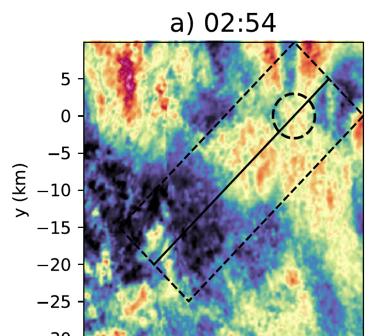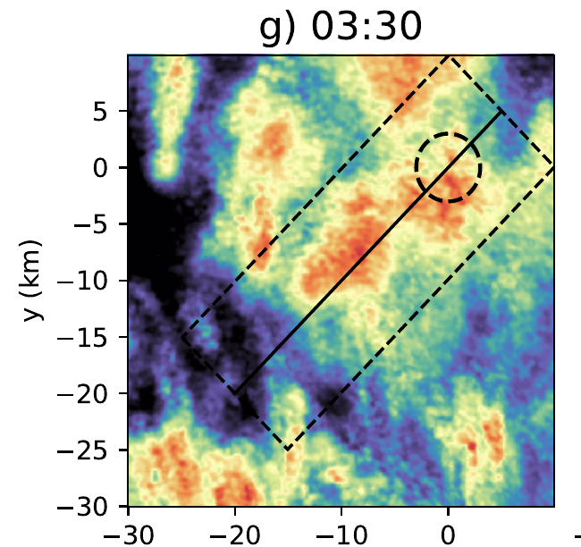
</figure>
  <figure><figcaption>1–1.5 km · <em>Z</em>e,max reflectivity</figcaption>
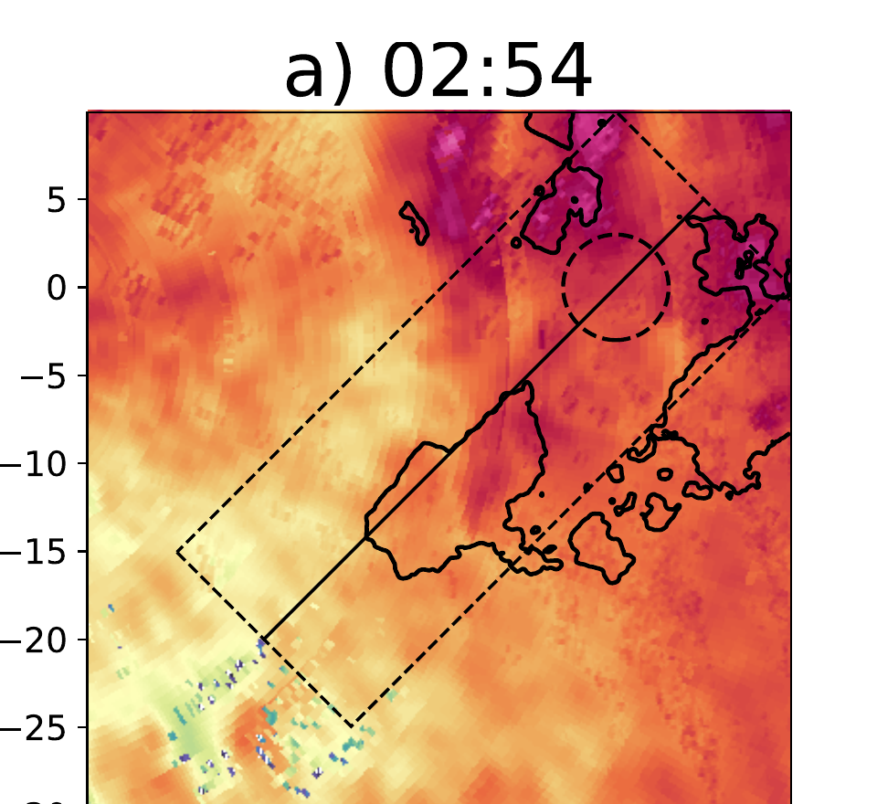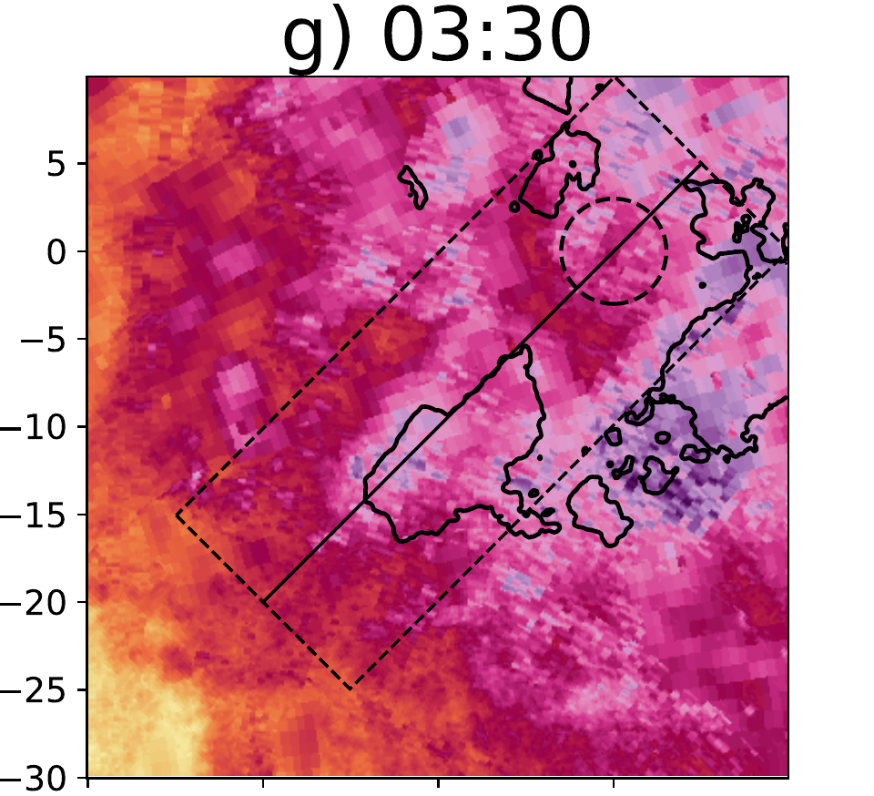
</figure>

An enhancement along the fall-streak path is consistent with feeding existing precipitation—not proof that this cell produced all echoes below.

Chapter 5 Figures 4(a, g) and 5(a, g), cropped. Cell-relative x/y maps in km; left: anomaly in dB; right: equivalent reflectivity in dBZ. Black lower-layer contours outline the time-mean footprint.

<!--
About 45 seconds. The horizontal views are aligned at the same time but display different quantities: on the left, the 3.5–5 km column-maximum Z-prime anomaly; on the right, 1–1.5 km maximum-radar equivalent reflectivity. At 02:54, north–south elongated mid-cloud structures already exist and lower-level precipitation is present; the melting-layer enhancement cannot be assigned to the selected CTGC. Click 1: at 03:30 a southwestward fall-streak signature is clearer, while the underlying precipitation field also intensifies and the original north–south organization becomes less distinct. Black contours on the right are the fixed upper-decile time-mean anomaly footprint from the earlier method slide, not instantaneous boundaries. The dashed box and line locate the analysis cross section, and the circle the cell. These images support overlap and a possible seeder–feeder interpretation, but cannot partition the lower precipitation among the tracked cell, other cells, and existing cloud. Madison emphasized this spatial overlap; the next slides quantify the rate contrast without treating it as a cell attribution.
-->

---
class: paper4-rates
---

# Estimated precipitation rates through time

  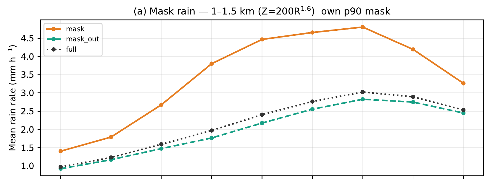
  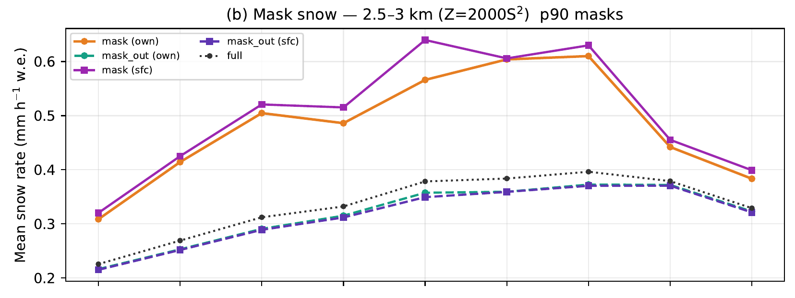

  
<strong>Rain · 1–1.5 km:</strong> 1.4 → 4.8 → 3.3 mm h−1 inside its footprint (02:54, peak 03:30, 03:42).

  
<strong>Snow · 2.5–3 km:</strong> 0.31 → 0.61 → 0.38 mm h−1 liquid equivalent inside its own footprint.

Chapter 5 Figure S3(a, b), enlarged. Orange = inside the layer's own footprint; green = outside; black = whole domain. Purple on the snow plot reuses the low-level footprint aloft and is not the main inside/outside comparison. Nine scans, every six minutes.

<!--
About 45 seconds. First show panel (a), the rain layer at 1–1.5 km MSL. Orange is the mean rate inside its own time-mean anomaly footprint; green is the remainder of the domain; black is the whole-domain mean. Estimated inside rain rate rises from 1.4 mm/h at 02:54 to 4.8 at 03:30, then falls to 3.3 at 03:42. The underlying precipitation also increases outside; this is a contrast, not an isolated cell response. Click 1: panel (b) is liquid-equivalent snow rate at 2.5–3 km, about 0.31 to 0.61 to 0.38 mm/h at those same times inside the snow layer's own footprint. The purple lines reuse the low-level footprint aloft as an alternate timing comparison; the principal inside/outside snow contrast uses orange and green. Figure S3's original legend abbreviates these as mask/own, mask_out/own, and sfc; sfc refers to the 1–1.5 km layer, not the ground. The x positions are every six minutes from 02:54 to 03:42 UTC; this crop leaves their labels off, so state the interval aloud. The overall mean contrasts follow.
-->

---
class: paper4-contrast
---

# Higher rates in the footprint — not this cell's share

  

    <section>Snow · 2.5–3 km<strong>+51%</strong>
liquid-equivalent rate
</section>
    <section>Rain · 1–1.5 km<strong>+72%</strong>
rate below the melting layer
</section>
    
Inside versus outside: snow <strong>+51%</strong>, rain <strong>+72%</strong>. Other cells and pre-existing precipitation are in both regions.

  

  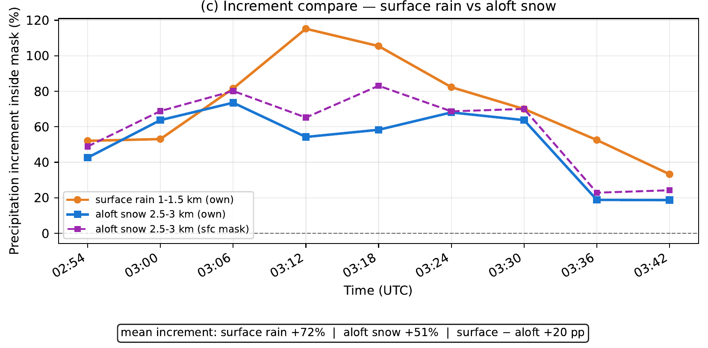

Chapter 5 Figure S3(c), enlarged. Time-mean estimated rates in each layer's own p90 footprint versus the rest of the domain; “surface” in the source figure means 1–1.5 km, not ground level.

<!--
About 55 seconds. This is the quantitative punchline, analogous to the benchmark result in Paper 1: radar-estimated liquid-equivalent snow rate averages 51% higher inside the 2.5–3 km footprint than outside; rain rate averages 72% higher inside the separate 1–1.5 km footprint. Point first to the gold numbers, then to the blue snow and orange rain time series in panel (c). The percentages summarize contrasts over the nine synchronized analyses, not the fraction of snowfall or rainfall made by this one CTGC. At 03:12 the instantaneous rain contrast is largest, about 115% (3.8 versus 1.8 mm/h), but it is not the time mean. The dashed purple curve uses the low-level footprint aloft; it does not change the headline layer-specific comparison. “Surface” in the source figure's legend means the 1–1.5 km analysis layer, not a surface rain gauge. Rates are estimates based on fixed reflectivity–rate relations, not fluxes or ground verification. As stated on the original slide: other cells and pre-existing precipitation are in both regions. Follow with the limitations before conclusions.
-->

---
class: smoothing-conclusions paper4-limits
---

# Project 4: Limitations

  <section>
One selected cell in one storm; six-minute volumes and two soundings limit temporal and thermodynamic detail.
</section>
  <section>
Time-mean footprints and reflectivity–rate relations affect the estimated precipitation contrast.
</section>
  <section>
Overlapping cells and pre-existing precipitation prevent attribution of a rate fraction to this cell alone.
</section>

<!--
About 35 seconds. This is one selected cell in one winter storm, not a population average; six-minute scans may miss faster changes. The 0 C and colder levels are interpolated from two soundings offset from the cell in space. The two footprints are fixed in time, so their upper-decile masks may not follow the instantaneous streak. The 85th-, 90th-, and 95th-percentile sensitivity test gave similar snow and rain contrasts, but that does not remove dependence on the footprint concept. The equivalent-reflectivity maximum across different radar wavelengths and two empirical Z–rate relations adds assumptions; the rates are not mass fluxes or ground observations. Critically, the comparison region outside each footprint also contains CTGC and pre-existing precipitation, and the inside footprint can contain other contributing echoes. We therefore cannot assign the 51% or 72% to the single tracked cell. Future work needs more cells, 3D winds and trajectories, and particle/cloud-liquid measurements to constrain contribution and growth.
-->

---
class: smoothing-conclusions paper4-conclusions
---

# Project 4: Conclusions

  <section>
Cell-relative multi-radar observations follow an evolving three-dimensional CTGC and fall streak.
</section>
  <section>
The southwestward signature connects with precipitation already present in the underlying cloud.
</section>
  <section>
Estimated snow and rain rates are higher in persistent-enhancement footprints, without isolating the tracked cell's contribution.
</section>

<!--
About 30 seconds. Summarize the question rather than re-delivering every figure: “Using the Paper 3 track and the methods developed in the first two papers, we built a moving three-radar view of a selected cloud-top cell. Its fall-streak anomaly connects with existing mid-cloud and lower-level precipitation. The footprints have higher estimated snow and rain rates, but those contrasts are not the amount produced by this one cell.” The measured connection is consistent with seeder–feeder growth, not direct evidence of particle trajectories. This manuscript is submitted to GRL and not yet accepted. Transition to the dissertation-level synthesis without adding a new number.
-->
