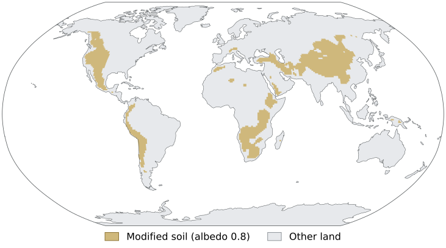
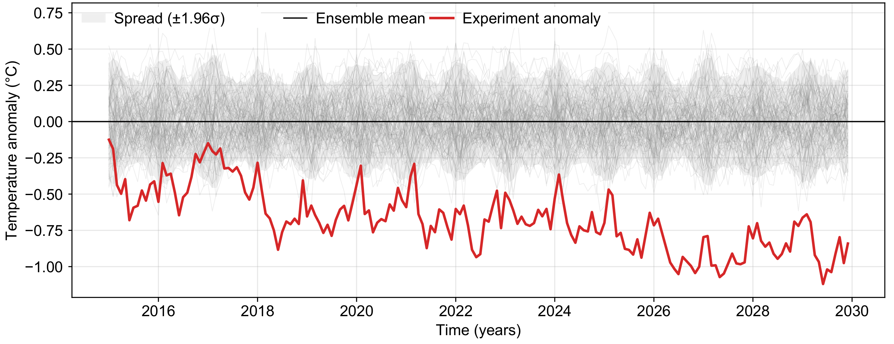
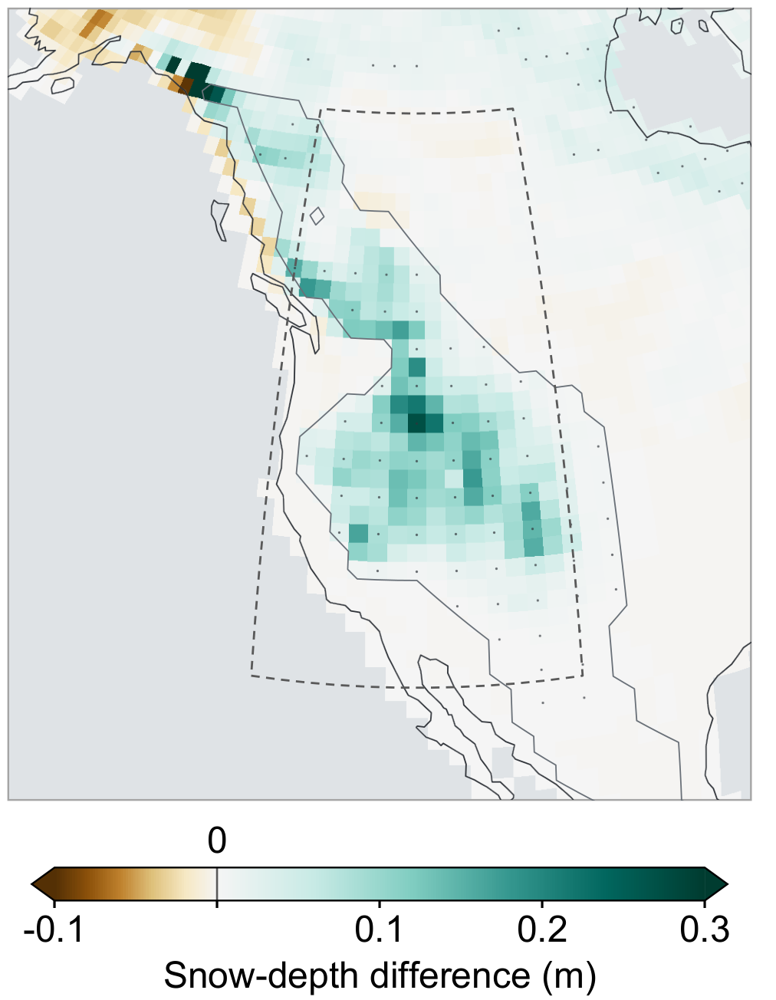
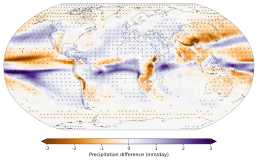

  <h1 v-click.hide="1" class="dissertation-synthesis-title">Dissertation contributions</h1>
  <DissertationSynthesis>
    <template #conclusion>
      
This dissertation developed an efficient spectral radar-processing framework and new CTGC observation techniques, characterized the population life cycle and inferred microphysical evolution, and resolved an evolving three-dimensional fall streak, providing new insight into how CTGCs enhance precipitation.

      

    </template>
  </DissertationSynthesis>

<!--
About 60–75 seconds, one click. The title is visible on entry and fades out on
the first click without shifting the diagram or changing the final frame.
Chapter 6, Summary of Key Findings, explains this integration.

Suggested delivery: “The four studies come together in the cell-relative
analysis. The smoothing and local-statistics methods supply the reflectivity
anomalies. The population study supplies the selected-cell track and its
temporal context. Together with observations from three radars, these allow
us to follow the fall streak through the surrounding precipitation field.”

Trace the two inputs separately before pointing to Paper 4. This is an
analysis-dependency diagram, not a physical pathway or a sequence in which
Papers 1–2 produced the Paper 3 population detection. The selected-cell track
defines the moving reference frame; the methods provide the anomaly fields.
Population evolution supplies context, not the radar measurements themselves.
Do not introduce new numbers or imply particle trajectories were retrieved.

[click] The title fades out as the diagram moves upward and softens while a gold
connector and compact conclusion card appear beneath it. Read the overall
contribution as one sentence:
“This dissertation developed an efficient spectral radar-processing framework and
new CTGC observation techniques, characterized the population life cycle and
inferred microphysical evolution, and resolved an evolving three-dimensional fall
streak, providing new insight into how CTGCs enhance precipitation.”

The observational scope remains one winter storm and one cell analyzed in 3D.
The animation links the studies to the overall contribution, not a physical
particle pathway or a claim that the methods directly produced population detection.

Supporting details for questions, not the timed delivery:

The method contribution is broader than this case. Paper 1 maintained an
approximately consistent physical smoothing scale across range; Paper 2
extended the framework to normalized local statistics with support and
explicit boundary assumptions. Do not treat its estimated gap values as
measurements or claim that sparse observational support creates information.
The benchmark was not a timing of the complete multi-radar volume workflow.

The 1.7-hour sequence describes collective population activity, not a typical
individual-cell lifetime. Contours can contain several turrets; fewer, larger
features support merging and clustering, not only individual-cell growth.
The early decrease and later increase in differential reflectivity are
microphysical interpretations, not unique measurements of particle habits.

The fall-streak connection is consistent with seeder–feeder growth; particle
growth along the streak and roll circulations were not directly measured.
The 51% snow and 72% rain enhancements remain in the preceding paper section.
They are spatial contrasts, not the cell's share of precipitation. Do not
repeat these numbers here or claim a measured storm-total contribution.

Transition to future work: the methods provide a way to test these observed
relationships across storms and to constrain the unresolved mechanisms.
-->

---
class: dissertation-outlook
title: Future work
---

# Future work

  <section>
Analyze more CTGC cases using the large existing dataset.
</section>
  <section>
Study microphysical evolution along fall streaks.
</section>
  <section>
Improve estimates of CTGC contributions to precipitation.
</section>

<!--
About 25–35 seconds, no clicks. These three concrete research directions
follow Chapter 6's Outlook: population and dynamics, particle growth, and
precipitation attribution. They are proposed work, not dissertation results.

Suggested delivery: “The first step is to analyze more CTGC cases using the
large dataset already available. We also want to study how particles evolve
along fall streaks. Finally, we need to improve estimates of how CTGC ice
supply changes precipitation. The observed precipitation enhancements do
not yet quantify that contribution.”

Supporting details for questions, not the timed delivery:

Apply the identification and tracking approaches to additional CTGC cases
in the existing dataset to test which aspects of the observed evolution recur.
Across-storm comparison should separate collective population duration from
individual-cell persistence. Rapid volumes, three-dimensional winds, and
more frequent soundings would help relate initiation, merging, and decay to
the environment. Shear, cloud-top cooling, moisture supply, and horizontal
convective rolls are mechanisms to test, not established causes in this case.

Particle growth along the streak remains unresolved. Spatially separated
radars view different angles, wavelengths, sampling volumes, and propagation
paths. A geometry-aware extension must consider scattering, attenuation,
calibration, and beam mismatch rather than directly merging polarimetric
values. Liquid-water and ice-particle measurements, winds, and trajectories
would provide complementary constraints; trajectories are future work here.

The attribution experiment must compare transport, growth, and precipitation
under controlled changes in CTGC ice supply. It should distinguish mass
acquired in feeder clouds from the change relative to precipitation without
the generating-cell ice. Observations should constrain and evaluate the
simulations; neither the 51% nor the 72% is already that contribution.
Keep detailed modeling references in discussion unless asked.
-->

---
class: figure-slide mountain-albedo-experiment
title: Side project
---

# Side project

Mountain albedo modification

  

    

      
0.8

      
Soil albedo

    

    

      
&gt;1,000 m

      
Elevation threshold · Globally

    

    
Vegetation unchanged

  

  

    

      
    

  

Collaborators: Jen Kay · Aneesh Subramanian · Katja Friedrich In preparation · Planned submission to GRL

<!--
About 20–30 seconds, no clicks. This is a side project, not a dissertation
chapter or a published article. Explain the experiment before showing results.
The layout follows reference PowerPoint slide 17: two large parameter labels
beside the global soil-modification map. The map itself is now generated from
the actual surface input, not the old presentation's categorical image.

The author confirmed prescribed soil albedo 0.8 and unchanged vegetation.
Gold cells are SOIL_COLOR == 21 in the experiment's actual surface dataset:
2,061 cells on its native 192 × 288 grid. Other land is a muted Natural Earth
background for geographic context, not another model variable.

The input contains no modified cell centers at or poleward of 60° latitude.
No extra latitude filter was applied when plotting: the figure shows the
assignments already present in the source file. “Globally” describes their distribution
across mountain regions, not modification of every mountain or polar region.
Full grid cells are displayed, not a subgrid land-area footprint. The 0.8
label is the prescribed soil parameter, not effective surface/canopy albedo.
The input data, original PowerPoint, and remote MAE project remain unchanged.

Collaborators are Jen Kay, Aneesh Subramanian, and Katja Friedrich. The
manuscript is in preparation, with a planned submission to Geophysical
Research Letters; it has not been submitted or accepted.
Do not carry over the reference deck's older simulation period or temperature
summary to the updated results on the next slide.
Source, data snapshot, checksums, and regeneration steps:
figures/mountain-albedo/sources.md.
-->

---
class: figure-slide mountain-albedo-results
title: 'Side project: results'
clicks: 1
---

# Side project: results

  

    

      
Global temperature

      

        
      

      
Temperature decrease: <strong>almost 1°C by 2030</strong>

    

    

      
Rocky Mountains · 2015–2029 time mean

      

        
      

      
Peak snow-depth increase: <strong>~1 foot</strong> in the Rocky Mountains

    

  

  
= 1" class="absolute inset-0 flex flex-col min-h-0 pt-3">
    

      
    

    
<strong>Precipitation patterns change globally.</strong>

  

Experiment − CESM2-LE ensemble mean

<!--
About 35–45 seconds, one click. First show cooling and local snow-depth
increases together; then explain the downside of a global precipitation
response. Keep delivery verbal rather than adding more slide text.

The temperature callout is the author's approximate summary: almost 1°C
cooling by 2030, not an exact annual-mean estimate calculated here. The gray
band is ensemble spread (±1.96 standard deviations), not uncertainty in the
ensemble mean; its source legend is corrected in the presentation image.

The author clarified that the approximately one-foot snow-depth increase
refers to peak local values, not the Rockies-wide average. One foot is
0.3048 m, consistent with the upper end of the plotted regional color scale.
The map is the 2015–2029 mean response. The source regional mean is +0.057 m;
do not describe the one-foot peak as a regional average, snow-water equivalent,
glacier mass balance, or evidence of glacier recovery.

[click] Replace both result panels and their callouts with the global
precipitation map and “Precipitation patterns change globally.” Stippling
uses |Z| ≥ 1.96 relative to ensemble spread, as confirmed by the author;
do not present it as confidence in the ensemble mean or field significance.
The revised author-supplied PDF is displayed intact as SVG, retaining its
orange–purple scale (−3 to +3 mm/day), cross markers, and original labels.
No old title crop or retyped colorbar annotations are applied to this figure.

This work remains in preparation and is separate from the publication counts
on the next slide. Transition to the other additional research contributions.
Sources and crop bounds: figures/mountain-albedo/sources.md.
-->

---
class: additional-research
title: Additional research contributions
clicks: 1
---

<AdditionalResearchBoard />

<!--
About 45–60 seconds, one click. These are additional research contributions,
not additional dissertation chapters. The opening frame keeps the counts and
three selected headers. One click starts the complete document-board animation:
the current headers spread out, the counts move to the upper-right corner,
and four additional headers enter automatically with staggered delays.
The time window and outside-dissertation scope remain in the lower-right corner.

[click] Let the roughly two-second sequence finish. All six journal articles
and the separately labeled preprint remain visible; no further reveal clicks
are needed. The next click advances to personal acknowledgments. Backing up
one click restores the opening frame. Reduced-motion playback removes the
movement and delays; overview and print-mode views show the complete board.

Suggested delivery: “Alongside the dissertation, I contributed to six other
journal articles published since 2024: two with first or shared first
authorship, and four as a co-author. These include hailstorm observations in
the Peruvian Andes, future changes in precipitation phase, and radar
ground-clutter filtering. I also co-authored a disdrometer-evaluation preprint,
which is reported separately from the published articles.”

Shared authorship: the Scientific Reports Author notes state, “These authors
contributed equally: Valeria Llactayo, Jairo Valdivia and Christian Yarleque.”
Thus the two first-author publications comprise one sole-first-author article
and one shared-first-author article, not two sole-first-author articles.

The four other co-authored publications are the Journal of Earth System Science
diurnal-cycle study (2024), the Agricultural and Forest Meteorology surface
energy/stability study (2025), the Pure and Applied Geophysics extreme-rainfall
case studies (2025), and the IEEE Access SOPHy clutter-filtering study (2026).
Do not invent specific personal roles in these collaborative studies; explain
them from your own experience if asked.

The extra preprint is Pérez-Tello et al. (2026), “Evaluation and Correction of
Precipitation Types Measured by a PARSIVEL2 Disdrometer in a Tropical Glacier
Environment,” https://doi.org/10.5194/egusphere-2026-2705. It is not counted as
a published journal article.

Exclude the four thesis studies (DCT smoothing, spectral local statistics,
CTGC population evolution, and 3D CTGC/fall-streak structure), the related
2025 AMS conference abstract, and duplicate preprint/published versions.
Inventory, DOI links, screenshot provenance, and counting rules:
figures/additional-publications/sources.md. Verified 10 October 2026.

Transition to personal acknowledgments.
-->

---
layout: none
title: Gracias a todos
subtitle: for making this possible
# One paragraph per message; keep two-space indentation and blank lines between people.
personalThanks: |
  A mi mamá, por siempre estar ahí cuando la necesito...

  To my advisor Katja, for her trust and guidance...

  To Yamina Silva, for showing me how to be a scientist...

  To my beautiful girlfriend Clairy, for being the loveliest person I ever met...

  A toda mi familia, en especial a mis tías que son como segundas mamás...

  A Jhonmer y Josep, las personas que han pasado más tiempo a mi lado...

  A todos mis amigas y amigos que compatireron sueños y experiencias conmigo
---

<ThankYouPhotos
  :title="$frontmatter.title"
  :subtitle="$frontmatter.subtitle"
  :personal-thanks="$frontmatter.personalThanks"
/>

<!--
Personal acknowledgments. All photographs in pictures/ appear around a stationary
heading and smaller subtitle, set by title and subtitle in the frontmatter above.
Background photographs expand and contract from 0.5× to 2×, gently
pushing their neighbors while remaining tethered to their home positions.
Individual photographs periodically zoom in from their current locations,
expanding inward near the edges rather than moving to fixed spotlight positions.
Every photograph is featured before the sequence repeats.

Handwritten personal thanks appear below the subtitle, one paragraph at a time
from the personalThanks frontmatter block above. Each writes on from left to
right, one line at a time over 3.2 seconds, remains fully visible for seven
seconds, and fades away before the next. Edit or add paragraphs in that block;
their order is the playback order. There is no visible play/pause button.

Moving to Questions stops both clocks. Reduced-motion, overview, and print-mode
views use the static collage and the first acknowledgment. All messages remain
available to screen readers without timed announcements.
-->

---
class: dissertation-questions
title: Questions
---

  <h1>Questions?</h1>
  
Thank you to my committee, the WINTRE-MIX participants,  and NSF awards AGS-2113995 and AGS-2114011.

<!--
Pause.

Likely questions, and where to go:

- Williams: boundary conditions, Neff, why the anomaly is not a raw composite. Backup: boundary, polar gaps, DCT comparison.
- Winters: why two bands, shear, soundings. Backup: synoptic and sounding. Do not claim rolls.
- Zaremba: sampling versus airborne volumes, overlap of the fall streak. Backup: mid-level anomaly and the nine-time context.
- Tessendorf: how general is one storm, seeder–feeder. Stay on the attribution limit.
- Friedrich: where Chapter 2 and 3 enter Chapter 5. The bridge slide is the answer.

Backup starts on the next slide.
-->
