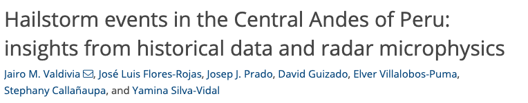
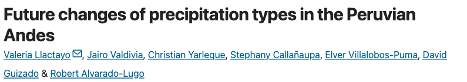
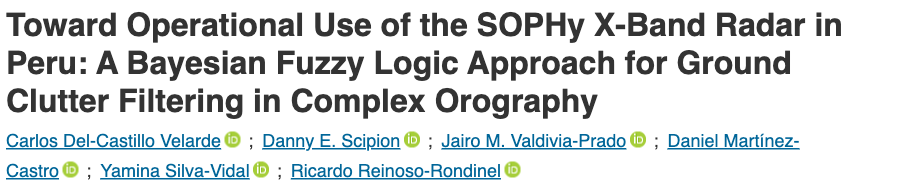

  <h1 v-click.hide="1" class="dissertation-synthesis-title">Dissertation contributions</h1>
  <DissertationSynthesis>
    <template #conclusion>
      
This dissertation developed an efficient spectral radar-processing framework and new CTGC observation techniques, characterized the population life cycle and inferred microphysical evolution, and resolved an evolving three-dimensional fall streak, providing new insight into how CTGCs enhance precipitation.

      
One winter storm; one cell analyzed in 3D.

    </template>
  </DissertationSynthesis>

<!--
About 60–75 seconds, one click. The title is visible on entry and fades out on
the first click without shifting the diagram or changing the final frame.
Chapter 6, Summary of Key Findings, explains this integration.

Suggested delivery: “The four studies come together in the cell-relative
analysis. The smoothing and local-statistics methods supply the reflectivity
anomalies. The population study supplies the selected-cell track and its
temporal context. Together with observations from three radars, these allow
us to follow the fall streak through the surrounding precipitation field.”

Trace the two inputs separately before pointing to Paper 4. This is an
analysis-dependency diagram, not a physical pathway or a sequence in which
Papers 1–2 produced the Paper 3 population detection. The selected-cell track
defines the moving reference frame; the methods provide the anomaly fields.
Population evolution supplies context, not the radar measurements themselves.
Do not introduce new numbers or imply particle trajectories were retrieved.

[click] The title fades out as the diagram moves upward and softens while a gold
connector and compact conclusion card appear beneath it. Read the overall
contribution as one sentence:
“This dissertation developed an efficient spectral radar-processing framework and
new CTGC observation techniques, characterized the population life cycle and
inferred microphysical evolution, and resolved an evolving three-dimensional fall
streak, providing new insight into how CTGCs enhance precipitation.”

The observational scope remains one winter storm and one cell analyzed in 3D.
The animation links the studies to the overall contribution, not a physical
particle pathway or a claim that the methods directly produced population detection.

Supporting details for questions, not the timed delivery:

The method contribution is broader than this case. Paper 1 maintained an
approximately consistent physical smoothing scale across range; Paper 2
extended the framework to normalized local statistics with support and
explicit boundary assumptions. Do not treat its estimated gap values as
measurements or claim that sparse observational support creates information.
The benchmark was not a timing of the complete multi-radar volume workflow.

The 1.7-hour sequence describes collective population activity, not a typical
individual-cell lifetime. Contours can contain several turrets; fewer, larger
features support merging and clustering, not only individual-cell growth.
The early decrease and later increase in differential reflectivity are
microphysical interpretations, not unique measurements of particle habits.

The fall-streak connection is consistent with seeder–feeder growth; particle
growth along the streak and roll circulations were not directly measured.
The 51% snow and 72% rain enhancements remain in the preceding paper section.
They are spatial contrasts, not the cell's share of precipitation. Do not
repeat these numbers here or claim a measured storm-total contribution.

Transition to future work: the methods provide a way to test these observed
relationships across storms and to constrain the unresolved mechanisms.
-->

---
class: dissertation-outlook
title: Future work
---

# Future work

  <section>
Compare population evolution across storms  using faster scans and improved environmental sampling.
</section>
  <section>
Constrain growth along fall streaks using three-dimensional winds, liquid-water and particle measurements, and geometry-aware polarimetric analysis.
</section>
  <section>
Use observation-constrained simulations with and without CTGC ice supply  to estimate its effect on precipitation.
</section>

<!--
About 50–55 seconds, no clicks. These three concrete research directions
follow Chapter 6's Outlook: population and dynamics, particle growth, and
precipitation attribution. They are proposed work, not dissertation results.

Suggested delivery: “The next step is to test which aspects of this evolution
recur across storms, with faster radar scans and better sampling of the
environment. We also need winds, liquid water, and particle measurements to
constrain growth along the fall streak. Finally, observation-constrained
simulations with and without the CTGC ice supply can estimate how that supply
changes precipitation, rather than treating an observed rate contrast as a
contribution estimate.”

Supporting details for questions, not the timed delivery:

Across-storm comparison should separate collective population duration from
individual-cell persistence. Rapid volumes, three-dimensional winds, and
more frequent soundings would help relate initiation, merging, and decay to
the environment. Shear, cloud-top cooling, moisture supply, and horizontal
convective rolls are mechanisms to test, not established causes in this case.

Particle growth along the streak remains unresolved. Spatially separated
radars view different angles, wavelengths, sampling volumes, and propagation
paths. A geometry-aware extension must consider scattering, attenuation,
calibration, and beam mismatch rather than directly merging polarimetric
values. Liquid-water and ice-particle measurements, winds, and trajectories
would provide complementary constraints; trajectories are future work here.

The attribution experiment must compare transport, growth, and precipitation
under controlled changes in CTGC ice supply. It should distinguish mass
acquired in feeder clouds from the change relative to precipitation without
the generating-cell ice. Observations should constrain and evaluate the
simulations; neither the 51% nor the 72% is already that contribution.
Keep detailed modeling references in discussion unless asked.
-->

---
class: additional-research
title: Additional research contributions
---

# Additional research contributions

2024–2026 · Outside this dissertationSelected journal-page headers

  

    
6 published journal articles

    

      <strong>2</strong>
      First-author publications
      <small>Including 1 shared first authorship</small>
    

    

      <strong>4</strong>
      Other co-authored publications
    

    
<a href="https://doi.org/10.5194/egusphere-2026-2705" target="_blank" rel="noopener noreferrer"><strong>+1</strong> co-authored preprint</a>

  

  

    <figure>
      <figcaption>Atmospheric Measurement Techniques · 2024First author</figcaption>
      <a class="additional-research-header" href="https://amt.copernicus.org/articles/17/2295/2024/" target="_blank" rel="noopener noreferrer">
        
        <svg viewBox="0 0 764 150" aria-hidden="true"><rect x="4" y="95.5" width="114.4" height="24.5" rx="2" /></svg>
      </a>
    </figure>
    <figure>
      <figcaption>Scientific Reports · 2024Shared first author</figcaption>
      <a class="additional-research-header" href="https://www.nature.com/articles/s41598-024-71840-2" target="_blank" rel="noopener noreferrer">
        
        <svg viewBox="0 0 795 141" aria-hidden="true"><rect x="146.2" y="82" width="98.9" height="23" rx="2" /></svg>
      </a>
    </figure>
    <figure>
      <figcaption>IEEE Access · 2026Co-author</figcaption>
      <a class="additional-research-header" href="https://ieeexplore.ieee.org/document/11595539" target="_blank" rel="noopener noreferrer">
        
        <svg viewBox="0 0 900 192" aria-hidden="true"><rect x="439.6" y="128.5" width="188.8" height="24.5" rx="2" /></svg>
      </a>
    </figure>
  

<!--
About 45–60 seconds, no clicks. These are additional research contributions,
not additional dissertation chapters. The three publisher headers are selected
examples, not the complete list counted on the left.

Suggested delivery: “Alongside the dissertation, I contributed to six other
journal articles published since 2024: two with first or shared first
authorship, and four as a co-author. These include hailstorm observations in
the Peruvian Andes, future changes in precipitation phase, and radar
ground-clutter filtering. I also co-authored a disdrometer-evaluation preprint,
which is reported separately from the published articles.”

Shared authorship: the Scientific Reports Author notes state, “These authors
contributed equally: Valeria Llactayo, Jairo Valdivia and Christian Yarleque.”
Thus the two first-author publications comprise one sole-first-author article
and one shared-first-author article, not two sole-first-author articles.

The four other co-authored publications are the Journal of Earth System Science
diurnal-cycle study (2024), the Agricultural and Forest Meteorology surface
energy/stability study (2025), the Pure and Applied Geophysics extreme-rainfall
case studies (2025), and the IEEE Access SOPHy clutter-filtering study (2026).
Do not invent specific personal roles in these collaborative studies; explain
them from your own experience if asked.

The extra preprint is Pérez-Tello et al. (2026), “Evaluation and Correction of
Precipitation Types Measured by a PARSIVEL2 Disdrometer in a Tropical Glacier
Environment,” https://doi.org/10.5194/egusphere-2026-2705. It is not counted as
a published journal article.

Exclude the four thesis studies (DCT smoothing, spectral local statistics,
CTGC population evolution, and 3D CTGC/fall-streak structure), the related
2025 AMS conference abstract, and duplicate preprint/published versions.
Inventory, DOI links, screenshot provenance, and counting rules:
figures/additional-publications/sources.md. Verified 10 October 2026.

Transition to personal acknowledgments.
-->

---
layout: none
title: Thank you
---

<ThankYouPhotos />

<!--
Personal acknowledgments. All photographs in pictures/ appear around a stationary
“Thank you.” Background photographs expand and contract from 0.5× to 2×, gently
pushing their neighbors while remaining tethered to their home positions.
Individual photographs periodically zoom in from their current locations,
expanding inward near the edges rather than moving to fixed spotlight positions.
Every photograph is featured before the sequence repeats.

Move the pointer to reveal Pause below the heading, or reach it with Tab, to hold
the current photographs while speaking. Use Resume to continue. Moving to
Questions stops the animation. Reduced-motion,
overview, and print/export views use the static collage.
-->

---
class: dissertation-questions
title: Questions
---

  <h1>Questions</h1>
  
Thank you to the committee, the WINTRE-MIX participants,  and NSF awards AGS-2113995 and AGS-2114011.

<!--
Pause.

Likely questions, and where to go:

- Williams: boundary conditions, Neff, why the anomaly is not a raw composite. Backup: boundary, polar gaps, DCT comparison.
- Winters: why two bands, shear, soundings. Backup: synoptic and sounding. Do not claim rolls.
- Zaremba: sampling versus airborne volumes, overlap of the fall streak. Backup: mid-level anomaly and the nine-time context.
- Tessendorf: how general is one storm, seeder–feeder. Stay on the attribution limit.
- Friedrich: where Chapter 2 and 3 enter Chapter 5. The bridge slide is the answer.

Backup starts on the next slide.
-->
