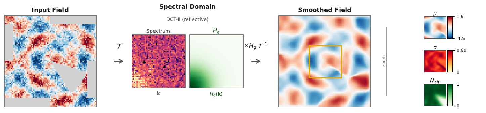
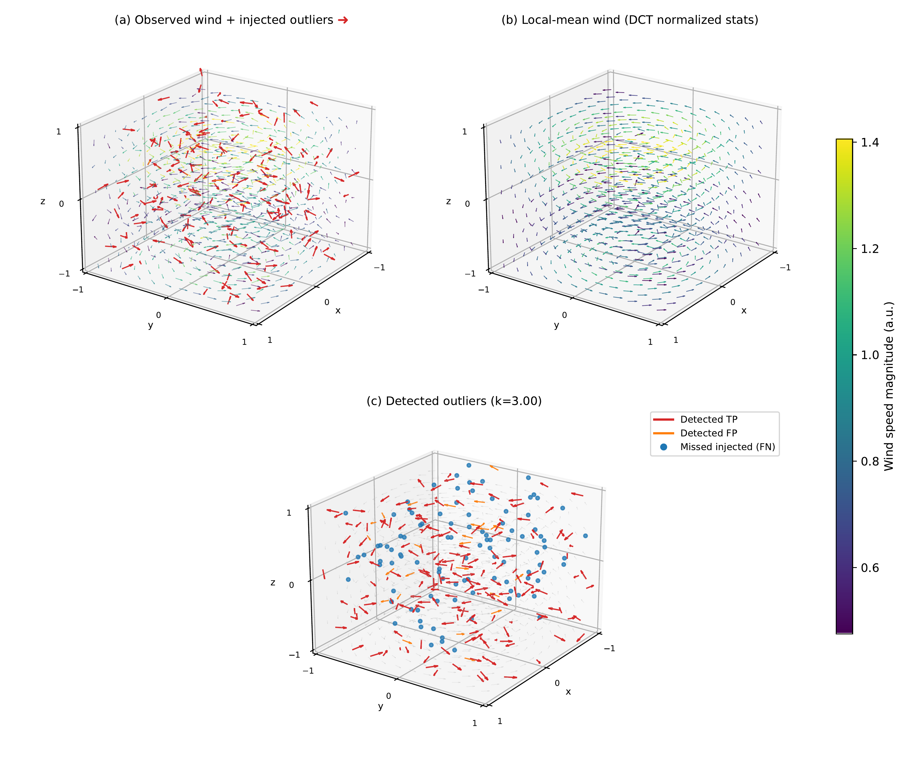
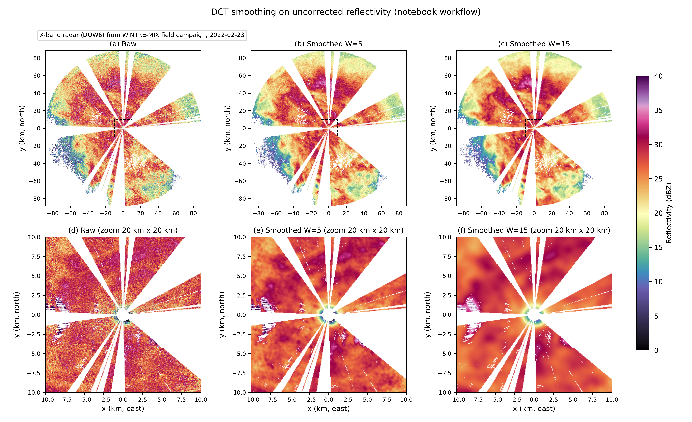

  
Paper 2 · Local statistics

  <h1>Spectral-Domain Local Statistics with Missing-Data Support</h1>
  <h2>For Cartesian and Polar Grids</h2>
  

    
<strong>Jairo M. Valdivia-Prado</strong>

    
Coauthors: Will Chapman · Katja Friedrich

  

  
Department of Atmospheric and Oceanic Sciences · University of Colorado Boulder

  
Under review at <em>Computers &amp; Geosciences</em> · Preprint arXiv:2604.22721 · doi:10.48550/arXiv.2604.22721

<!--
About 20 seconds. This is the second of four paper talks. Name the paper and its status once: under review at Computers and Geosciences, with an arXiv preprint. Do not call it published. Credit Will Chapman and Katja Friedrich. Handoff from Paper 1: Paper 1 gave a fast way to smooth radar data with a kernel average, but gaps were filled before filtering and those filled values then entered the average. Paper 2 asks whether that average can use valid observations directly and account for missing data.
-->

---
class: local-math
---

# Local statistics on incomplete grids

Smoothing uses a kernel average, but filled gaps contribute to that average.

<svg class="local-kernel-svg" viewBox="0 0 140 132" role="img" aria-label="Illustrative kernel neighborhood with valid, missing, and excluded observations">
  <rect x="14" y="10" width="112" height="112" rx="4" fill="none" stroke="currentColor" stroke-width="1.2" opacity="0.6" />
  <g>
    <rect x="22" y="18" width="18" height="18" class="k-valid" />
    <rect x="42" y="18" width="18" height="18" class="k-valid" />
    <rect x="62" y="18" width="18" height="18" class="k-missing" />
    <rect x="82" y="18" width="18" height="18" class="k-valid" />
    <rect x="102" y="18" width="18" height="18" class="k-valid" />
    <rect x="22" y="38" width="18" height="18" class="k-valid" />
    <rect x="42" y="38" width="18" height="18" class="k-excluded" />
    <rect x="62" y="38" width="18" height="18" class="k-valid" />
    <rect x="82" y="38" width="18" height="18" class="k-valid" />
    <rect x="102" y="38" width="18" height="18" class="k-missing" />
    <rect x="22" y="58" width="18" height="18" class="k-valid" />
    <rect x="42" y="58" width="18" height="18" class="k-valid" />
    <rect x="62" y="58" width="18" height="18" class="k-center" />
    <rect x="82" y="58" width="18" height="18" class="k-valid" />
    <rect x="102" y="58" width="18" height="18" class="k-valid" />
    <rect x="22" y="78" width="18" height="18" class="k-missing" />
    <rect x="42" y="78" width="18" height="18" class="k-valid" />
    <rect x="62" y="78" width="18" height="18" class="k-valid" />
    <rect x="82" y="78" width="18" height="18" class="k-excluded" />
    <rect x="102" y="78" width="18" height="18" class="k-valid" />
    <rect x="22" y="98" width="18" height="18" class="k-valid" />
    <rect x="42" y="98" width="18" height="18" class="k-valid" />
    <rect x="62" y="98" width="18" height="18" class="k-valid" />
    <rect x="82" y="98" width="18" height="18" class="k-valid" />
    <rect x="102" y="98" width="18" height="18" class="k-valid" />
    <line x1="46" y1="42" x2="56" y2="52" class="k-cross" />
    <line x1="56" y1="42" x2="46" y2="52" class="k-cross" />
    <line x1="86" y1="82" x2="96" y2="92" class="k-cross" />
    <line x1="96" y1="82" x2="86" y2="92" class="k-cross" />
  </g>
  <circle cx="71" cy="67" r="3.2" class="k-target" />
</svg>
<ul class="local-kernel-legend">
  <li>Valid observation</li>
  <li>Missing gate</li>
  <li>×Suspicious, masked</li>
</ul>

<section class="local-math-card">
<h2>Use valid observations</h2>

Missing gates and excluded values carry zero weight inside the kernel.

</section>
<section class="local-math-card">
<h2>Estimate mean and spread</h2>

Local average plus variance, standard deviation, and available support.

</section>
<section class="local-math-card">
<h2>Generalize the grid</h2>

Polar and Cartesian forms, extended to N-dimensional arrays.

</section>

How can the kernel average use retained values only, while also reporting variability, and suitable boundaries?

<!--
About 55 seconds. Paper 1 smooths with a kernel-weighted average, but gaps are filled before filtering and those filled values then contribute to the average. Once we are computing a local average, we can also compute variance and standard deviation to describe spread within the same neighborhood, and extend the method beyond a two-dimensional polar scan to Cartesian and N-dimensional grids. The problem is that inside the kernel some locations are missing and others were excluded by quality control as suspicious. We want local statistics from retained values, a measure of available support, and boundary handling suited to each grid. Normalized convolution is the established foundation; the spectral integration and safeguards are the extension.
-->

---
class: local-math local-mask
---

# Extending spectral smoothing to local statistics

Retain the spectral filter; normalize by available support.

<section class="local-flow-box">
<h2>Masked values</h2>

Keep retained values, zero elsewhere.

$$
x \cdot m
$$
</section>
+
<section class="local-flow-box">
<h2>Mask</h2>

Record where data contribute.

$$
m
$$
</section>
→
<section class="local-flow-box">
<h2>Filter both, then divide</h2>

Same spectral operator throughout.

$$
\mu = \mathcal{S}_g\{x \cdot m\} / \mathcal{S}_g\{m\}
$$
</section>

<section class="local-math-card">
<h2>Extended statistics</h2>
<svg class="local-card-illustration" viewBox="0 0 220 82" role="img" aria-label="Observed and missing samples produce a local mean, spread, and available-support indicator">
  <line class="diagram-axis" x1="12" y1="61" x2="94" y2="61" />
  <g class="diagram-stem">
    <line x1="22" y1="38" x2="22" y2="61" />
    <line x1="40" y1="20" x2="40" y2="61" />
    <line x1="58" y1="30" x2="58" y2="61" />
    <line x1="76" y1="48" x2="76" y2="61" />
  </g>
  <g class="diagram-observed-dot">
    <circle cx="22" cy="38" r="4" />
    <circle cx="40" cy="20" r="4" />
    <circle cx="58" cy="30" r="4" />
    <circle cx="76" cy="48" r="4" />
  </g>
  <circle class="diagram-missing-dot" cx="90" cy="39" r="4" />
  <path class="diagram-arrow" d="M101 39h18m-6-6 6 6-6 6" />
  <path class="diagram-spread" d="M135 27v21m0-10h57m0-11v21" />
  <circle class="diagram-estimate-dot" cx="164" cy="38" r="5" />
  <g class="diagram-support">
    <circle cx="140" cy="63" r="3" />
    <circle cx="154" cy="63" r="3" />
    <circle cx="168" cy="63" r="3" />
    <circle cx="182" cy="63" r="3" />
  </g>
  <circle class="diagram-missing-dot" cx="196" cy="63" r="3" />
</svg>

Repeat for squared values to obtain the second moment, variance, and standard deviation.

</section>
<section class="local-math-card">
<h2>Explicit boundaries</h2>
<svg class="local-card-illustration" viewBox="0 0 240 82" role="img" aria-label="Left: a signal reflects at a mirrored boundary. Right: the signal wraps from the end back to the beginning at a periodic boundary">
  <path class="diagram-boundary-data" d="M18 55 36 25 54 43 66 43m78 12 18-30 18 18 12 0" />
  <path class="diagram-mirror" d="M65 13v62m4-62v62" />
  <path class="diagram-boundary-copy" d="M68 43 80 43 98 25 116 55 M128 43 140 43 M196 55 214 25 232 43" />
  <path class="diagram-periodic-seam" d="M142 20v53m52-53v53" />

</svg>

DCT for reflective axes; RFFT for periodic axes such as full-circle azimuth.

</section>
<section class="local-math-card">
<h2>Gap filling</h2>
<svg class="local-card-illustration" viewBox="0 0 220 82" role="img" aria-label="A missing cell is estimated from neighboring observations, with the filled value distinguished from observations">
  <g class="diagram-observed-cell">
    <rect x="26" y="12" width="16" height="16" /><rect x="46" y="12" width="16" height="16" /><rect x="66" y="12" width="16" height="16" />
    <rect x="26" y="32" width="16" height="16" /><rect x="66" y="32" width="16" height="16" />
    <rect x="26" y="52" width="16" height="16" /><rect x="46" y="52" width="16" height="16" /><rect x="66" y="52" width="16" height="16" />
    <rect x="140" y="12" width="16" height="16" /><rect x="160" y="12" width="16" height="16" /><rect x="180" y="12" width="16" height="16" />
    <rect x="140" y="32" width="16" height="16" /><rect x="180" y="32" width="16" height="16" />
    <rect x="140" y="52" width="16" height="16" /><rect x="160" y="52" width="16" height="16" /><rect x="180" y="52" width="16" height="16" />
  </g>
  <rect class="diagram-missing-cell" x="46" y="32" width="16" height="16" />
  <path class="diagram-arrow" d="M98 40h29m-7-7 7 7-7 7" />
  <rect class="diagram-estimated-cell" x="160" y="32" width="16" height="16" />
</svg>

Missing data can be filled with the mean where support is insufficient.

</section>

<!--
About 60 seconds. We use the same spectral convolution. To exclude missing or suspicious values we build a mask and perform normalized convolution: filter the masked data and the mask, then divide by the filtered mask so excluded locations carry zero weight. Applying the same procedure to squared values gives the second moment, hence variance and standard deviation. For boundaries we use RFFT where periodic behavior is wanted and DCT where reflective behavior is wanted; this distinction is particularly useful on Cartesian grids. The same local mean can also estimate missing values if a downstream operation needs a complete field—for example, a dual-Doppler wind retrieval. That is a use case, not a validation in this paper. Where neighbors provide support, use the normalized mean; where support is insufficient, iterative smoothing and nearest completion provide the prefilled-field fallback. Filled cells do not become observations: the original mask still records support. The workflow and the estimators follow.
-->

---
class: local-math local-workflow
---

# Spectral local-statistics workflow

One operator applied to values, squared values, and mask.

  

Reflective Cartesian (DCT-II) 2D example with missing values in gray; zoomed inset shows μ, σ, and Neff. The same spectral operator filters masked values, squared values, and mask before normalization. N-dimensional Cartesian and polar forms follow.

<!--
About 45 seconds. Putting these pieces together gives this workflow. We apply spectral filtering to the masked values, their squares, and the mask. From those filtered fields we obtain the local mean, standard deviation, and effective support. The figure is a two-dimensional reflective Cartesian example with DCT-II and a Gaussian response; missing values are gray. The framework also covers N-dimensional Cartesian arrays and polar grids with mixed boundaries. Relative to the prior DCT smoothing work, this generalizes mean-only interpolation-first smoothing by deriving normalized statistics beyond the mean, unifying Cartesian and polar forms under explicit boundary modes, formalizing stability and support diagnostics, and adding threshold-based 3D outlier validation. Next: the estimators in equation form.
-->

---
class: local-math
---

# Local mean, variance, and support

One shared denominator from the filtered mask.

Data density

$$
\rho = \mathcal{S}_g\{m\}
$$

Mean

$$
\mu = \mathcal{S}_g\{x \cdot m\} / \rho
$$

Variance, std

$$
\sigma^2 = \mathcal{S}_g\{x^2 \cdot m\} / \rho - \mu^2, \quad \sigma = \sqrt{\sigma^2}
$$

Effective number

$$
N_{\mathrm{eff}} = A\,\rho
$$

Area

$$
A = \prod_d W_d, \quad A_{\mathrm{polar}}(r) = W_{\mathrm{range}} \cdot W_{\mathrm{az,grid}}(r)
$$

<!--
About 80 seconds. x is the observed field and m is 1 where retained, 0 where missing or excluded. S_g is the spectral smoothing operator: transform, multiply by H_g, invert. The filtered mask ρ is the shared denominator: normalizing the filtered values gives the mean, and normalizing the filtered squared values gives the second moment for variance and standard deviation. The same denominator measures available support through N_eff: ρ is the retained fraction, and A is the nominal window area — the product of axis widths on Cartesian grids, range-dependent on polar grids — so N_eff reads as the effective number of contributing grid cells. Zero placeholders never enter as zero-valued observations because the denominator removes their weight. The prefilled-field fallback applies only where ρ is below epsilon; screening weakly supported estimates is a separate analysis choice. Next: how the spectral operator implements boundaries.
-->

---
class: local-math
---

# Boundary conditions are part of the transform

The choice of transform is also a boundary model for Sg.

$$
\mathcal{S}_g\{f\} = \mathcal{T}^{-1}\{\mathcal{T}\{f\} \cdot H_g\}
$$

  <section class="local-math-card">
    <h2>Reflective (DCT-II)</h2>
    <svg class="local-boundary-svg" viewBox="0 0 300 70" aria-hidden="true">
      <line x1="10" y1="56" x2="290" y2="56" stroke="currentColor" stroke-width="1.2" opacity="0.6" />
      <rect class="ext" x="70" y="37" width="16" height="18" />
      <rect class="ext" x="90" y="43" width="16" height="12" />
      <rect class="orig" x="110" y="43" width="16" height="12" />
      <rect class="orig" x="130" y="37" width="16" height="18" />
      <rect class="orig" x="150" y="31" width="16" height="24" />
      <rect class="orig" x="170" y="25" width="16" height="30" />
      <rect class="orig" x="190" y="19" width="16" height="36" />
      <rect class="orig" x="210" y="13" width="16" height="42" />
      <rect class="ext" x="230" y="13" width="16" height="42" />
      <rect class="ext" x="250" y="19" width="16" height="36" />
    </svg>
    
Mirror at the ends. Finite axes.

$$
\omega_k = \pi k / n
$$

  </section>
  <section class="local-math-card">
    <h2>Periodic (RFFT)</h2>
    <svg class="local-boundary-svg" viewBox="0 0 300 70" aria-hidden="true">
      <line x1="10" y1="56" x2="290" y2="56" stroke="currentColor" stroke-width="1.2" opacity="0.6" />
      <rect class="ext" x="70" y="19" width="16" height="36" />
      <rect class="ext" x="90" y="13" width="16" height="42" />
      <rect class="orig" x="110" y="43" width="16" height="12" />
      <rect class="orig" x="130" y="37" width="16" height="18" />
      <rect class="orig" x="150" y="31" width="16" height="24" />
      <rect class="orig" x="170" y="25" width="16" height="30" />
      <rect class="orig" x="190" y="19" width="16" height="36" />
      <rect class="orig" x="210" y="13" width="16" height="42" />
      <rect class="ext" x="230" y="43" width="16" height="12" />
      <rect class="ext" x="250" y="37" width="16" height="18" />
    </svg>
    
Repeat end to start. Circular azimuth.

$$
\omega_k = 2\pi k / n
$$

  </section>

Gaussian example: Hg[k] = exp[−½(sωk)²], s = W/√12. Same form, different grid. Boxcar and discrete boxcar are also implemented.

<!--
About 60 seconds. Read the center equation as: S sub g of f equals the inverse transform of the transform of f, times H sub g. S_g is the spectral smoother, T is the forward transform, and H_g is the kernel response. The same operator applies to data, mask, squared data, or a prefilled field; it is not itself a local mean. The transform is also the boundary model: DCT-II, read D C T two, means half-sample symmetric reflective extension; RFFT means periodic extension. The bars are schematic: gold is the finite signal of n samples, muted bars the assumed continuation — mirrored at the edges on the left, wrapped end to start on the right. Below, omega sub k equals pi k over n is the DCT frequency grid, and two pi k over n is the periodic grid; k indexes frequency, n counts samples. The Gaussian response H sub g of k is e to the minus one-half s omega sub k squared, with s equals W over root twelve linking s to the window width W. Same functional form, different grid. Next: does the boundary choice matter in practice?
-->

---
class: figure-slide
---

# Boundary treatment changes the edges

Edge RMSE over the first and last W samples: 0.38 reflective versus 2.52 periodic.

  

1D non-periodic signal, N = 200, W = 15 Gaussian, mean over 5 seeds. All-domain RMSE 0.28 versus 1.00. Dashed boxes mark the edge regions.

<!--
About 45 seconds. A 1D non-periodic synthetic signal with trend plus Gaussian noise, matched W = 15 Gaussian kernel, 5 seeds. Reflective DCT follows local trend continuity; periodic treatment pulls the edges toward the opposite end. All-domain RMSE is about 0.28 reflective versus 1.00 periodic; edge-only RMSE over the first and last W samples is about 0.38 versus 2.52. This is a boundary-model check, not a general accuracy claim. Transition from boundaries to dimensionality.
-->

---
class: local-math
---

# Cartesian filtering in N dimensions

One field, filtered along each axis in turn.

$$
H_D(k_1,\ldots,k_D) = \prod_{d=1}^{D} H_d(k_d), \quad \mathcal{S}^{(D)} = \mathcal{S}_D \circ \cdots \circ \mathcal{S}_1
$$

  
Pass 1 filter the volume along x

  →
  
Pass 2 filter the same volume along y

  →
  
Pass 3 filter the same volume along z

Each axis keeps its own width; the 3D wind test uses (3, 7, 7). Apply the full operator to x·m, x²·m, and m, then form ratios. Do not average separately normalized intermediates.

<!--
About 40 seconds. For Cartesian D-dimensional smoothing, the transfer function is the product of axis transfer functions. Implementation reduces the operation to sequential 1D spectral multiplications while preserving spectral efficiency for large windows. Each dimension keeps its own width; the cyclone-wind validation uses windows (3, 7, 7). Apply the full multidimensional operator to the masked field, masked squares, and mask, then form the normalized moments. Normalization follows the complete filtering operation. Next: the same idea with mixed boundaries on a polar grid.
-->

---
class: smoothing-polar-dct
---

# Polar filtering with mixed boundaries

Apply the separable filter to the two dimensions of the polar field, X(θ, r).

<section class="polar-dct-pass">

## 1 · Azimuth pass — range-dependent width

$$
Y_{\mathrm{az}} = \operatorname{IRFFT}\!\left[\operatorname{RFFT}(X) \odot H_{\mathrm{az}}\right]
$$

At each range index, the grid width follows $W_{\mathrm{az,grid}}(r) = W_{\mathrm{azimuth}}/(r\Delta\theta)$.

</section>

<section class="polar-dct-pass">

## 2 · Range pass — fixed reflective width

$$
Y = \operatorname{IDCT}_{r}\!\left[\operatorname{DCT}_{r}(Y_{\mathrm{az}}) \odot H_{r}\right]
$$

At each angle, multiply range coefficients by the same fixed-width response.

</section>

Full-circle: periodic azimuth with reflective range; partial-sector: reflective azimuth. Here r is the range index and Δθ is azimuth spacing. The azimuth response is range-dependent, so the intermediate field is required.

<!--
About 50 seconds. Polar arrays are indexed as azimuth by range. To hold physical azimuth width approximately fixed, the kernel width in grid units is W_az,grid(r) = W_azimuth / (r delta-theta), where r is the 1-based range index and delta-theta is azimuth spacing in radians. This r is an index convention, distinct from physical range discussed in the smoothing section. Because that width varies with range, H_az is a range-dependent 2D transfer-function array, not one global 2D multiplication. For a full-circle scan the implemented mixed mode is periodic azimuth with reflective range, shown here with RFFT and IRFFT; a partial-sector scan need not wrap and uses reflective DCT in azimuth. Stage 2 filters the intermediate field Y_az along range with reflective DCT-II. Apply the same two-stage operator to masked values, masked squares, and mask, then normalize. Polar effective area is range-dependent: A_polar(r) = W_range times W_az,grid(r). Next: validation, starting with structured 3D flow.
-->

---
class: figure-slide
---

# Outlier detection in a 3D wind field

Flag a wind-speed residual larger than k local standard deviations.

$$
|\,\|v\| - \mu_{\|v\|}\,| > k\,\sigma_{\|v\|}
$$

  

Synthetic cyclone-like wind, 18 × 96 × 96, windows (3, 7, 7). At k = 3.0: precision 0.92, recall 0.77, F1 0.84, mean over 5 seeds.

<!--
About 50 seconds. An idealized smooth 3D cyclone-like wind with Gaussian perturbations of sigma 0.14 per component, plus sparse injected vector anomalies of amplitude 1.25 to 2.25 as ground truth at 0.3% of grid points. Scoring uses wind-speed residuals against local statistics: flag where the absolute wind-speed residual exceeds k times local sigma. Panel (a) shows injected anomalies in red against structured flow; (b) shows the local-mean field; (c) separates true positives, false positives, and missed points at k = 3.0. At k = 3.0, mean precision is about 0.92, recall about 0.77, F1 about 0.84. Signed-component global averages are near zero while valid shear keeps global spread large, which motivates neighborhood re-centering and re-scaling; this test reports local-detector skill against known anomalies. This is a synthetic validation, not storm data. Next: how the threshold trades false alarms against misses.
-->

---
class: figure-slide
---

# Outlier threshold sensitivity

$$
|\,\|v\| - \mu_{\|v\|}\,| > k\,\sigma_{\|v\|}
$$

  

Precision is the fraction of detections that are true anomalies; recall is the fraction of true anomalies found. At k = 2.0: 0.14 and 0.86. At k = 3.0: 0.92, 0.77, F1 0.84. At k = 4.0: 1.00 and 0.63. Mean F1 peaks at k = 3.0 within the tested 2.0–6.0 sweep.

<!--
About 40 seconds. Threshold sweep over k from 2.0 to 6.0, mean plus/minus std across seeds. Lower k finds more with more false alarms; higher k is cleaner but misses more. Mean F1 peaks at k = 3.0 within the tested sweep. Recommended practice is iterative: compute local statistics, flag with the z-score criterion, exclude flagged points from the mask, and recompute so outliers do not inflate local spread. Window width, support, and boundary mode also affect screening. Transition from synthetic winds to real radar.
-->

---
class: figure-slide
---

# Local smoothing on a polar radar scan

  

DOW6 X-band, WINTRE-MIX, 23 Feb 2022. Top: full domain. Bottom: 20 km central zoom. Shared dBZ scale. Missing sectors carry zero weight. W = 5 preserves gradients; W = 15 suppresses small-scale variability. Qualitative single-dataset demonstration.

<!--
About 50 seconds. Real-radar polar demonstration on uncorrected DOW6 reflectivity from the same 23 February 2022 event, following the dct_toolkit notebook workflow. W sets both the range width and the azimuth target width. Panels (a)–(c) are full-domain raw, W = 5, and W = 15; panels (d)–(f) are the matching 20 km central zooms. The operator uses mixed boundaries: periodic azimuth with reflective range. Despite extensive beam-blockage sectors, normalized convolution gives coherent local-mean estimates without obvious gap-driven artifacts, and no evident center-of-grid distortion appears even at W = 15. As expected, W = 5 preserves sharper gradients while W = 15 suppresses more small-scale variability; this is a tuning trade-off, not evidence for one globally optimal width. The evidence here is qualitative and dataset-specific. Next: what remains limited.
-->

---
class: smoothing-conclusions
---

# Project 2: limits

  <section>
    
Sparse observations weaken estimates even when numerically stable.

  </section>
  <section>
    
Window width and threshold shape detection.

  </section>
  <section>
    
The radar demonstration is qualitative and dataset-specific.

  </section>

<!--
About 35 seconds. Three qualifications. First, low-support regions can remain numerically stable yet weakly constrained; exclude or down-weight estimates where N_eff is a small fraction of nominal area. Second, outlier screening depends on threshold k, kernel width, support, and boundary mode; there is no single best setting from these tests. Third, the real-radar block shows plausible behavior on one dataset with large missing sectors; broader generalization needs more benchmarks, and non-binary certainty masks are not evaluated. These experiments also do not re-prove normalized-convolution fundamentals or re-benchmark transform scaling from the prior DCT work. Transition to the takeaways.
-->

---
class: smoothing-conclusions
---

# Project 2: Conclusions

  <section>
    
Spectral filtering estimates local averages and variability from incomplete data.

  </section>
  <section>
    
Matching boundary conditions to the grid reduces edge artifacts.

  </section>
  <section>
    
Local statistics identify anomalies, but interpretation depends on available data.

  </section>

<!--
About 35 seconds. Suggested delivery: “This extends the smoothing method to local statistics that account for missing observations and scan geometry.” Results use dct_toolkit at commit 9d3b60e. Future work should test more broadly against alternative baselines, expand sensitivity analyses, and evaluate non-binary certainty. This work is under review; cite the arXiv preprint, not a publication. The dissertation use of these statistics is the weighted background mean in Z-prime, introduced on the next slide. Then go to the population: the observational studies begin with how a cloud-top generating-cell population evolves.
-->

---

# The methods are how the cells get measured

- **Population:** smooth the perturbation, then contour at 5 dBZ
- **One cell:** local background mean per radar for $Z'$, merged by beam weight
- **The link:** the population track is the origin of the moving grid

<!--
About 30 seconds. This is the hinge. Keep the two method roles distinct. Population identification smooths the reflectivity perturbation and contours it; that path does not use the Paper 2 background estimator. For the tracked cell, each radar's smoothed reflectivity minus its Paper 2 weighted background mean gives that radar's Z-prime, and the radars are merged by beam weight so an unsampled voxel does not vote. Z-prime is therefore an anomaly relative to each radar's background, not a raw reflectivity composite or a rainfall rate. The population track supplies the moving-grid origin used in that merge. Then go to the storm.
-->
