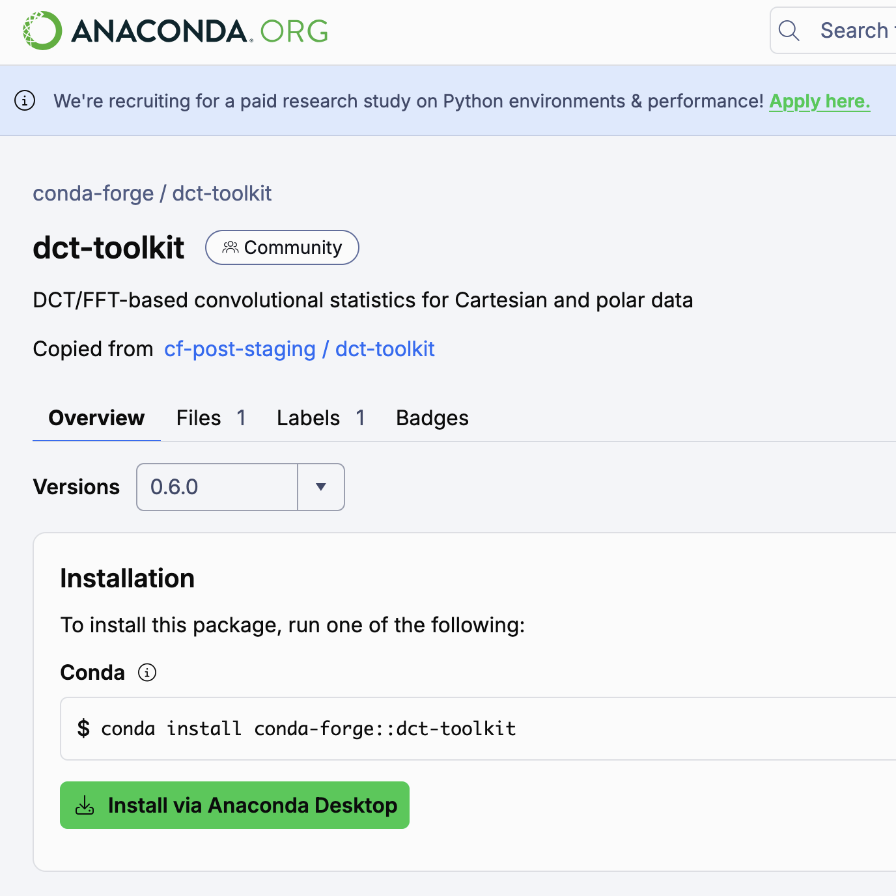

  
Paper 2 · Local statistics

  <h1>Spectral-Domain Local Statistics with Missing-Data Support</h1>
  <h2>For Cartesian and Polar Grids</h2>
  

    
<strong>Jairo M. Valdivia-Prado</strong>

    
Coauthors: Will Chapman · Katja Friedrich

  

  
Department of Atmospheric and Oceanic Sciences · University of Colorado Boulder

  
Under review at <em>Computers &amp; Geosciences</em> · Preprint arXiv:2604.22721 · doi:10.48550/arXiv.2604.22721

<!--
About 20 seconds. This is the second of four paper talks. Name the paper and its status once: under review at Computers and Geosciences, with an arXiv preprint. Do not call it published. Credit Will Chapman and Katja Friedrich. Handoff from Paper 1: Paper 1 gave a fast way to smooth radar data with a kernel average, but gaps were filled before filtering and those filled values then entered the average. Paper 2 asks whether that average can use valid observations directly and account for missing data.
-->

---
class: local-math local-intro
---

# Local statistics on incomplete grids

Smoothing uses a kernel average, but filled gaps contribute to that average.

<svg class="local-kernel-svg" viewBox="0 0 140 132" role="img" aria-label="Illustrative kernel neighborhood with valid, missing, and excluded observations">
  <rect x="14" y="10" width="112" height="112" rx="4" fill="none" stroke="currentColor" stroke-width="1.2" opacity="0.6" />
  <g>
    <rect x="22" y="18" width="18" height="18" class="k-valid" />
    <rect x="42" y="18" width="18" height="18" class="k-valid" />
    <rect x="62" y="18" width="18" height="18" class="k-missing" />
    <rect x="82" y="18" width="18" height="18" class="k-valid" />
    <rect x="102" y="18" width="18" height="18" class="k-valid" />
    <rect x="22" y="38" width="18" height="18" class="k-valid" />
    <rect x="42" y="38" width="18" height="18" class="k-excluded" />
    <rect x="62" y="38" width="18" height="18" class="k-valid" />
    <rect x="82" y="38" width="18" height="18" class="k-valid" />
    <rect x="102" y="38" width="18" height="18" class="k-missing" />
    <rect x="22" y="58" width="18" height="18" class="k-valid" />
    <rect x="42" y="58" width="18" height="18" class="k-valid" />
    <rect x="62" y="58" width="18" height="18" class="k-center" />
    <rect x="82" y="58" width="18" height="18" class="k-valid" />
    <rect x="102" y="58" width="18" height="18" class="k-valid" />
    <rect x="22" y="78" width="18" height="18" class="k-missing" />
    <rect x="42" y="78" width="18" height="18" class="k-valid" />
    <rect x="62" y="78" width="18" height="18" class="k-valid" />
    <rect x="82" y="78" width="18" height="18" class="k-excluded" />
    <rect x="102" y="78" width="18" height="18" class="k-valid" />
    <rect x="22" y="98" width="18" height="18" class="k-valid" />
    <rect x="42" y="98" width="18" height="18" class="k-valid" />
    <rect x="62" y="98" width="18" height="18" class="k-valid" />
    <rect x="82" y="98" width="18" height="18" class="k-valid" />
    <rect x="102" y="98" width="18" height="18" class="k-valid" />
    <line x1="46" y1="42" x2="56" y2="52" class="k-cross" />
    <line x1="56" y1="42" x2="46" y2="52" class="k-cross" />
    <line x1="86" y1="82" x2="96" y2="92" class="k-cross" />
    <line x1="96" y1="82" x2="86" y2="92" class="k-cross" />
  </g>
  <circle cx="71" cy="67" r="3.2" class="k-target" />
</svg>
<ul class="local-kernel-legend">
  <li>Valid observation</li>
  <li>Missing gate</li>
  <li>×Suspicious, masked</li>
</ul>

<section class="local-math-card">
<h2>Use valid observations</h2>

</section>
<section class="local-math-card">
<h2>Estimate mean and spread</h2>

</section>
<section class="local-math-card">
<h2>Generalize the grid</h2>

</section>

How can the kernel average use retained values only, while also reporting variability, and suitable boundaries?

<!--
About 55 seconds. Paper 1 smooths with a kernel-weighted average, but gaps are filled before filtering and those filled values then contribute to the average. Once we are computing a local average, we can also compute variance and standard deviation to describe spread within the same neighborhood, and extend the method beyond a two-dimensional polar scan to Cartesian and N-dimensional grids. The problem is that inside the kernel some locations are missing and others were excluded by quality control as suspicious. We want local statistics from retained values, a measure of available support, and boundary handling suited to each grid. Normalized convolution is the established foundation; the spectral integration and safeguards are the extension.
-->

---
class: local-math local-mask
---

# Extending spectral smoothing to local statistics

Retain the spectral filter; normalize by available support.

<section class="local-flow-box">
<h2>Masked values</h2>

Keep retained values, zero elsewhere.

$$
x \cdot m
$$
</section>
+
<section class="local-flow-box">
<h2>Mask</h2>

Record where data contribute.

$$
m
$$
</section>
→
<section class="local-flow-box">
<h2>Filter both, then divide</h2>

Same spectral operator throughout.

$$
\mu = \mathcal{S}_g\{x \cdot m\} / \mathcal{S}_g\{m\}
$$
</section>

<section class="local-math-card">
<h2>Extended statistics</h2>
<svg class="local-card-illustration" viewBox="0 0 220 82" role="img" aria-label="Observed and missing samples produce a local mean, spread, and available-support indicator">
  <line class="diagram-axis" x1="12" y1="61" x2="94" y2="61" />
  <g class="diagram-stem">
    <line x1="22" y1="38" x2="22" y2="61" />
    <line x1="40" y1="20" x2="40" y2="61" />
    <line x1="58" y1="30" x2="58" y2="61" />
    <line x1="76" y1="48" x2="76" y2="61" />
  </g>
  <g class="diagram-observed-dot">
    <circle cx="22" cy="38" r="4" />
    <circle cx="40" cy="20" r="4" />
    <circle cx="58" cy="30" r="4" />
    <circle cx="76" cy="48" r="4" />
  </g>
  <circle class="diagram-missing-dot" cx="90" cy="39" r="4" />
  <path class="diagram-arrow" d="M101 39h18m-6-6 6 6-6 6" />
  <path class="diagram-spread" d="M135 27v21m0-10h57m0-11v21" />
  <circle class="diagram-estimate-dot" cx="164" cy="38" r="5" />
  <g class="diagram-support">
    <circle cx="140" cy="63" r="3" />
    <circle cx="154" cy="63" r="3" />
    <circle cx="168" cy="63" r="3" />
    <circle cx="182" cy="63" r="3" />
  </g>
  <circle class="diagram-missing-dot" cx="196" cy="63" r="3" />
</svg>

Repeat for squared values to obtain the second moment, variance, and standard deviation.

</section>
<section class="local-math-card">
<h2>Explicit boundaries</h2>
<svg class="local-card-illustration" viewBox="0 0 240 82" role="img" aria-label="Left: a signal reflects at a mirrored boundary. Right: the signal wraps from the end back to the beginning at a periodic boundary">
  <path class="diagram-boundary-data" d="M18 55 36 25 54 43 66 43m78 12 18-30 18 18 12 0" />
  <path class="diagram-mirror" d="M65 13v62m4-62v62" />
  <path class="diagram-boundary-copy" d="M68 43 80 43 98 25 116 55 M128 43 140 43 M196 55 214 25 232 43" />
  <path class="diagram-periodic-seam" d="M142 20v53m52-53v53" />

</svg>

DCT for reflective axes; RFFT for periodic axes such as full-circle azimuth.

</section>
<section class="local-math-card">
<h2>Gap filling</h2>
<svg class="local-card-illustration" viewBox="0 0 220 82" role="img" aria-label="A missing cell is estimated from neighboring observations, with the filled value distinguished from observations">
  <g class="diagram-observed-cell">
    <rect x="26" y="12" width="16" height="16" /><rect x="46" y="12" width="16" height="16" /><rect x="66" y="12" width="16" height="16" />
    <rect x="26" y="32" width="16" height="16" /><rect x="66" y="32" width="16" height="16" />
    <rect x="26" y="52" width="16" height="16" /><rect x="46" y="52" width="16" height="16" /><rect x="66" y="52" width="16" height="16" />
    <rect x="140" y="12" width="16" height="16" /><rect x="160" y="12" width="16" height="16" /><rect x="180" y="12" width="16" height="16" />
    <rect x="140" y="32" width="16" height="16" /><rect x="180" y="32" width="16" height="16" />
    <rect x="140" y="52" width="16" height="16" /><rect x="160" y="52" width="16" height="16" /><rect x="180" y="52" width="16" height="16" />
  </g>
  <rect class="diagram-missing-cell" x="46" y="32" width="16" height="16" />
  <path class="diagram-arrow" d="M98 40h29m-7-7 7 7-7 7" />
  <rect class="diagram-estimated-cell" x="160" y="32" width="16" height="16" />
</svg>

Missing data can be filled with the mean where support is insufficient.

</section>

<!--
About 60 seconds. We use the same spectral convolution. To exclude missing or suspicious values we build a mask and perform normalized convolution: filter the masked data and the mask, then divide by the filtered mask so excluded locations carry zero weight. Applying the same procedure to squared values gives the second moment, hence variance and standard deviation. For boundaries we use RFFT where periodic behavior is wanted and DCT where reflective behavior is wanted; this distinction is particularly useful on Cartesian grids. The same local mean can also estimate missing values if a downstream operation needs a complete field—for example, a dual-Doppler wind retrieval. That is a use case, not a validation in this paper. Where neighbors provide support, use the normalized mean; where support is insufficient, iterative smoothing and nearest completion provide the prefilled-field fallback. Filled cells do not become observations: the original mask still records support. The workflow follows; the estimator equations are in backup.
-->

---
class: local-math local-workflow
---

# Spectral local-statistics workflow

One operator applied to values, squared values, and mask.

  

Reflective Cartesian (DCT-II) 2D example with missing values in gray; zoomed inset shows μ, σ, and Neff. The same spectral operator filters masked values, squared values, and mask before normalization. N-dimensional Cartesian and polar forms follow.

<!--
About 45 seconds. Putting these pieces together gives this workflow. We apply spectral filtering to the masked values, their squares, and the mask. From those filtered fields we obtain the local mean, standard deviation, and effective support. The figure is a two-dimensional reflective Cartesian example with DCT-II and a Gaussian response; missing values are gray. The framework also covers N-dimensional Cartesian arrays and polar grids with mixed boundaries. Relative to the prior DCT smoothing work, this generalizes mean-only interpolation-first smoothing by deriving normalized statistics beyond the mean, unifying Cartesian and polar forms under explicit boundary modes, formalizing stability and support diagnostics, and adding threshold-based 3D outlier validation. Next: what is new in this work.
-->

---
class: smoothing-contribution
---

# Contribution: from smoothing to local statistics

  
Local mean and spread on <strong>N-dimensional Cartesian</strong> and <strong>polar grids</strong>, mixing <strong>boundary conditions</strong> and <strong>kernel types</strong> per dimension.

  <svg class="shrink-0" width="360" height="225" viewBox="0 0 320 200" role="img" aria-label="Illustrative Cartesian grid and polar sampling grid, not measured data">
    <g fill="none" stroke="currentColor" stroke-opacity="0.65" stroke-width="2">
      <path d="M18 50 H108 M18 50 V140 M108 50 V140 M18 140 H108 M48 50 V140 M78 50 V140 M18 80 H108 M18 110 H108" />
    </g>
    <rect x="48" y="80" width="30" height="30" fill="#cfb87c" fill-opacity="0.55" />
    <text x="63" y="170" text-anchor="middle" fill="currentColor" style="font-size: 22px">Cartesian</text>
    <g transform="translate(140,45) scale(0.55)">
      <path d="M32 158 L250.24 32 A252 252 0 0 1 284 158 Z" fill="#cfb87c" fill-opacity="0.12" />
      <g fill="none" stroke="currentColor" stroke-opacity="0.65" stroke-width="2">
        <path d="M32 158 H284 M32 158 L280.18 114.24 M32 158 L268.8 71.81 M32 158 L250.24 32" />
        <path d="M86.56 126.5 A63 63 0 0 1 95 158 M141.12 95 A126 126 0 0 1 158 158 M195.68 63.5 A189 189 0 0 1 221 158 M250.24 32 A252 252 0 0 1 284 158" />
      </g>
      <circle cx="32" cy="158" r="4" fill="currentColor" />
    </g>
    <text x="227" y="160" text-anchor="middle" fill="currentColor" style="font-size: 22px">Polar</text>
  </svg>

See the preprint <a href="https://doi.org/10.48550/arXiv.2604.22721" target="_blank" rel="noopener noreferrer">Valdivia et al. (arXiv:2604.22721)</a> for the mathematical formulation and implementation.

<!--
About 30 seconds, no clicks. The sketches are illustrative, not results or measured data. Suggested delivery: “Paper 1 smoothed complete fields with one kernel average. The new step is a statistical framework: from retained values only, we estimate local mean, spread, and available support — on N-dimensional Cartesian and polar grids, combining reflective and periodic boundaries and different kernel types per dimension. I will leave the formulation to the paper and now show the validation.” Do not present equations on this slide; the estimator, boundary, dimensionality, and polar-filter details are in the supporting slides if asked. This work is under review; cite the arXiv preprint, not a publication. The link opens the preprint in a separate tab.
-->

---
class: outlier-animation
---

# Outlier detection in a 3D wind field

Flag a wind-speed residual larger than k local standard deviations.

  {{ label }}

  

    

      <CuManim :steps="4" :width="1000" :height="275" :construct="outlierDetection" />
      <svg v-if="clicks === 0" class="outlier-first-frame" viewBox="0 0 1000 560" aria-hidden="true">
        <path v-for="(edge, i) in outlierPreview.edges" :key="`edge-${i}`" :d="edge" fill="none" stroke="#52667b" stroke-width="1.5" opacity="0.55" />
        <path v-for="(arrow, i) in outlierPreview.arrows" :key="`arrow-${i}`" :d="arrow" fill="none" stroke="#85bec8" stroke-width="2" opacity="0.8" />
      </svg>
    

    
{{ clicks === 3 ? 'Enlarged neighborhood · wind speed in arbitrary units' : 'Sparse 3D rendering · statistics use all 165,888 grid points' }}

  

  

    

$$
|\,\|v\| - \mu_{\|v\|}\,| > k\,\sigma_{\|v\|}
$$

    

      <h2>Synthetic circulation</h2>
      
18 × 96 × 96 grid

      
Known wind field and anomaly locations.

    

    

      <h2>Observed wind</h2>
      
Noise: σ = 0.14 per component.

      
<i class="outlier-key" :style="{ background: outlierColors.tp }"></i>Injected anomalies: 526 points.

      
Random vector perturbations of amplitude 1.25–2.25.

    

    

      <h2>Local reference</h2>
      
Reflective DCT · widths (3, 7, 7)

      
Estimate local mean and standard deviation of <strong>wind speed</strong>.

      
Arrows show the local-mean vector field.

    

    

      <section v-for="(sample, i) in [outlierData.focus, outlierData.ordinary]" :key="i" :class="{ flagged: i === 0 }">
        <h2><i class="outlier-key" :style="{ background: i === 0 ? outlierColors.tp : outlierColors.ordinary }"></i>{{ i === 0 ? 'Injected anomaly' : 'Ordinary point' }}</h2>
        
Speed <strong>{{ sample.speed.toFixed(2) }}</strong> · μ {{ sample.meanSpeed.toFixed(2) }} · σ {{ sample.stdSpeed.toFixed(2) }}

        

          
          
          
        

        
{{ sample.score.toFixed(2) }}σ {{ i === 0 ? '> 3σ → flagged' : '< 3σ → retained' }}

      </section>
      
Shaded interval: μ ± 3σ · marker: observed speed

    

    

      <h2>Detection at k = 3</h2>
      
<i class="outlier-key" :style="{ background: outlierColors.tp }"></i><strong>406</strong> true detections

      
<i class="outlier-key" :style="{ background: outlierColors.fp }"></i><strong>39</strong> false alarms

      
<i class="outlier-key" :style="{ background: outlierColors.fn }"></i><strong>120</strong> missed anomalies

      
Full-volume counts for this realization.

    

  

Synthetic cyclone-like wind, 18 × 96 × 96, windows (3, 7, 7). At k = 3.0: precision 0.92, recall 0.77, F1 0.84, mean over 5 seeds.

Velocity-vector scoring may improve sensitivity to directional anomalies; this was not evaluated here.

<!--
About 70 seconds. This is the original synthetic 3D cyclone-wind experiment, regenerated with the paper's code and random-number sequence, using dct_toolkit at commit 9d3b60e. The displayed realization uses seed 20260414. The animation depicts processing stages of one static field, not a time-evolving storm. Arrows are sparsely sampled for visibility; all statistics and detection counts use the full 18 × 96 × 96 grid. The projection compresses height for legibility, and the enlarged neighborhood is a display crop, not a truncated kernel.

[click] Add the original Gaussian perturbations, sigma 0.14 per component, and sparse injected vector anomalies with random 3D direction and amplitude 1.25 to 2.25. Injection probability is 0.3%; this realization contains 526 injected points. Red indicates known injection locations at this stage.

[click] Show the local-mean vector field estimated with reflective DCT normalized convolution and Gaussian widths (3, 7, 7), in z, y, x order. The detector separately computes the mean and standard deviation of wind SPEED. The mean speed is not the magnitude of the mean vector. In this complete-data experiment the support mask is all ones. The estimates include the noisy observations and injected anomalies; this is the original single-pass detector, not an iterative re-masking experiment.

[click] Enlarge a neighborhood and inspect two actual grid points. At the red-ringed injected anomaly, speed is 2.29, local mean 1.41, and local standard deviation 0.20: the residual is 4.48 local standard deviations, exceeding the threshold of 3. At the white-ringed ordinary point, speed is 1.27 and the score is only 0.17, so it is retained. Each horizontal shaded interval is mean plus or minus three local standard deviations, with a center tick at the mean and a marker at observed speed. Here k is the detection-threshold multiplier, distinct from the earlier spectral bin index.

[click] Return to the full volume. Red denotes true detections, orange false alarms, and blue missed injections. This realization has 406 true positives, 39 false positives, and 120 false negatives. The precision 0.92, recall 0.77, and F1 0.84 in the fine text are averages across five realizations, not scores from the displayed subset of arrows. Velocity-vector scoring could add sensitivity to direction changes, but its performance has not been evaluated in this experiment. Next: the same framework on a real polar radar scan.
-->

---
class: figure-slide polar-figure
---

# Local smoothing on a polar radar scan

  

DOW6 X-band, WINTRE-MIX, 23 Feb 2022. Top: full domain. Bottom: 20 km central zoom. Shared dBZ scale. Missing sectors carry zero weight.

<!--
About 50 seconds. Real-radar polar demonstration on uncorrected DOW6 reflectivity from the same 23 February 2022 event, following the dct_toolkit notebook workflow. W sets both the range width and the azimuth target width. Panels (a)–(c) are full-domain raw, W = 5, and W = 15; panels (d)–(f) are the matching 20 km central zooms. The operator uses mixed boundaries: periodic azimuth with reflective range. Despite extensive beam-blockage sectors, normalized convolution gives coherent local-mean estimates without obvious gap-driven artifacts, and no evident center-of-grid distortion appears even at W = 15. As expected, W = 5 preserves sharper gradients while W = 15 suppresses more small-scale variability; this is a tuning trade-off, not evidence for one globally optimal width. The evidence here is qualitative and dataset-specific. Next: where to find the implementation.
-->

---
class: toolkit-availability
---

# Spectral statistics implementation

  

    <section>
      <h2>Conda</h2>
      <pre><code>conda install conda-forge::dct-toolkit</code></pre>
    </section>
    <section>
      <h2>pip</h2>
      <pre><code>pip install dct-toolkit</code></pre>
    </section>
    <figure class="toolkit-qr">
      
      <figcaption>github.com/JValdivia23/dct-toolkit</figcaption>
    </figure>
  

  <figure class="toolkit-shot">
    
  </figure>

<!--
About 30 seconds. The spectral-statistics implementation is packaged as dct-toolkit, installable from conda-forge or PyPI with the commands shown. The screenshot is the conda-forge page listing version 0.6.0. Results in this talk used version 0.5.0 at commit 9d3b60e. The QR code links to the GitHub repository for source, documentation, and notebooks. Then go to the takeaways.
-->

---
class: smoothing-conclusions conclusions-bullets
---

# Project 2: Conclusions

- Compute local statistics in incomplete fields.
- Work in N-dimensional Cartesian or 2D polar coordinates.
- Combine boundary conditions across dimensions, and mix kernel types per dimension.
- Potential applications go beyond radar: satellite observations, numerical simulations, even medical 3D-flow measurements.

<!--
About 45 seconds. Suggested delivery: “So what are the conclusions of this work? With the current implementation of dct-toolkit you can do the following.” First, compute local statistics in incomplete fields. Second, work in N-dimensional Cartesian or 2D polar coordinates. Third, combine boundary conditions across dimensions — periodic or reflective azimuth with reflective range in polar — and mix kernel types per dimension. Fourth, these potential applications go beyond radar signal processing: satellite observations, numerical simulations, even medical studies measuring 3D flows inside the body. Results in this talk used version 0.5.0 at commit 9d3b60e; per-axis kernel types are a 0.6.0 feature. This work is under review; cite the arXiv preprint, not a publication. The dissertation use of these statistics is the weighted background mean in Z-prime, used in the Paper 4 fall-streak analysis. Then go to the population: the observational studies begin with how a cloud-top generating-cell population evolves.
-->
