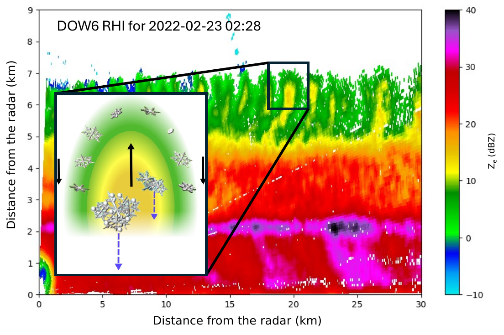

# Cloud-Top Generating Cells

  

DOW6 RHI, 23 Feb 2022, 02:28 UTC. Concept adapted from Kumjian et al. (2014).

Small convective regions near cloud top (~1–2 km)

Ice particles seed the cloud below and descend in **fall streaks**

Their small scale is poorly resolved by many weather prediction models

<!--
[click] Point to the boxed feature in the radar cross section. This is a vertical view through a winter storm. These small convective regions near cloud top are cloud-top generating cells, typically about one to two kilometers across.

[click] Point to the conceptual inset, then follow the trail downward. Ice particles form and grow in the cells and fall in trails called fall streaks. As they descend through the underlying cloud, they can continue to grow and enhance precipitation. The cells seed ice into a cloud that provides conditions for further growth—a seeder–feeder interaction.

[click] Despite their possible importance to winter precipitation, these small, high-altitude circulations are poorly resolved by many operational weather prediction models. That leaves three physical questions.

Do not yet discuss the sampling limits. Those come after the questions, as the reason the questions remain open.
-->

---
class: physical-questions
---

# Physical and Microphysical Questions

  <h3>Formation and organization</h3>
  

    

      <svg viewBox="0 0 72 48"><path d="M8 12 H64 M36 18 V36 M30 30 L36 38 L42 30" fill="none" stroke="currentColor" stroke-width="1.8" stroke-linejoin="round" /></svg>
      Cooling
    

    

      <svg viewBox="0 0 72 48"><path d="M8 10 L12 4 L16 10 M12 4 V44 H64 M58 40 L64 44 L58 48 M50 44 L26 10" fill="none" stroke="currentColor" stroke-width="1.8" stroke-linejoin="round" /></svg>
      Instability
    

    

      <svg viewBox="0 0 72 48"><path d="M8 14 H54 M48 8 L58 14 L48 20 M8 34 H34 M28 28 L38 34 L28 40" fill="none" stroke="currentColor" stroke-width="1.8" stroke-linejoin="round" /></svg>
      Shear
    

  

  
What processes govern how the cells form and become organized?

  
Cooling, instability, and shear are candidate mechanisms. Their role through a population's evolution is not established.

  <h3>Particle evolution</h3>
  

    <svg viewBox="0 0 220 112"><g fill="none" stroke="currentColor" stroke-width="1.8">
      <rect x="30" y="48" width="160" height="24" fill="currentColor" fill-opacity="0.08" />
      <rect x="136" y="24" width="42" height="24" />
      <path d="M157 44 L110 72 V94" />
      <path d="M52 84 V94 M72 84 V94 M132 84 V94 M152 84 V94 M172 84 V94" />
    </g></svg>
  

  
How do ice particles change in the cells and during descent?

  
Growth can occur near cloud top and in the cloud below. The change through a cell's life and along the fall streak remains unresolved.

  <h3>Precipitation contribution</h3>
  

    

      <svg viewBox="0 0 100 112"><g fill="none" stroke="currentColor" stroke-width="1.8">
        <rect x="10" y="44" width="80" height="22" fill="currentColor" fill-opacity="0.08" />
        <path d="M24 78 V90 M50 78 V90 M76 78 V90" />
      </g></svg>
      Unseeded
    

    

      <svg viewBox="0 0 100 112"><g fill="none" stroke="currentColor" stroke-width="1.8">
        <rect x="10" y="44" width="80" height="22" fill="currentColor" fill-opacity="0.08" />
        <rect x="30" y="18" width="40" height="26" />
        <path d="M50 40 L40 66 V94" />
        <path d="M24 78 V90 M50 78 V90 M76 78 V90" />
      </g></svg>
      Seeded
    

  

  
How much does ice supplied by the cells change precipitation?

  
The lower cloud may already be precipitating. Overlapping fall streaks prevent attribution to one cell.

<!--
These are broader motivating questions, not results of this dissertation. Do not explain the sampling limits yet.

Point to the three marks separately. The middle mark is a temperature profile that cools steeply with height. Do not draw a circulation that connects cooling, instability, and shear.

Formation and organization: cloud-top potential instability and lifting can initiate the updrafts. Longwave cooling helps sustain them; in the Keeler simulations, latent heating alone was not sufficient. Shear can organize the cells, including into linear, roll-like structures in simulations. A snapshot does not show how a population forms, merges, and dissipates, and it does not establish the circulation. Kumjian et al. (2014), Rauber et al. (2014), Keeler et al. (2016, 2017).

Trace the diagram: the cell box sits flush on the cloud, one diagonal streak runs to the cloud base, then falls vertically as rain. Particle evolution: the cells are strongly ice-supersaturated, so depositional growth near cloud top is rapid. Kumjian et al. (2014) described pristine plates or dendrites around a core of aggregates or rimed particles. That is one time, not a life cycle. Plummer et al. (2015) summarize earlier studies as finding most ice-mass growth below the cells, mainly by deposition and aggregation. Riming is possible where supercooled liquid is present. Do not put a percentage on the slide.

Precipitation contribution: the two panels show the same precipitating cloud unseeded and seeded. The extra line marks the open question, not a measured increase. The open quantity is the change relative to what that lower cloud would have produced alone. Do not say the cells are responsible for 20–30% of precipitation.

These questions have stayed open because of how the cells are observed.
-->

---
class: observation-limits
---

# Observational Limitations

  

    

      <svg viewBox="0 0 72 52"><g transform="translate(16,6) scale(1.667)"><g transform="rotate(90 12 12)"><path d="M21 16v-2l-8-5V3.5c0-.83-.67-1.5-1.5-1.5S10 2.67 10 3.5V9l-8 5v2l8-2.5V19l-2 1.5V22l3.5-1 3.5 1v-1.5L13 19v-5.5l8 2.5z" fill="currentColor" stroke="none" /></g></g></svg>
      Aircraft
    

    

      <svg viewBox="0 0 72 52"><path d="M14 44 L34 12 A28 28 0 0 1 58 30 L14 44" fill="none" stroke="currentColor" stroke-width="1.8" /><circle cx="14" cy="44" r="2.4" fill="currentColor" /></svg>
      PPI/RHI
    

    

      <svg viewBox="0 0 72 52"><path d="M36 4 V48" fill="none" stroke="currentColor" stroke-width="1.8" stroke-dasharray="3 2.5" /><rect x="18" y="18" width="36" height="16" fill="none" stroke="currentColor" stroke-width="1.8" /></svg>
      Vertical
    

  

  <h3>Incidental snapshots</h3>
  
Most published views are a single aircraft pass, RHI/PPI scan, or vertically pointing profile, often collected while the study focused on the broader storm.

  

    
Motion<i></i>

    

      <b></b>
      <b class="on"></b>
      <b></b>
      Fixed scan
    

  

  <h3>Advection through a fixed scan</h3>
  
A 1–2 km cell is observed only while it crosses the beam. A fixed scan does not remain with the cell or the snow falling below it.

  

    
Tracked cell, at least 10 min

    

    
Population duration

    

  

  <h3>Cell lifetime and population duration</h3>
  
One continuously tracked cell lasted at least ~10 min (Kumjian et al. 2014). Populations are common in winter storms sampled at sufficient resolution.

<!--
These questions have stayed open because of how the cells are observed.

Most published observations are single snapshots, often collected while the study focused on the broader storm: an aircraft pass, an RHI or PPI scan, or a vertically pointing radar. Kumjian et al. (2014, J. Appl. Meteor. Climatol.) distinguished this kind of snapshot from a sequence intended to follow evolution. FROST, PLOWS, SNOWIE, and SOCRATES were not designed specifically to follow these cells.

The cells move with the flow. Kumjian et al. steered range–height scans along the mean cell motion, and still noted a motion component out of the scan plane.

Kumjian et al. followed one vigorous cell for about 10 minutes and reported lifetimes of at least 10 minutes. An older scanning-radar study inferred lifetimes of several hours; that was not a continuous track of one cell.

Populations are common in winter storms sampled closely enough to resolve them. Kumjian et al. found generating cells in every FROST case and described them as very common, if not ubiquitous. Rosenow et al. (2014) described them as ubiquitous in the PLOWS dataset. Tessendorf et al. (2024) described them as fairly ubiquitous in winter orographic clouds. Do not say every winter storm.

This dissertation does not try to close those three questions for winter storms in general. For one observed storm, it asks what the radar observations can show. Do not open the range-dependent radar window here; that begins the methods.
-->

---
class: dissertation-objectives
---

# Dissertation Objectives

  <h3>Radar analysis</h3>
  

    <svg viewBox="0 0 220 112"><g fill="none" stroke="currentColor" stroke-width="1.8">
      <rect x="70" y="20" width="72" height="72" />
      <path d="M94 20 V92 M118 20 V92 M70 44 H142 M70 68 H142" />
      <rect x="97" y="47" width="18" height="18" stroke-dasharray="4 3" />
      <circle cx="106" cy="56" r="30" />
    </g></svg>
  

  
Develop and evaluate efficient smoothing and local statistics for radar fields with changing sampling geometry and missing data.

  <h3>Population evolution</h3>
  

    <svg viewBox="0 0 220 112"><g fill="none" stroke="currentColor" stroke-width="1.8">
      <path d="M20 92 H200 M60 86 V92 M110 86 V92 M160 86 V92" />
      <rect x="42" y="35" width="12" height="9" /><rect x="62" y="45" width="12" height="9" /><rect x="48" y="58" width="12" height="9" />
      <rect x="100" y="38" width="14" height="10" /><rect x="116" y="48" width="14" height="10" /><rect x="104" y="60" width="14" height="10" />
      <rect x="153" y="40" width="34" height="26" /><path d="M170 40 V66" stroke-dasharray="4 3" />
    </g></svg>
  

  
Characterize changes in the organization and polarimetric signatures of one observed cell population.

  <h3>One cell and its precipitation</h3>
  

    <svg viewBox="0 0 220 112"><g fill="none" stroke="currentColor" stroke-width="1.8">
      <rect x="30" y="48" width="160" height="24" fill="currentColor" fill-opacity="0.08" />
      <rect x="136" y="24" width="42" height="24" />
      <path d="M157 44 L110 72 V94" />
      <path d="M52 84 V94 M72 84 V94 M132 84 V94 M152 84 V94 M172 84 V94" />
      <rect x="95" y="48" width="30" height="46" stroke-dasharray="4 3" />
    </g></svg>
  

  
Examine a selected cell's three-dimensional structure and fall streak relative to the surrounding precipitation.

<!--
These are the objectives this dissertation addresses, not the three broader questions. The first is addressed by two methodological studies. The second concerns the population in one WINTRE-MIX event; the third concerns a cell selected from that population. The fall-streak analysis examines structure and precipitation contrasts, not the cell's individual contribution to precipitation.

Transition from the limits: those sampling limits define what can be claimed. This dissertation develops tools to analyze the available radar data, then uses one observed storm to study a population and one selected cell. Do not imply that the methods in Chapters 2 and 3 produced the Chapter 4 results; Chapter 5 combines those methods with the track from Chapter 4.
-->

---
class: presentation-roadmap
---

# Presentation Roadmap

  

    

      <section class="roadmap-stage">
        Paper 1
        

          <h2>Radar data smoothing using the DCT</h2>
          
Fast noise removal

        

      </section>
      <svg class="roadmap-method-link" viewBox="0 0 20 32" aria-hidden="true">
        <path d="M10 0 V26 M4 20 L10 26 L16 20" />
      </svg>
      <section class="roadmap-stage">
        Paper 2
        

          <h2>Spectral-domain local statistics</h2>
          
Spectral operation for cartesian and polar grids

        

      </section>
    

    <section class="roadmap-stage roadmap-population">
      Paper 3
      <h2>Temporal evolution of cloud-top generating cells</h2>
      
CTGC population life cycle and organization

    </section>
  

  <svg class="roadmap-links" viewBox="0 0 1000 100" preserveAspectRatio="none" aria-hidden="true">
    <path d="M245 0 L500 65 M755 0 L500 65 M500 65 V94" />
    <path d="M490 82 L500 94 L510 82" />
  </svg>

  <section class="roadmap-stage roadmap-destination">
    Paper 4
    <h2>Tracking 3D CTGC structure and associated precipitation</h2>
    
CTGC fall streak and precipitation

  </section>

<!--
These four boxes represent the four papers in talk order. Paper 1 develops physical-scale smoothing for radar data; Paper 2 extends that spectral framework to local statistics with missing data. Paper 3 follows a population of cells in one storm and identifies a persistent cell. Paper 4 brings the methods from Papers 1 and 2 together with that cell track to examine three-dimensional structure, the fall streak, and precipitation context. I will close with a synthesis and limitations.

The arrows summarize the narrative, not every direct methodological input: Paper 1 leads to Paper 2, while Papers 2 and 3 connect to Paper 4. Paper 4 also draws directly on Paper 1's smoothing. The methods studies are Chapters 2 and 3, the population study is Chapter 4, and the selected-cell study is Chapter 5. Do not imply that the methods in Chapters 2 and 3 produced the Chapter 4 results. The precipitation contrasts do not attribute an individual contribution to the selected cell.

Status, if asked:

- Valdivia, Chapman, and Friedrich, AMT, 2026. doi:10.5194/amt-19-5211-2026
- Valdivia, Chapman, and Friedrich, arXiv:2604.22721. Under review. Not accepted.
- Valdivia, Friedrich, Zaremba, and Tessendorf, JAS, 2026. doi:10.1175/JAS-D-25-0088.1
- Same author team, GRL manuscript 2026GL126989, submitted 16 September 2026. Not accepted.

Transition: begin the methods with the change in physical area covered by a fixed radar window.
-->
