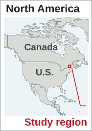
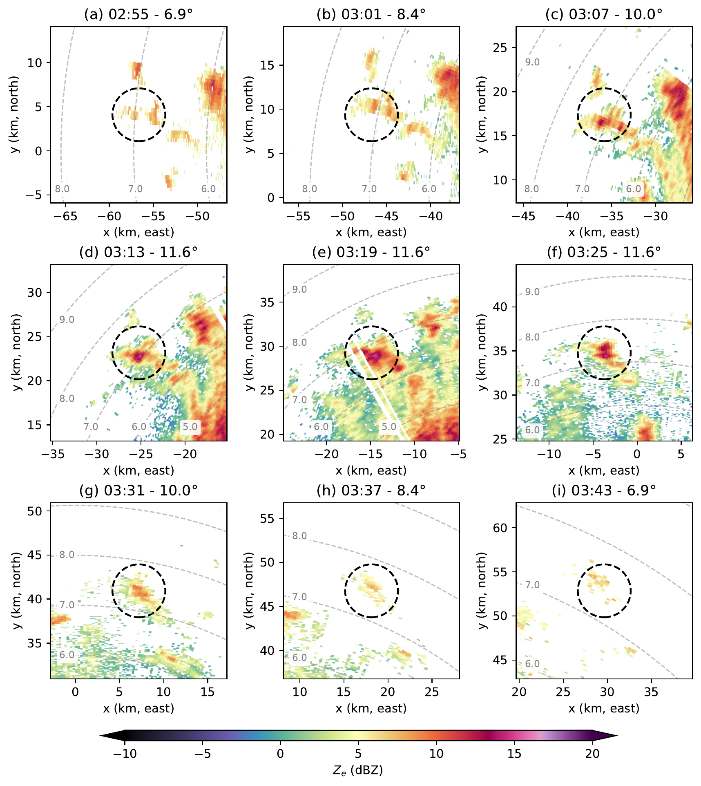
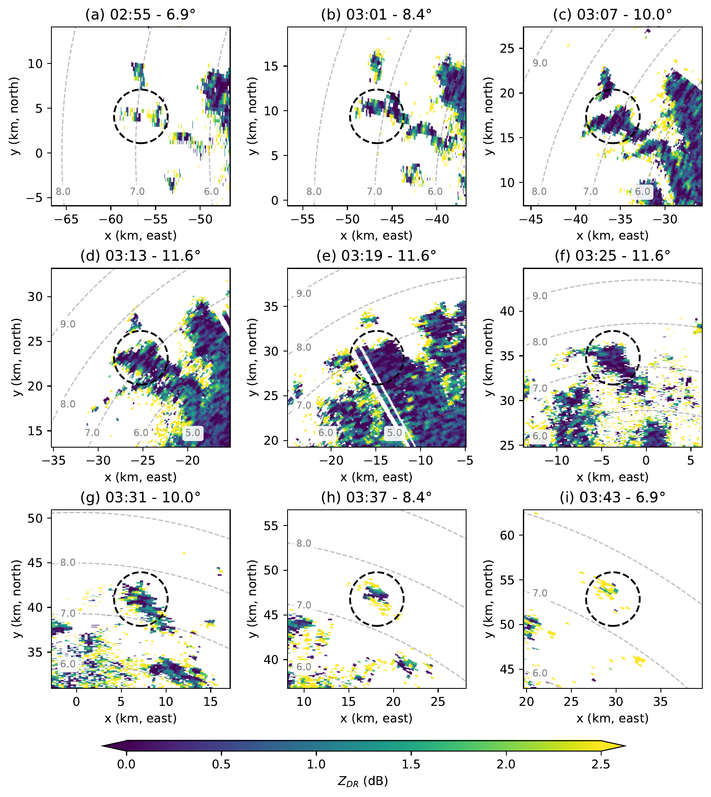
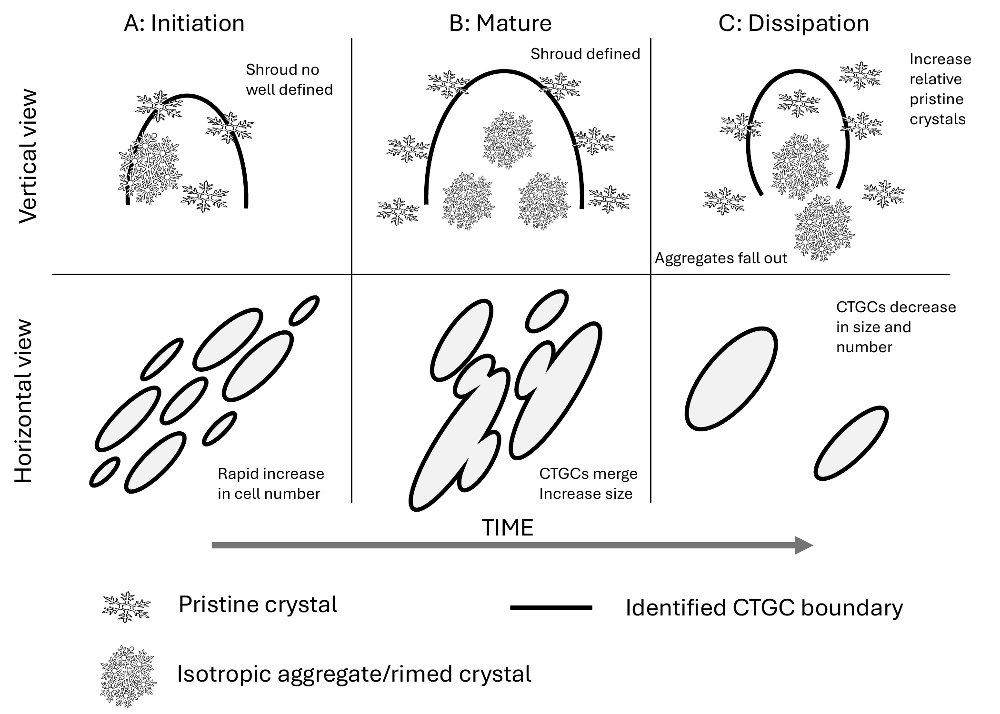

  
Paper 3 · CTGC population

  <h1>Temporal Evolution of Cloud-Top Generating Cells</h1>
  <h2>A Case Study</h2>
  

    
<strong>Jairo M. Valdivia-Prado</strong>

    
Coauthors: Katja Friedrich · Troy Zaremba · Sarah Tessendorf

  

  
Department of Atmospheric and Oceanic Sciences · University of Colorado Boulder

  
Published as Valdivia, Friedrich, Zaremba, and Tessendorf, <em>Journal of the Atmospheric Sciences</em> 83, 1405–1431 (2026) · doi:10.1175/JAS-D-25-0088.1

<!--
About 20 seconds. The first two papers addressed radar analysis methods. This third paper is an observational case study, published in the Journal of the Atmospheric Sciences. Credit Katja Friedrich, Troy Zaremba, and Sarah Tessendorf. Do not imply that the spectral methods of Papers 1 and 2 produced this study's population results: the Chapter 4 identification procedure uses its own quality control, polar-coordinate smoothing, azimuthal-mean perturbation, and contouring. The fourth paper later combines the methodological work with the cell track from this study. Next, outline the core problem and three research objectives.
-->

---
class: population-objectives
---

# Objectives: CTGC population evolution

  While instantaneous cell structures are known from snapshots, the <strong>complete lifecycle of a CTGC population</strong> has remained undocumented observationally.

  <h3>Macrostructural evolution</h3>
  
How do CTGCs organize and evolve through time?

  
Track changes in cell counts, horizontal dimensions, and the merging of individual cells into contiguous clusters.

  <h3>Microphysical progression</h3>
  
How do particle signatures change across stages?

  
Examine systematic trends in polarimetric radar variables (<em>Z</em>e, <em>Z</em>DR, <em>ρ</em>HV) and infer crystal habit evolution.

  <h3>Environmental conditions</h3>
  
What factors govern the cell lifecycle?

  
Assess the roles of vertical wind shear, cloud-top thermodynamic stability, and moisture depletion in cell maintenance and decay.

<!--
About 45 seconds. The first two papers developed radar analysis methods. This third paper applies high-resolution radar observations to address an open physical problem: following an entire CTGC population through time.

While past studies revealed the instantaneous 1–2 km structure of generating cells using isolated RHI sweeps or aircraft passes, the complete life cycle of a population—from first appearance through organization to decay—has remained uncharacterized observationally.

We address three questions:
First, macrostructure: how do cell count, size, and clustering change over time?
Second, microphysics: what do polarimetric variables reveal about particle sorting and habit changes as cells mature?
And third, environment: what thermodynamic and shear conditions support each stage?

To answer these, we analyze repeated volumetric radar scans from one winter storm during WINTRE-MIX.
-->

---
class: population-context
---

# WINTRE-MIX: Study area and instrumentation

  

    

      <strong>WINTRE-MIX Campaign · IOP05</strong>
      22–23 February 2022 · St. Lawrence and Champlain valleys (US–Canada border). Studying winter precipitation near 0°C in complex terrain.
    

    

      <strong>DOW6 X-band radar (primary)</strong>
      Dual-polarization Doppler radar; 75 m range resolution; 17 PPI sweeps every 6 min (02:00–04:00 UTC).
    

    

      <strong>Context instrumentation</strong>
      Operational S-band radar from Environment and Climate Change Canada (ECCC Blainville; 240 km range); radiosondes from Sorel, QC (02:00 &amp; 04:15 UTC); airborne NAX radar on the NRC Convair-580.
    

  

  

    
    
  

Paper Figure 2. DOW6 supplies the repeated 6-minute volumetric scans for cell detection; ECCC radar, soundings, and airborne radar provide mesoscale context.

<!--
About 45 seconds. Introduce the observational framework. The dataset comes from the Winter Precipitation Type Research Multi-scale Experiment (WINTRE-MIX), conducted in late winter 2022 across the US–Canada border in the St. Lawrence and Champlain valleys.

Point to the map: DOW6 was deployed near the valley confluence to sample winter storm IOP05. The primary platform is the Doppler on Wheels 6 from the NSF-supported CSWR facility: an X-band dual-polarization radar sampling 17 PPI sweeps every six minutes between 02:00 and 04:00 UTC, with 75-meter range resolution. CTGCs were observed between 5.5 and 8 km MSL.

Supporting context came from Environment and Climate Change Canada's operational S-band radar at Blainville for storm-scale coverage, two radiosondes launched at Sorel for vertical thermodynamics, and a flight pass by the NRC Convair-580 with the NAX cloud radar.

Next, I will explain how we identify CTGC features from these volumetric scans.
-->

---
class: population-identification
---

# CTGC detection: Layer maximum and perturbation

  {{ label }}

  

    

      <CuManim :steps="6" :width="1000" :height="310" :construct="ctgcIdentification" />
      <svg v-if="clicks === 0" class="ctgc-first-frame" viewBox="0 0 1000 580" aria-hidden="true">
        <path v-for="(item, i) in ctgcPreview" :key="i" :d="item.d" :fill="item.color" :fill-opacity="item.fill" :stroke="item.color" :stroke-opacity="item.stroke" :stroke-width="item.width" />
      </svg>
      <svg v-if="clicks < 6" class="ctgc-labels" viewBox="0 0 1000 580" aria-hidden="true">
        <defs>
          <linearGradient id="ctgc-field-scale">
            <stop v-for="(color, i) in clicks === 5 ? ctgcColors.perturbation : ctgcColors.reflectivity" :key="i" :offset="`${i * 25}%`" :stop-color="color" />
          </linearGradient>
          <marker id="ctgc-arrow-head" viewBox="0 0 8 8" refX="7" refY="4" markerWidth="7" markerHeight="7" orient="auto-start-reverse">
            <path d="M0,0 L8,4 L0,8 z" fill="#cfb87c" />
          </marker>
        </defs>
        <g v-if="clicks <= 2">
          <text v-for="(item, i) in ctgcLabels.side" :key="i" :x="item.x" :y="item.y" :text-anchor="item.anchor">{{ item.text }}</text>
          <rect x="700" y="27" width="140" height="12" fill="url(#ctgc-field-scale)" />
          <text x="681" y="42">0</text><text x="902" y="42">18 dBZ</text>
          <text v-if="clicks === 2" x="540" y="528" class="ctgc-gold">Retain the maximum at each range gate</text>
          <g v-if="clicks >= 1" class="ctgc-gold">
            <text v-for="(item, i) in ctgcLabels.layer" :key="i" :x="item.x" :y="item.y" :text-anchor="item.anchor">{{ item.text }}</text>
          </g>
        </g>
        <g v-else>
          <text v-for="(item, i) in ctgcLabels.map" :key="i" :x="item.x" :y="item.y" :text-anchor="item.anchor">{{ item.text }}</text>
          <text v-if="clicks === 5" x="830" y="95" class="ctgc-map-title">Z′ (dB)</text>
          <text v-else x="830" y="95" class="ctgc-map-title">Z<tspan baseline-shift="sub" style="font-size: 18px">max</tspan><tspan> (dBZ)</tspan></text>
          <text x="830" y="128">{{ clicks >= 4 ? 'One range ring: 36.25 km' : 'Sampled layer maximum' }}</text>
          <g v-if="clicks >= 4" class="ctgc-ring-profile" :class="{ 'ctgc-no-anim': ctgcNoAnim }">
            <line x1="520" y1="252" x2="698" y2="252" class="ctgc-link-arrow" marker-end="url(#ctgc-arrow-head)" />
            <path d="M715 165 V338 H955" />
            <path :d="`M715 ${ctgcRingProfile.meanY} H955`" class="ctgc-mean-line ctgc-xfade" :class="{ faded: clicks === 5 }" />
            <path :d="`M715 ${ctgcRingProfile.zeroY} H955`" class="ctgc-mean-line ctgc-xfade" :class="{ faded: clicks !== 5 }" />
            <polyline :points="ctgcRingProfile.maximum" class="ctgc-profile-poly ctgc-xfade" :class="{ faded: clicks === 5 }" />
            <polyline :points="ctgcRingProfile.perturbation" class="ctgc-profile-poly ctgc-xfade" :class="{ faded: clicks !== 5 }" />
            <text x="704" y="188" text-anchor="end">{{ clicks === 5 ? '12' : '18' }}</text>
            <text x="704" y="340" text-anchor="end">{{ clicks === 5 ? '−4' : '0' }}</text>
            <text x="715" y="365">0°</text><text x="955" y="365">360°</text>
            <text x="835" y="397">Azimuth</text>
            <text x="835" y="435" class="ctgc-gold">{{ clicks === 5 ? 'Reference becomes zero' : `Azimuthal mean = ${ctgcData.focus.mean.toFixed(1)} dBZ` }}</text>
          </g>
          <g v-else>
            <text x="830" y="270">One value per (r, θ)</text>
            <text x="830" y="307">Horizontal CTGC footprint</text>
          </g>
          <rect x="715" y="466" width="240" height="16" fill="url(#ctgc-field-scale)" />
          <text x="715" y="512">{{ clicks === 5 ? '−4' : '0' }}</text>
          <text x="835" y="512">{{ clicks === 5 ? '4' : '9' }}</text>
          <text x="955" y="512">{{ clicks === 5 ? '12 dB' : '18 dBZ' }}</text>
        </g>
      </svg>
      
= 6" class="ctgc-observed">
        
      

    

    
{{ clicks >= 6 ? 'Observed example · 03:18 UTC · Validiva, et al. 2026 Fig. 5e' : clicks <= 2 ? 'Schematic · one azimuth · vertical scale exaggerated' : 'Schematic · same volume reduced to a horizontal field' }}

  

  

    

      <h2>Discrete vertical sampling</h2>
      
<strong>17 PPI elevations · 0.4°–50°</strong>

      
Each ray is a side view of one elevation sweep.

      
The volume repeats every 6 minutes.

    

    

      <h2>Select the generating layer</h2>
      
<strong>5.5–8 km MSL</strong>, identified from RHI observations.

      
Only sampled gates inside this band contribute.

      
The number of contributing elevations changes with range.

    

    

      <h2>Layer column maximum</h2>
      
Extract maximum reflectivity in the 5.5–8 km MSL cell layer at each range–azimuth gate (<em>r</em>, <em>θ</em>).

      
The white rings mark the contributing samples; only the largest value is retained.

    

    

      <h2>Repeat around the radar</h2>
      
Each PPI samples azimuth around the radar.

      
Retaining one maximum per (<em>r</em>, <em>θ</em>) produces the <strong>2D Zmax field</strong>.

      
The layer maximum collapses the elevation dimension.

    

    

      <h2>A range-dependent background</h2>
      
Average Zmax over valid azimuths at the same range.

      
The highlighted ring has a mean of <strong>{{ ctgcData.focus.mean.toFixed(1) }} dBZ</strong>.

      
Repeat for every range ring.

    

    

      <h2>Reflectivity perturbation (Z′)</h2>
      
Subtract the range-dependent azimuthal mean:

      

$$Z'(r,\theta) = Z_{\max}(r,\theta) - \overline{Z_{\max}}_{\theta}(r)$$

      
Positive Z′ marks an enhancement above its range-ring background.

    

    

      <h2>Smoothing, 5-dB contouring &amp; screening</h2>
      
Apply 2D Gaussian smoothing, contour at 5 dB, and discard nested or &lt;0.09 km² regions.

      
Gaussian σ = 1 gate in range and azimuth.

      
Closed boundaries are used to quantify CTGCs.

    

  

{{ clicks >= 6 ? '' : '' }}

<!--
About 90 seconds. This click-stepped schematic explains the sampling and reduction behind the Paper 3 detection method. It uses the 17 nominal elevations from Paper Figure 3: 0.4–50 degrees. The coarse reflectivity values and cell locations are illustrative, with actual maxima and azimuthal means calculated from that same schematic volume. One initial azimuth is shown in a range–height view. The straight beam centerlines have exaggerated vertical scale; gates are schematic samples, not the radar's actual 75-m spacing. The volume scan repeats every six minutes. Standard quality control and initial reflectivity smoothing precede the operations illustrated here.

[click] Select only observations in the 5.5–8 km MSL cloud-top layer identified in RHI scans. At a particular range, only a few of the 17 elevations intersect the layer. Missing coverage stays missing; the animation does not fill these gaps.

[click] At each polar range–azimuth gate, take the largest of the sampled in-layer reflectivities. The highlighted example at 36.25 km has two contributing elevations, marked by white rings, and the selected maxima move into a common radial strip. The maximum is over available observations, not a reconstructed continuous vertical profile.

[click] Each of these elevations is a PPI sweep around the radar. Rotate the same strip into plan view, and repeat the reduction over all azimuths to obtain Z_max(r, theta). The sweep is a reveal of this one schematic volume, not a simultaneous scan or a time-evolving storm. The PPI volume samples height; reducing the elevations to one layer maximum produces the two-dimensional horizontal footprint. Gray rings have no in-layer samples.

[click] Highlight one range ring and average its valid Z_max values over azimuth. The small profile plots those exact values; the gold dashed line is their mean in dBZ. Each range has its own background value.

[click] Subtract the range-dependent mean from every gate to obtain Z-prime. The profile is now centered on zero, with peaks marking enhancements above the range-ring background. This logarithmic reflectivity difference has units of dB. Localized enhancements remain prominent as the broad background weakens.

[click] Now switch explicitly from the schematic to the observed 03:18 UTC example, Paper Figure 5(e). Apply the paper's two-dimensional Gaussian filter to Z-prime (sigma 1 gate in each direction, 9-by-9 window), contour at a 5-dB enhancement, remove nested contours, and discard regions smaller than 0.09 square kilometers. These are coherent horizontal boundaries for the population analysis. A connected boundary can encompass more than one turret.
-->

---
class: population-video
---

# Horizontal evolution

  <video class="population-video-player" muted autoplay loop playsinline controls poster="../figures/compsii-horizontal-poster.png">
    <source src="../figures/compsii-horizontal-evolution.mp4" type="video/mp4" />
  </video>
  

    <section><h2>Temporal evolution</h2>
Detected anomalies emerge, intensify, and dissipate over the observed population sequence.
</section>
    <section><h2>Spatial distribution</h2>
Two distinct CTGC groups are visible: the earlier Set 1 and the later Set 2.
</section>
  

<!--
About 40 seconds. This looping animation from COMPSII slide 26 shows the full-domain detected reflectivity anomaly evolving through the observed population sequence: anomalies emerge, intensify into coherent features, and dissipate. Two spatiotemporal groups are visible here: the earlier Set 1 and the later Set 2. This is the same detection field quantified later: the maps show where the count and area time series come from, and the color scale is anomaly in dB, not equivalent reflectivity in dBZ. Do not attribute individual low-level echoes to the selected cell. Next, place these groups within the broader storm; the subsequent structure maps and time series quantify their evolution.
-->

---
class: population-storm
---

# CTGC population within the evolving storm

23 February 2022 · WINTRE-MIX IOP05 · the same storm and selected cell in Papers 3 and 4.

  <figure><figcaption>02:54 UTC</figcaption></figure>
  <figure><figcaption>03:18 UTC</figcaption></figure>
  <figure><figcaption>03:42 UTC</figcaption></figure>
  <svg class="population-storm-scale" viewBox="0 0 64 300" role="img" aria-label="ECCC reflectivity scale, −5 to 40 dBZ, with open-ended extremes">
    <defs><clipPath id="population-storm-scale-clip"><path d="M11 27 L18 39 V268.5 L11 280 L4 268.5 V39Z" /></clipPath></defs>
    <image href="../figures/population-storm-scale.png" x="-3.8" y="24" width="65" height="265" preserveAspectRatio="none" clip-path="url(#population-storm-scale-clip)" />
    <text x="32" y="15" class="population-scale-unit">dBZ</text>
    <g v-for="(value, index) in [40, 35, 30, 25, 20, 15, 10, 5, 0, -5]" :key="value">
      <line x1="18" x2="23" :y1="39 + index * 25.5" :y2="39 + index * 25.5" />
      <text x="28" :y="39 + index * 25.5">{{ value }}</text>
    </g>
  </svg>

<strong>Black dots:</strong> both CTGC sets · <strong>Red marker:</strong> selected Set 1 cell · <strong>Red box:</strong> Paper 4 analysis domain

ECCC reflectivity (dBZ) with DOW6-derived CTGC centroids; dashed circle = DOW6's 75-km range.

<!--
About 45 seconds. These three enlarged panels from Paper 4 supporting Figure S1 show the broader precipitation system and connect the two observational papers: the storm and the selected cell are the same. Color is ECCC equivalent reflectivity in dBZ, not cloud-top reflectivity or the perturbation field from the previous slide. Small black dots are the DOW6-derived CTGC centroids from both sets, not separate color-coded set labels. The red marker follows the selected Set 1 cell northeast, and the red box is the moving 40-by-40-kilometer domain used later in Paper 4. The dashed circle marks DOW6's 75-kilometer range. Do not interpret every strong low-level echo as precipitation from this cell.

The two groups began before this displayed sequence: Set 1 near 02:18 UTC west of DOW6, moving northeast; Set 2 near 02:48 UTC to the southwest, moving east. Those onset times come from Paper 3, not from these later S1 panels. Focus on Set 1 because its complete population sequence was observed; Set 2's dissipation was not fully captured. This is radar storm context, not a thermodynamic diagnosis or proof of wave-driven forcing. Next, quantify Set 1's structure evolution; the RHI sequence and soundings are retained in supporting material. Paper 4 is submitted to GRL, not published.
-->

---
class: population-trends population-maps
---

# Set 1: structure evolution

The approximately 1.7-hour observed population is divided into initiation, mature, and dissipation stages.

  

    

      <figure><figcaption>02:30 · many small features</figcaption></figure>
      →
      <figure><figcaption>03:12 · larger contiguous features</figcaption></figure>
    

    
  

  

  

    <svg class="population-legend-sample" viewBox="0 0 48 20" aria-hidden="true"><path d="M4 10H44" stroke="#ff0000" stroke-width="4" /><circle cx="24" cy="10" r="6" fill="#ff0000" /></svg>Count
    <svg class="population-legend-sample" viewBox="0 0 48 20" aria-hidden="true"><path d="M4 10H44" stroke="#0000ff" stroke-width="4" /></svg>Mean area
    <svg class="population-legend-sample" viewBox="0 0 48 20" aria-hidden="true"><path d="M4 10H44" stroke="#008000" stroke-width="4" stroke-dasharray="8 5" /></svg>Area mode
    <svg class="population-legend-sample" viewBox="0 0 48 20" aria-hidden="true"><rect x="4" y="4" width="40" height="12" fill="#e4e4e4" stroke="#aaaaaa" /></svg>10th–90th percentile of area
  

  
<strong>Small boundaries become larger contiguous clusters.</strong> A large boundary can contain several cells.

  
<strong>Count peaks early.</strong> During maturity, count falls while mean contiguous area rises; later the count and coverage decline.

<!--
About 1 minute. The two Figure 12 maps show initiation at 02:30 and mid-maturity at 03:12, 42 minutes apart. The black star marks DOW6; the scale at right gives the contour-area classes in square kilometers, with warmer colors indicating larger contiguous areas. Many small, separate enhancements become fewer, larger patches, some tens of square kilometers. The insets classify centroids into Set 1 (blue) and Set 2 (red); focus on the northern/earlier Set 1. Contiguous complexes up to approximately 60 km² do not mean an isolated 1–2 km turret grew to 60 km². A contour can connect multiple adjacent cells, so the maps show population organization and merging, with sensitivity to segmentation.

[click] Figure 13(a), cropped to Set 1, quantifies this evolution. The red curve is detected feature count and the blue curve is mean contour area; the dashed green is the area mode and gray shading the 10th–90th percentile. Set 1 begins near 02:18 UTC; count rises sharply around 02:30–02:36, then declines during the mature stage while mean area grows, consistent with merging or clustering. During dissipation from roughly 03:24 to 04:00 the count and total coverage fall, although the mean area of surviving features does not necessarily decline monotonically because smaller features disappear. The stages are defined mainly from the count/area evolution. The chapter text and table place the first transition near 02:30, while the plotted dashed divider appears closer to 02:36; avoid presenting its minute as exact. Dissipation begins near 03:24. The chart's last plotted label is 03:54, while the study period extends to 04:00. This is about 1.7 hours of collective activity, not a mean individual-cell lifetime. Polarimetry next adds the microphysical dimension.

Figure sources: Paper Figure 12(a, c) (map view; 42 minutes apart) and Paper Figure 13(a) (count/area view).
-->

---
class: population-trends
---

# Set 1: polarimetric evolution

Mean differential reflectivity falls early, then rises through maturity and dissipation.

  

  

    <svg class="population-legend-sample" viewBox="0 0 48 20" aria-hidden="true"><path d="M4 10H44" stroke="#0000ff" stroke-width="4" /></svg>Mean ZDR
    <svg class="population-legend-sample" viewBox="0 0 48 20" aria-hidden="true"><path d="M4 10H44" stroke="#008000" stroke-width="4" stroke-dasharray="8 5" /></svg>Mode ZDR
    <svg class="population-legend-sample" viewBox="0 0 48 20" aria-hidden="true"><rect x="4" y="4" width="40" height="12" fill="#e4e4e4" stroke="#aaaaaa" /></svg>10th–90th percentile
  

  
<strong>Mean ZDR falls, then rises: Suggesting aggregation and preferential sedimentation</strong>

<!--
About 25 seconds. Figure 13(c) shows the mean and mode of differential reflectivity Z_DR with its 10th–90th percentile envelope. Mean Z_DR decreases early, then rises significantly through the mature and dissipation stages, passing about 1 dB late in the record. Pause on this observed trend before explaining the proposed microphysical mechanism. Introduce differential reflectivity on the next slide for audience members unfamiliar with the variable; its two clicks return to this same curve. The population mean remains positive: the near-zero example next is a teaching reference, not a value reached by this mean curve. The complete sign tutorial, including the negative example, is retained in supporting material.

Figure source: Paper Figure 13(c), Set 1, 02:18–03:54 UTC.
-->

---
class: population-zdr-summary
clicks: 2
---

# Differential reflectivity

{{ summaryStages[summaryStep] }}

  <section class="zdr-summary-intro" :class="{ 'is-hidden': summaryStep > 0 }">
    

      <svg viewBox="0 0 500 290" role="img" aria-label="Independent positive-ZDR reference: an idealized horizontally oriented plate has a stronger horizontal than vertical return.">
        <text x="250" y="40" text-anchor="middle" class="zdr-reference-title">Positive ZDR reference</text>
        <ellipse cx="115" cy="145" rx="67" ry="17" fill="#edf2f7" fill-opacity="0.12" stroke="#edf2f7" stroke-width="3" />
        <text x="115" y="207" text-anchor="middle">Horizontal plate</text>
        <text x="229" y="133" class="zdr-horizontal">H</text>
        <text x="229" y="176" class="zdr-vertical">V</text>
        <rect x="265" y="113" width="180" height="25" rx="2" fill="#78baff" />
        <rect x="265" y="156" width="70" height="25" rx="2" fill="#ef8f9b" />
        <text x="350" y="253" text-anchor="middle" class="zdr-reference-value">H &gt; V · ZDR &gt; 0</text>
      </svg>
      <svg viewBox="0 0 500 290" role="img" aria-label="Independent near-zero-ZDR reference: an idealized spherical particle has approximately equal horizontal and vertical returns.">
        <text x="250" y="40" text-anchor="middle" class="zdr-reference-title">Near-zero ZDR reference</text>
        <circle cx="115" cy="145" r="42" fill="#edf2f7" fill-opacity="0.12" stroke="#edf2f7" stroke-width="3" />
        <text x="115" y="207" text-anchor="middle">Spherical particle</text>
        <text x="229" y="133" class="zdr-horizontal">H</text>
        <text x="229" y="176" class="zdr-vertical">V</text>
        <rect x="265" y="113" width="130" height="25" rx="2" fill="#78baff" />
        <rect x="265" y="156" width="130" height="25" rx="2" fill="#ef8f9b" />
        <text x="350" y="253" text-anchor="middle" class="zdr-reference-value">H ≈ V · ZDR ≈ 0</text>
      </svg>
    

    

$$Z_{\mathrm{DR}} = 10\log_{10}\!\left(\frac{z_{\mathrm{H}}}{z_{\mathrm{V}}}\right)\;\mathrm{dB}$$

  </section>

  

    <figure class="zdr-summary-observation">
      

        
        <svg viewBox="0 0 1066 467" aria-hidden="true">
          <template v-if="summaryStep === 1">
            <rect class="zdr-summary-muted-region" x="313" y="9" width="419" height="431" />
            <rect class="zdr-summary-muted-region" x="736" y="9" width="261" height="431" />
          </template>
          <rect v-if="summaryStep === 2" class="zdr-summary-muted-region" x="154" y="9" width="155" height="431" />
        </svg>
      

      <figcaption>Set 1 · blue: mean · dashed green: mode · gray: 10th–90th percentile</figcaption>
    </figure>
    <aside class="zdr-summary-concept">
      
Generating layer · 5.5–8 km MSL

      

        <CuManim :steps="2" :width="1000" :height="190" :construct="zdrLifecycleInterpretation" />
        <svg v-if="summaryStep === 0" class="zdr-summary-preview" viewBox="0 0 1000 650" aria-hidden="true">
          <path v-for="(shape, index) in zdrLifecyclePreview" :key="index" :d="shape.d" :fill="shape.color" :fill-opacity="shape.fill" :stroke="shape.color" :stroke-opacity="shape.stroke" :stroke-width="shape.width" />
        </svg>
      

      

        <i aria-hidden="true"></i>Oriented crystals
        <i class="zdr-aggregate" aria-hidden="true"></i>Aggregates
      

    </aside>
  

{{ summaryMessages[summaryStep] }}

{{ summaryStep === 0 ? 'Independent idealized examples · bars show relative returned reflectivity' : 'Paper Figure 13(c) · schematic interpretation, not direct particle observations' }}

<!--
About 45–60 seconds, two clicks. Entry: briefly define differential reflectivity as ten times the base-ten logarithm of the ratio of linear horizontal and vertical reflectivity from the same sample. H and V label relative returned reflectivity, not transmitted-wave amplitudes. The two cartoons are independent idealized reference cases viewed with a near-horizontal beam, not an observed particle changing shape: an oriented horizontal plate can give H > V, while a spherical particle gives H approximately equal to V. Particle mixtures, orientations, density, and beam elevation also influence measured Z_DR. A small Z_DR is neither an absence of particles nor a unique identification of spheres or aggregates. The observed Set 1 mean on the next builds stays positive; the near-zero reference does not imply that this population mean reaches zero. Keep the full sign tutorial, including the negative example, for the detailed supporting slide.

[click] Initiation. Return to the same observed Set 1 Figure 13(c) as main slide 35, now enlarged and fixed in position. Blue is the mean, dashed green the mode, and gray the 10th–90th percentile. Highlight the initiation region using the original plotted stage divider, rather than treating the full interval before the Z_DR minimum as initiation: the decline briefly continues into the early mature stage. The stages were defined primarily from count and area evolution, not from Z_DR alone, and the first transition time is approximate. The compact animation illustrates oriented crystals joining into larger, more isotropic aggregates. The decreasing Z_DR is consistent with aggregation; riming can also reduce anisotropy and neither process is uniquely identified by this variable. The cartoon shapes and relative sizes are schematic, not particle counts or a scattering calculation.

[click] Mature and dissipation. Keep the complete plot at exactly the same size and position and highlight both named stages, retaining their original divider. The overall rise begins after the brief early-mature dip and continues through dissipation; it is not strictly monotonic at every sample. The accompanying animation illustrates larger aggregates preferentially falling below the generating layer while slower-falling oriented crystals remain aloft. This differential sedimentation and particle sorting is consistent with the observed increasing Z_DR, but particle habits and trajectories were not directly measured. Crystals remain crystals; aggregates do not turn back into pristine crystals. The population mean stays positive throughout. Next, use the selected-cell sequence on main slide 37 as a separate example supporting the population-level interpretation.
-->

---
class: population-cell
clicks: 1
---

# One selected cell persisted for nearly 50 minutes

  
Tracked CTGC · nine times-steps · 02:55–03:43 UTC

    <section><strong>Sampling the moving cell</strong>
PPI elevation changes between panels (6.9°, 11.6°) keep the cell in view; gray dashed arcs mark altitude.
</section>
    <section><strong>Nearly 50 minutes</strong>

</section>
  <section><strong>Peak near 03:25</strong>
Strongest and largest near mid-track (maximum contour area about 45 km²), then smaller.
</section>
  <section><strong>Matching ZDR behavior</strong>
ZDR falls to near zero during maturity, then exceeds 2 dB late in the track, consistent with the population trend.
</section>

  
  

<!--
About 60 seconds, one click. Show the complete reflectivity sequence first: the dashed circle follows one selected Set 1 feature from 02:55 to 03:43 UTC, nearly 50 minutes, sampled at nine times. The middle panels near 03:25 show a stronger and larger signature (the paper estimates a maximum contour area of roughly 45 km²), then the signature weakens. The elevation angle printed above each panel changes to continue sampling the moving cell; the gray dashed arcs indicate altitude. Click once to swap to the full Z_DR sequence for the same cell and times: Z_DR decreases to near zero during maturity and exceeds 2 dB late in the track, consistent with the population trend but subject to the same interpretive caveats. This is a manually followed, long-lived example, not evidence that typical cells live 50 minutes. The track is also the starting point for the cell-relative three-dimensional analysis in Paper 4. Continue to the conceptual population-life-cycle figure, where this individual case supports the population synthesis.
-->

---
class: figure-slide population-schematic
---

# A conceptual population life cycle

  

<!--
About 40 seconds. This is the complete Paper Figure 19 schematic, synthesizing the observed boundary evolution and inferred microphysics across initiation, mature, and dissipation stages. Read the bottom row first: many small boundaries, then merging into contiguous features, then fewer detected boundaries. This part summarizes the count, area, and maps just shown. The top row is a conceptual interpretation, not a camera view of crystal habits: less organized particles initially; a mature core of more isotropic aggregates or rimed crystals and a surrounding shroud of oriented pristine crystals; then preferential fallout of larger particles, consistent with higher Z_DR remaining in the generating layer. The bottom legend defines the pristine crystal, aggregate/rimed crystal, and the 5-dBZ perturbation CTGC boundary. The selected cell just shown grounds this synthesis in one tracked example. Do not say every cell displayed this exact geometry or that direct in situ particles were measured here. Candidate influences discussed in the paper include shear-related organization and decreasing moisture, but the observations do not isolate the forcing mechanism. This closes the population results; the conclusions follow.
-->

---
class: smoothing-conclusions population-conclusions conclusions-bullets
title: "Project 3: Conclusions"
---

# Project 3: Conclusions
- A CTGC population progressed through initiation, maturity, and dissipation over approximately 1.7 hours.
- During maturity, counts decreased while size area increased, supporting merging and clustering into larger features rather than simply growth of individual turrets.
- The polarimetric signals are consistent with early aggregation and later preferential sedimentation and particle sorting within the generating layer.

One selected cell showed a similar structural and polarimetric progression.

<!--
About 40 seconds, no clicks. This conclusion slide has no visible title or labeled lead-ins; the title in frontmatter is only for navigation. Present three findings and their significance, then the selected-cell connection to the next paper. Suggested delivery: “Set 1's detected population evolved through initiation, maturity, and dissipation over about 1.7 hours. During maturity, fewer but larger radar features indicated organization through merging and clustering, rather than only growth of individual turrets. The early decrease and later increase in differential reflectivity are consistent with early aggregation and later preferential fallout and particle sorting in the generating layer. One selected cell showed a similar progression; we next follow its three-dimensional structure and fall streak.”

Keep the approximately 1.7-hour observed population sequence distinct from individual-cell lifetimes. Counts and boundary areas describe the detected radar features, not a one-to-one census of updrafts. The structural result is population organization, not a claim that all area growth is an artifact or that individual turrets cannot grow. The microphysical statement remains an interpretation consistent with the radar signatures: early aggregation, potentially riming, produces more isotropic particles; later preferential fallout of larger aggregates or rimed particles leaves a greater relative contribution from slower-falling oriented pristine crystals. Do not describe aggregates transforming back into pristine crystals or imply that every cell follows an identical sequence. The selected nearly 50-minute track provides cell-scale support within this case and the moving reference for Paper 4, not a typical lifetime estimate. Leave shear relaxation and layer-specific drying as accompanying environmental context rather than introduce a causal conclusion here; the detailed limitations are in the supporting slides.

Paper 3 is published in JAS (2026); Paper 4 is submitted to GRL, not yet accepted. Do not say Papers 1 and 2 directly generated the Paper 3 identification; Paper 4 integrates their methods with this track.
-->
