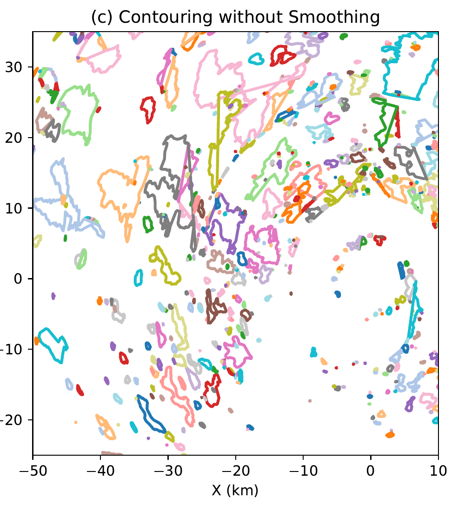

  
Paper 3 · CTGC population

  <h1>Temporal Evolution of Cloud-Top Generating Cells</h1>
  <h2>A Case Study</h2>
  

    
<strong>Jairo M. Valdivia-Prado</strong>

    
Coauthors: Katja Friedrich · Troy Zaremba · Sarah Tessendorf

  

  
Department of Atmospheric and Oceanic Sciences · University of Colorado Boulder

  
Published as Valdivia, Friedrich, Zaremba, and Tessendorf, <em>Journal of the Atmospheric Sciences</em> 83, 1405–1431 (2026) · doi:10.1175/JAS-D-25-0088.1

<!--
About 20 seconds. The first two papers addressed radar analysis methods. This third paper is an observational case study, published in the Journal of the Atmospheric Sciences. Credit Katja Friedrich, Troy Zaremba, and Sarah Tessendorf. Do not imply that the spectral methods of Papers 1 and 2 produced this study's population results: the Chapter 4 identification procedure uses its own quality control, polar-coordinate smoothing, azimuthal-mean perturbation, and contouring. The fourth paper later combines the methodological work with the cell track from this study.
-->

---
class: population-context
---

# Following a cell population through time

  

    
How did cloud-top generating cells form, organize, and dissipate in one observed winter storm?

    
<strong>23 February 2022</strong>WINTRE-MIX IOP05 · St. Lawrence valley

    
<strong>Every 6 minutes</strong>DOW6 X-band volume scans, 02:00–04:00 UTC

    
<strong>5.5–8 km MSL</strong>Observed cloud-top cell layer

  

  

Paper Figure 2. DOW6 supplies the population's repeated PPI observations; ECCC radar, RHI scans, airborne radar, and soundings provide context.

<!--
About 45 seconds. The problem is temporal: isolated cross-sections reveal cell structure but not how a population changes from first appearance through decay. During WINTRE-MIX IOP05 near Montreal on 23 February 2022, DOW6 repeatedly sampled the storm with 17 PPI sweeps per six-minute volume between 02:00 and 04:00 UTC. Cells were observed near 5.5–8 km MSL. Locate DOW6, ECCC Blainville, and the Sorel sounding on the map; the magenta line is the DOW6 RHI path. ECCC low-level reflectivity, the DOW6 RHIs, a short airborne NAX pass, and two soundings provide context, but the population identification and statistics come from the DOW6 PPI volumes. This is one storm, not a climatology. Next, explain what is counted as a CTGC feature.
-->

---
class: population-identification
---

# Identifying CTGC boundaries

From the 5.5–8 km column maximum to closed reflectivity-perturbation contours.

  

    <section>1
Take the maximum reflectivity in the cloud-top layer at each range–azimuth location.
</section>
    <section>2
Subtract the azimuthal mean at each range to obtain a reflectivity perturbation, <em>Z</em>′.
</section>
    <section>3
Gaussian-smooth <em>Z</em>′, contour at a 5-dB enhancement, and remove nested or &lt;0.09 km² regions.
</section>
  

  

    
    
  

  
Paper Figure 5(c): direct contouring fragments into noise-scale boundaries.

  
Paper Figure 5(e): smoothing and contour screening yield coherent closed boundaries; 03:18 UTC example.

<!--
About 55 seconds. First quality-control the DOW6 radar measurements. From the PPI volume, take maximum reflectivity in the 5.5–8 km layer at each range and azimuth. Subtract the azimuthal mean at that range to isolate enhancements relative to the background. This is a difference in logarithmic reflectivity and therefore has dB units, though the paper and figure use the familiar dBZ notation for the threshold. The initial 5-dB contours without smoothing, Figure 5(c), are highly fragmented. Click 1: Figure 5(e) shows the final boundaries after a 9-by-9, one-gate-standard-deviation Gaussian smoothing of the perturbation, a 5-dB contour, removal of nested contours, and rejection of regions smaller than 0.09 km². The 5-dB choice was subjective after sensitivity tests; these are threshold-defined radar features, not guaranteed one-to-one individual updrafts. This is the paper's own spatial processing, not the Paper 2 normalized local-statistics background estimator. The full Figure 5 includes intermediate fields. Next, locate the groups in the storm.
-->

---
class: population-bands
---

# Two spatiotemporal groups in one storm

  
  

    <section><h2>Set 1 · earlier</h2>
First detected near 02:18 UTC west of DOW6; translated northeast.
</section>
    <section><h2>Set 2 · later</h2>
First detected near 02:48 UTC southwest of DOW6; translated east.
</section>
    
Focus on Set 1: its full population evolution was observed within the radar domain.

  

Paper Figure 10: ECCC reflectivity at 500 m MSL shows the associated precipitation bands. Set membership comes from DOW6 cell centroids, not the ECCC field.

<!--
About 40 seconds. The detected CTGCs were neither spatially uniform nor all simultaneous. Set 1 appeared west of DOW6 near 02:18 UTC and translated northeast; Set 2 appeared later to the southwest near 02:48 UTC and translated east. On the ECCC radar panels, the blue and red annotations mark low-level precipitation bands or boundaries associated with the two groups. This is spatial-temporal context, not evidence that low-level bands caused the cells, nor definitive evidence of waves: the paper's Doppler-velocity diagnostics did not establish a persistent wave signature. Set 2's dissipation was not fully captured. Follow Set 1 for the complete life-cycle discussion. The grouping itself was based on DOW6 cell-centroid locations and tracks; the associated centroid plot is in the paper's appendix.
-->

---
class: population-maps
---

# From small boundaries to contiguous clusters

Set 1: two snapshots of the same event, 42 minutes apart.

  <figure><figcaption>02:30 · many small features</figcaption></figure>
  →
  <figure><figcaption>03:12 · larger contiguous features</figcaption></figure>

Paper Figure 12(a, c). Color indicates contour area (warmer = larger); insets show Set 1 blue and Set 2 red centroids. A large boundary can contain several cells.

<!--
About 45 seconds. These are the initiation snapshot at 02:30 and a mid-mature snapshot at 03:12, both from Figure 12. The black star marks DOW6; warmer colors indicate larger contiguous contour areas. At first there are many small, separate enhancements west of the radar. Later there are fewer, larger patches, some tens of square kilometers. The insets classify centroids into Set 1 (blue) and Set 2 (red); focus on the northern/earlier Set 1. The paper reports contiguous complexes up to about 60 km², but that does not mean one isolated 1–2 km turret grew to 60 km². A contour can connect multiple adjacent cells, so this is evidence of population organization and merging, plus sensitivity to segmentation. The time series next quantifies the count and area changes.
-->

---
class: population-trends
---

# Set 1: structure and polarimetric evolution

The approximately 1.7-hour observed population is divided into initiation, mature, and dissipation stages.

  
  

  
<strong>Count peaks early.</strong> During maturity, count falls while mean contiguous area rises; later the count and coverage decline.

  
<strong>Mean ZDR falls, then rises.</strong> The later increase is consistent with differential sedimentation and particle sorting in the cloud-top layer.

  
Paper Figure 13(a), Set 1: red = count; blue = mean boundary area; green dashed = area mode; gray = 10th–90th percentile.

  
Paper Figure 13(c), Set 1, 02:18–03:54 UTC: blue = mean ZDR; green dashed = mode; gray = 10th–90th percentile. Particle habits are inferred.

<!--
About 1 minute 15 seconds. Begin with Figure 13(a), cropped to Set 1. The red curve is detected feature count and the blue curve is mean contour area; the dashed green is the area mode and gray shading the 10th–90th percentile. Set 1 begins near 02:18 UTC; count rises sharply around 02:30–02:36, then declines during the mature stage while mean area grows, consistent with merging or clustering. During dissipation from roughly 03:24 to 04:00 the count and total coverage fall, although the mean area of surviving features does not necessarily decline monotonically because smaller features disappear. The stages are defined mainly from the count/area evolution. The chapter text and table place the first transition near 02:30, while the plotted dashed divider appears closer to 02:36; avoid presenting its minute as exact. Dissipation begins near 03:24. The chart's last plotted label is 03:54, while the study period extends to 04:00. This is about 1.7 hours of collective activity, not a mean individual-cell lifetime.

Click 1: Figure 13(c), now the mean and mode of differential reflectivity Z_DR with its 10th–90th percentile envelope. Mean Z_DR decreases early, then rises significantly through the mature and dissipation stages, passing about 1 dB late in the record. The interpretation is that larger, more isotropic particles sediment out, leaving a relatively greater contribution from slower-falling oriented crystals aloft. Polarimetry supports this inference but does not directly identify particle habit. Reflectivity is relatively stable after initiation and rho_HV stays high; these additional plots remain in the full Figure 13. Do not call the contour-size increase growth of every individual cell. Move to the explicitly conceptual synthesis.
-->

---
class: figure-slide population-schematic
---

# A conceptual population life cycle

  

Paper Figure 19, cropped. Bottom: observed boundary evolution. Top: microphysical interpretation from radar signatures, not direct particle imagery.

<!--
About 40 seconds. Read the bottom row first: many small boundaries, then merging into contiguous features, then fewer detected boundaries. This part summarizes the count, area, and maps just shown. The top row is a conceptual interpretation, not a camera view of crystal habits: less organized particles initially; a mature core of more isotropic aggregates or rimed crystals and a surrounding shroud of oriented pristine crystals; then preferential fallout of larger particles, consistent with higher Z_DR remaining in the generating layer. Do not say every cell displayed this exact geometry or that direct in situ particles were measured here. Candidate influences discussed in the paper include shear-related organization and decreasing moisture, but the observations do not isolate the forcing mechanism. One unusually persistent cell lets us connect the population view to the next paper.
-->

---
class: population-cell
---

# One selected cell persisted for nearly 50 minutes

Three of nine reflectivity snapshots from a manually tracked Set 1 cell.

  <figure><figcaption>02:55 · first observed</figcaption></figure>
  <figure><figcaption>03:25 · near peak area</figcaption></figure>
  <figure><figcaption>03:43 · last observed</figcaption></figure>

Paper Figure 17(a, f, i), cropped. Dashed circles locate the same cell; PPI elevations are 6.9°, 11.6°, and 6.9°. This selected track is not a population lifetime estimate.

<!--
About 45 seconds. The dashed circle follows one selected Set 1 feature from 02:55 to 03:43 UTC, nearly 50 minutes. These are three of the nine PPI reflectivity panels in Figure 17; the full sequence and the corresponding Z_DR series appear in the paper, with the Z_DR sequence also in backup. The middle panel at 03:25 shows a stronger and larger signature (the paper estimates a maximum contour area of roughly 45 km²), then the signature weakens. The elevation angle printed above each panel changes to continue sampling the moving cell; the gray dashed arcs indicate altitude. This is a manually followed, long-lived example, not evidence that typical cells live 50 minutes. Its Z_DR decreases to near zero during maturity and exceeds 2 dB late in the track, consistent with the population trend but subject to the same interpretive caveats. The track is the starting point for the cell-relative three-dimensional analysis in Paper 4.
-->

---
class: smoothing-conclusions
---

# Project 3: Limits

  <section>
The 5-dB threshold and X-band sensitivity can miss weak or small cells.
</section>
  <section>
Contiguous contours may join several turrets; six-minute scans miss rapid changes.
</section>
  <section>
One storm and radar polarimetry constrain, but do not prove, particle or forcing mechanisms.
</section>

<!--
About 35 seconds. The threshold was chosen to balance noise and coherent detections, not to include every weak cloud-top feature. X-band sensitivity and the smoothing/size screen favor stronger cells; the detected boundaries are not necessarily individual updrafts. Connected regions may merge several turrets, so an increase in contour area is not exclusively physical growth of one cell. Six-minute sampling can miss short-lived cells and fast splitting/merging; stage boundaries are approximate. The observed Z_DR evolution is a polarimetric signature consistent with sorting, not a particle-habit measurement or proof of causality. The two soundings and wind context do not establish a unique radiative, shear, or wave mechanism. Uncorrected X-band differential attenuation can lower absolute Z_DR; the paper's conservative bound argues it cannot create the late higher Z_DR. These results describe one winter storm and require other cases to test generality.
-->

---
class: smoothing-conclusions population-conclusions
---

# Project 3: Conclusions

  <section>
Set 1 showed an approximately 1.7-hour population sequence: initiation, maturity, dissipation.
</section>
  <section>
Counts fell as mean boundary area rose during maturity: adjacent features clustered.
</section>
  <section>
Mean ZDR fell early, then rose, consistent with later particle sedimentation and sorting.
</section>

A selected cell track connects this population analysis to the three-dimensional fall-streak study.

<!--
About 35 seconds. Suggested delivery: “In this one storm, the earlier cell group was visible for about 1.7 hours. It began as many small detected features; the count then fell while contiguous boundaries grew as the population organized, before activity declined. Differential reflectivity decreased early and increased later, consistent with particle sorting aloft, though radar does not directly reveal habits.” Keep population duration distinct from individual-cell lifetime, and the 5-dB radar boundaries distinct from one-to-one physical updrafts. The selected, nearly 50-minute track provides the moving reference for Paper 4. This paper is published in JAS (2026); the next one is submitted to GRL, not yet accepted. Do not say Papers 1 and 2 directly generated the Paper 3 identification; Paper 4 integrates their methods with this track.
-->
