

  
Paper 3 · CTGC population

  <h1>Temporal Evolution of Cloud-Top Generating Cells</h1>
  <h2>A Case Study</h2>
  

    
<strong>Jairo M. Valdivia-Prado</strong>

    
Coauthors: Katja Friedrich · Troy Zaremba · Sarah Tessendorf

  

  
Department of Atmospheric and Oceanic Sciences · University of Colorado Boulder

  
Published as Valdivia, Friedrich, Zaremba, and Tessendorf, <em>Journal of the Atmospheric Sciences</em> 83, 1405–1431 (2026) · doi:10.1175/JAS-D-25-0088.1

<!--
About 20 seconds. The first two papers addressed radar analysis methods. This third paper is an observational case study, published in the Journal of the Atmospheric Sciences. Credit Katja Friedrich, Troy Zaremba, and Sarah Tessendorf. Do not imply that the spectral methods of Papers 1 and 2 produced this study's population results: the Chapter 4 identification procedure uses its own quality control, polar-coordinate smoothing, azimuthal-mean perturbation, and contouring. The fourth paper later combines the methodological work with the cell track from this study. Next, outline the core problem and three research objectives.
-->

---
class: population-objectives
---

# Objectives: CTGC population evolution

  While instantaneous cell structures are known from snapshots, the <strong>complete lifecycle of a CTGC population</strong> has remained undocumented observationally.

  <h3>Macrostructural evolution</h3>
  
How do CTGCs organize and evolve through time?

  
Track changes in cell counts, horizontal dimensions, and the merging of individual cells into contiguous clusters.

  <h3>Microphysical progression</h3>
  
How do particle signatures change across stages?

  
Examine systematic trends in polarimetric radar variables (<em>Z</em>e, <em>Z</em>DR, <em>ρ</em>HV) and infer crystal habit evolution.

  <h3>Environmental conditions</h3>
  
What factors govern the cell lifecycle?

  
Assess the roles of vertical wind shear, cloud-top thermodynamic stability, and moisture depletion in cell maintenance and decay.

<!--
About 45 seconds. The first two papers developed radar analysis methods. This third paper applies high-resolution radar observations to address an open physical problem: following an entire CTGC population through time.

While past studies revealed the instantaneous 1–2 km structure of generating cells using isolated RHI sweeps or aircraft passes, the complete life cycle of a population—from first appearance through organization to decay—has remained uncharacterized observationally.

We address three questions:
First, macrostructure: how do cell count, size, and clustering change over time?
Second, microphysics: what do polarimetric variables reveal about particle sorting and habit changes as cells mature?
And third, environment: what thermodynamic and shear conditions support each stage?

To answer these, we analyze repeated volumetric radar scans from one winter storm during WINTRE-MIX.
-->

---
class: population-context
---

# WINTRE-MIX: Study area and instrumentation

  

    

      <strong>WINTRE-MIX Campaign · IOP05</strong>
      22–23 February 2022 · St. Lawrence and Champlain valleys (US–Canada border). Studying winter precipitation near 0°C in complex terrain.
    

    

      <strong>DOW6 X-band radar (primary)</strong>
      Dual-polarization Doppler radar; 75 m range resolution; 17 PPI sweeps every 6 min (02:00–04:00 UTC).
    

    

      <strong>Context instrumentation</strong>
      Operational S-band radar from Environment and Climate Change Canada (ECCC Blainville; 240 km range); radiosondes from Sorel, QC (02:00 &amp; 04:15 UTC); airborne NAX radar on the NRC Convair-580.
    

  

  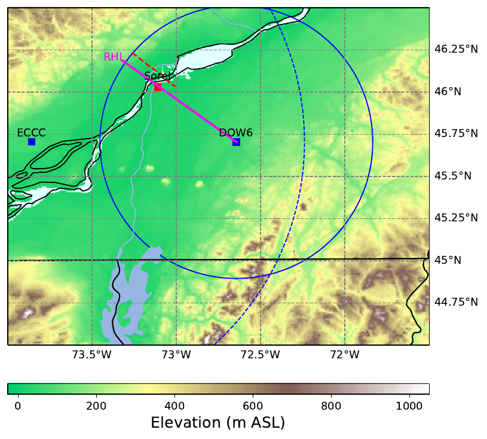

Paper Figure 2. DOW6 supplies the repeated 6-minute volumetric scans for cell detection; ECCC radar, soundings, and airborne radar provide mesoscale context.

<!--
About 45 seconds. Introduce the observational framework. The dataset comes from the Winter Precipitation Type Research Multi-scale Experiment (WINTRE-MIX), conducted in late winter 2022 across the US–Canada border in the St. Lawrence and Champlain valleys.

Point to the map: DOW6 was deployed near the valley confluence to sample winter storm IOP05. The primary platform is the Doppler on Wheels 6 from the NSF-supported CSWR facility: an X-band dual-polarization radar sampling 17 PPI sweeps every six minutes between 02:00 and 04:00 UTC, with 75-meter range resolution. CTGCs were observed between 5.5 and 8 km MSL.

Supporting context came from Environment and Climate Change Canada's operational S-band radar at Blainville for storm-scale coverage, two radiosondes launched at Sorel for vertical thermodynamics, and a flight pass by the NRC Convair-580 with the NAX cloud radar.

Next, I will explain how we identify CTGC features from these volumetric scans.
-->

---
class: population-identification
---

# CTGC detection: Layer maximum and perturbation

  {{ label }}

  

    

      <CuManim :steps="6" :width="1000" :height="310" :construct="ctgcIdentification" />
      <svg v-if="clicks === 0" class="ctgc-first-frame" viewBox="0 0 1000 580" aria-hidden="true">
        <path v-for="(item, i) in ctgcPreview" :key="i" :d="item.d" :fill="item.color" :fill-opacity="item.fill" :stroke="item.color" :stroke-opacity="item.stroke" :stroke-width="item.width" />
      </svg>
      <svg v-if="clicks < 6" class="ctgc-labels" viewBox="0 0 1000 580" aria-hidden="true">
        <defs>
          <linearGradient id="ctgc-field-scale">
            <stop v-for="(color, i) in clicks === 5 ? ctgcColors.perturbation : ctgcColors.reflectivity" :key="i" :offset="`${i * 25}%`" :stop-color="color" />
          </linearGradient>
          <marker id="ctgc-arrow-head" viewBox="0 0 8 8" refX="7" refY="4" markerWidth="7" markerHeight="7" orient="auto-start-reverse">
            <path d="M0,0 L8,4 L0,8 z" fill="#cfb87c" />
          </marker>
        </defs>
        <g v-if="clicks <= 2">
          <text v-for="(item, i) in ctgcLabels.side" :key="i" :x="item.x" :y="item.y" :text-anchor="item.anchor">{{ item.text }}</text>
          <rect x="700" y="27" width="140" height="12" fill="url(#ctgc-field-scale)" />
          <text x="681" y="42">0</text><text x="902" y="42">18 dBZ</text>
          <text v-if="clicks === 2" x="540" y="528" class="ctgc-gold">Retain the maximum at each range gate</text>
          <g v-if="clicks >= 1" class="ctgc-gold">
            <text v-for="(item, i) in ctgcLabels.layer" :key="i" :x="item.x" :y="item.y" :text-anchor="item.anchor">{{ item.text }}</text>
          </g>
        </g>
        <g v-else>
          <text v-for="(item, i) in ctgcLabels.map" :key="i" :x="item.x" :y="item.y" :text-anchor="item.anchor">{{ item.text }}</text>
          <text v-if="clicks === 5" x="830" y="95" class="ctgc-map-title">Z′ (dB)</text>
          <text v-else x="830" y="95" class="ctgc-map-title">Z<tspan baseline-shift="sub" style="font-size: 18px">max</tspan><tspan> (dBZ)</tspan></text>
          <text x="830" y="128">{{ clicks >= 4 ? 'One range ring: 36.25 km' : 'Sampled layer maximum' }}</text>
          <g v-if="clicks >= 4" class="ctgc-ring-profile" :class="{ 'ctgc-no-anim': ctgcNoAnim }">
            <line x1="520" y1="252" x2="698" y2="252" class="ctgc-link-arrow" marker-end="url(#ctgc-arrow-head)" />
            <path d="M715 165 V338 H955" />
            <path :d="`M715 ${ctgcRingProfile.meanY} H955`" class="ctgc-mean-line ctgc-xfade" :class="{ faded: clicks === 5 }" />
            <path :d="`M715 ${ctgcRingProfile.zeroY} H955`" class="ctgc-mean-line ctgc-xfade" :class="{ faded: clicks !== 5 }" />
            <polyline :points="ctgcRingProfile.maximum" class="ctgc-profile-poly ctgc-xfade" :class="{ faded: clicks === 5 }" />
            <polyline :points="ctgcRingProfile.perturbation" class="ctgc-profile-poly ctgc-xfade" :class="{ faded: clicks !== 5 }" />
            <text x="704" y="188" text-anchor="end">{{ clicks === 5 ? '12' : '18' }}</text>
            <text x="704" y="340" text-anchor="end">{{ clicks === 5 ? '−4' : '0' }}</text>
            <text x="715" y="365">0°</text><text x="955" y="365">360°</text>
            <text x="835" y="397">Azimuth</text>
            <text x="835" y="435" class="ctgc-gold">{{ clicks === 5 ? 'Reference becomes zero' : `Azimuthal mean = ${ctgcData.focus.mean.toFixed(1)} dBZ` }}</text>
          </g>
          <g v-else>
            <text x="830" y="270">One value per (r, θ)</text>
            <text x="830" y="307">Horizontal CTGC footprint</text>
          </g>
          <rect x="715" y="466" width="240" height="16" fill="url(#ctgc-field-scale)" />
          <text x="715" y="512">{{ clicks === 5 ? '−4' : '0' }}</text>
          <text x="835" y="512">{{ clicks === 5 ? '4' : '9' }}</text>
          <text x="955" y="512">{{ clicks === 5 ? '12 dB' : '18 dBZ' }}</text>
        </g>
      </svg>
      
= 6" class="ctgc-observed">
        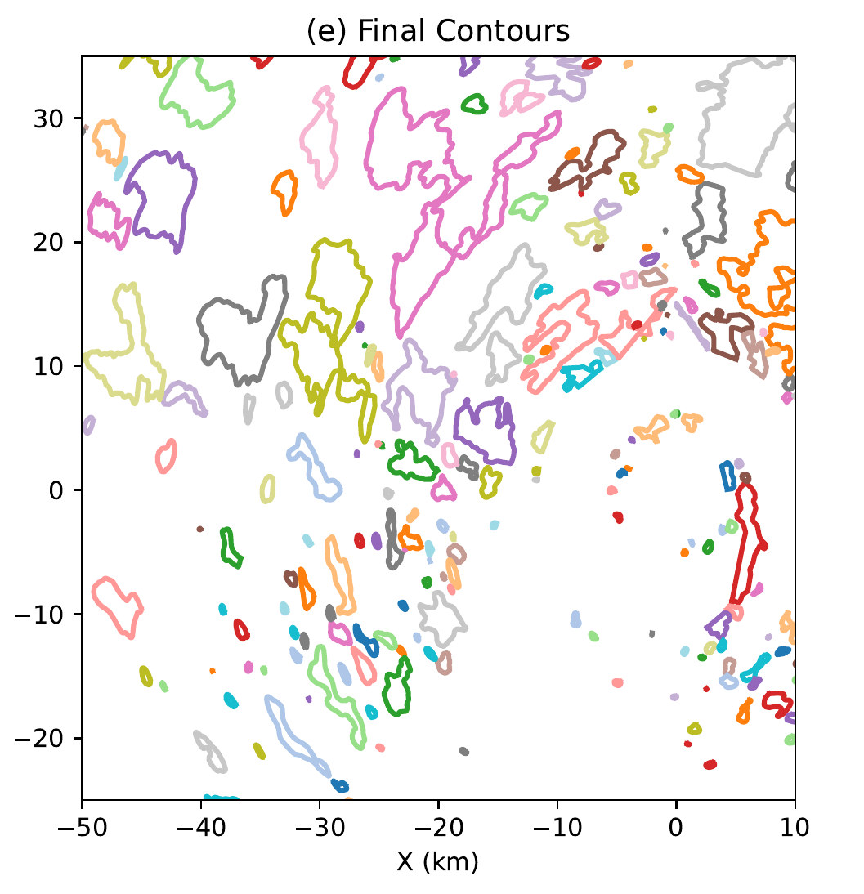
      

    

    
{{ clicks >= 6 ? 'Observed example · 03:18 UTC · Validiva, et al. 2026 Fig. 5e' : clicks <= 2 ? 'Schematic · one azimuth · vertical scale exaggerated' : 'Schematic · same volume reduced to a horizontal field' }}

  

  

    

      <h2>Discrete vertical sampling</h2>
      
<strong>17 PPI elevations · 0.4°–50°</strong>

      
Each ray is a side view of one elevation sweep.

      
The volume repeats every 6 minutes.

    

    

      <h2>Select the generating layer</h2>
      
<strong>5.5–8 km MSL</strong>, identified from RHI observations.

      
Only sampled gates inside this band contribute.

      
The number of contributing elevations changes with range.

    

    

      <h2>Layer column maximum</h2>
      
Extract maximum reflectivity in the 5.5–8 km MSL cell layer at each range–azimuth gate (<em>r</em>, <em>θ</em>).

      
The white rings mark the contributing samples; only the largest value is retained.

    

    

      <h2>Repeat around the radar</h2>
      
Each PPI samples azimuth around the radar.

      
Retaining one maximum per (<em>r</em>, <em>θ</em>) produces the <strong>2D Zmax field</strong>.

      
The layer maximum collapses the elevation dimension.

    

    

      <h2>A range-dependent background</h2>
      
Average Zmax over valid azimuths at the same range.

      
The highlighted ring has a mean of <strong>{{ ctgcData.focus.mean.toFixed(1) }} dBZ</strong>.

      
Repeat for every range ring.

    

    

      <h2>Reflectivity perturbation (Z′)</h2>
      
Subtract the range-dependent azimuthal mean:

      

$$Z'(r,\theta) = Z_{\max}(r,\theta) - \overline{Z_{\max}}_{\theta}(r)$$

      
Positive Z′ marks an enhancement above its range-ring background.

    

    

      <h2>Smoothing, 5-dB contouring &amp; screening</h2>
      
Apply 2D Gaussian smoothing (9×9 window), contour at 5 dB, and discard nested or &lt;0.09 km² regions.

      
Gaussian σ = 1 gate in range and azimuth.

      
Closed boundaries describe the horizontal CTGC distribution.

    

  

{{ clicks >= 6 ? 'Gaussian smoothing and area screening (≥0.09 km²) yield coherent closed cell boundaries.' : 'Illustrative reflectivity field · maxima and azimuthal means computed from the example.' }}

<!--
About 90 seconds. This click-stepped schematic explains the sampling and reduction behind the Paper 3 detection method. It uses the 17 nominal elevations from Paper Figure 3: 0.4–50 degrees. The coarse reflectivity values and cell locations are illustrative, with actual maxima and azimuthal means calculated from that same schematic volume. One initial azimuth is shown in a range–height view. The straight beam centerlines have exaggerated vertical scale; gates are schematic samples, not the radar's actual 75-m spacing. The volume scan repeats every six minutes. Standard quality control and initial reflectivity smoothing precede the operations illustrated here.

[click] Select only observations in the 5.5–8 km MSL cloud-top layer identified in RHI scans. At a particular range, only a few of the 17 elevations intersect the layer. Missing coverage stays missing; the animation does not fill these gaps.

[click] At each polar range–azimuth gate, take the largest of the sampled in-layer reflectivities. The highlighted example at 36.25 km has two contributing elevations, marked by white rings, and the selected maxima move into a common radial strip. The maximum is over available observations, not a reconstructed continuous vertical profile.

[click] Each of these elevations is a PPI sweep around the radar. Rotate the same strip into plan view, and repeat the reduction over all azimuths to obtain Z_max(r, theta). The sweep is a reveal of this one schematic volume, not a simultaneous scan or a time-evolving storm. The PPI volume samples height; reducing the elevations to one layer maximum produces the two-dimensional horizontal footprint. Gray rings have no in-layer samples.

[click] Highlight one range ring and average its valid Z_max values over azimuth. The small profile plots those exact values; the gold dashed line is their mean in dBZ. Each range has its own background value.

[click] Subtract the range-dependent mean from every gate to obtain Z-prime. The profile is now centered on zero, with peaks marking enhancements above the range-ring background. This logarithmic reflectivity difference has units of dB. Localized enhancements remain prominent as the broad background weakens.

[click] Now switch explicitly from the schematic to the observed 03:18 UTC example, Paper Figure 5(e). Apply the paper's two-dimensional Gaussian filter to Z-prime (sigma 1 gate in each direction, 9-by-9 window), contour at a 5-dB enhancement, remove nested contours, and discard regions smaller than 0.09 square kilometers. These are coherent horizontal boundaries for the population analysis. A connected boundary can encompass more than one turret.
-->

---
class: population-storm
---

# CTGC population within the evolving storm

23 February 2022 · WINTRE-MIX IOP05 · the same storm and selected cell in Papers 3 and 4.

  <figure>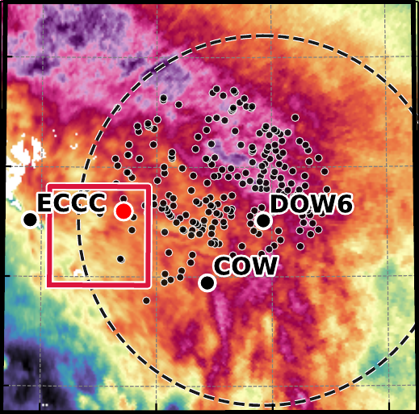<figcaption>02:54 UTC</figcaption></figure>
  <figure>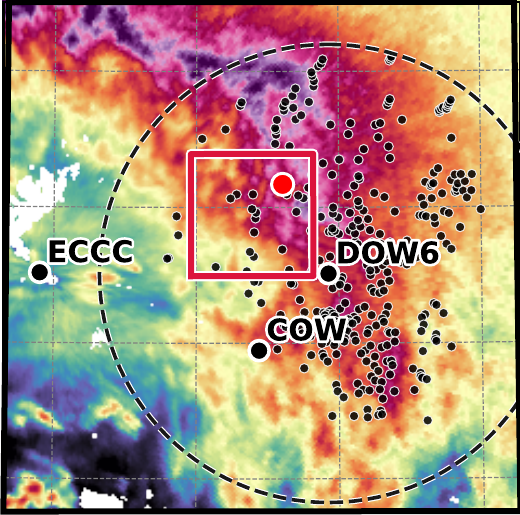<figcaption>03:18 UTC</figcaption></figure>
  <figure>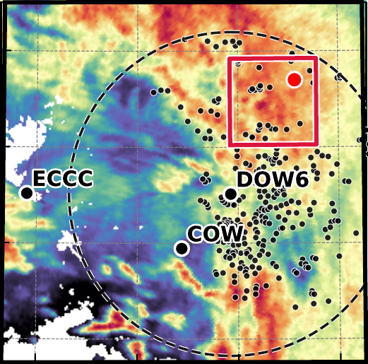<figcaption>03:42 UTC</figcaption></figure>
  <svg class="population-storm-scale" viewBox="0 0 64 300" role="img" aria-label="ECCC reflectivity scale, −5 to 40 dBZ, with open-ended extremes">
    <defs><clipPath id="population-storm-scale-clip"><path d="M11 27 L18 39 V268.5 L11 280 L4 268.5 V39Z" /></clipPath></defs>
    <image href="../figures/population-storm-scale.png" x="-3.8" y="24" width="65" height="265" preserveAspectRatio="none" clip-path="url(#population-storm-scale-clip)" />
    <text x="32" y="15" class="population-scale-unit">dBZ</text>
    <g v-for="(value, index) in [40, 35, 30, 25, 20, 15, 10, 5, 0, -5]" :key="value">
      <line x1="18" x2="23" :y1="39 + index * 25.5" :y2="39 + index * 25.5" />
      <text x="28" :y="39 + index * 25.5">{{ value }}</text>
    </g>
  </svg>

<strong>Black dots:</strong> both CTGC sets · <strong>Red marker:</strong> selected Set 1 cell · <strong>Red box:</strong> Paper 4 analysis domain

ECCC reflectivity (dBZ) with DOW6-derived CTGC centroids; dashed circle = DOW6's 75-km range.

<!--
About 45 seconds. These three enlarged panels from Paper 4 supporting Figure S1 show the broader precipitation system and connect the two observational papers: the storm and the selected cell are the same. Color is ECCC equivalent reflectivity in dBZ, not cloud-top reflectivity or the perturbation field from the previous slide. Small black dots are the DOW6-derived CTGC centroids from both sets, not separate color-coded set labels. The red marker follows the selected Set 1 cell northeast, and the red box is the moving 40-by-40-kilometer domain used later in Paper 4. The dashed circle marks DOW6's 75-kilometer range. Do not interpret every strong low-level echo as precipitation from this cell.

The two groups began before this displayed sequence: Set 1 near 02:18 UTC west of DOW6, moving northeast; Set 2 near 02:48 UTC to the southwest, moving east. Those onset times come from Paper 3, not from these later S1 panels. Focus on Set 1 because its complete population sequence was observed; Set 2's dissipation was not fully captured. This is radar storm context, not a thermodynamic diagnosis or proof of wave-driven forcing. The soundings and RHI sequence next provide the vertical and environmental context. Paper 4 is submitted to GRL, not published.
-->

---
class: population-environment
---

# Vertical evolution and environmental conditions

  
DOW6 RHI observations show the evolution of the 5.5–8 km MSL generating layer.

  
Sorel soundings bracket the event: 02:00 and 04:15 UTC. Gray shading marks 5.5–8 km MSL.

  

    <figure><figcaption>02:22 · deep stratiform echo</figcaption></figure>
    <figure><figcaption>02:40 · distinct cloud-top turrets</figcaption></figure>
    <figure><figcaption>03:04 · fewer, larger features</figcaption></figure>
    <figure><figcaption>03:34 · increasing echo separation</figcaption></figure>
    <svg class="population-rhi-scale" viewBox="0 0 64 300" role="img" aria-label="DOW6 reflectivity scale, −10 to 40 dBZ">
      <defs><clipPath id="population-rhi-scale-clip"><rect x="4" y="27" width="14" height="253" /></clipPath></defs>
      <image href="../figures/population-rhi-scale.png" x="1" y="22.6" width="71.5" height="266" preserveAspectRatio="none" clip-path="url(#population-rhi-scale-clip)" />
      <text x="32" y="15" class="population-scale-unit">dBZ</text>
      <g v-for="(value, index) in [40, 30, 20, 10, 0, -10]" :key="value">
        <line x1="18" x2="23" :y1="27 + index * 50.6" :y2="27 + index * 50.6" />
        <text x="28" :y="27 + index * 50.6">{{ value }}</text>
      </g>
    </svg>
  

  

    <figure><figcaption>02:00 UTC</figcaption>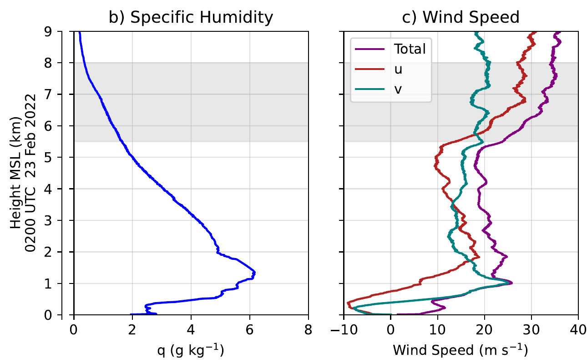</figure>
    <figure><figcaption>04:15 UTC</figcaption>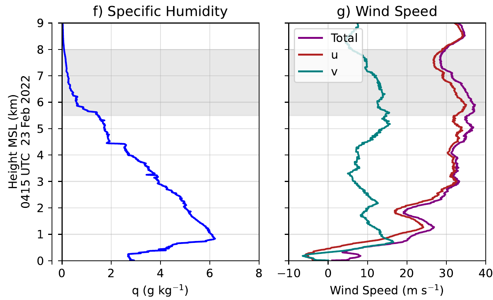</figure>
  

  
<strong>Cloud-top features become fewer and larger,</strong> with increasing separation from the underlying stratiform echo.

  
<strong>Generating-layer drying and weaker shear:</strong> 5.5–8 km bulk wind shear decreased from approximately 18 to 9 m s−1 between soundings.

<!--
About 75 seconds. Begin with the northwest portions of the four DOW6 RHI scans in Paper 3 Figure 6. These are fixed-azimuth cuts at 316 degrees, not a Lagrangian vertical sequence of the red selected cell. At 02:22 the stratiform echo is deep, with cloud top near 7 km. By 02:40 there are many distinct cloud-top turrets. At 03:04 the visible generating features are fewer and larger. By 03:34 the generating-layer echo is increasingly separated from the stratiform echo below. This apparent decoupling is consistent with drying, but reflectivity alone does not measure humidity. The cross-shear viewing direction emphasizes turret spacing and does not capture the complete along-shear fall streak. Negative ranges point northwest from DOW6; the shared color scale is equivalent reflectivity in dBZ.

[click] Now compare specific humidity and horizontal wind profiles from the Sorel soundings at 02:00 and 04:15 UTC, Paper 3 Figure 9(b,c,f,g). The source figure's original shared height axes and sounding-time labels are retained beside the cropped panel pairs. Gray shading identifies the 5.5–8 km MSL generating layer. Specific humidity decreases within this layer, not uniformly throughout the column. The layer's bulk vector wind shear decreases from approximately 18 to 9 meters per second; do not describe this as halving the wind speed. Paper 3's VAD analysis, retained in the full backup Figure 9, gives intermediate kinematic context and shows shear relaxation during the organization period. The soundings bracket the event rather than resolve its short-term thermodynamic evolution, and their spatial separation from the cells limits causal interpretation. The layer is generally near-neutral to weakly stable, with only a shallow weakly-negative ice-equivalent-potential-temperature gradient near cloud top initially; do not claim broad instability or diagnose a unique radiative, shear, or wave initiation mechanism. These are accompanying conditions, not demonstrated causes. Next watch the complete detected evolution, then quantify the horizontal population changes.
-->

---
class: population-video
---

# Horizontal evolution

The complete detected evolution: both CTGC sets emerge, intensify, and dissipate.

  <video class="population-video-player" muted autoplay loop playsinline controls poster="../figures/compsii-horizontal-poster.png">
    <source src="../figures/compsii-horizontal-evolution.mp4" type="video/mp4" />
  </video>
  

    <section><h2>Temporal evolution</h2>
Detected anomalies emerge, intensify, and dissipate over the observed population sequence.
</section>
    <section><h2>Spatial distribution</h2>
Two distinct CTGC groups are visible: the earlier Set 1 and the later Set 2.
</section>
  

<!--
About 40 seconds. This looping animation from COMPSII slide 26 shows the full-domain detected reflectivity anomaly evolving through the observed population sequence: anomalies emerge, intensify into coherent features, and dissipate. Both spatiotemporal groups from the previous storm-context slide are visible here: the earlier Set 1 and the later Set 2. This is the same detection field quantified next: the maps show where the count and area time series come from, and the color scale is anomaly in dB, not equivalent reflectivity in dBZ. Do not attribute individual low-level echoes to the selected cell. The still maps and time series next quantify what this animation shows qualitatively.
-->

---
class: population-trends population-maps
---

# Set 1: structure evolution

The approximately 1.7-hour observed population is divided into initiation, mature, and dissipation stages.

  

    

      <figure>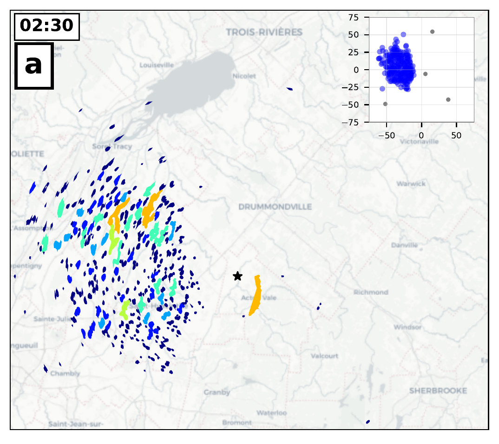<figcaption>02:30 · many small features</figcaption></figure>
      →
      <figure>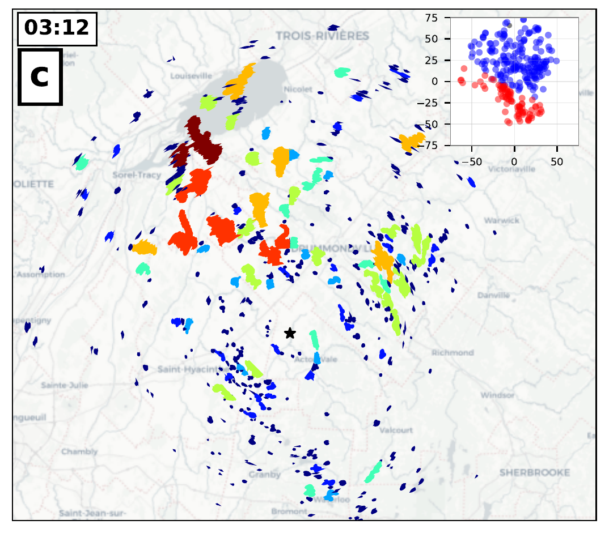<figcaption>03:12 · larger contiguous features</figcaption></figure>
    

    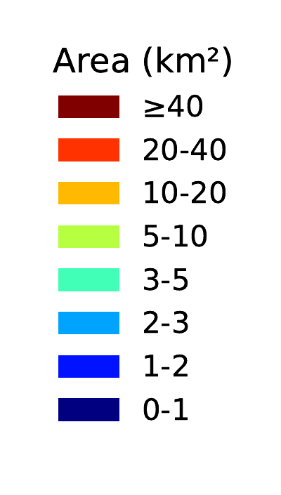
  

  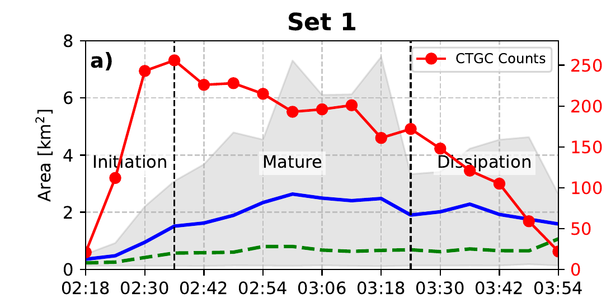

  
<strong>Small boundaries become larger contiguous clusters.</strong> A large boundary can contain several cells.

  
<strong>Count peaks early.</strong> During maturity, count falls while mean contiguous area rises; later the count and coverage decline.

  
Paper Figure 12(a, c), 42 minutes apart. Color = contour area in km² (right); insets show Set 1 blue and Set 2 red centroids.

  
Paper Figure 13(a), Set 1: red = count; blue = mean boundary area; green dashed = area mode; gray = 10th–90th percentile.

<!--
About 1 minute. The two Figure 12 maps show initiation at 02:30 and mid-maturity at 03:12, 42 minutes apart. The black star marks DOW6; the scale at right gives the contour-area classes in square kilometers, with warmer colors indicating larger contiguous areas. Many small, separate enhancements become fewer, larger patches, some tens of square kilometers. The insets classify centroids into Set 1 (blue) and Set 2 (red); focus on the northern/earlier Set 1. Contiguous complexes up to approximately 60 km² do not mean an isolated 1–2 km turret grew to 60 km². A contour can connect multiple adjacent cells, so the maps show population organization and merging, with sensitivity to segmentation.

[click] Figure 13(a), cropped to Set 1, quantifies this evolution. The red curve is detected feature count and the blue curve is mean contour area; the dashed green is the area mode and gray shading the 10th–90th percentile. Set 1 begins near 02:18 UTC; count rises sharply around 02:30–02:36, then declines during the mature stage while mean area grows, consistent with merging or clustering. During dissipation from roughly 03:24 to 04:00 the count and total coverage fall, although the mean area of surviving features does not necessarily decline monotonically because smaller features disappear. The stages are defined mainly from the count/area evolution. The chapter text and table place the first transition near 02:30, while the plotted dashed divider appears closer to 02:36; avoid presenting its minute as exact. Dissipation begins near 03:24. The chart's last plotted label is 03:54, while the study period extends to 04:00. This is about 1.7 hours of collective activity, not a mean individual-cell lifetime. Polarimetry next adds the microphysical dimension.
-->

---
class: population-trends
---

# Set 1: polarimetric evolution

Mean differential reflectivity falls early, then rises through maturity and dissipation.

  

  
<strong>Mean ZDR falls, then rises.</strong> The later increase is consistent with differential sedimentation and particle sorting in the cloud-top layer.

  
Paper Figure 13(c), Set 1, 02:18–03:54 UTC: blue = mean ZDR; green dashed = mode; gray = 10th–90th percentile. Particle habits are inferred.

<!--
About 40 seconds. Figure 13(c) shows the mean and mode of differential reflectivity Z_DR with its 10th–90th percentile envelope. Mean Z_DR decreases early, then rises significantly through the mature and dissipation stages, passing about 1 dB late in the record. The interpretation is that larger, more isotropic particles sediment out, leaving a relatively greater contribution from slower-falling oriented crystals aloft. Polarimetry supports this inference but does not directly identify particle habit. Reflectivity is relatively stable after initiation and rho_HV stays high; these additional plots remain in the full Figure 13. Do not call the contour-size increase growth of every individual cell. Move to the explicitly conceptual synthesis.
-->

---
class: figure-slide population-schematic
---

# A conceptual population life cycle

  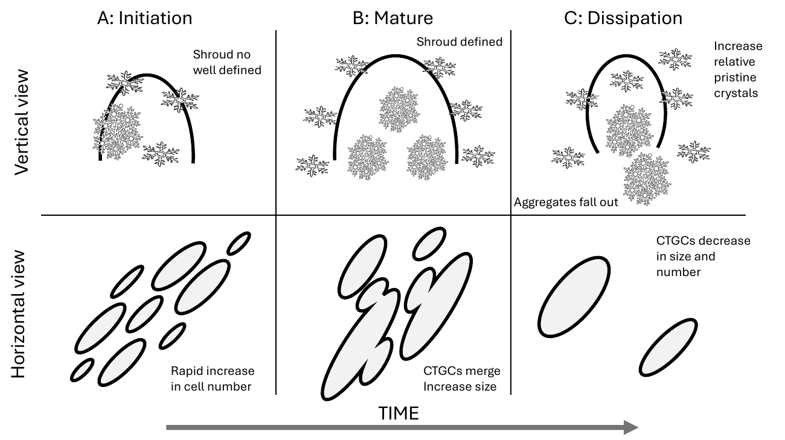

Paper Figure 19, cropped. Bottom: observed boundary evolution. Top: microphysical interpretation from radar signatures, not direct particle imagery.

<!--
About 40 seconds. Read the bottom row first: many small boundaries, then merging into contiguous features, then fewer detected boundaries. This part summarizes the count, area, and maps just shown. The top row is a conceptual interpretation, not a camera view of crystal habits: less organized particles initially; a mature core of more isotropic aggregates or rimed crystals and a surrounding shroud of oriented pristine crystals; then preferential fallout of larger particles, consistent with higher Z_DR remaining in the generating layer. Do not say every cell displayed this exact geometry or that direct in situ particles were measured here. Candidate influences discussed in the paper include shear-related organization and decreasing moisture, but the observations do not isolate the forcing mechanism. One unusually persistent cell lets us connect the population view to the next paper.
-->

---
class: population-cell
---

# One selected cell persisted for nearly 50 minutes

Three of nine reflectivity snapshots from a manually tracked Set 1 cell.

  <figure>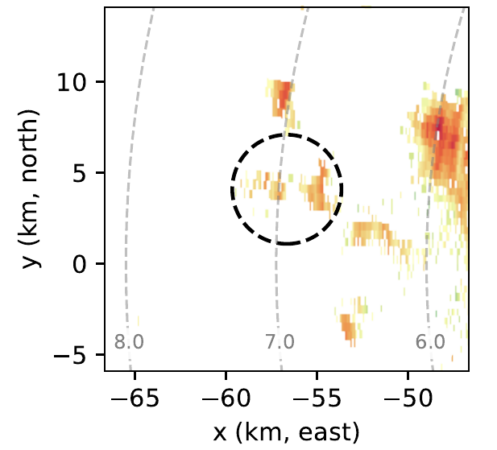<figcaption>02:55 · first observed</figcaption></figure>
  <figure>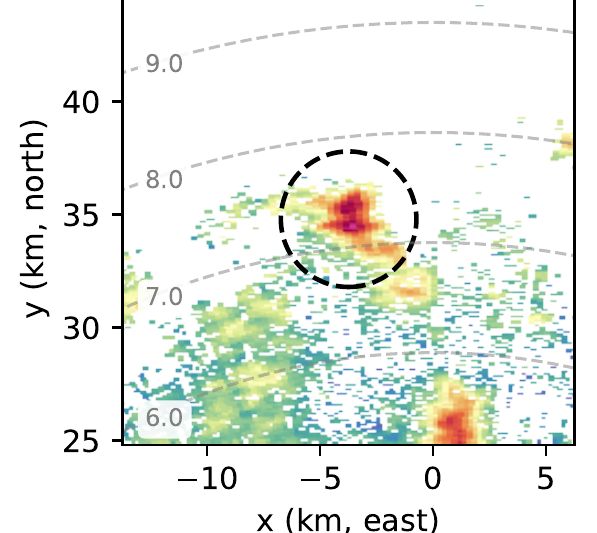<figcaption>03:25 · near peak area</figcaption></figure>
  <figure>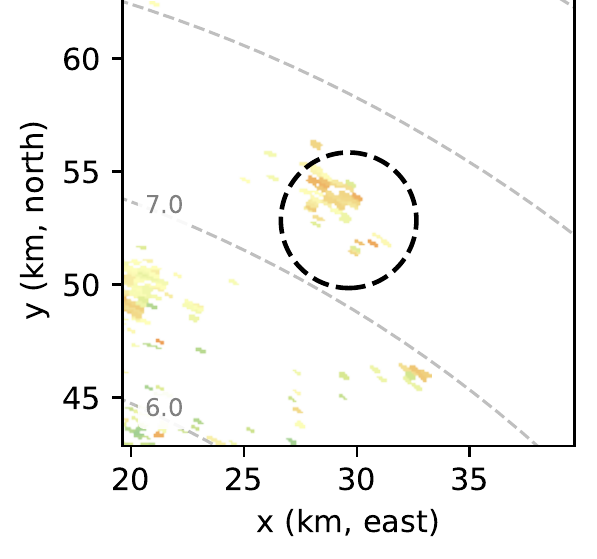<figcaption>03:43 · last observed</figcaption></figure>

Paper Figure 17(a, f, i), cropped. Dashed circles locate the same cell; PPI elevations are 6.9°, 11.6°, and 6.9°. This selected track is not a population lifetime estimate.

<!--
About 45 seconds. The dashed circle follows one selected Set 1 feature from 02:55 to 03:43 UTC, nearly 50 minutes. These are three of the nine PPI reflectivity panels in Figure 17; the full sequence and the corresponding Z_DR series appear in the paper, with the Z_DR sequence also in backup. The middle panel at 03:25 shows a stronger and larger signature (the paper estimates a maximum contour area of roughly 45 km²), then the signature weakens. The elevation angle printed above each panel changes to continue sampling the moving cell; the gray dashed arcs indicate altitude. This is a manually followed, long-lived example, not evidence that typical cells live 50 minutes. Its Z_DR decreases to near zero during maturity and exceeds 2 dB late in the track, consistent with the population trend but subject to the same interpretive caveats. The track is the starting point for the cell-relative three-dimensional analysis in Paper 4.
-->

---
class: smoothing-conclusions
---

# Project 3: Limits

  <section>
The 5-dB threshold and X-band sensitivity can miss weak or small cells.
</section>
  <section>
Contiguous contours may join several turrets; six-minute scans miss rapid changes.
</section>
  <section>
One storm and radar polarimetry constrain, but do not prove, particle or forcing mechanisms.
</section>

<!--
About 35 seconds. The threshold was chosen to balance noise and coherent detections, not to include every weak cloud-top feature. X-band sensitivity and the smoothing/size screen favor stronger cells; the detected boundaries are not necessarily individual updrafts. Connected regions may merge several turrets, so an increase in contour area is not exclusively physical growth of one cell. Six-minute sampling can miss short-lived cells and fast splitting/merging; stage boundaries are approximate. The observed Z_DR evolution is a polarimetric signature consistent with sorting, not a particle-habit measurement or proof of causality. The two soundings and wind context do not establish a unique radiative, shear, or wave mechanism. Uncorrected X-band differential attenuation can lower absolute Z_DR; the paper's conservative bound argues it cannot create the late higher Z_DR. These results describe one winter storm and require other cases to test generality.
-->

---
class: smoothing-conclusions population-conclusions conclusions-bullets
---

# Project 3: Conclusions

- Set 1 showed an approximately 1.7-hour population sequence: initiation, maturity, dissipation.
- Counts fell as mean boundary area rose during maturity: adjacent features clustered.
- Mean ZDR fell early, then rose, consistent with later particle sedimentation and sorting.

A selected cell track connects this population analysis to the three-dimensional fall-streak study.

<!--
About 35 seconds. Suggested delivery: “In this one storm, the earlier cell group was visible for about 1.7 hours. It began as many small detected features; the count then fell while contiguous boundaries grew as the population organized, before activity declined. Differential reflectivity decreased early and increased later, consistent with particle sorting aloft, though radar does not directly reveal habits.” Keep population duration distinct from individual-cell lifetime, and the 5-dB radar boundaries distinct from one-to-one physical updrafts. The selected, nearly 50-minute track provides the moving reference for Paper 4. This paper is published in JAS (2026); the next one is submitted to GRL, not yet accepted. Do not say Papers 1 and 2 directly generated the Paper 3 identification; Paper 4 integrates their methods with this track.
-->
