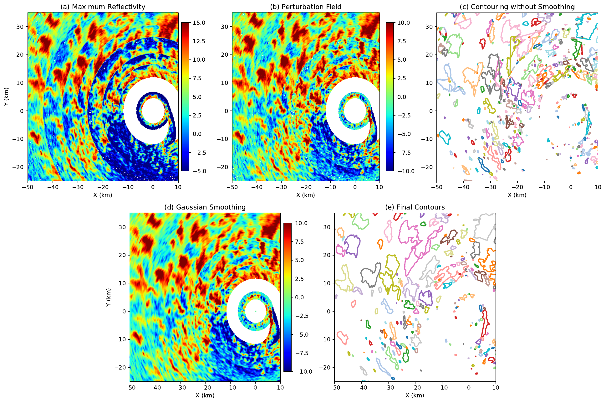
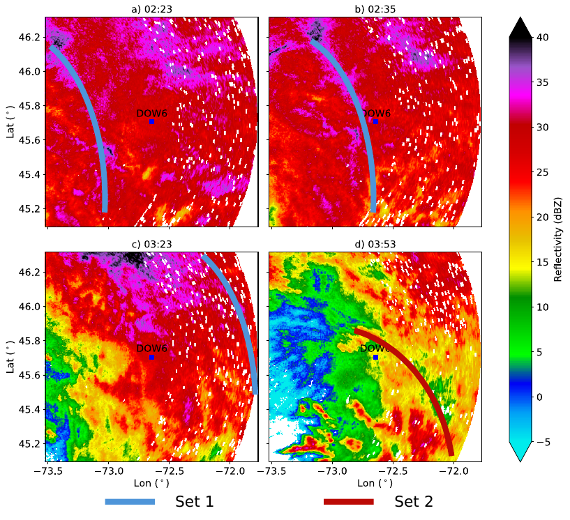
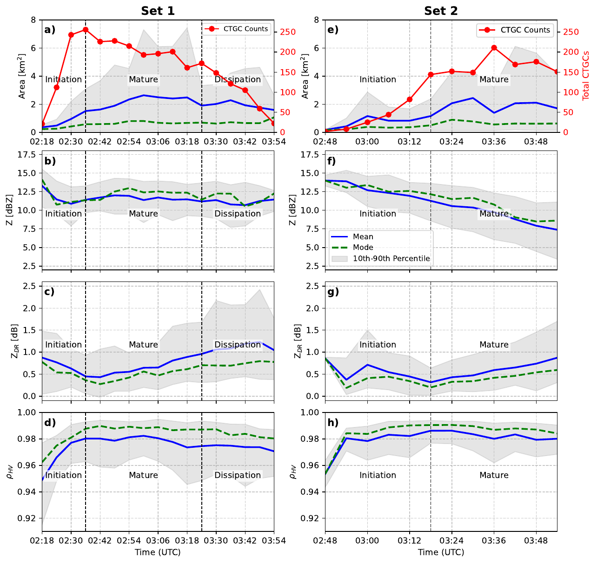
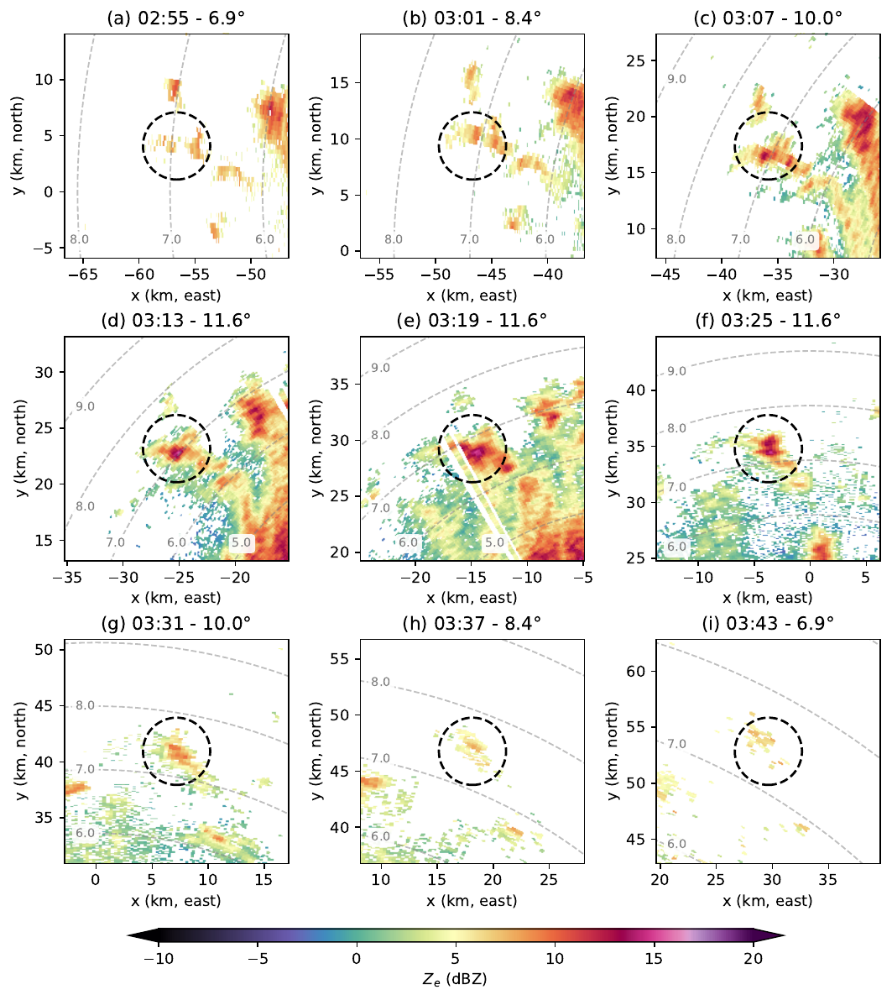

# Unsmoothed contours are noise

  

Column maximum in the 5.5–8 km layer, azimuthal mean removed, smoothed, contoured at 5 dBZ. 03:18 UTC.

<!--
Panel (c) versus panel (e) is the point. Without smoothing, the 5 dBZ line fragments. After smoothing, drop nested contours and features smaller than 0.09 km².

A closed boundary can contain more than one cell. Its area is a measure of organization, not necessarily the growth of one cell. Say that before the life-cycle plots.

Published as Valdivia, Friedrich, Zaremba, and Tessendorf, JAS, 2026.
-->

---
class: figure-slide
---

# Two groups, following two bands

  

ECCC radar, 500 m. The rest of the talk follows Set 1.

<!--
Cells aloft are not scattered at random. They follow two precipitation bands. Blue is Set 1. Red is Set 2, a second group, not a second case.

Do not give Set 2 equal time. If asked: it also increases in number, but the life-cycle description and the tracked cell are Set 1.
-->

---
class: figure-slide
---

# More cells, then fewer and larger

  

Set 1, left. Counts rise, then fall. Mean area rises as boundaries merge. $Z_{DR}$ falls, then rises.

<!--
Stay on the left column.

Panel (a): initiation adds features; the mature stage merges them into fewer, larger boundaries; dissipation reduces number and coverage. About 1.7 hours. That duration is collective activity.

Panel (c): ZDR decreases early, then increases through mature and dissipation. The early decrease is consistent with aggregation. The later increase suggests preferential sedimentation of larger or more isotropic particles, leaving slower-falling, oriented crystals in the generating layer. It is an inference from polarimetry, not an in-situ habit measurement.

Panel (d): correlation coefficient stays high. Reflectivity in panel (b) does not carry the story.

A larger boundary can enclose several neighboring cells. Statistical tests and the differential-attenuation bound are backup.
-->

---
class: figure-slide
---

# Initiation, mature, dissipation

  

<!--
Linger here. Walk left to right.

Horizontal row is the observation: many small boundaries, then merging, then fewer and smaller. Vertical row is the interpretation: a defined shroud of pristine crystals in the mature stage, then aggregates falling out.

Do not say we imaged particle habits. The schematic is the summary of the radar signatures.

Stage lengths, if asked from the published paper: initiation on the order of 12–30 min, mature about 54 min, dissipation about 36 min. Prefer "about 1.7 hours, in three stages" unless they want the split.
-->

---
class: figure-slide
---

# One cell persists for nearly 50 minutes

  

02:55–03:43 UTC. This is the cell the three-dimensional analysis follows.

<!--
The dashed circle is the tracked cell. It shows a similar polarimetric progression to the population; the ZDR sequence is backup.

The elevation angle changes because the scan has to keep the cell in the beam as it moves. That is the sampling problem the next section solves.

Six-minute volumes. Nearly 50 minutes is long for one cell in this literature, and it is still one cell in one storm.
-->
