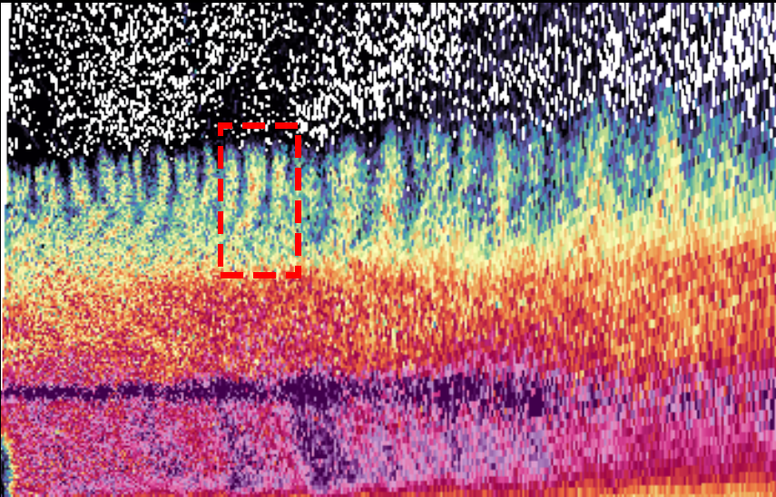
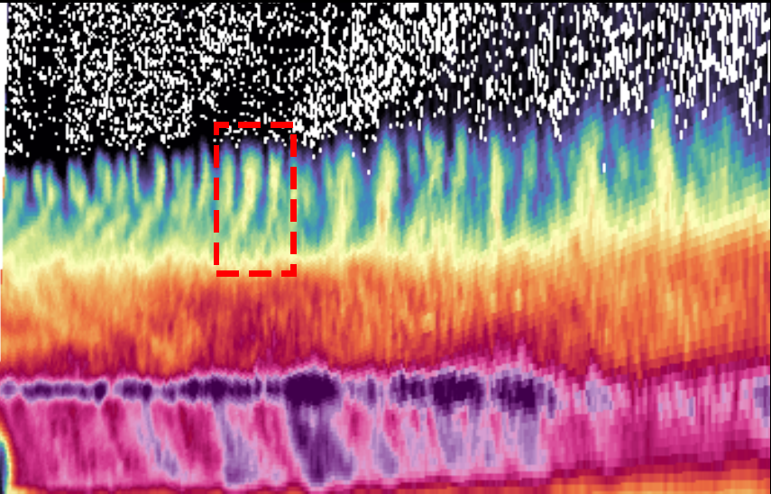

  
Paper 1 · Radar smoothing

  <h1>Radar Data Smoothing using the Discrete Cosine Transform</h1>
  <h2>A Fast Spectral Domain Algorithm</h2>
  

    
<strong>Jairo M. Valdivia-Prado</strong>

    
Coauthors: Will Chapman · Katja Friedrich

  

  
Department of Atmospheric and Oceanic Sciences · University of Colorado Boulder

  
Published as Valdivia, Chapman, and Friedrich, <em>Atmospheric Measurement Techniques</em> 19, 5211–5222 (2026) · doi:10.5194/amt-19-5211-2026

<!--
About 20 seconds. This is the first of four paper talks. The journal article uses Jairo M. Valdivia in its published byline; the presenter name here matches the defense cover. Credit Will Chapman and Katja Friedrich. Start the paper's own introduction on the next slide rather than reviewing the dissertation roadmap again.
-->

---
class: radar-data-intro
---

# The nature of radar data

  
  

  
Radar is natively collected in <strong>polar coordinates</strong>.

  
Raw radar observations are <strong>noisy</strong>.

<!--
About 45 seconds. This is a COW1high range–height scan on 23 February 2022 at 02:28:53–02:29:05 UTC. In this vertical scan, the native coordinates are range and elevation angle. First show unsmoothed horizontal reflectivity; one click replaces it with differential reflectivity from the same scan and with the same spatial bounds. The right panels enlarge 17–23 km range and 4.5–7.5 km altitude. Gate-to-gate variability and missing observations motivate smoothing, but not every small-scale change is random noise; coherent cloud-top structures remain visible. The ZDRC field is calibration-corrected but not smoothed. The reflectivity view corresponds to panels (a) and (e) of Figure 4 in the AMT paper; the ZDR view is newly plotted from the same RHI file. Transition to the polar-grid geometry problem.
-->

---
class: convolution-cartesian
---

# Convolution on a Cartesian grid

  
Noisy inputSmoothed output

  

    <CuManim :steps="4" :width="1080" :height="320" :construct="cartesianConvolution" />
    <svg v-if="clicks === 0" class="convolution-first-frame" viewBox="0 0 1080 390" aria-hidden="true">
      <rect v-for="(cell, index) in cartesianPreview.input" :key="`in-${index}`" :x="cell.x" :y="cell.y" :width="cell.w" :height="cell.h" :fill="cell.fill" />
      <rect v-for="(cell, index) in cartesianPreview.backing" :key="`back-${index}`" :x="cell.x" :y="cell.y" :width="cell.w" :height="cell.h" :fill="cell.fill" />
      <rect v-for="(tile, index) in cartesianPreview.tint" :key="`tint-${index}`" :x="tile.x" :y="tile.y" :width="tile.w" :height="tile.h" fill="#cfb87c" fill-opacity="0.25" />
      <rect v-for="(bar, index) in cartesianPreview.bars" :key="`bar-${index}`" :x="bar.x" :y="bar.y" :width="bar.w" :height="bar.h" fill="#cfb87c" />
      <path :d="`M${cartesianPreview.arrowShaft.x1},${cartesianPreview.arrowShaft.y1} L${cartesianPreview.arrowShaft.x2},${cartesianPreview.arrowShaft.y2}`" stroke="#cfb87c" stroke-width="6" stroke-linecap="round" fill="none" />
      <polygon :points="cartesianPreview.arrowTip.map(point => `${point.x},${point.y}`).join(' ')" fill="#cfb87c" />
    </svg>
  

  
Illustrative, evenly spaced grid · <strong>{{ clicks >= 3 ? 'Gaussian: center-weighted mean' : 'Boxcar: equal-weight mean' }}</strong>

<!--
About 1 minute. After slide 8, explain that we want to reduce gate-to-gate variability while preserving coherent structure. Convolution applies the same local operation at each position. The three-by-three boxcar kernel starts over the center of this synthetic, evenly spaced grid. Click 1: all nine kernel weights are equal, so their average appears at the corresponding output cell. Click 2: clear that example, then scan successive rows from the upper-left cell, alternately left-to-right and right-to-left, revealing each output value as the kernel reaches it; finish at the lower right. Edge values are extended with nearest-value padding in this illustration; this is not Paper 1's DCT boundary treatment. Click 3: dissolve the box and show the Gaussian weights as dots in every cell, sized by the same discrete Gaussian (truncated to three-by-three samples and normalized for the output); weights far from the center are near zero, visible as specks. Click 4: glide the weighting across the grid along the same row-by-row path with dot sizes tracking it, revealing each Gaussian output value in sync. These are illustrative, complete data, not a measured radar field or a comparison of method performance. The kernels are symmetric, so the sliding weighted average is the convolution used here. Transition: a fixed pixel window has a fixed physical footprint on an evenly spaced Cartesian grid, but radar is sampled in range and angle.
-->

---
class: convolution-polar
---

# A fixed polar-grid window changes physical size

The same three-by-three sample window in range and elevation angle

  

    <CuManim :steps="2" :width="1080" :height="320" :construct="polarConvolution" />
    <svg v-if="clicks === 0" class="convolution-first-frame" viewBox="0 0 1080 390" aria-hidden="true">
      <path v-for="(ray, index) in polarPreview.rays" :key="`ray-${index}`" :d="ray" class="convolution-preview-line" />
      <path v-for="(arc, index) in polarPreview.arcs" :key="`arc-${index}`" :d="arc" class="convolution-preview-line" />
      <path :d="polarPreview.near" class="convolution-preview-footprint" />
      <path :d="polarPreview.chord" class="convolution-preview-chord" />
      <rect :x="polarPreview.radar.x - 8" :y="polarPreview.radar.y - 8" width="16" height="16" fill="#cfb87c" />
    </svg>
  

  

    
Angular sample spacing grows with range: <strong>r Δθ</strong>. Range-gate spacing stays fixed.

    
To keep a fixed physical smoothing width, <strong>adjust the angular window with range.</strong>

  

<!--
About 1 minute 10 seconds. Click 1: glide a three-by-three sample window from the first gates by the radar out to far range; the near example fades as the sweep launches, so a single box travels. Adjacent rays diverge, so its transverse footprint is larger at far range even though the number of angular samples and the range-direction width are unchanged. Click 2: bring the middle window back for comparison while narrowing the far window's angular width to approximately the near window's physical transverse width. This is a schematic of footprint changes, not a distortion of the measurements. For 1–2 km cloud-top generating cells, the smoothing scale needs to be specified in distance, not gate count. The angular width decreases with range to hold the physical width approximately fixed; the range-direction kernel stays fixed. A spatial kernel that changes with range is computationally costly. The next slide shows what that computation achieves on a radar field and why the processing time matters. Do not say range gates themselves widen with range.
-->

---
class: smoothing-cost
---

# Range-adaptive spatial smoothing is costly

  

    <section>
      <h2>One volume · personal timing</h2>
      <strong>~20 min</strong>
      
Spatial smoothing of 20 sweeps and five variables: ZH, ZDR, ρHV, KDP, VEL

    </section>
    <section>
      <h2>Two hours · extrapolated</h2>
      <strong>~6 h 40 min</strong>
      
~20 volumes at a 6-min time-step

    </section>
    

      
Same RHI: full view and 17–23 km zoom · 5-pixel boxcar · Paper Figure 4(a, b, e, f)

      
Images show one ZH sweep. Smoothed with Dynamic Kernel method.

    

  

  

    

      
      
    

    

      
      
    

  

<!--
About 1 minute 20 seconds. We saw that maintaining a physical smoothing width requires the angular window to change with range. Point to the top image: the unsmoothed reflectivity zoom from the 23 February 2022 C-band RHI varies from gate to gate. The lower image shows the paper's 5-pixel spatial dynamic boxcar: the three cloud-top structures remain while much of the gate-to-gate variability is reduced. These matched zooms are panels (e) and (f) of the paper's Figure 4, with the same bounds and color scale. Click 1: replace both zooms in place with the full original and spatially smoothed RHI panels (a) and (b); the red boxes indicate the zoom region. In my separate radar-data test, spatial smoothing alone took about 20 minutes for an entire 20-sweep volume and four fields: Z_H, Z_DR, rho_HV, and K_DP. That is not 20 minutes for the pictured sweep or zoom, and does not include reading or other processing. With one volume every 6 minutes, two hours contains roughly 20 volumes; at the same per-volume rate, serial smoothing would take about 400 minutes, or 6 hours 40 minutes. This total is extrapolated, not a measured two-hour run, and my personal timing is distinct from the controlled paper benchmark shown later. I propose using a fast transform to compute the smoothing more efficiently.
-->

---
class: smoothing-dct-intro
---

# Discrete cosine transform (DCT)

  
A DCT represents samples along a chosen dimension (space or time) as cosine components.

  

    <section>
      <h2>Samples along one axis</h2>
      <svg viewBox="0 0 320 130" aria-hidden="true">
        <line class="dct-intro-axis" x1="14" y1="110" x2="306" y2="110" />
        <polyline class="dct-intro-profile" points="18,87 44,70 70,77 96,43 122,54 148,82 174,68 200,38 226,58 252,75 278,59 304,84" />
        <g class="dct-intro-samples">
          <circle cx="18" cy="87" r="3.5" /><circle cx="44" cy="70" r="3.5" />
          <circle cx="70" cy="77" r="3.5" /><circle cx="96" cy="43" r="3.5" />
          <circle cx="122" cy="54" r="3.5" /><circle cx="148" cy="82" r="3.5" />
          <circle cx="174" cy="68" r="3.5" /><circle cx="200" cy="38" r="3.5" />
          <circle cx="226" cy="58" r="3.5" /><circle cx="252" cy="75" r="3.5" />
          <circle cx="278" cy="59" r="3.5" /><circle cx="304" cy="84" r="3.5" />
        </g>
      </svg>
      
Schematic 1D profile · x(n)

    </section>
    
DCT →← inverse DCT

    <section>
      <h2>Cosine coefficients</h2>
      <svg viewBox="0 0 320 130" aria-hidden="true">
        <line class="dct-intro-axis" x1="14" y1="105" x2="306" y2="105" />
        <g class="dct-intro-bars">
          <rect x="20" y="27" width="16" height="78" /><rect x="50" y="48" width="16" height="57" />
          <rect x="80" y="73" width="16" height="32" /><rect x="110" y="88" width="16" height="17" />
          <rect x="140" y="105" width="16" height="17" /><rect x="170" y="80" width="16" height="25" />
          <rect x="200" y="94" width="16" height="11" /><rect x="230" y="99" width="16" height="6" />
          <rect x="260" y="102" width="16" height="3" /><rect x="290" y="103" width="16" height="2" />
        </g>
      </svg>
      
Low to high frequency · X(k)

    </section>
  

  
Unchanged coefficients reconstruct the original samples, no smoothing yet. Our radar method filters along both angle and range.

JPEG also uses the DCT for image compression; here we use it to filter radar data, not to compress it.

<!--
About 55 seconds. The proposed way around repeated spatial windows begins with a fast discrete cosine transform. This is a general transform of sampled data along a chosen dimension, spatial or temporal: it expresses the samples as coefficients of cosine components ordered from low to high frequency. The drawing illustrates one 1D slice, not a measured spectrum from the RHI or the full 2D operation. Applying the inverse DCT with coefficients unchanged reconstructs the original samples; the transform alone has not smoothed anything. The DCT is familiar from JPEG, where it is applied to image blocks as part of compression; here we filter a 2D polar radar field by applying DCT-based smoothing along angle and along range in separate passes, without JPEG quantization or encoding. The cosine basis corresponds to reflecting data at the boundaries rather than wrapping opposite edges together. The next slide shows how the convolution theorem supplies the weighting in each pass. The angular response changes with range; the range response has fixed width.
-->

---
class: smoothing-spectral
---

# Convolution theorem

There is an equivalent operation in the spectral domain for any convolution in the spatial/time domain.

$$
\mathcal{T}\{\vec{f} * \vec{g}\} = \mathcal{T}\{\vec{f}\} \cdot \mathcal{T}\{\vec{g}\}
$$

$$
H(k) \equiv \mathcal{T}\{\vec{g}\}(k) \qquad \text{kernel transfer function}
$$

<strong>f</strong> = sampled data · <strong>g</strong> = smoothing kernel · <strong>T</strong> = spectral transform

  <section><h2>Spatial domain: convolution (*)</h2>
Slide the kernel across the data; calculate a weighted sum at each location.
</section>
  ↔
  <section><h2>Transform domain: multiplication (·)</h2>
Transform the data and kernel, multiply corresponding coefficients, then invert.
</section>

For radar: DCT convolution along angle (range-varying width), then along range (fixed width).

<!--
About 50 seconds. On slide 9 we moved a kernel across a field and computed a weighted sum at each location. Here f represents sampled data and g a smoothing kernel. The left side of the equation transforms their spatial convolution—the result of sliding g over f. The right side says that with a suitable spectral transform T and matching boundary treatment, we can instead transform the data and kernel, multiply corresponding coefficients, and inverse-transform the product to recover the filtered data. The multiplication is point-wise in the transform domain, not multiplication of the original samples. We know the data and the desired spatial kernel; the remaining piece is the kernel's matching spectral response T{g}, called the transfer function H. Paper 1 derives analytical responses for boxcar and Gaussian kernels, so I will not derive those here. How do we choose and apply H on a polar grid, where angular spacing changes with range but range-gate spacing does not? Next slide. Exact equivalence requires matching the kernel and reflected boundary treatment; the spatial baseline in the paper also handles missing pixels differently. The field comparison uses boxcar smoothing; the later large-array timing callout uses the analytical Gaussian DCT. Avoid saying one filter produced both results.

This first method needs a complete field: gaps are interpolated before the DCT. Discuss that limitation after the results.
-->

---
class: smoothing-transfer
---

# Transfer functions on a polar grid

Choose a smoothing kernel and its analytical DCT-domain response, H(k; W).

  <section>

## Angle: response varies with range

Adjacent rays separate by approximately rΔθ.

$$
\begin{aligned}
W_{\theta}(r) &= \frac{W_{\mathrm{phys}}}{r\,\Delta\theta} \\
H_{\theta}(k_{\theta},r) &= H_{\mathrm{kernel}}\!\left(k_{\theta};W_{\theta}(r)\right)
\end{aligned}
$$

One angular-frequency response for each range.

  </section>

  <section>

## Range: fixed response

Range-gate spacing Δr is constant.

$$
\begin{aligned}
W_r &= \text{fixed in range gates} \\
H_r(k_r) &= H_{\mathrm{kernel}}\!\left(k_r;W_r\right)
\end{aligned}
$$

The same range-frequency response at every angle.

  </section>

The angle responses form a range-indexed set; the range response is shared. Apply each in its own DCT pass.

Boxcar response via the Dirichlet identity: Oppenheim et al. (1999). Gaussian response: Smith (1997).

<!--
About 45 seconds. The paper obtains the analytical continuous-width boxcar response using the Dirichlet-kernel identity cited to Oppenheim et al. (1999), and cites Smith (1997) for the normalized Gaussian response. We do not need to derive either on this slide. H_kernel denotes the chosen response as a function of spatial frequency and smoothing width; the Gaussian's native width parameter is sigma. For the field comparison after the method slide, we use the analytical boxcar response; the later large-array benchmark highlights the Gaussian response. Along angle, adjacent rays are physically separated by approximately r times delta theta, so a fixed physical smoothing scale translates to W_theta(r) = W_phys/(r delta theta) angular samples. Evaluate the chosen response at that width for each range, giving a range-indexed set of angular responses H_theta(k_theta,r). Along range, range gates have fixed separation, so W_r and the range response H_r(k_r) are fixed and shared across angles. These responses are derived for the chosen kernel and reflected DCT boundary treatment, not obtained by naively transforming an arbitrary finite array of weights. Next slide: apply the two responses in successive DCT filtering passes, with an inverse angular DCT between them.
-->

---
class: smoothing-polar-dct
---

# DCT smoothing on a polar grid

Apply the separable filter to the two dimensions of the polar field, X(θ, r).

<section class="polar-dct-pass">

## 1 · Angular pass — range-varying width

$$
Y_{\theta} = \operatorname{IDCT}_{\theta}\!\left[\operatorname{DCT}_{\theta}(X) \odot H_{\theta}(k_{\theta},r)\right]
$$

At each range, multiply angular-frequency coefficients by a response that changes with range.

</section>

<section class="polar-dct-pass">

## 2 · Range pass — fixed width

$$
Y = \operatorname{IDCT}_{r}\!\left[\operatorname{DCT}_{r}(Y_{\theta}) \odot H_{r}(k_{r})\right]
$$

At each angle, multiply range-frequency coefficients by the same fixed-width response.

</section>

The angular response varies with range, so the intermediate field Yθ is needed between passes—not one global 2D multiplication.

<!--
About 1 minute. We have now selected the angle-dependent response H_theta and fixed range response H_r. The separable boxcar lets us smooth the 2D field in two directions. Click 1: at every range, take the DCT along the angular samples, multiply corresponding coefficients by H_theta, and inverse-transform to get the intermediate angularly smoothed field Y_theta. Its angular width decreases in samples with range, holding the desired physical scale. Click 2: DCT the intermediate field along range, multiply by H_r, and inverse-transform to obtain the final 2D field Y. Range-gate spacing does not widen with range. The products are element-wise in the appropriate spectral domain; both passes use reflected boundaries. Because the angular response depends on spatial range, we must return to Y_theta before transforming along range. This is not one global 2D DCT followed by a single product H_theta times H_r. The field comparison on the next slide uses the boxcar response. Gaps are interpolated before this method; discuss the limitation after the results.
-->

---
class: smoothing-synthetic
---

# Synthetic validation of DCT smoothing

  
  

Synthetic reflectivity-like field · Paper Figure 2(a–f). Noise and difference panels have separate scales.

<!--
About 1 minute. First show the synthetic ground truth, noisy observation with added noise of standard deviation 2, and the noise pattern. This is an artificial reflectivity-like field, not the measured C-band RHI on the next slide. Click 1: reveal the paper's DCT-smoothed result, spatial dynamic-kernel result, and DCT-minus-dynamic-kernel difference. Both remove much of the speckle and preserve the broad structures. The DCT and spatial outputs are visually nearly indistinguishable, but not numerically identical: their RMSEs against the known truth are 0.263 and 0.241, respectively. The difference panel uses a separate narrow scale and shows small structured discrepancies, especially near edges; do not call the outputs exactly equal or confuse this with an error-to-truth panel. These are the boxcar comparisons from panels (a)–(f) of the paper's Figure 2. The shared field-value scale is shown below, while the noise and difference panels retain their own colorbars. Next move from controlled synthetic data to the real C-band radar comparison.
-->

---
class: smoothing-comparison
---

# Spatial and DCT smoothing on a C-band scan

  
Full RHI: the red boxes locate the cloud-top zoom.

  
17–23 km zoom: the three cloud-top features remain distinct in both outputs.

  

    
    
  

  

    
    
  

C-band radar, 23 Feb 2022, 02:28 UTC · 5-pixel boxcar · Paper Figure 4(b, c, f, g). Spatial skips missing gates; DCT input is interpolated.

<!--
About 1 minute 30 seconds. Move from the synthetic test with known ground truth to measured C-band radar. Initially show the matched full-RHI spatial dynamic-boxcar and analytical DCT-boxcar outputs, panels (b) and (c) of Figure 4. Point to the red boxes at 17–23 km. Click 1: replace both panels with their matched cloud-top zooms (f) and (g). The three roughly 1–2 km structures at about 5–7 km altitude remain distinguishable in both outputs. They are closely matching, not numerically identical; the original paper also includes difference panels. The spatial method skips missing values whereas Paper 1 linearly interpolates gaps before the DCT, so do not attribute every discrepancy to the filter itself. Both views retain the source axes and shared reflectivity color scale. The full eight-panel comparison remains in backup.
-->

---
class: smoothing-benchmark
---

# DCT benchmark: window width and data size

  

    

      
Random-noise arrays · fixed 5-pixel window

      
<strong>42 min</strong>spatial dynamic kernel · 2518 s

      
<strong>&lt;12 s</strong>Gaussian DCT · 180 million pixels

      
<strong>&gt;200×</strong> faster than the spatial dynamic kernel

      
A full radar volume: overnight → between volume scans.

    

    

      
Fixed RHI · window 5–101 pixels

      
<strong>≈60 ms</strong>analytical Gaussian and boxcar

      
<strong>8.5 to &gt;44 s</strong>tested spatial dynamic kernel

      
<strong>&gt;800×</strong> faster at a 101-pixel window · analytical boxcar &gt;700×

      
Runtime is window-size agnostic: choose any width for free.

    

  

  

    
    
  

  
Paper Figure 5(c): fixed window width, varying data size. A full volume at the spatial method's 42-minute runtime becomes a task measured in seconds.

  
Paper Figure 5(a): fixed 474 × 1180-pixel RHI, varying window width. The filter response changes with width, but analytical-kernel runtime does not — a separate finding from the volume benchmark.

<!--
About 1 minute 45 seconds. This paper benchmarks two different scaling questions. Open with the practical question: what does smoothing a full radar volume cost? Click 0 shows Figure 5(c), which fixes the window at 5 pixels and varies random-noise array size. At 180 million pixels — a full radar volume — the spatial dynamic-kernel implementation takes 2518 seconds, about 42 minutes. Gaussian DCT takes less than 12 seconds: over 200 times faster. That factor is derived from the reported times and is consistent with the paper's Figure 5(d); state it as a conservative bound. It is the difference between a job you run overnight and one you run between volume scans. This is a controlled array benchmark, not the C-band RHI on slide 17 or the 20-sweep example on slide 11. Click 1: switch to Figure 5(a), which holds one measured 474-by-1180-pixel RHI fixed and varies the window from 5 to 101 pixels. Here the story changes: the analytical Gaussian and boxcar DCT transfer functions change with width, so the smoothing itself is not width-independent, but their measured computation times stay approximately constant near 60 ms because evaluating the response does not iterate over every window weight. The tested spatial dynamic-kernel implementation rises from 8.5 to over 44 seconds. At width 101, Figure 5(b) gives over 800-fold Gaussian and over 700-fold analytical-boxcar speedup. Other discrete DCT responses are faster than this spatial baseline but their cost increases with window width. Two separate findings: the volume speedup does not transfer to the window-width test, and the window-width speedup does not transfer to the volume test. Do not claim all possible spatial algorithms scale this way.
-->

---
class: smoothing-limitation
---

# Limitations: missing data and boundaries

  <section>
    <h2>Missing data</h2>
    <svg class="smoothing-limitation-diagram" viewBox="0 0 500 280" role="img" aria-label="Illustrative polar grid with a missing sector beginning halfway out in range and scattered patches of missing gates">
      <circle class="scan-field" cx="250" cy="140" r="118" />
      <g class="scan-grid">
        <circle cx="250" cy="140" r="59" />
        <circle cx="250" cy="140" r="89" />
        <path d="M132 140 H368 M250 22 V258 M167 57 L333 223 M333 57 L167 223" />
      </g>
      <g class="missing-gates">
        <path d="M288 95 L326 50 A118 118 0 0 1 364 109 L307 125 A59 59 0 0 0 288 95 Z" />
        <path d="M170 92 L179 85 L194 89 L199 101 L189 108 L173 104 Z" />
        <path d="M202 179 L211 171 L226 176 L229 187 L217 193 L204 190 Z" />
        <path d="M264 211 L273 204 L286 209 L288 220 L278 226 L266 221 Z" />
        <path d="M322 177 L332 172 L343 179 L340 189 L328 193 L319 185 Z" />
      </g>
      <circle class="scan-outline" cx="250" cy="140" r="118" />
      <circle class="scan-origin" cx="250" cy="140" r="4" />
    </svg>
    
Interpolating broad gaps can bias estimates near missing regions.

  </section>
  <section>
    <h2>Boundary conditions</h2>
    <svg class="smoothing-limitation-diagram" viewBox="0 0 500 280" role="img" aria-label="Illustrative full-circle polar grid with neighboring azimuth rays joined across the zero-degree and 360-degree seam">
      <circle class="scan-field" cx="250" cy="140" r="118" />
      <g class="scan-grid">
        <circle cx="250" cy="140" r="59" />
        <circle cx="250" cy="140" r="89" />
        <path d="M132 140 H368 M250 22 V258 M167 57 L333 223 M333 57 L167 223" />
      </g>
      <path class="seam-neighborhood" d="M250 140 L237 23 A118 118 0 0 1 263 23 Z" />
      <path class="seam-rays" d="M250 140 L237 23 M250 140 L263 23" />
      <path class="seam-join" d="M237 23 Q250 3 263 23" />
      <path class="seam-arrow" d="M263 23 L253 19 M263 23 L260 13" />
      <circle class="scan-outline" cx="250" cy="140" r="118" />
      <circle class="scan-origin" cx="250" cy="140" r="4" />
    </svg>
    
Reflective edges suit finite RHIs; full-circle PPI azimuth joins at 0°/360°.

  </section>

<!--
About 1 minute 10 seconds. These minimal polar sketches are illustrative, not measured fields or a demonstration of Paper 1's interpolation error. Two assumptions qualify Paper 1. First, its DCT needs defined input values, so the paper linearly interpolates missing gates before smoothing. In the left sketch, a blocked sector begins about halfway out in range, with separate isolated invalid patches. A short gap may be less consequential than a wide blocked sector: interpolation can introduce a low-frequency bridge and kinks at its edges. Filled values are not observations. Second, DCT-II in the angular and range passes assumes reflected boundaries. This is a reasonable model for the finite elevation and range limits of an RHI, not a universal radar boundary rule. On the right, the two rays on either side of 0/360 degrees are physically adjacent on a full-circle PPI; a periodic angular transform is more appropriate while range remains reflective. A partial-sector scan need not wrap in azimuth. There is also a scale-versus-noise trade-off: keeping physical smoothing width approximately fixed means fewer angular samples at longer ranges, where signal-to-noise ratio may be poorer, so the method does not guarantee equal noise reduction everywhere. The real-data demonstration here is reflectivity; Doppler velocity must be de-aliased before smoothing. Paper 2 extends the framework to support-aware local statistics and explicit periodic azimuth versus reflective range modes. Do not imply that it automatically solves the range-dependent noise trade-off.
-->

---
class: smoothing-conclusions
---

# Project 1: Conclusions

  <section>
    
Spectral domain smoothing makes radar processing practical for large datasets.

  </section>
  <section>
    
DCT gives nearly identical results to convolution while being orders of magnitudes faster.

  </section>
  <section>
    
Missing data and boundary conditions still need explicit handling.

  </section>

<!--
About 45 seconds. These statements are conclusions; the benchmark timings are supporting results already shown on slide 18. Suggested delivery: “So, in this work, we developed a fast DCT-based method for reducing noise in polar radar data. It gives results visually very close to spatial convolution while accounting for radar geometry. In our large-array benchmark, processing fell from about 42 minutes to under 12 seconds. But gaps still need to be interpolated, and the boundary assumption must suit the scan. Those limitations motivated my next project.” The 180-million-pixel data-size test uses random-noise arrays at a fixed five-pixel width: 2518 s for the tested spatial dynamic-kernel implementation versus less than 12 s for Gaussian DCT. It is not a measured full-volume processing time. Separately, on a fixed RHI, analytical Gaussian and boxcar runtimes stay near 60 ms across tested widths of 5–101 pixels; the filter response does change with width. The analytical Gaussian is the recommended general-purpose kernel, and analytical boxcar allows comparison with a spatial moving average. The synthetic outputs are visually nearly indistinguishable, not numerically identical; the real C-band cloud-top features remain distinct in both outputs. Slide 19 introduced the missing-data and boundary assumptions, so there is no need to repeat its details here. Do not imply that all spatial methods scale like the tested implementation. This paper is published in AMT (2026).
-->
