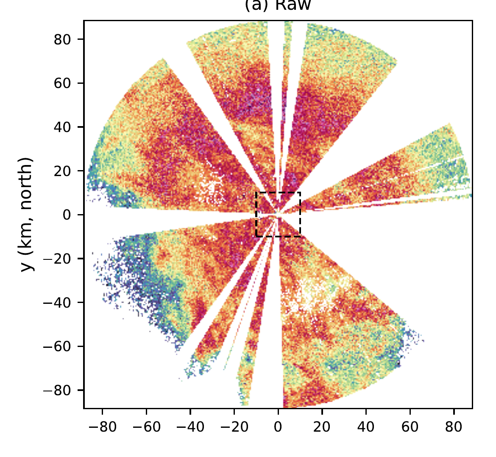

  
Paper 1 · Radar smoothing

  <h1>Radar Data Smoothing using the Discrete Cosine Transform</h1>
  <h2>A Fast Spectral Domain Algorithm</h2>
  

    
<strong>Jairo M. Valdivia-Prado</strong>

    
Coauthors: Will Chapman · Katja Friedrich

  

  
Department of Atmospheric and Oceanic Sciences · University of Colorado Boulder

  
Published as Valdivia, Chapman, and Friedrich, <em>Atmospheric Measurement Techniques</em> 19, 5211–5222 (2026) · doi:10.5194/amt-19-5211-2026

<!--
The first paper is titled:

That I did in collaboration of Will Chapman and Katja Friedrich

and it is already published in Atmospheric Measurement Techniques
-->

---
class: radar-data-intro
---

# The nature of radar data

  
  

  
Radar is natively collected in <strong>polar coordinates</strong>.

  
Raw radar observations are <strong>noisy</strong>.

<!--
TO understand what is the problem we are trying to solve we need understand the nature of radar data.

These is my CTGC example again and it is in polar polar coordinates
Elevation vs range, but we could have azimuth vs range too.

And as you can see the data is very noisy.

And this gets worse if we look at the polarimetric variables. This is ZDR and will explain the meaning later on.

The problem is that we want to develop some detection algorithm we need to smooth the data, and reduce the noise.
-->

---
class: convolution-cartesian
---

# Convolution on a Cartesian grid

  
Noisy inputSmoothed output

  

    <CuManim :steps="2" :width="1080" :height="320" :construct="cartesianConvolution" />
    <svg v-if="clicks === 0" class="convolution-first-frame" viewBox="0 0 1080 390" aria-hidden="true">
      <rect v-for="(cell, index) in cartesianPreview.input" :key="`in-${index}`" :x="cell.x" :y="cell.y" :width="cell.w" :height="cell.h" :fill="cell.fill" />
      <rect v-for="(cell, index) in cartesianPreview.backing" :key="`back-${index}`" :x="cell.x" :y="cell.y" :width="cell.w" :height="cell.h" :fill="cell.fill" />
      <rect v-for="(tile, index) in cartesianPreview.tint" :key="`tint-${index}`" :x="tile.x" :y="tile.y" :width="tile.w" :height="tile.h" fill="#cfb87c" fill-opacity="0.25" />
      <rect v-for="(bar, index) in cartesianPreview.bars" :key="`bar-${index}`" :x="bar.x" :y="bar.y" :width="bar.w" :height="bar.h" fill="#cfb87c" />
      <path :d="`M${cartesianPreview.arrowShaft.x1},${cartesianPreview.arrowShaft.y1} L${cartesianPreview.arrowShaft.x2},${cartesianPreview.arrowShaft.y2}`" stroke="#cfb87c" stroke-width="6" stroke-linecap="round" fill="none" />
      <polygon :points="cartesianPreview.arrowTip.map(point => `${point.x},${point.y}`).join(' ')" fill="#cfb87c" />
    </svg>
  

  
Illustrative, evenly spaced grid · <strong>Boxcar: equal-weight mean</strong>

<!--
The standard way to do this is through a convolution, where you have a box, also called "the kernel", and you compute the average of that box.

And you just repeat this process for all the grid points, libraries like numpy and scipy have very efficient algorithms do to this.
-->

---
class: convolution-polar
---

# A fixed polar-grid window changes physical size

The same three-by-three sample window in range and elevation angle

  

    <CuManim :steps="2" :width="1080" :height="320" :construct="polarConvolution" />
    <svg v-if="clicks === 0" class="convolution-first-frame" viewBox="0 0 1080 390" aria-hidden="true">
      <path v-for="(ray, index) in polarPreview.rays" :key="`ray-${index}`" :d="ray" class="convolution-preview-line" />
      <path v-for="(arc, index) in polarPreview.arcs" :key="`arc-${index}`" :d="arc" class="convolution-preview-line" />
      <path :d="polarPreview.near" class="convolution-preview-footprint" />
      <path :d="polarPreview.chord" class="convolution-preview-chord" />
      <rect :x="polarPreview.radar.x - 8" :y="polarPreview.radar.y - 8" width="16" height="16" fill="#cfb87c" />
    </svg>
  

  

    
Angular sample spacing grows with range: <strong>r Δθ</strong>. Range-gate spacing stays fixed.

    
To keep a fixed physical smoothing width, <strong>adjust the angular window with range.</strong>

  

<!--
But the problem is that if we want to do this in polar coordines, then is not that easy anymore. Because when you slide your window,the kernel gets sqeezed, therefore your data will also get squeezed.

To fix this you will need to dynamically adjust the size of the kernel, which is computationally very expensive.
-->

---
class: smoothing-cost
---

# Range-adaptive spatial smoothing is costly

  

    <section>
      <h2>One volume · personal timing</h2>
      <strong>~20 min</strong>
      
Spatial smoothing of 20 sweeps and five variables: ZH, ZDR, ρHV, KDP, VEL

    </section>
    <section>
      <h2>Two hours · extrapolated</h2>
      <strong>~6 h 40 min</strong>
      
~20 volumes at a 6-min time-step

    </section>
    

      
17–23 km zoom · 5-pixel boxcar · Paper Figure 4(e, f)

      
Images show one ZH sweep. Smoothed with Dynamic Kernel method.

    

  

  

    

      
    

    

      
    

  

<!--
How expensive is this?
Here I want an example of doing the smoothing on my CTGC on my Mac mini.
For a single data file, which contains 20 sweeps at different elevations, it takes around of 20 min. And this represents just 6 min of data.
-->

---
class: smoothing-spectral
---

# Convolution theorem

For any convolution in the spatial/time domain, there is an equivalent operation in the spectral domain.

$$
\mathcal{T}\{\vec{f} * \vec{g}\} = \mathcal{T}\{\vec{f}\} \cdot \mathcal{T}\{\vec{g}\}
$$

$$
H(k) \equiv \mathcal{T}\{\vec{g}\}(k) \qquad \text{kernel transfer function}
$$

<strong>f</strong> = data, <strong>g</strong> = smoothing kernel, <strong>T</strong> = spectral transform

  <section><h2>Spatial domain: convolution (*)</h2>
Slide the kernel across the data.
</section>
  ↔
  <section><h2>Transform domain: multiplication (·)</h2>
Multiply corresponding coefficients, then invert.
</section>

<!--
How are we proposing to solve this.

We gonna use a mathematical trick called "the convolution theorem".

What is interesting about this theorem is that the operation in the spectral domain is a point wise multiplication.
-->

---
class: convolution-cartesian dct-convolution
clicks: 5
---

# DCT convolution in one dimension

  

    <CuManim v-if="dctActive" :steps="5" :width="1080" :height="360" :construct="constructDct" />
  

  
Illustrative 12-sample signal · Three-point boxcar · Reflected boundaries

<!--
I am going to illustrate this an example.
-->

---
class: smoothing-contribution
---

# Challenge: 

  
Spectral operation of <strong>2D radar fields</strong> in <strong>polar coordinates</strong>.

  <svg class="shrink-0" width="360" height="225" viewBox="0 0 320 200" role="img" aria-label="Illustrative two-dimensional radar sampling grid in range and angle, not measured radar data">
    <path d="M32 158 L250.24 32 A252 252 0 0 1 284 158 Z" fill="#cfb87c" fill-opacity="0.12" />
    <g fill="#cfb87c" fill-opacity="0.55">
      <path d="M141.12 95 L195.68 63.5 A189 189 0 0 1 209.6 93.36 L150.4 114.91 A126 126 0 0 0 141.12 95 Z" />
      <path d="M156.09 136.12 L218.13 125.18 A189 189 0 0 1 221 158 L158 158 A126 126 0 0 0 156.09 136.12 Z" />
    </g>
    <g fill="none" stroke="currentColor" stroke-opacity="0.65" stroke-width="2">
      <path d="M32 158 H284 M32 158 L280.18 114.24 M32 158 L268.8 71.81 M32 158 L250.24 32" />
      <path d="M86.56 126.5 A63 63 0 0 1 95 158 M141.12 95 A126 126 0 0 1 158 158 M195.68 63.5 A189 189 0 0 1 221 158 M250.24 32 A252 252 0 0 1 284 158" />
    </g>
    <circle cx="32" cy="158" r="4" fill="currentColor" />
    <text x="162" y="190" text-anchor="middle" fill="currentColor" style="font-size: 22px">Range</text>
    <text x="242" y="24" fill="currentColor" style="font-size: 22px">Angle</text>
  </svg>

See <a href="https://doi.org/10.5194/amt-19-5211-2026" target="_blank" rel="noopener noreferrer">Valdivia et al. (2026)</a> for the mathematical formulation and implementation.

<!--
The real challenge here is to do this in a 2D space while keeping the polar geometry.
-->

---
class: smoothing-comparison
---

# Spatial and DCT smoothing on a C-band scan

  
Full RHI: the red boxes locate the cloud-top zoom.

  
17–23 km zoom: the three cloud-top features remain distinct in both outputs.

  

    
    
  

  

    
    
  

C-band radar, 23 Feb 2022, 02:28 UTC · 5-pixel boxcar · Paper Figure 4(b, c, f, g). Spatial skips missing gates; DCT input is interpolated.

<!--
But if we look at the results, just as the convolution theorem predicted, our operation is almost identical.
There are some differences due to the boundary conditions. But it is really hard to tell the difference.
-->

---
class: smoothing-benchmark
---

# DCT benchmark: window width and data size

  

    

      
Random-noise arrays · fixed 5-pixel window

      
<strong>42 min</strong>spatial dynamic kernel · 2518 s

      
<strong>12 s</strong>Gaussian DCT · 180 million pixels

      
<strong>&gt;200×</strong> faster than the spatial dynamic kernel

      

    

    

      
Fixed RHI · window 5–101 pixels

      
<strong>≈60 ms</strong>analytical Gaussian and boxcar

      
<strong>8.5 to &gt;44 s</strong>tested spatial dynamic kernel

      
<strong>&gt;800×</strong> faster at a 101-pixel window · analytical boxcar &gt;700×

      
Runtime is window-size agnostic: choose any width for free.

    

  

  

    <SmoothingBenchmarkPlot v-click.hide="1" view="volume" />
    <SmoothingBenchmarkPlot v-click="1" view="window" />
  

  
Paper Figure 5(c): fixed window width, varying data size. A full volume at the spatial method's 42-minute runtime becomes a task measured in seconds.

  
Paper Figure 5(a): fixed 474 × 1180-pixel RHI, varying window width. The filter response changes with width, but analytical-kernel runtime does not — a separate finding from the volume benchmark.

<!--
The advantage is this is that we get same results but way faster.
Here I am showing the benchmark for different amount of data, measured in number of pixels.

The operation in the spectral domain is orders of magnitude faster.

I have another benchmark here, with the same data points but changing the window size.
Note how the dynamic kernel increase as you window size increase.
But our analytical solutions are "window-size agnostic".
-->

---
class: smoothing-conclusions conclusions-bullets
---

# Project 1: Conclusions

- Spectral domain smoothing makes radar processing practical for large datasets.
- DCT gives nearly identical results to convolution while being orders of magnitude faster.
- Missing data and boundary conditions still need explicit handling.

<!--
Just to conclude this project.
-->

---
class: smoothing-limitation
---

# Limitations: missing data and boundaries

  <section>
    <h2>Missing data</h2>
    
    
Interpolating broad gaps can bias estimates near missing regions.

  </section>
  <section>
    <h2>Boundary conditions</h2>
    <svg class="smoothing-limitation-diagram" viewBox="0 0 500 280" role="img" aria-label="Illustrative full-circle polar grid with neighboring azimuth rays joined across the zero-degree and 360-degree seam">
      <circle class="scan-field" cx="250" cy="140" r="118" />
      <g class="scan-grid">
        <circle cx="250" cy="140" r="59" />
        <circle cx="250" cy="140" r="89" />
        <path d="M132 140 H368 M250 22 V258 M167 57 L333 223 M333 57 L167 223" />
      </g>
      <path class="seam-neighborhood" d="M250 140 L237 23 A118 118 0 0 1 263 23 Z" />
      <path class="seam-rays" d="M250 140 L237 23 M250 140 L263 23" />
      <path class="seam-join" d="M237 23 Q250 3 263 23" />
      <path class="seam-arrow" d="M263 23 L253 19 M263 23 L260 13" />
      <circle class="scan-outline" cx="250" cy="140" r="118" />
      <circle class="scan-origin" cx="250" cy="140" r="4" />
    </svg>
    
Reflective edges suit finite RHIs; full-circle PPI azimuth joins at 0°/360°.

  </section>

<!--
On the examples I showed, I did interpolate the data. But cannot always interpolate.

This is how a typical radar data looks like.

This problem motivated the next paper.
-->
