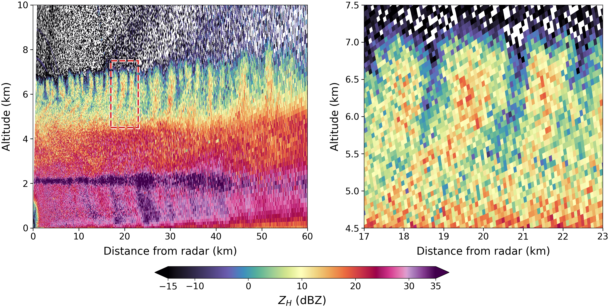
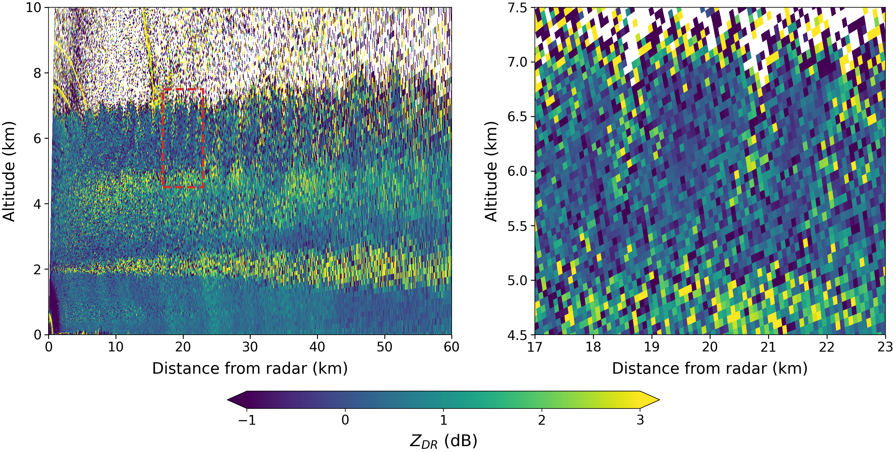
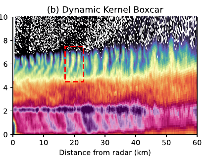
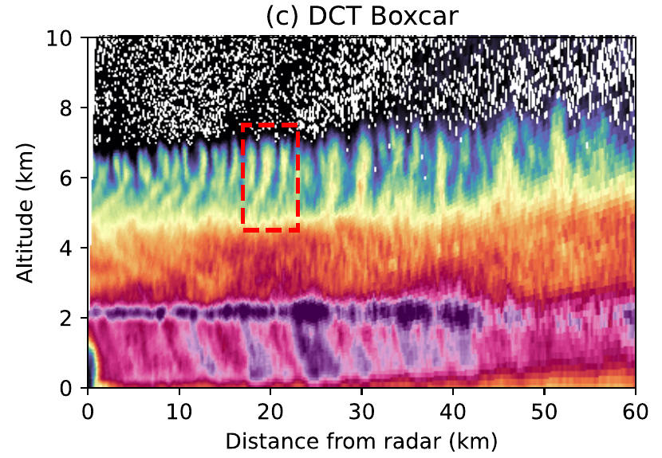
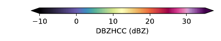
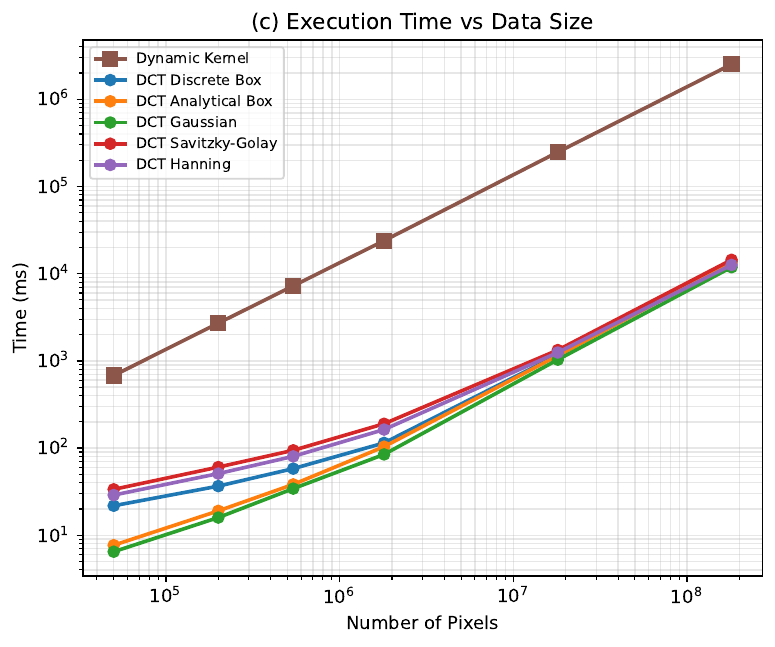

  
Paper 1 · Radar smoothing

  <h1>Radar Data Smoothing using the Discrete Cosine Transform</h1>
  <h2>A Fast Spectral Domain Algorithm</h2>
  

    
<strong>Jairo M. Valdivia-Prado</strong>

    
Coauthors: Will Chapman · Katja Friedrich

  

  
Department of Atmospheric and Oceanic Sciences · University of Colorado Boulder

  
Published as Valdivia, Chapman, and Friedrich, <em>Atmospheric Measurement Techniques</em> 19, 5211–5222 (2026) · doi:10.5194/amt-19-5211-2026

<!--
About 20 seconds. This is the first of four paper talks. The journal article uses Jairo M. Valdivia in its published byline; the presenter name here matches the defense cover. Credit Will Chapman and Katja Friedrich. Start the paper's own introduction on the next slide rather than reviewing the dissertation roadmap again.
-->

---
class: radar-data-intro
---

# The nature of radar data

  
  

  
Radar is natively collected in <strong>polar coordinates</strong>.

  
Raw radar observations are <strong>noisy</strong>.

<!--
About 45 seconds. This is a COW1high range–height scan on 23 February 2022 at 02:28:53–02:29:05 UTC. In this vertical scan, the native coordinates are range and elevation angle. First show unsmoothed horizontal reflectivity; one click replaces it with differential reflectivity from the same scan and with the same spatial bounds. The right panels enlarge 17–23 km range and 4.5–7.5 km altitude. Gate-to-gate variability and missing observations motivate smoothing, but not every small-scale change is random noise; coherent cloud-top structures remain visible. The ZDRC field is calibration-corrected but not smoothed. The reflectivity view corresponds to panels (a) and (e) of Figure 4 in the AMT paper; the ZDR view is newly plotted from the same RHI file. Transition to the polar-grid geometry problem.
-->

---
class: convolution-cartesian
---

# Convolution on a Cartesian grid

  
Noisy inputSmoothed output

  

    <CuManim :steps="4" :width="1080" :height="320" :construct="cartesianConvolution" />
    <svg v-if="clicks === 0" class="convolution-first-frame" viewBox="0 0 1080 390" aria-hidden="true">
      <rect v-for="(cell, index) in cartesianPreview.input" :key="`in-${index}`" :x="cell.x" :y="cell.y" :width="cell.w" :height="cell.h" :fill="cell.fill" stroke="#243548" stroke-width="1.2" />
      <rect v-for="(cell, index) in cartesianPreview.backing" :key="`back-${index}`" :x="cell.x" :y="cell.y" :width="cell.w" :height="cell.h" :fill="cell.fill" stroke="#364a5f" stroke-width="1.2" />
      <rect v-for="(tile, index) in cartesianPreview.tint" :key="`tint-${index}`" :x="tile.x" :y="tile.y" :width="tile.w" :height="tile.h" fill="#cfb87c" fill-opacity="0.25" />
      <rect v-for="(bar, index) in cartesianPreview.bars" :key="`bar-${index}`" :x="bar.x" :y="bar.y" :width="bar.w" :height="bar.h" fill="#cfb87c" />
      <path :d="`M${cartesianPreview.arrowShaft.x1},${cartesianPreview.arrowShaft.y1} L${cartesianPreview.arrowShaft.x2},${cartesianPreview.arrowShaft.y2}`" stroke="#cfb87c" stroke-width="6" stroke-linecap="round" fill="none" />
      <polygon :points="cartesianPreview.arrowTip.map(point => `${point.x},${point.y}`).join(' ')" fill="#cfb87c" />
    </svg>
  

  
Illustrative, evenly spaced grid · <strong>{{ clicks >= 3 ? 'Gaussian: center-weighted mean' : 'Boxcar: equal-weight mean' }}</strong>

<!--
About 1 minute. After slide 8, explain that we want to reduce gate-to-gate variability while preserving coherent structure. Convolution applies the same local operation at each position. The three-by-three boxcar kernel starts over the center of this synthetic, evenly spaced grid. Click 1: all nine kernel weights are equal, so their average appears at the corresponding output cell. Click 2: clear that example, then scan successive rows from the upper-left cell, alternately left-to-right and right-to-left, revealing each output value as the kernel reaches it; finish at the lower right. Edge values are extended with nearest-value padding in this illustration; this is not Paper 1's DCT boundary treatment. Click 3: return to the center and change to a discrete Gaussian kernel (truncated to three-by-three samples and normalized); its nearer samples have more weight, and the center-weighted output appears. Click 4: repeat the same row-by-row scan for the Gaussian output. These are illustrative, complete data, not a measured radar field or a comparison of method performance. The kernels are symmetric, so the sliding weighted average is the convolution used here. Transition: a fixed pixel window has a fixed physical footprint on an evenly spaced Cartesian grid, but radar is sampled in range and angle.
-->

---
class: convolution-polar
---

# A fixed polar-grid window changes physical size

The same three-by-three sample window in range and elevation angle

  

    <CuManim :steps="3" :width="1080" :height="320" :construct="polarConvolution" />
    <svg v-if="clicks === 0" class="convolution-first-frame" viewBox="0 0 1080 390" aria-hidden="true">
      <path v-for="(ray, index) in polarPreview.rays" :key="`ray-${index}`" :d="ray" class="convolution-preview-line" />
      <path v-for="(arc, index) in polarPreview.arcs" :key="`arc-${index}`" :d="arc" class="convolution-preview-line" />
      <path :d="polarPreview.near" class="convolution-preview-footprint" />
      <path :d="polarPreview.chord" class="convolution-preview-chord" />
      <rect :x="polarPreview.radar.x - 8" :y="polarPreview.radar.y - 8" width="16" height="16" fill="#cfb87c" />
    </svg>
  

  

    
Angular sample spacing grows with range: <strong>r Δθ</strong>. Range-gate spacing stays fixed.

    
To keep a fixed physical smoothing width, <strong>adjust the angular window with range.</strong>

  

<!--
About 1 minute 10 seconds. Click 1: show the range–elevation grid and a three-by-three sample window near the radar. Click 2: move an identical index-space window outward, leaving the near example visible. Adjacent rays diverge, so its transverse footprint is larger at far range even though the number of angular samples and the range-direction width are unchanged. Click 3: show how a narrower angular window at far range gives approximately the near window's physical transverse width. This is a schematic of footprint changes, not a distortion of the measurements. For 1–2 km cloud-top generating cells, the smoothing scale needs to be specified in distance, not gate count. A spatial kernel that changes with range is computationally costly; the paper tests a spectral alternative against the spatial method for both field structure and processing time. The next slide quantifies the angular-width adjustment. Do not say range gates themselves widen with range.
-->

---
class: smoothing-geometry
---

# Change the angular window with range

  

    
For a target physical width <strong>L</strong>:

    
Wθ(r) = L / (r Δθ)

    
Angular sample spacing is r Δθ.

  

  

    <section>
      <h2>Near the radar</h2>
      

      
More angular samples within the same physical width

    </section>
    <section>
      <h2>Farther away</h2>
      

      
Fewer angular samples within that width

    </section>
  

The range-direction kernel remains fixed; the angular width changes with range.

<!--
About 1 minute 20 seconds. At fixed angular resolution, the distance between adjacent rays grows with range. To keep a specified length L, use more angular samples nearby and fewer farther out. In the paper W_theta is continuous for the analytical transfer function; a discrete spatial baseline rounds to an odd number of samples. The equation and preceding text in Chapter 2 show the 1/r dependence.
-->

---
class: smoothing-spectral
---

# Smoothing in the spectral domain

  <section>1<h2>Transform</h2>
DCT of angular profiles
</section>
  <section>2<h2>Weight</h2>
Range-specific spectral response
</section>
  <section>3<h2>Invert</h2>
Return to the radar grid
</section>
  <section>4<h2>Repeat</h2>
Fixed-width pass along range
</section>

The filter changes with range, but the spectral multiplication remains efficient.

<!--
About 1 minute 25 seconds. The convolution theorem motivates transforming each angular profile, multiplying by an analytical transfer function whose width depends on range, and transforming back. Then apply a fixed-width range-direction pass. This is a sequence of separable one-dimensional operations, not a single global two-dimensional transfer function. DCT boundary treatment corresponds to reflection rather than a periodic wrap. The main field comparison uses boxcar smoothing; the large-array timing callout later uses the analytical Gaussian DCT. Avoid saying one filter produced both results.

This first method needs a complete field: gaps are interpolated before the DCT. Discuss that limitation after the results.
-->

---
class: smoothing-comparison
---

# DCT and spatial smoothing retain similar structure

  
  

C-band radar, 23 Feb 2022, 02:28 UTC; 5-pixel window. Cropped panels (b) and (c) from the paper's Figure 4.

<!--
About 1 minute 30 seconds. Point to the cloud-top features near 5–7 km. The DCT and spatial dynamic boxcar produce closely matching structures, but are not identical; the original paper includes a difference panel. The spatial method skips missing values whereas Paper 1 linearly interpolates gaps before the DCT. These crops preserve the source panels and common color scale; the full eight-panel comparison remains in backup. Do not attribute all differences to algorithmic error.
-->

---
class: smoothing-benchmark
---

# The spectral method reduces processing time

  

    
About 180 million pixels

    
<strong>42 min</strong>spatial dynamic kernel

    
<strong>&lt;12 s</strong>Gaussian DCT

  

  

Random-noise benchmark arrays, 5-pixel window. Cropped panel (c) from the paper's Figure 5.

<!--
About 1 minute 30 seconds. This is a controlled computation benchmark on arrays of increasing size, not a measured processing time for the displayed C-band scan. At 180 million pixels, the spatial baseline takes 2518 seconds (about 42 minutes); the analytical Gaussian DCT takes less than 12 seconds. At a different fixed data size, the Gaussian method also exceeds 800× speedup for the largest tested window. Keep those two comparisons separate. The crop foregrounds the data-size result.
-->

---
class: smoothing-limitation
---

# Limitation: the DCT needs a complete field

  <section><h2>Radar gaps</h2>
Blocked or filtered gates have no valid observation.
</section>
  →
  <section><h2>Paper 1 treatment</h2>
Interpolate those gaps before transforming the field.
</section>

Broad gaps can bias the smoothed estimate within or near the missing region.

<!--
About 55 seconds. A spectral transform requires defined input values; this paper uses linear interpolation before smoothing. A short gap may be less consequential than a wide blocked sector, where interpolation can introduce a low-frequency bridge and kinks at the edges. These filled values are not observations. This is a limitation of the first method, not a claim that the paper's real-data comparison is invalid. The next paper extends the spectral framework to explicit valid-data support.
-->

---
class: smoothing-conclusions
---

# Paper 1: conclusions

  
<strong>Physical scale:</strong> the angular window adapts to radar range.

  
<strong>Field comparison:</strong> DCT and spatial smoothing give closely matching structures in the example.

  
<strong>Computation:</strong> the DCT is much faster on the large-array benchmark.

Next: local statistics with missing-data support.

<!--
About 55 seconds. Summarize the method, quality comparison, and computational result, then pause. The main qualification is that Paper 1 interpolates missing gates. Paper 2 addresses incomplete grids using support-aware local statistics; it is a separate methodological study. Do not imply either methods paper produced the Chapter 4 population results. The paper is published in AMT (2026).
-->
