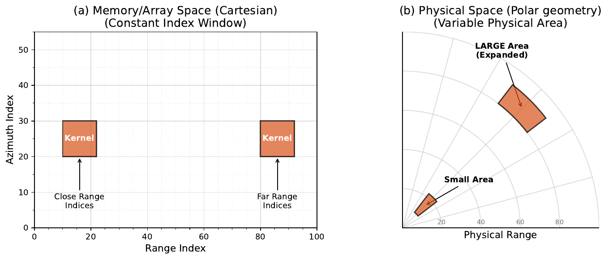

  
Paper 1 · Radar smoothing

  <h1>Radar Data Smoothing using the Discrete Cosine Transform</h1>
  <h2>A Fast Spectral Domain Algorithm</h2>
  

    
Presenter: <strong>Jairo M. Valdivia-Prado</strong>

    
Coauthors: Will Chapman · Katja Friedrich

  

  
Department of Atmospheric and Oceanic Sciences · University of Colorado Boulder

  
Published as Valdivia, Chapman, and Friedrich, <em>Atmospheric Measurement Techniques</em> 19, 5211–5222 (2026) · doi:10.5194/amt-19-5211-2026

<!--
About 20 seconds. This is the first of four paper talks. The journal article uses Jairo M. Valdivia in its published byline; the presenter name here matches the defense cover. Credit Will Chapman and Katja Friedrich. Start the paper's own introduction on the next slide rather than reviewing the dissertation roadmap again.
-->

---
class: radar-data-intro
---

# The nature of radar data

  
Radar is natively collected in <strong>polar coordinates</strong>.

  
Raw radar observations are <strong>noisy</strong>.

  
  

<!--
About 45 seconds. This is a COW1high range–height scan on 23 February 2022 at 02:28:53–02:29:05 UTC. In this vertical scan, the native coordinates are range and elevation angle. First show unsmoothed horizontal reflectivity; one click replaces it with differential reflectivity from the same scan and with the same spatial bounds. The right panels enlarge 17–23 km range and 4.5–7.5 km altitude. Gate-to-gate variability and missing observations motivate smoothing, but not every small-scale change is random noise; coherent cloud-top structures remain visible. The ZDRC field is calibration-corrected but not smoothed. The reflectivity view corresponds to panels (a) and (e) of Figure 4 in the AMT paper; the ZDR view is newly plotted from the same RHI file. Transition to the polar-grid geometry problem.
-->

---
class: smoothing-problem
---

# A fixed radar-grid window changes physical size

  

For 1–2 km cloud-top generating cells, the smoothing width must be specified in physical distance, not gate count.

A fixed number of angular gates spans a larger transverse distance at far range. Figure 1 from the AMT paper.

<!--
About 1 minute 10 seconds. Introduce the problem independently of the dissertation opening. Radar data are sampled in range and angle; a fixed grid-space smoothing window changes its physical footprint with range. The cells of interest are small, so the smoothing scale must be tied to distance rather than a constant number of angle bins. The source figure is Figure 1 of the AMT paper.

Do not say that range gates themselves widen with range; it is the transverse angular spacing that grows. The cost of a spatial kernel that changes with range motivates the next slide.
-->

---
class: smoothing-objective
---

# Objective: consistent smoothing at lower cost

  <section>
    <h2>Physical scale</h2>
    
Adjust the angular window with range so the intended smoothing width remains approximately constant.

  </section>
  <section>
    <h2>Computation</h2>
    
Avoid applying a different spatial window at every range and angle.

  </section>

Test against a spatial dynamic kernel: <strong>compare the resulting radar fields and processing times.</strong>

<!--
About 45 seconds. The paper addresses a tradeoff: a range-dependent spatial kernel can maintain the physical smoothing scale, but repeatedly evaluating it on large data is expensive. The alternative is spectral-domain filtering with the Discrete Cosine Transform (DCT). Its test is not just speed: the smoothed field must also be compared with the spatial reference.
-->

---
class: smoothing-geometry
---

# Change the angular window with range

  

    
For a target physical width <strong>L</strong>:

    
Wθ(r) = L / (r Δθ)

    
Angular sample spacing is r Δθ.

  

  

    <section>
      <h2>Near the radar</h2>
      

      
More angular samples within the same physical width

    </section>
    <section>
      <h2>Farther away</h2>
      

      
Fewer angular samples within that width

    </section>
  

The range-direction kernel remains fixed; the angular width changes with range.

<!--
About 1 minute 20 seconds. At fixed angular resolution, the distance between adjacent rays grows with range. To keep a specified length L, use more angular samples nearby and fewer farther out. In the paper W_theta is continuous for the analytical transfer function; a discrete spatial baseline rounds to an odd number of samples. The equation and preceding text in Chapter 2 show the 1/r dependence.
-->

---
class: smoothing-spectral
---

# Smoothing in the spectral domain

  <section>1<h2>Transform</h2>
DCT of angular profiles
</section>
  <section>2<h2>Weight</h2>
Range-specific spectral response
</section>
  <section>3<h2>Invert</h2>
Return to the radar grid
</section>
  <section>4<h2>Repeat</h2>
Fixed-width pass along range
</section>

The filter changes with range, but the spectral multiplication remains efficient.

<!--
About 1 minute 25 seconds. The convolution theorem motivates transforming each angular profile, multiplying by an analytical transfer function whose width depends on range, and transforming back. Then apply a fixed-width range-direction pass. This is a sequence of separable one-dimensional operations, not a single global two-dimensional transfer function. DCT boundary treatment corresponds to reflection rather than a periodic wrap. The main field comparison uses boxcar smoothing; the large-array timing callout later uses the analytical Gaussian DCT. Avoid saying one filter produced both results.

This first method needs a complete field: gaps are interpolated before the DCT. Discuss that limitation after the results.
-->

---
class: smoothing-comparison
---

# DCT and spatial smoothing retain similar structure

  
  

C-band radar, 23 Feb 2022, 02:28 UTC; 5-pixel window. Cropped panels (b) and (c) from the paper's Figure 4.

<!--
About 1 minute 30 seconds. Point to the cloud-top features near 5–7 km. The DCT and spatial dynamic boxcar produce closely matching structures, but are not identical; the original paper includes a difference panel. The spatial method skips missing values whereas Paper 1 linearly interpolates gaps before the DCT. These crops preserve the source panels and common color scale; the full eight-panel comparison remains in backup. Do not attribute all differences to algorithmic error.
-->

---
class: smoothing-benchmark
---

# The spectral method reduces processing time

  

    
About 180 million pixels

    
<strong>42 min</strong>spatial dynamic kernel

    
<strong>&lt;12 s</strong>Gaussian DCT

  

  

Random-noise benchmark arrays, 5-pixel window. Cropped panel (c) from the paper's Figure 5.

<!--
About 1 minute 30 seconds. This is a controlled computation benchmark on arrays of increasing size, not a measured processing time for the displayed C-band scan. At 180 million pixels, the spatial baseline takes 2518 seconds (about 42 minutes); the analytical Gaussian DCT takes less than 12 seconds. At a different fixed data size, the Gaussian method also exceeds 800× speedup for the largest tested window. Keep those two comparisons separate. The crop foregrounds the data-size result.
-->

---
class: smoothing-limitation
---

# Limitation: the DCT needs a complete field

  <section><h2>Radar gaps</h2>
Blocked or filtered gates have no valid observation.
</section>
  →
  <section><h2>Paper 1 treatment</h2>
Interpolate those gaps before transforming the field.
</section>

Broad gaps can bias the smoothed estimate within or near the missing region.

<!--
About 55 seconds. A spectral transform requires defined input values; this paper uses linear interpolation before smoothing. A short gap may be less consequential than a wide blocked sector, where interpolation can introduce a low-frequency bridge and kinks at the edges. These filled values are not observations. This is a limitation of the first method, not a claim that the paper's real-data comparison is invalid. The next paper extends the spectral framework to explicit valid-data support.
-->

---
class: smoothing-conclusions
---

# Paper 1: conclusions

  
<strong>Physical scale:</strong> the angular window adapts to radar range.

  
<strong>Field comparison:</strong> DCT and spatial smoothing give closely matching structures in the example.

  
<strong>Computation:</strong> the DCT is much faster on the large-array benchmark.

Next: local statistics with missing-data support.

<!--
About 55 seconds. Summarize the method, quality comparison, and computational result, then pause. The main qualification is that Paper 1 interpolates missing gates. Paper 2 addresses incomplete grids using support-aware local statistics; it is a separate methodological study. Do not imply either methods paper produced the Chapter 4 population results. The paper is published in AMT (2026).
-->
