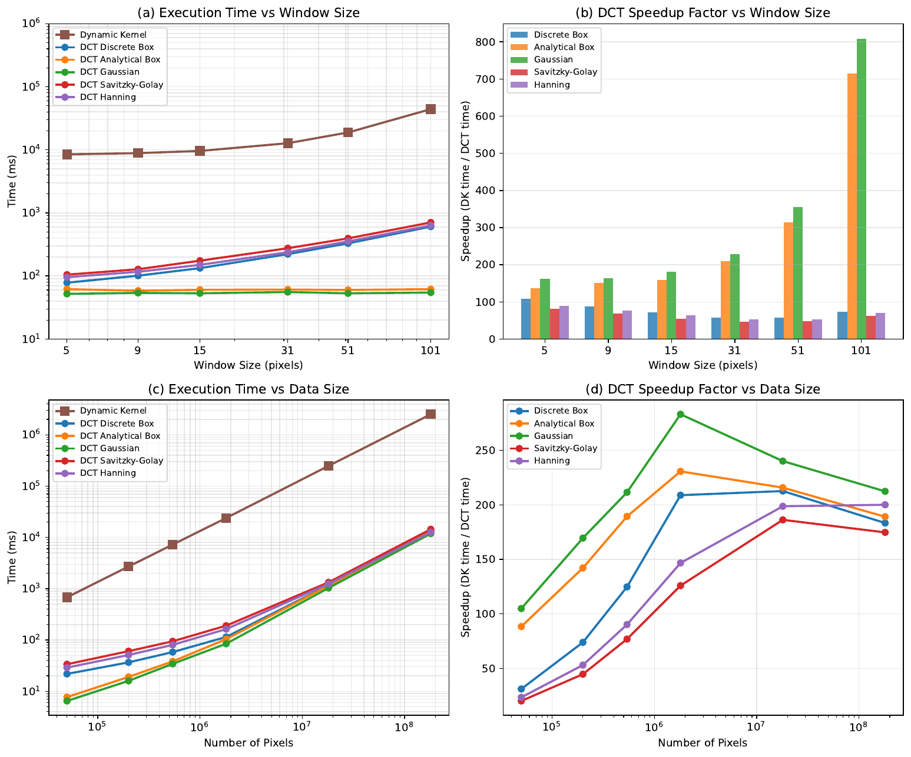

# Observations of Cloud-Top Generating Cells

## Dissertation defense

Advisor: Katja Friedrich

Committee: Andrew Winters · Troy Zaremba · Sarah Tessendorf · Christopher Williams

<!--
Open with the science, not the methods.

One sentence if you need it: in one WINTRE-MIX storm, a cloud-top generating-cell population organized over about 1.7 hours, and one tracked cell's fall streak reached below the melting layer into precipitation that was already there.

About 40 minutes. Stop at Questions. Backup follows.

Do not say the local-statistics paper is published, or that the GRL manuscript is accepted.
-->

---
layout: image-right
image: ./figures/ctgc-concept.png
imageAlt: DOW6 range-height scan on 23 February 2022 at 02:28 UTC, with a conceptual cloud-top generating cell inset
imageCaption: DOW6 RHI, 23 Feb 2022, 02:28 UTC. Concept adapted from Kumjian et al. (2014).
---

# A cell near cloud top, and a trail beneath it

- About 1–2 km across, near the top of a winter storm
- A local reflectivity enhancement
- A fall streak: ice leaving the cell

<!--
This is the object. Do not teach the whole Kumjian model.

The inset is a sketch, not a retrieval. Green shroud: more pristine, oriented crystals. Yellow core: aggregates or rimed particles. Blue arrows: larger particles falling out.

The bright band near 2 km is the melting layer. The question for the talk is how cells like this change with time, and what happens to the ice as it descends into cloud that is already precipitating.
-->

---

# Two things are still hard to see

- How a **population** changes as cells form, merge, and decay
- How **one moving cell** connects to precipitation already below it
- Radar geometry, missing data, and data volume get in the way of both

<!--
Snapshots are ahead of time evolution. Kumjian et al. followed one cell for about 10 minutes. A population can persist while individual cells turn over, so the group's duration is not a cell lifetime.

A fall streak that overlaps other echoes is not, by itself, one seeder–feeder path.

The third bullet is why the methods exist. A fixed range–azimuth window covers more area farther from the radar. Missing values are not zeros. Say that, then move on.
-->

---

# Three objectives

<v-clicks>

1. **Methods.** Physical scale, boundaries, and missing data — fast enough to use
2. **Population.** How organization and polarimetric signatures change
3. **One cell.** A moving frame, against the precipitation around it

</v-clicks>

<!--
[click] Objective 1 is the tool. It is not a separate thesis.
[click] Objective 2 is one event: initiation, mature, dissipation, and what ZDR suggests about particles.
[click] Objective 3 is one cell from that population, not a second case study.

The observational conclusions describe this storm and this cell. They are not a climatology.
-->

---

# Four studies, one storm

- **Smoothing** — published, *Atmospheric Measurement Techniques* (2026)
- **Local statistics** — under review, *Computers & Geosciences*
- **Population life cycle** — published, *J. Atmospheric Sciences* (2026)
- **One cell in three dimensions** — submitted, *Geophysical Research Letters*

<!--
Status, if asked:

- Valdivia, Chapman, and Friedrich, AMT, 2026. doi:10.5194/amt-19-5211-2026
- Valdivia, Chapman, and Friedrich, arXiv:2604.22721. Under review. Not accepted.
- Valdivia, Friedrich, Zaremba, and Tessendorf, JAS, 2026. doi:10.1175/JAS-D-25-0088.1
- Same author team, GRL manuscript 2026GL126989, submitted 16 September 2026. Not accepted.

The order of the talk is the order of the dissertation: methods, then the storm. Chapter 5 uses the Chapter 4 track.
-->

---
layout: image-right
image: ./figures/wintremix-map.png
imageAlt: Topographic map of the St. Lawrence valley with DOW6, ECCC, and the Sorel sounding site
imageCaption: WINTRE-MIX IOP05. DOW6 range 75 km; ECCC range 180 km.
---

# 23 February 2022, near Montreal

- WINTRE-MIX IOP05, St. Lawrence valley
- DOW6 X-band volumes, 02:00–04:00 UTC
- Generating cells in a layer near **5.5–8 km**

<!--
Name what is on the map: DOW6, the ECCC S-band radar at Blainville, the Sorel sounding, and the DOW6 RHI azimuth.

The C-band radar on wheels (COW) is the third radar in the 3D analysis. It is not marked here. Introduce it when the moving frame appears.

One synoptic sentence if needed: a winter storm, with the cells organized along low-level precipitation bands. The synoptic figure and soundings are backup. Do not tour the environment unless asked.
-->

---
layout: image-right
image: ./figures/polar-scale.png
imageAlt: A constant index window covers a larger physical area at far range
imageCaption: A fixed window in range–azimuth index is not a fixed physical area.
---

# A fixed window is not a fixed area

- The same gates cover more area farther from the radar
- These cells are 1–2 km, so the scale has to stay physical
- Repeating that calculation on full volumes is slow

<!--
This is the reason for a range-dependent azimuth kernel. Close the point in one sentence and go to the result.

If asked about gaps: treating a missing value as zero changes the mean. That is the next method, not this figure.
-->

---
class: figure-slide
---

# Same smoothing, at a small fraction of the cost

  

Gaussian DCT on a ~180-million-pixel array: seconds, not tens of minutes. Speedup grows with window size.

<!--
The operation is convolution through a transfer function. The azimuth kernel narrows with range so the physical scale stays roughly constant.

Chapter 6 number, if asked: a 5-pixel window, less than 12 s versus about 42 min (2518 s) for the spatial dynamic kernel. On the synthetic polar test, the two outputs were nearly indistinguishable. Do not say identical.

Panel (b): Gaussian speedup exceeds 800× at the largest window. Other kernels and the Gibbs example are backup.

Published as Valdivia, Chapman, and Friedrich, AMT, 2026.
-->

---
class: figure-slide
---

# A local mean, a variance, and a sample count

  

Missing values stay missing. <em>N</em>eff says how much data supports the estimate.

<!--
Normalized convolution. The mask goes through the same transform as the field, so gaps are not filled with zeros before the mean is taken.

Boundaries: periodic in azimuth, so 0° and 360° stay neighbors; reflective in range and elevation, so the ends of a finite scan are not tied together.

This is under review at Computers & Geosciences. Preprint arXiv:2604.22721. Do not call it published.

The outlier test and the 1D boundary comparison are backup. The use in the dissertation is the background mean for Z-prime.
-->

---

# The methods are how the cells get measured

- **Population:** smooth the perturbation, then contour
- **One cell:** smooth in polar coordinates, then a weighted local mean for $Z'$
- **The link:** the population track is the origin of the moving grid

<!--
This is the hinge. If you skip it, the methods feel like a separate thesis.

Z-prime is smoothed reflectivity minus a local background, computed per radar and merged with beam weights. It is not a raw reflectivity composite, and it is not a rainfall rate.

Then go to the storm. The audience should now trust a 5 dBZ contour and a Z-prime isosurface enough to look at them.
-->

---
class: figure-slide
---

# Unsmoothed contours are noise

  

Column maximum in the 5.5–8 km layer, azimuthal mean removed, smoothed, contoured at 5 dBZ. 03:18 UTC.

<!--
Panel (c) versus panel (e) is the point. Without smoothing, the 5 dBZ line fragments. After smoothing, drop nested contours and features smaller than 0.09 km².

A closed boundary can contain more than one cell. Its area is a measure of organization, not necessarily the growth of one cell. Say that before the life-cycle plots.

Published as Valdivia, Friedrich, Zaremba, and Tessendorf, JAS, 2026.
-->

---
class: figure-slide
---

# Two groups, following two bands

  

ECCC radar, 500 m. The rest of the talk follows Set 1.

<!--
Cells aloft are not scattered at random. They follow two precipitation bands. Blue is Set 1. Red is Set 2, a second group, not a second case.

Do not give Set 2 equal time. If asked: it also increases in number, but the life-cycle description and the tracked cell are Set 1.
-->

---
class: figure-slide
---

# More cells, then fewer and larger

  

Set 1, left. Counts rise, then fall. Mean area rises as boundaries merge. $Z_{DR}$ falls, then rises.

<!--
Stay on the left column.

Panel (a): initiation adds features; the mature stage merges them into fewer, larger boundaries; dissipation reduces number and coverage. About 1.7 hours. That duration is collective activity.

Panel (c): ZDR decreases early, then increases through mature and dissipation. The early decrease is consistent with aggregation. The later increase suggests preferential sedimentation of larger or more isotropic particles, leaving slower-falling, oriented crystals in the generating layer. It is an inference from polarimetry, not an in-situ habit measurement.

Panel (d): correlation coefficient stays high. Reflectivity in panel (b) does not carry the story.

A larger boundary can enclose several neighboring cells. Statistical tests and the differential-attenuation bound are backup.
-->

---
class: figure-slide
---

# Initiation, mature, dissipation

  

<!--
Linger here. Walk left to right.

Horizontal row is the observation: many small boundaries, then merging, then fewer and smaller. Vertical row is the interpretation: a defined shroud of pristine crystals in the mature stage, then aggregates falling out.

Do not say we imaged particle habits. The schematic is the summary of the radar signatures.

Stage lengths, if asked from the published paper: initiation on the order of 12–30 min, mature about 54 min, dissipation about 36 min. Prefer "about 1.7 hours, in three stages" unless they want the split.
-->

---
class: figure-slide
---

# One cell persists for nearly 50 minutes

  

02:55–03:43 UTC. This is the cell the three-dimensional analysis follows.

<!--
The dashed circle is the tracked cell. It shows a similar polarimetric progression to the population; the ZDR sequence is backup.

The elevation angle changes because the scan has to keep the cell in the beam as it moves. That is the sampling problem the next section solves.

Six-minute volumes. Nearly 50 minutes is long for one cell in this literature, and it is still one cell in one storm.
-->

---

# Follow the cell, not the radar

- **DOW6** (X), **COW** (C), and **ECCC** (S), every 6 minutes
- The grid moves with the track. The cell stays at the origin
- $Z'$ is each radar's anomaly, merged by beam weight

<!--
Why not one radar: a vertically pointing radar sees the cell only while it is overhead. A single scanning radar changes resolution as the cell moves away.

Nine volumes, 02:54–03:42 UTC. Common grid 40 km by 40 km, 1–9 km, 100 m spacing. The cell centroid is at x = y = 0.

Each radar is smoothed in polar coordinates, mapped to the moving grid, and turned into an anomaly against its own spatial background. The backgrounds are combined with a beam weight, so a voxel a radar does not sample does not vote.

COW is beyond its maximum range at the last time, about 94 km from the cell. Wavelength differences are why this is an anomaly merge, not a raw reflectivity blend.

Submitted to GRL, manuscript 2026GL126989. Not accepted.
-->

---
class: figure-slide
---

# A fall streak from cloud top to below the melting layer

  

Cell-relative $Z'$. 03:00, 03:18, and 03:36 UTC. The mid-level connection is clearer in the mature stage.

<!--
Left: 5 dB and 7 dB isosurfaces. Right: slices at 6.5, 5, 3.5, and 2 km.

The signature extends from the tracked cell through underlying cloud, including the dendritic growth zone, to below the melting layer. Do not point at a panel and call it the dendritic growth zone unless you are looking at the sounding. The rain-layer comparison later is 1–1.5 km; the snow-layer comparison is 2.5–3 km.

The connection to mid-level precipitation becomes more prominent at the mature time. It develops inside an existing precipitation field.
-->

---
class: figure-slide
---

# The enhancement is not a column under the cell

  

Top 10% of time-mean $Z'$. The cell is at the origin. The footprint lies along the fall streak.

<!--
This is the attribution slide. Say it before the percentages.

The footprint is the upper decile of the time-mean column-maximum anomaly, not the instantaneous position of the streak at every time. The strong enhancement is southwest of the cell, overlapping pre-existing north–south precipitation structures.

Consistent with ice from the cell entering cloud that is already producing precipitation, and with further growth during descent. Not proof that this cell produced the precipitation below.

Figure titles still use analysis-script wording. The claim does not depend on those labels.
-->

---
class: figure-slide
---

# Higher rates in the footprint — not this cell's share

  

Inside versus outside: snow <strong>+51%</strong>, rain <strong>+72%</strong>. Other cells and pre-existing precipitation are in both regions.

<!--
Chapter 6 wording: radar-estimated liquid-equivalent snow rates averaged 51% higher inside the snow-layer footprint than outside. Rain rates averaged 72% higher inside the rain-layer footprint than outside.

Relations: Z = 2000 S² above the melting layer, Z = 200 R^1.6 below. The outside region is the rest of the domain. It is not a no-generating-cell control.

The contrast is not very sensitive to the 85th, 90th, or 95th percentile threshold. Say that only if asked.

The axis titles on this figure are provisional and should be cleaned before the defense. The bottom annotation is the number to stand on.
-->

---

# One analysis, not four papers

- The methods make the contours and $Z'$ usable
- The population supplies the track, and the time context
- That cell's fall streak enters cloud that is already precipitating

<!--
Read the synthesis, then stop.

For this event, the polarimetric change in the generating layer and the fall streak into underlying cloud support a seeder–feeder reading. Overlapping echoes bound that reading. Do not add a new number on this slide.
-->

---

# What this case shows

1. A physical-scale analysis that handles gaps, fast enough to use on the volumes
2. A **1.7-hour** population life cycle: merging, then a rise in $Z_{DR}$
3. A fall streak to **below the melting layer**, with enhanced rates that cannot be assigned to this cell alone

<!--
Map each line to an objective. Then the limits, in one breath: one storm, one cell in three dimensions, six-minute volumes, two soundings, and overlapping precipitation sources.

Do not soften line 3, and do not strengthen it.
-->

---

# What would make it general

- Does this life cycle recur, and what organizes the cells?
- How do particles change along the fall streak?
- How much does ice from these cells change precipitation, beyond the feeder cloud?

<!--
Three questions, then stop.

Horizontal bands do not establish horizontal convective rolls. Shear, cloud-top cooling, and moisture supply are hypotheses for later work.

Particle growth along the streak is unresolved. Separated radars see different angles, wavelengths, and paths, so a polarimetric merge is not the next easy step.

The 51% and 72% motivate a contribution estimate. They are not that estimate. Quantifying it needs transport, growth, and a controlled comparison against the feeder cloud without the generating-cell ice.

Do not open the modeling papers unless asked.
-->

---

# Questions

Thank you to the committee, the WINTRE-MIX participants, and NSF awards AGS-2113995 and AGS-2114011.

<!--
Pause.

Likely questions, and where to go:

- Williams: boundary conditions, Neff, why the anomaly is not a raw composite. Backup: boundary, polar gaps, DCT comparison.
- Winters: why two bands, shear, soundings. Backup: synoptic and sounding. Do not claim rolls.
- Zaremba: sampling versus airborne volumes, overlap of the fall streak. Backup: mid-level anomaly and the nine-time context.
- Tessendorf: how general is one storm, seeder–feeder. Stay on the attribution limit.
- Friedrich: where Chapter 2 and 3 enter Chapter 5. The bridge slide is the answer.

Backup starts on the next slide.
-->

---
layout: section
---

# Backup

Jump here only if asked.

<!--
Not part of the 40 minutes.
-->

---

# Backup: limits of this case

- One storm, and one cell in the three-dimensional analysis
- Six-minute volumes; soundings at 02:00 and 04:15 UTC
- A boundary can enclose several cells
- Overlapping echoes block attribution to the tracked cell
- Rates depend on the chosen $Z$–rate relations

<!--
Use this if the question is "what does this not show?"

Also: COW loses the cell at the last time. The footprints are time-mean masks, so they are not the streak's position at every step. Results change little from the 85th to the 95th percentile.
-->

---
class: figure-slide
---

# Backup: DCT and spatial smoothing on radar data

  

23 Feb 2022, 02:28 UTC. Window of 5 pixels. Difference is the rightmost column of the comparison.

---
class: figure-slide
---

# Backup: a hard spectral cutoff rings

  

The talk uses a Gaussian taper, not a hard cutoff.

---
class: figure-slide
---

# Backup: periodic boundaries wrap

  

Reflective DCT follows the local trend. Periodic treatment pulls the edges toward the opposite end.

---
class: figure-slide
---

# Backup: gaps, without filling them first

  

DOW6, 23 Feb 2022. Periodic azimuth, reflective range. Blocked sectors stay unsupported.

---
class: figure-slide
---

# Backup: the variance can flag outliers

  

A validation of the local statistics, not a result of the storm.

---
class: figure-slide
---

# Backup: two soundings, and the wind in between

  

Sorel, 02:00 and 04:15 UTC. Gray band is the 5.5–8 km generating-cell layer.

<!--
Use for environment questions. Moisture and shear are context. They are not a demonstrated cause of the life cycle.
-->

---
class: figure-slide
---

# Backup: the storm at 03:00 UTC

  

ERA5. The green star is DOW6. Not a synoptic analysis of the cells.

---
class: figure-slide
---

# Backup: where the boundaries were

  

Set 1 in blue on the insets. Larger markers are merged boundaries, not necessarily single cells.

---
class: figure-slide
---

# Backup: the same cell in $Z_{DR}$

  

Same track as the reflectivity sequence. The population's $Z_{DR}$ rise has an individual-cell example.

---
class: figure-slide
---

# Backup: mid-level precipitation the streak meets

  

3.5–5 km. The fall streak overlaps structures that are already there.

---
class: figure-slide
---

# Backup: the tracked cell in the population

  

Nine analysis times, 02:54–03:42 UTC. The 3D cell is one member of Set 1.

